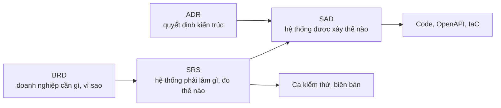

# Tài liệu – HRHelper (HR Enterprise Platform)

Bộ tài liệu đi theo thứ tự **BRD → SRS → SAD**: tài liệu sau lấy tài liệu trước làm đầu vào, và mỗi yêu cầu có mã để truy vết
từ mục tiêu kinh doanh tới code và ca kiểm thử.

| Giai đoạn | Tài liệu | Trả lời câu hỏi | Mã truy vết | Tương ứng chuẩn |
|---|---|---|---|---|
| 1. Yêu cầu nghiệp vụ | [BRD](business/BRD.md) + [business rule nghỉ phép](business/leave-rules.md), [loại phép, ngày lễ](business/leave-types-holidays.md), [kho tài liệu](business/document-rules.md) | Bối cảnh, mục tiêu, phạm vi, người dùng, quy trình, business rule, nghiệm thu | `MT-n`, `BR-nn` | BRS/StRS – ISO/IEC/IEEE 29148 |
| 2. Yêu cầu phần mềm | [SRS](requirements/SRS.md); tài liệu từng tính năng [`features/`](features/README.md) (UC1 → UC7: requirements, spec, deploy, test) | Yêu cầu chức năng, dữ liệu, phi chức năng, giao diện ngoài, truy vết; luồng từng use case | `FR-x.y`, `NFR-n.m`, `UCn` | SRS – ISO/IEC/IEEE 29148 |
| 3. Kiến trúc | [SAD](architecture/SAD.md): [phần 1 – kiến trúc hệ thống](architecture/SAD-1-system-architecture.md), [phần 2 – kiến trúc phần mềm](architecture/SAD-2-software-architecture.md), [ADR](architecture/adr/README.md); phụ lục [database schema](architecture/database-schema.md), [hợp đồng event](architecture/event-contract.md) | Khối, hạ tầng, module, pattern, quyết định; bảng, cột, khóa; event qua queue | `ADR-nn` | ISO/IEC/IEEE 42010 |
| 4. Bảo mật | [Ma trận phân quyền](security/access-control-matrix.md), [threat model](security/threat-model.md) | Ai được gọi API nào; mối đe dọa và cách chặn | – | STRIDE |
| 5. Hợp đồng API | [`openapi.yaml`](openapi.yaml) | Endpoint, request, response | – | OpenAPI 3 |
| 6. Kiểm thử | [Ca kiểm thử nghỉ phép](business/leave-test-cases.md), [ca kiểm thử bảo mật](business/security-test-cases.md), biên bản [tuần 8](business/test-report-tuan-08.md), [tuần 9](business/test-report-tuan-09.md) | Kiểm gì, kết quả chạy thật | `TC-nn`, `SEC-nn` | ISO/IEC/IEEE 29119-3 |
| 7. Cloud | [Ánh xạ dịch vụ và chi phí AWS](cloud/mapping.md) | Dịch vụ cloud cho từng khối, chi phí | – | – |
| 8. Phát triển | [Biến môi trường](development/configuration.md), [mã lỗi API](development/error-codes.md), [CONVENTIONS](CONVENTIONS.md) | Cấu hình từng môi trường; lỗi API trả gì | – | – |

Quy trình làm việc: [`CONVENTIONS.md`](CONVENTIONS.md). Kế hoạch và báo cáo tuần: [`progress/`](progress/README.md).

**Khi đổi yêu cầu:** sửa BRD nếu đổi mục tiêu, phạm vi, business rule; sửa SRS nếu đổi FR, NFR, tiêu chí chấp nhận; sửa
kiến trúc nếu đổi thiết kế. Tăng phiên bản và ghi một dòng vào "Lịch sử thay đổi" của tài liệu bị sửa, trong cùng PR.
