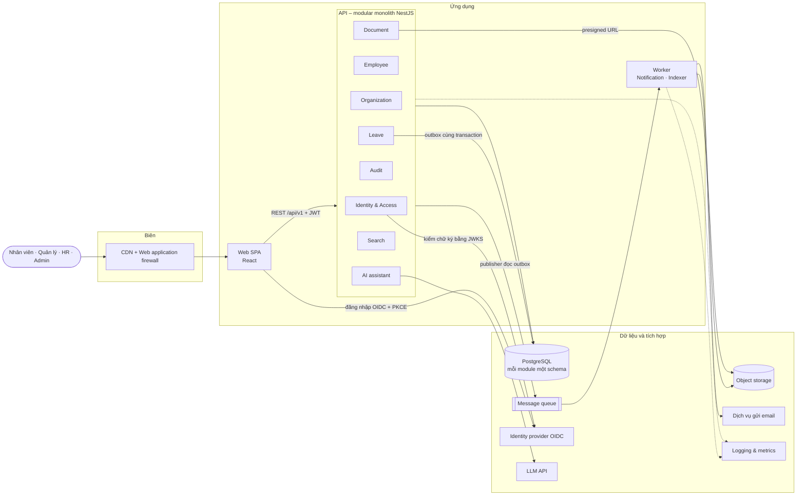
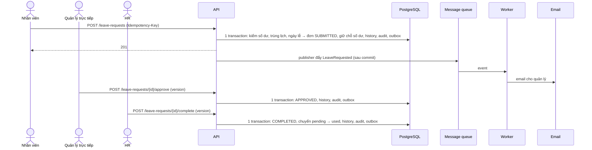

# Kiến trúc tổng quan – Enterprise HR Platform

Tài liệu này gom kiến trúc hệ thống vào một chỗ. Chi tiết và lý do lựa chọn nằm ở các ADR và báo cáo tuần được dẫn link.
Cập nhật lần cuối: 6/11/2026 (tuần 9).

**Quy ước:** phần **đã chọn công cụ** ghi tên công cụ; phần **chưa quyết định** ghi tên chức năng, kèm nơi sẽ quyết định.
Cột "Trạng thái": ✅ đã chạy trên `dev` · 🟡 đang làm / đang review · ⬜ chưa làm.

## 1. Bối cảnh

- **Bài toán:** doanh nghiệp (giả định) ~2.000 nhân viên, 25 phòng ban, 3 văn phòng quản lý hồ sơ bằng Excel và duyệt đơn nghỉ
  phép qua email ([problem statement tuần 5](progress/tuan-05/TV1_Duong.md#1-business-problem-statement)).
- **Mục tiêu đo được:** duyệt đơn < 1 ngày; 100% thao tác trên dữ liệu nhạy cảm được audit; nhân viên tự tra cứu.
- **Phạm vi MVP:** 7 use case, luồng nghỉ phép làm sâu; không làm lương, chấm công, tuyển dụng (ADR-05).
- **NFR chính** ([tuần 5](progress/tuan-05/TV3_Bao.md)): p95 < 300 ms đọc / < 500 ms ghi; availability 99.5%/tháng;
  RPO ≤ 1 giờ, RTO ≤ 4 giờ; thiết kế cho 50 RPS (peak thực tế ≈ 10 RPS); chi phí < 100 USD/tháng.

## 2. Sơ đồ tổng quan

Một deployment unit cho API (chạy 2 instance sau load balancer trên cloud), một process riêng cho worker. Không dùng
microservices hay Kubernetes (ADR-01, ADR-06).

## 3. Thành phần

| Thành phần | Trách nhiệm | Công nghệ / chức năng | Trạng thái |
|---|---|---|---|
| Web SPA | Giao diện cho 4 vai trò | React + Vite, `oidc-client-ts` (ADR-04) | ✅ 10 màn hình (hồ sơ, danh bạ, tổ chức, nghỉ phép); 🟡 HR tạo/sửa hồ sơ (tuần 10) |
| Identity & Access | Xác thực token OIDC, map tài khoản ↔ nhân viên, role (MANAGER suy ra từ sơ đồ tổ chức, ADR-10) | Keycloak khi chạy local; cloud: **managed identity provider** | ✅ Keycloak; 🟡 hỗ trợ token Cognito (nhánh `feat/auth-cognito`) |
| Employee | Hồ sơ, danh bạ, trường nhạy cảm mã hóa AES-256-GCM (ADR-08) | NestJS module, schema `employee` | ✅ |
| Organization | Phòng ban, chức danh, cây tổ chức | NestJS module, schema `org`, cache in-memory 10 phút (ADR-07) | ✅ |
| Leave | Đơn nghỉ, state machine, số dư, ngày lễ, outbox | NestJS module, schema `leave` | ✅ BR-01 → BR-11; ⬜ BR-06, BR-12 (tuần 10) |
| Audit | Ghi và tra cứu log, không sửa/xóa được (ADR-09) | Schema `audit`, trigger chặn UPDATE/DELETE | ✅ API; ⬜ màn hình xem audit |
| Document | Tài liệu chính sách, phạm vi truy cập, presigned URL | **Object storage** (chưa chọn dịch vụ) | ⬜ tuần 10 |
| Search | Tìm danh bạ và tài liệu, lọc theo quyền | Danh bạ: truy vấn PostgreSQL; tài liệu: **full-text search** (đề xuất PostgreSQL full-text, tuần 6) | ✅ danh bạ; ⬜ tài liệu |
| AI assistant | Trả lời câu hỏi chính sách HR có trích dẫn, lọc theo quyền (RAG) | **LLM API** + **lưu vector** (chưa chọn) | ⬜ tuần 12 |
| Worker | Gửi email theo event, chống trùng, DLQ; về sau trích text tài liệu | Process Node riêng (`backend/src/worker/`) | ✅ Notification; ⬜ Indexer |
| Message queue | Chuyển event từ outbox sang worker | RabbitMQ khi chạy local; cloud: **managed message queue** | ✅ RabbitMQ; 🟡 tách adapter (nhánh `feat/queue-adapter`) |
| Gửi email | Thông báo nghỉ phép | Mailpit khi chạy local; cloud: **dịch vụ gửi email (SMTP)** chưa chọn | ✅ Mailpit |
| Database | Dữ liệu giao dịch, số dư, audit | PostgreSQL 16 (ADR-02); cloud: **managed PostgreSQL** | ✅ |
| Biên | Phân phối web, chặn tấn công | **CDN**, **web application firewall**, **load balancer** | ⬜ |
| Quan sát | Log, metric, cảnh báo | **Logging & metrics** (chưa chọn công cụ) | ⬜ tuần 10–11 |

## 4. Ranh giới module và dữ liệu

- Mỗi module sở hữu một schema: `iam`, `employee`, `org`, `leave`, `audit`, `notification` (worker). Không foreign key chéo
  schema; module khác đọc dữ liệu qua service được export, ví dụ `EmployeeService.managerIdOf()`
  ([CONVENTIONS mục 1](CONVENTIONS.md#1-ranh-giới-module-quan-trọng-nhất)).
- Thao tác nghiệp vụ, audit log và event outbox ghi trong **cùng một transaction**.
- Migration TypeORM trong `backend/src/database/migrations/`; `synchronize` luôn tắt.
- Chi tiết bảng: [data model tuần 6](progress/tuan-06/TV2_Thanh.md); hợp đồng API: [`openapi.yaml`](openapi.yaml).

## 5. Luồng chính: đơn nghỉ phép

Quy tắc nghiệp vụ: [`business/leave-rules.md`](business/leave-rules.md). Gửi lặp cùng quyết định không đổi gì (BR-11),
lệch `version` trả 409. Event được gửi ít nhất một lần, worker bỏ bản trùng theo id event.

## 6. Bảo mật

| Lớp | Cách làm |
|---|---|
| Xác thực | OIDC Authorization Code + PKCE; API kiểm chữ ký JWT bằng JWKS, issuer, client |
| Phân quyền | Hai lớp: `@Roles` ở controller, điều kiện theo dữ liệu ở service; [ma trận phân quyền](security/access-control-matrix.md) phủ 27/27 API |
| Dữ liệu nhạy cảm | CCCD, tài khoản, lương mã hóa ở tầng ứng dụng; chỉ HR xem, mỗi lần xem ghi audit (ADR-08) |
| Truy vết | Audit log append-only ở mức database (ADR-09) |
| Secret | Production không khởi động khi thiếu secret (nhánh `feat/secret-config`); cloud: **secret manager** |
| Threat model | STRIDE, tuần 9 (TV2) |

## 7. Môi trường

| | Local (đã chạy) | Staging / production (cloud) |
|---|---|---|
| Khởi chạy | `docker compose up`: db, Keycloak, RabbitMQ, Mailpit, API, worker, web, seed 2.000 nhân viên | Hạ tầng bằng code (IaC); deploy bằng pipeline CI/CD |
| Cloud provider | – | **Chưa chốt:** ADR-12 đề xuất AWS, đang review ([`progress/tuan-09/README.md`](progress/tuan-09/README.md#adr-12--chọn-cloud-provider)) |
| Chạy API, worker | Container | **Dịch vụ chạy container managed**, 2 instance API |
| Database | PostgreSQL container | **Managed PostgreSQL**, backup + point-in-time recovery |
| Đăng nhập | Keycloak | **Managed identity provider (OIDC)** |
| Queue | RabbitMQ | **Managed message queue** |
| Email | Mailpit | **Dịch vụ gửi email** |
| CI | GitHub Actions: lint, unit test, build trên mọi PR (✅); build + quét image Docker (🟡) | Thêm bước deploy staging (🟡) |

## 8. Danh sách quyết định

| ADR | Quyết định | Ở đâu |
|---|---|---|
| ADR-00 | Managed services cho database, storage, identity | [tuần 5](progress/tuan-05/README.md#adr-00--dùng-managed-services-cho-database-storage-và-identity) |
| ADR-01 | Modular monolith | [tuần 6](progress/tuan-06/README.md#adr-01--modular-monolith-thay-vì-microservices) |
| ADR-02 | PostgreSQL | [tuần 6](progress/tuan-06/README.md#adr-02--postgresql-thay-vì-nosql) |
| ADR-03 | Workflow đồng bộ, thông báo bất đồng bộ qua outbox + queue | [tuần 6](progress/tuan-06/README.md#adr-03--workflow-đồng-bộ-thông-báo-và-index-bất-đồng-bộ) |
| ADR-04 | NestJS + React + PostgreSQL + Keycloak | [tuần 7](progress/tuan-07/README.md#adr-04--tech-stack-nestjs--react--postgresql--keycloak) |
| ADR-05 | Phạm vi MVP | [tuần 4](progress/tuan-04-ke-hoach-tong.md#adr-05--phạm-vi-mvp-một-luồng-nghiệp-vụ-nghỉ-phép-end-to-end) |
| ADR-06 | 99.5%, thiết kế cho 50 RPS, không Kubernetes | [tuần 5](progress/tuan-05/README.md#adr-06--availability-995-và-thiết-kế-cho-50-rps-không-dùng-kubernetes) |
| ADR-07 | Không dùng Redis, cache in-memory | [tuần 6](progress/tuan-06/README.md#adr-07--không-dùng-redis-ở-mvp) |
| ADR-08 → ADR-11 | Mã hóa trường nhạy cảm, audit append-only, MANAGER suy ra từ sơ đồ, phân vai | [tuần 7](progress/tuan-07/README.md) |
| ADR-12 | Cloud provider (đang review) | [tuần 9](progress/tuan-09/README.md#adr-12--chọn-cloud-provider) |

## 9. Chưa quyết định

| Chức năng | Cần quyết định | Khi nào / ai |
|---|---|---|
| Cloud provider và dịch vụ cụ thể | Chạy container, managed PostgreSQL, identity, queue, secret, CDN | ADR-12, tuần 9 (TV3) |
| Dịch vụ gửi email trên cloud | Dịch vụ SMTP/email nào, xác thực domain gửi | Tuần 9–10 (TV3) |
| Object storage cho tài liệu | Dịch vụ lưu file, mã hóa, vòng đời | Tuần 10 (TV1, TV3) |
| Full-text search tài liệu | PostgreSQL full-text (đề xuất tuần 6) hay công cụ riêng | Tuần 10 (TV1) |
| Logging & metrics | Công cụ log tập trung, dashboard, cảnh báo | Tuần 10–11 (TV3) |
| LLM API và lưu vector | Nhà cung cấp LLM, nơi lưu embedding | Tuần 12 (TV1) |
| Web application firewall | Có dùng ở staging hay chỉ production | Tuần 10 (TV3) |
