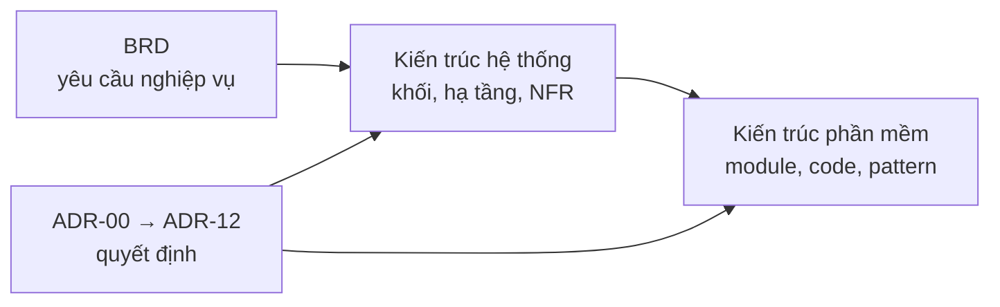

# Kiến trúc – Enterprise HR Platform

Hai tài liệu, hai góc nhìn:

| Tài liệu | Trả lời câu hỏi | Dành cho |
|---|---|---|
| [Kiến trúc hệ thống](system-architecture.md) | Hệ thống gồm những khối chạy riêng nào, nói chuyện với hệ thống ngoài nào, chạy ở đâu, mạng, bảo mật hạ tầng, sẵn sàng, phục hồi, quan sát, CI/CD, chi phí | Người vận hành, cloud, đánh giá NFR |
| [Kiến trúc phần mềm](software-architecture.md) | Bên trong API, worker, web: cấu trúc code, module và phụ thuộc, luồng xử lý request, dữ liệu, pattern đảm bảo nghiệp vụ, API, frontend, kiểm thử, cách mở rộng | Người viết code, review code |

Liên quan: [BRD](../business/BRD.md) · [ma trận phân quyền](../security/access-control-matrix.md) ·
[quy ước code](../CONVENTIONS.md) · [API](../openapi.yaml) · [danh sách ADR](../progress/README.md#danh-sách-quyết-định-adr).

## Quyết định kiến trúc (ADR)

| ADR | Quyết định | Góc nhìn | Ở đâu |
|---|---|---|---|
| ADR-00 | Managed services cho database, lưu file, đăng nhập | Hệ thống | [tuần 5](../progress/tuan-05/README.md#adr-00--dùng-managed-services-cho-database-storage-và-identity) |
| ADR-01 | Modular monolith | Phần mềm | [tuần 6](../progress/tuan-06/README.md#adr-01--modular-monolith-thay-vì-microservices) |
| ADR-02 | PostgreSQL | Cả hai | [tuần 6](../progress/tuan-06/README.md#adr-02--postgresql-thay-vì-nosql) |
| ADR-03 | Workflow đồng bộ, thông báo bất đồng bộ qua outbox + queue | Cả hai | [tuần 6](../progress/tuan-06/README.md#adr-03--workflow-đồng-bộ-thông-báo-và-index-bất-đồng-bộ) |
| ADR-04 | NestJS + React + PostgreSQL + Keycloak | Phần mềm | [tuần 7](../progress/tuan-07/README.md#adr-04--tech-stack-nestjs--react--postgresql--keycloak) |
| ADR-05 | Phạm vi MVP | Nghiệp vụ | [tuần 4](../progress/tuan-04-ke-hoach-tong.md#adr-05--phạm-vi-mvp-một-luồng-nghiệp-vụ-nghỉ-phép-end-to-end) |
| ADR-06 | 99,5%, 2 instance, thiết kế 50 RPS, không Kubernetes | Hệ thống | [tuần 5](../progress/tuan-05/README.md#adr-06--availability-995-và-thiết-kế-cho-50-rps-không-dùng-kubernetes) |
| ADR-07 | Không Redis, cache in-memory | Phần mềm | [tuần 6](../progress/tuan-06/README.md#adr-07--không-dùng-redis-ở-mvp) |
| ADR-08 | Mã hóa trường nhạy cảm ở tầng ứng dụng | Phần mềm | [tuần 7](../progress/tuan-07/README.md#adr-08--mã-hóa-trường-nhạy-cảm-ở-tầng-ứng-dụng) |
| ADR-09 | Audit log append-only khóa ở database | Phần mềm | [tuần 7](../progress/tuan-07/README.md#adr-09--audit-log-append-only-khóa-ở-mức-database) |
| ADR-10 | Role MANAGER suy ra từ sơ đồ tổ chức | Phần mềm | [tuần 7](../progress/tuan-07/README.md#adr-10--role-manager-suy-ra-từ-sơ-đồ-tổ-chức) |
| ADR-11 | Điều chỉnh phân vai | Dự án | [tuần 7](../progress/tuan-07/README.md#adr-11--điều-chỉnh-phân-vai-cho-giai-đoạn-code) |
| ADR-12 | Cloud provider (đang review) | Hệ thống | [tuần 9](../progress/tuan-09/README.md#adr-12--chọn-cloud-provider) |
