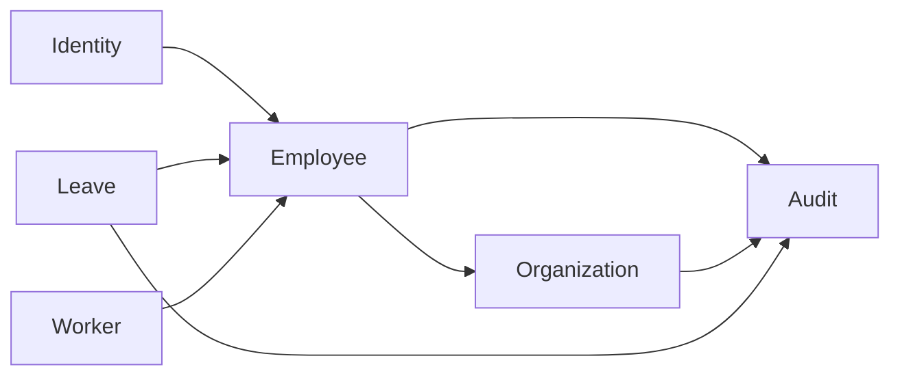

# SAD phần 2 – Kiến trúc phần mềm – HRHelper (HR Enterprise Platform)

Tài liệu mô tả **bên trong** các khối của hệ thống: cách tổ chức code, module, luồng xử lý một request, dữ liệu, các pattern
dùng để đảm bảo đúng nghiệp vụ, giao diện web và cách kiểm thử. Các khối chạy ở đâu, mạng, hạ tầng nằm ở
[kiến trúc hệ thống](SAD-1-system-architecture.md).

Cập nhật: 18/11/2026 (tuần 11, sau UC1 #80, #84 → #90), theo code trên nhánh `dev`. Trạng thái: ✅ có trên `dev` · 🟡 đang review · ⬜ chưa làm.

## 1. Kiểu kiến trúc

- **Modular monolith** (ADR-01): một ứng dụng NestJS chia thành module theo nghiệp vụ; mỗi module sở hữu một schema PostgreSQL.
  Thay đổi đơn + số dư + audit nằm trong một transaction cục bộ, không cần saga hay transaction phân tán.
- **Ranh giới module chặt** để sau này tách được thành service: không inject repository của module khác, không foreign key
  chéo schema, module khác chỉ gọi service được `exports` ([CONVENTIONS mục 1](../CONVENTIONS.md#1-ranh-giới-module-quan-trọng-nhất)).
- **Đồng bộ cho nghiệp vụ, bất đồng bộ cho tác vụ phụ** (ADR-03): duyệt đơn trả kết quả ngay; email đi qua outbox → queue → worker.
- **Worker** là process riêng dùng lại module của API (cùng codebase, cùng image), không mở HTTP.

## 2. Công nghệ

| Lớp | Công nghệ | Vai trò |
|---|---|---|
| Ngôn ngữ | TypeScript 5 (backend và frontend) | Một ngôn ngữ cho cả hệ thống (ADR-04) |
| Backend | NestJS 10, Express | Module, dependency injection, guard, pipe, filter |
| Truy cập dữ liệu | TypeORM 0.3, PostgreSQL 16 | Entity, migration, transaction |
| Xác thực | `jose` (kiểm JWT bằng JWKS) | OIDC resource server |
| Kiểm tra dữ liệu vào | `class-validator`, `class-transformer` | DTO, `ValidationPipe` |
| Tài liệu API | `@nestjs/swagger` → `docs/openapi.yaml` | Sinh từ code (`npm run openapi`) |
| Queue, email | `amqplib` (RabbitMQ, local), `@aws-sdk/client-sqs` (SQS, AWS) chọn bằng `QUEUE_DRIVER` qua `src/messaging/`; `nodemailer` (SMTP) | Publisher outbox, worker |
| Frontend | React 18, React Router 6, Vite 5 | SPA |
| Đăng nhập web | `oidc-client-ts` | Authorization Code + PKCE |
| Kiểm thử | Jest, Supertest | Unit test, e2e với database thật |

## 3. Cấu trúc code

```
backend/src/
├── main.ts, bootstrap.ts      khởi động API; cấu hình chung (prefix, CORS, pipe, filter, Swagger)
├── app.module.ts              ghép các module
├── config/                    đọc biến môi trường (12-factor), kiểm tra cấu hình khi khởi động
├── common/                    lỗi chuẩn, traceId, phân trang, cache TTL, mã hóa trường (FieldCrypto)
├── database/                  data-source, migrations/, seed.ts
├── modules/
│   ├── identity/              guard, kiểm token, map tài khoản ↔ nhân viên, role
│   ├── employee/              hồ sơ, danh bạ, quy tắc xem/sửa (employee-access.ts)
│   ├── organization/          phòng ban, chức danh, cây tổ chức
│   ├── audit/                 ghi và tra cứu audit
│   └── leave/                 đơn nghỉ, state machine, business rule, outbox/
└── worker/                    process worker: nhận event, gửi email
backend/test/                  e2e test

frontend/src/
├── main.tsx, App.tsx          router, phân tách đã/chưa đăng nhập
├── auth/                      oidc-client-ts, giữ token
├── api/                       client gọi REST, hook useApi, kiểu dữ liệu
├── components/                Layout (menu theo vai trò), ErrorBox
└── pages/                     hồ sơ, danh bạ, nhân viên, tổ chức, leave/
```

Cấu trúc bên trong một module (ví dụ `employee`): `*.entity.ts` (bảng), `*.dto.ts` (dữ liệu vào/ra + validate),
`*-access.ts` hoặc `*-rules.ts` (quy tắc nghiệp vụ dạng hàm thuần, có `*.spec.ts`), `*.service.ts` (transaction, gọi audit),
`*.controller.ts` (chỉ nhận request và gọi service), `*.module.ts`.

## 4. Danh mục module

| Module | Trách nhiệm | Schema · bảng | Cung cấp cho module khác | Phụ thuộc | API |
|---|---|---|---|---|---|
| Identity | Guard toàn cục, kiểm token, tạo tài khoản lần đầu đăng nhập, gom role, chặn tài khoản gắn hồ sơ `TERMINATED` (403) | `iam`: `user_account`, `role_assignment` | `AuthGuard` (APP_GUARD), `@Roles`, `@CurrentUser` | Employee | – (`GET /me` nằm ở controller Employee) |
| Employee | Hồ sơ theo mục (`summary`, API từng mục, quyền theo mục), yêu cầu cập nhật và HR duyệt, mục HR quản lý, thông tin tự tính, file hồ sơ, nhật ký thay đổi, danh bạ | `employee`: `employee`, `employee_sensitive`, `profile_item`, `profile_change_request`, `profile_file` | `EmployeeService` (`managerIdOf`, `directReportIds`, `namesOf`, `contactOf`, `hasDirectReports`, `placementOf`) | Organization, Audit, RateLimit | ~30 (3 controller: `EmployeeController`, `ProfileChangeController`, `ProfileFileController`) |
| Organization | Phòng ban, chức danh, cây tổ chức, cache tham chiếu | `org`: `department`, `position` | `OrganizationService` (`lookups`) | Audit | 6 |
| Audit | Ghi log trong transaction của module gọi; tra cứu | `audit`: `audit_log` (trigger chặn sửa/xóa) | `AuditService.record(entry, manager)` | – | 1 |
| Leave | Đơn, số dư, ngày lễ, state machine, outbox, publisher | `leave`: `leave_type`, `leave_balance`, `leave_request`, `leave_request_history`, `holiday`, `outbox` | – | Employee, Audit | 12 |
| Worker (Notification) | Nhận event, gửi email (nghỉ phép; kết quả yêu cầu hồ sơ, đổi tài khoản ngân hàng, báo HR gộp 1 email/giờ), chống trùng | `notification`: `processed_event` | – | Employee | – |
| Common: RateLimit | Giới hạn tần suất theo người dùng (`RateLimitInterceptor` toàn cục, `@RateLimit(nhóm)`, `RateLimitService.consume`) | `iam`: `rate_limit_counter` (cửa sổ ngày) | `RateLimitService` | – | – |

Danh sách operation đầy đủ ở [`openapi.yaml`](../openapi.yaml); quyền từng API: [ma trận phân quyền](../security/access-control-matrix.md).



Mũi tên là "gọi service được export". Không có vòng phụ thuộc; Audit không phụ thuộc module nào.

## 5. Luồng xử lý một request

```mermaid
sequenceDiagram
  participant C as Client
  participant MW as TraceIdMiddleware + SecurityHeaders
  participant G as AuthGuard
  participant RL as RateLimitInterceptor
  participant TV as TokenVerifier
  participant ID as IdentityService
  participant P as ValidationPipe
  participant CT as Controller
  participant S as Service
  participant DB as PostgreSQL
  participant F as ApiErrorFilter

  C->>MW: HTTP /api/v1/...
  MW->>G: gắn traceId (header X-Trace-Id)
  G->>TV: kiểm chữ ký JWT (JWKS), issuer, client
  TV-->>G: subject, email, role trong token
  G->>ID: map tài khoản ↔ nhân viên, gom role (HR/ADMIN từ DB, MANAGER suy ra từ sơ đồ tổ chức); hồ sơ TERMINATED → 403
  G->>G: kiểm @Roles của endpoint (lớp 1)
  G->>RL: request đã xác thực
  RL->>RL: đếm nhóm global + nhóm của endpoint; vượt → 429 + Retry-After
  RL->>P: tiếp tục
  P->>CT: DTO hợp lệ (bỏ trường thừa thì 400; body > 64 KiB → 413)
  CT->>S: gọi service
  S->>DB: transaction: kiểm quyền theo dữ liệu (lớp 2), nghiệp vụ, audit, outbox
  S-->>C: 200/201
  Note over F: mọi lỗi → {code, message, traceId}
```

- **Phân quyền hai lớp:** `@Roles(...)` ở controller chặn sớm theo vai trò; điều kiện theo dữ liệu ("chỉ hồ sơ của mình",
  "chỉ quản lý trực tiếp", "đơn đang SUBMITTED") nằm trong service hoặc hàm thuần.
- **Lỗi thống nhất:** `ApiErrorFilter` trả `{ code, message, traceId }`; lỗi unique của database thành 409; 429 kèm header
  `Retry-After`.
- **Header bảo mật** (`SecurityHeadersMiddleware`): `nosniff`, `X-Frame-Options: DENY`, `Referrer-Policy`, CSP
  `default-src 'none'` (riêng Swagger nới cho script của nó), HSTS khi `NODE_ENV=production`.
- **Giới hạn tần suất** theo người dùng (NFR-5.21, UC1 FR-1.14): `global` 100/phút, `search` 20/phút, `profile-write` 30/phút
  và 300/ngày, `profile-upload` 10/giờ và 30/ngày, `avatar-upload` 5/ngày, `profile-download` 60/giờ, `sensitive-view` 100/giờ.
  Phút, giờ đếm trong bộ nhớ; ngày đếm ở `iam.rate_limit_counter`. Ngưỡng đổi được qua `RATE_LIMIT_OVERRIDES`.

## 6. Dữ liệu

- **Một PostgreSQL, mỗi module một schema** (ADR-02); foreign key chỉ trong cùng schema.
- **Migration** TypeORM, `synchronize` luôn tắt; có `up` và `down`; migration đã merge không sửa lại. Hiện có:
  `InitSchemas` (tuần 7), `LeaveWorkflow` (ngày lễ, nửa ngày), `LeaveOutbox` (outbox, `processed_event`), `Documents`
  (schema `document`, tuần 10), `RateLimitCounter`, `ProfileChangeRequests`, `ProfileFiles` (UC1, tuần 11).
- **Mục hồ sơ một bảng chung** `employee.profile_item` (`data` jsonb + `sensitive_data` mã hóa, `version` từng dòng): mô tả
  từng mục (trường, kiểu, ai nhập, số dòng tối đa) nằm ở `profile-schema.ts`, mức xem ở `profile-sections.ts`. Thêm mục không
  cần migration; đánh đổi là database không ràng buộc từng trường, bù bằng kiểm ở API và test.
- **File hồ sơ** ở bucket riêng `PROFILE_STORAGE_BUCKET` (ADR-13 áp cho UC1): presigned PUT 10 phút, xác nhận kiểm dung lượng,
  magic number, SHA-256; ảnh đại diện cắt 512 × 512 và bỏ EXIF bằng `sharp`; xóa thì gắn tag `deleted=true` cho lifecycle 30
  ngày.
- **Trường nhạy cảm** (CCCD, tài khoản, lương) nằm ở bảng riêng `employee_sensitive`, mã hóa AES-256-GCM bằng `FieldCrypto`
  trước khi ghi (ADR-08); audit chỉ ghi tên trường.
- **Audit** append-only: trigger chặn UPDATE/DELETE (ADR-09).
- **Số dư phép** có ràng buộc `used + pending <= entitled` ở database, là chốt chặn cuối nếu code sai.
- **Mô hình dữ liệu chi tiết** (sơ đồ ERD từng schema, mô tả bảng, cột, khóa, index, tham chiếu chéo schema):
  [database-schema.md](database-schema.md). Bản thiết kế ban đầu ở tuần 6: [TV2_Thanh](../progress/tuan-06/TV2_Thanh.md#2-data-model--data-ownership).

## 7. Pattern đảm bảo đúng nghiệp vụ

| Vấn đề | Pattern | Ở đâu |
|---|---|---|
| Quy tắc chuyển trạng thái đơn rõ ràng, test được | **State machine** hàm thuần: trả `changed` / `unchanged` / `forbidden` / `conflict` | `leave-state-machine.ts` |
| Business rule (số dư, trùng lịch, ngày làm việc, nửa ngày) | **Hàm thuần** có unit test | `leave-rules.ts`, `employee-access.ts`, `profile-sections.ts`, `profile-schema.ts`, `profile-file-rules.ts`, `profile-computed.ts`, `employee-audit.ts`, `rate-limit-rules.ts` |
| Nhân viên sửa hồ sơ nhưng dữ liệu phải được kiểm | **Maker-checker**: yêu cầu cập nhật `PENDING` → HR duyệt (kiểm `baseVersion`) hoặc từ chối; duyệt và HR sửa thẳng dùng chung `applyChange` | `profile-change.service.ts` |
| Nhiều mục hồ sơ cùng cách xử lý | **Schema-driven**: một file mô tả mục sinh kiểm dữ liệu, mã hóa, danh sách mục, form ở giao diện | `profile-schema.ts`, `profile-sections.ts`, `RowSectionPage.tsx` |
| Chỉ đọc dữ liệu cá nhân khi người dùng thật sự cần | **Tải theo nhu cầu**: trang hồ sơ chỉ gọi `summary`; mục chỉ gọi khi bấm; giá trị nhạy cảm chỉ giải mã khi `reveal=true`, mỗi lần có audit | `employee.service.ts`, `ProfilePanel.tsx` |
| Spam, cào dữ liệu | **Rate limit** theo người dùng, cửa sổ cố định, nhóm theo endpoint | `common/rate-limit/` |
| Audit có giá trị nhưng không lộ dữ liệu cá nhân | **Audit theo nhóm trường**: trường tổ chức ghi `{ from, to }`, trường cá nhân và nhạy cảm chỉ ghi tên; quá trình công tác dựng lại từ đó | `employee-audit.ts`, `profile-computed.ts` |
| Đơn + số dư + lịch sử + audit phải cùng thành công | **Một transaction**, truyền `EntityManager` cho `AuditService.record` | `leave.service.ts`, `employee.service.ts` |
| Gửi lại do mạng lỗi tạo đơn thứ hai | **Idempotency-Key** + unique `(employee_id, idempotency_key)` | `POST /leave-requests`, `POST /employees/{id}/change-requests` |
| Hai người sửa cùng lúc | **Optimistic locking** (`version` bắt buộc, lệch → 409) + khóa dòng khi xử lý | Đơn nghỉ, hồ sơ, từng dòng mục hồ sơ |
| Hai đơn song song cùng vượt kiểm tra số dư | **Advisory lock** theo nhân viên trong transaction tạo đơn | `leave.service.ts` |
| Bấm duyệt hai lần | **Thao tác lặp không đổi gì** (BR-11): state machine trả `unchanged` trước khi kiểm `version` | State machine |
| Event không được mất khi queue lỗi | **Transactional outbox** + publisher confirm, `FOR UPDATE SKIP LOCKED` | `leave/outbox/` |
| Queue giao một event nhiều lần | **Consumer idempotent**: lưu id event đã xử lý | `worker/notification-worker.ts` |
| Dữ liệu tham chiếu đọc nhiều | **Cache-aside** in-memory 10 phút (ADR-07) | `common/ttl-cache.ts`, Organization |

Tên event, payload, exchange/queue và cách chống trùng: [hợp đồng event và queue](event-contract.md).

## 8. API

- REST, tiền tố `/api/v1`; tài nguyên số nhiều, kebab-case; hành động đặc biệt dùng POST: `/leave-requests/{id}/approve`.
- Danh sách luôn phân trang `?page=&size=` (tối đa 100), trả `{ items, page, size, total }`.
- Hợp đồng sinh từ code ra [`openapi.yaml`](../openapi.yaml); Swagger ở `/api/docs`.
- Quy ước đầy đủ: [CONVENTIONS mục 4](../CONVENTIONS.md#4-api).
- Lỗi trả `{ code, message, traceId }`; danh sách mã lỗi và message theo module: [mã lỗi API](../development/error-codes.md).

## 9. Frontend

| Phần | Cách làm |
|---|---|
| Đăng nhập | `oidc-client-ts`: Authorization Code + PKCE, token giữ trong `sessionStorage`, tự gia hạn |
| Gọi API | `api/client.ts` gắn Bearer token, chuẩn hóa lỗi thành `ApiError` có `traceId`; hook `useApi` lo loading/lỗi/tải lại |
| Khung ứng dụng | Nav bar (logo, ô tìm **chỉ đồng nghiệp**, chuông, menu ảnh đại diện), trang chủ với ô chức năng theo vai trò; `ShellProvider` giữ `GET /me` và thẻ xem nhanh ([frontend.md](../features/frontend.md)) |
| Điều hướng | React Router; popup hồ sơ có URL (`/me/profile`, `/employees/:id`, `/employees/:id/:section`) dựng bằng route nền `state.background`; mở thẳng URL thì trang chủ hiện phía sau |
| Màn hình | Popup hồ sơ theo nhóm (trang con dựng từ mô tả mục của API: dòng, file, tự tính), thẻ xem nhanh, "Việc cần duyệt" (tab Sửa hồ sơ), hợp đồng sắp hết hạn, danh bạ, sơ đồ tổ chức, form hồ sơ HR; nghỉ phép: tạo đơn, đơn của tôi, chờ duyệt, chi tiết, HR hoàn tất |
| Tải dữ liệu | Theo nhu cầu: cache `summary` 60 giây trong bộ nhớ; giá trị nhạy cảm qua `MaskedValue` chỉ gọi khi bấm mắt |
| File | `FileUpload`: kiểm loại, dung lượng, SHA-256 ở trình duyệt, PUT thẳng lên storage có tiến độ; tải xuống và ảnh đại diện lấy qua API bằng token |
| Giao diện | CSS thuần với biến màu cyan (frontend.md 5.1), biểu tượng `lucide-react`; 429 khóa nút tới hết `Retry-After` |
| Thao tác ghi | Khóa nút khi đang gửi, gửi kèm `version`; tạo đơn giữ một `Idempotency-Key` cho mỗi lần gửi |
| Quyền | Ẩn/hiện nút chỉ để tiện dùng; quyền thật do backend kiểm |

Form HR tạo, sửa hồ sơ dựng từ `employee-fields.ts`; các mục hồ sơ dựng từ `fields` mà API trả về (`profile-schema.ts`), nên
thêm mục mới không phải sửa giao diện.

## 10. Cấu hình và secret trong code

- Mọi cấu hình đọc từ biến môi trường qua `loadConfig()` (12-factor); một chỗ duy nhất, có giá trị mặc định cho local.
  Danh sách từng biến, mặc định và giá trị staging: [biến môi trường](../development/configuration.md).
- `AUTH_MODE=dev` (token giả cho test) bị chặn khi `NODE_ENV=production`.
- 🟡 Nhánh `feat/secret-config`: production thiếu secret hoặc dùng khóa dev thì không khởi động; tùy chọn TLS tới database.
- 🟡 Nhánh `feat/auth-cognito`: claim client, claim role, userinfo cấu hình được để dùng identity provider khác Keycloak.

## 11. Kiểm thử

| Loại | Phạm vi | Số lượng (dev, 6/11) | Chạy ở |
|---|---|---|---|
| Unit | Hàm thuần: state machine, business rule, quyền theo mục, mô tả mục, file, thông tin tự tính, audit theo nhóm, rate limit, mã hóa, cache, email, worker | 103 (15/11) | CI mọi PR |
| e2e | API thật + database thật, token giả `dev:<email>`: phân quyền, hồ sơ theo mục, yêu cầu cập nhật, file hồ sơ (bucket giả trong bộ nhớ `test/fake-storage.ts`), rate limit, workflow nghỉ phép, audit, outbox | 83 + 6 bỏ qua khi chưa có bucket tài liệu (15/11) | Máy dev (cần database) |
| Kiểm thử chức năng | Giao diện, theo ca kiểm thử | 21 bước (tuần 7), 22 ca nghỉ phép | TV4, mỗi tuần |
| Phân quyền | Mỗi dòng ma trận một ca được phép + một ca bị chặn | Tuần 9 | e2e + TV4 |

## 12. Hướng dẫn mở rộng

- **Thêm module:** thư mục mới trong `modules/`, schema riêng, migration riêng; chỉ gọi module khác qua service được export;
  thêm dòng vào ma trận phân quyền.
- **Thêm event:** khai báo trong `leave/outbox/leave-events.ts` (hoặc file event của module), ghi outbox trong transaction,
  thêm xử lý ở worker, giữ consumer idempotent.
- **Thêm trường chính của hồ sơ:** migration → entity → DTO → `employee-fields.ts` ở frontend → OpenAPI → ma trận phân quyền →
  ca kiểm thử.
- **Thêm mục hồ sơ:** khai báo ở `profile-sections.ts` (nhóm, mức xem, `available`) và `profile-schema.ts` (trường, ai nhập,
  số dòng); không cần migration; thêm vào danh sách mục dòng ở `SectionPage.tsx` nếu mục dùng trang dòng; thêm e2e.
- **Tách một module thành service** (khi cần): thay lời gọi in-process bằng REST/event; vì không có foreign key chéo schema,
  có thể chuyển schema sang database riêng.
