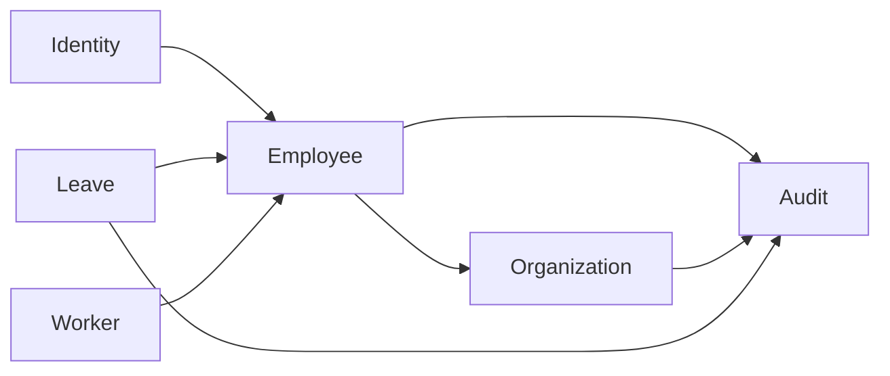
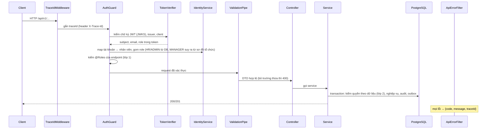

# SAD phần 2 – Kiến trúc phần mềm – HRHelper (HR Enterprise Platform)

Tài liệu mô tả **bên trong** các khối của hệ thống: cách tổ chức code, module, luồng xử lý một request, dữ liệu, các pattern
dùng để đảm bảo đúng nghiệp vụ, giao diện web và cách kiểm thử. Các khối chạy ở đâu, mạng, hạ tầng nằm ở
[kiến trúc hệ thống](SAD-1-system-architecture.md).

Cập nhật: 6/11/2026 (tuần 9), theo code trên nhánh `dev`. Trạng thái: ✅ có trên `dev` · 🟡 đang review · ⬜ chưa làm.

## 1. Kiểu kiến trúc

- **Modular monolith** (ADR-01): một ứng dụng NestJS chia thành module theo nghiệp vụ; mỗi module sở hữu một schema PostgreSQL.
  Thay đổi đơn + số dư + audit nằm trong một transaction cục bộ, không cần saga hay transaction phân tán.
- **Ranh giới module chặt** để sau này tách được thành service: không inject repository của module khác, không foreign key
  chéo schema, module khác chỉ gọi service được `exports` ([CONVENTIONS mục 1](../CONVENTIONS.md#1-ranh-giới-module-quan-trọng-nhất)).
- **Đồng bộ cho nghiệp vụ, bất đồng bộ cho tác vụ phụ** (ADR-03): duyệt đơn trả kết quả ngay; email đi qua outbox → queue → worker.
- **Worker** là process riêng dùng lại module của API (cùng codebase, cùng image), không mở HTTP.

## 2. Công nghệ

| Lớp | Công nghệ | Vai trò |
|---|---|---|
| Ngôn ngữ | TypeScript 5 (backend và frontend) | Một ngôn ngữ cho cả hệ thống (ADR-04) |
| Backend | NestJS 10, Express | Module, dependency injection, guard, pipe, filter |
| Truy cập dữ liệu | TypeORM 0.3, PostgreSQL 16 | Entity, migration, transaction |
| Xác thực | `jose` (kiểm JWT bằng JWKS) | OIDC resource server |
| Kiểm tra dữ liệu vào | `class-validator`, `class-transformer` | DTO, `ValidationPipe` |
| Tài liệu API | `@nestjs/swagger` → `docs/openapi.yaml` | Sinh từ code (`npm run openapi`) |
| Queue, email | `amqplib` (RabbitMQ, local), `@aws-sdk/client-sqs` (SQS, AWS) chọn bằng `QUEUE_DRIVER` qua `src/messaging/`; `nodemailer` (SMTP) | Publisher outbox, worker |
| Frontend | React 18, React Router 6, Vite 5 | SPA |
| Đăng nhập web | `oidc-client-ts` | Authorization Code + PKCE |
| Kiểm thử | Jest, Supertest | Unit test, e2e với database thật |

## 3. Cấu trúc code

```
backend/src/
├── main.ts, bootstrap.ts      khởi động API; cấu hình chung (prefix, CORS, pipe, filter, Swagger)
├── app.module.ts              ghép các module
├── config/                    đọc biến môi trường (12-factor), kiểm tra cấu hình khi khởi động
├── common/                    lỗi chuẩn, traceId, phân trang, cache TTL, mã hóa trường (FieldCrypto)
├── database/                  data-source, migrations/, seed.ts
├── modules/
│   ├── identity/              guard, kiểm token, map tài khoản ↔ nhân viên, role
│   ├── employee/              hồ sơ, danh bạ, quy tắc xem/sửa (employee-access.ts)
│   ├── organization/          phòng ban, chức danh, cây tổ chức
│   ├── audit/                 ghi và tra cứu audit
│   └── leave/                 đơn nghỉ, state machine, business rule, outbox/
└── worker/                    process worker: nhận event, gửi email
backend/test/                  e2e test

frontend/src/
├── main.tsx, App.tsx          router, phân tách đã/chưa đăng nhập
├── auth/                      oidc-client-ts, giữ token
├── api/                       client gọi REST, hook useApi, kiểu dữ liệu
├── components/                Layout (menu theo vai trò), ErrorBox
└── pages/                     hồ sơ, danh bạ, nhân viên, tổ chức, leave/
```

Cấu trúc bên trong một module (ví dụ `employee`): `*.entity.ts` (bảng), `*.dto.ts` (dữ liệu vào/ra + validate),
`*-access.ts` hoặc `*-rules.ts` (quy tắc nghiệp vụ dạng hàm thuần, có `*.spec.ts`), `*.service.ts` (transaction, gọi audit),
`*.controller.ts` (chỉ nhận request và gọi service), `*.module.ts`.

## 4. Danh mục module

| Module | Trách nhiệm | Schema · bảng | Cung cấp cho module khác | Phụ thuộc | API |
|---|---|---|---|---|---|
| Identity | Guard toàn cục, kiểm token, tạo tài khoản lần đầu đăng nhập, gom role | `iam`: `user_account`, `role_assignment` | `AuthGuard` (APP_GUARD), `@Roles`, `@CurrentUser` | Employee | `GET /me` |
| Employee | Hồ sơ, danh bạ, cấp dưới, trường nhạy cảm mã hóa | `employee`: `employee`, `employee_sensitive` | `EmployeeService` (`managerIdOf`, `directReportIds`, `namesOf`, `contactOf`, `hasDirectReports`) | Organization, Audit | 7 |
| Organization | Phòng ban, chức danh, cây tổ chức, cache tham chiếu | `org`: `department`, `position` | `OrganizationService` (`lookups`) | Audit | 6 |
| Audit | Ghi log trong transaction của module gọi; tra cứu | `audit`: `audit_log` (trigger chặn sửa/xóa) | `AuditService.record(entry, manager)` | – | 1 |
| Leave | Đơn, số dư, ngày lễ, state machine, outbox, publisher | `leave`: `leave_type`, `leave_balance`, `leave_request`, `leave_request_history`, `holiday`, `outbox` | – | Employee, Audit | 12 |
| Worker (Notification) | Nhận event, gửi email, chống trùng | `notification`: `processed_event` | – | Employee | – |

Tổng cộng 27 operation + `GET /health`; quyền từng API: [ma trận phân quyền](../security/access-control-matrix.md).



Mũi tên là "gọi service được export". Không có vòng phụ thuộc; Audit không phụ thuộc module nào.

## 5. Luồng xử lý một request



- **Phân quyền hai lớp:** `@Roles(...)` ở controller chặn sớm theo vai trò; điều kiện theo dữ liệu ("chỉ hồ sơ của mình",
  "chỉ quản lý trực tiếp", "đơn đang SUBMITTED") nằm trong service hoặc hàm thuần.
- **Lỗi thống nhất:** `ApiErrorFilter` trả `{ code, message, traceId }`; lỗi unique của database thành 409.

## 6. Dữ liệu

- **Một PostgreSQL, mỗi module một schema** (ADR-02); foreign key chỉ trong cùng schema.
- **Migration** TypeORM, `synchronize` luôn tắt; có `up` và `down`; migration đã merge không sửa lại. Hiện có:
  `InitSchemas` (tuần 7), `LeaveWorkflow` (ngày lễ, nửa ngày), `LeaveOutbox` (outbox, `processed_event`).
- **Trường nhạy cảm** (CCCD, tài khoản, lương) nằm ở bảng riêng `employee_sensitive`, mã hóa AES-256-GCM bằng `FieldCrypto`
  trước khi ghi (ADR-08); audit chỉ ghi tên trường.
- **Audit** append-only: trigger chặn UPDATE/DELETE (ADR-09).
- **Số dư phép** có ràng buộc `used + pending <= entitled` ở database, là chốt chặn cuối nếu code sai.
- Mô hình dữ liệu chi tiết: [tuần 6](../progress/tuan-06/TV2_Thanh.md#2-data-model--data-ownership).

## 7. Pattern đảm bảo đúng nghiệp vụ

| Vấn đề | Pattern | Ở đâu |
|---|---|---|
| Quy tắc chuyển trạng thái đơn rõ ràng, test được | **State machine** hàm thuần: trả `changed` / `unchanged` / `forbidden` / `conflict` | `leave-state-machine.ts` |
| Business rule (số dư, trùng lịch, ngày làm việc, nửa ngày) | **Hàm thuần** có unit test | `leave-rules.ts`, `employee-access.ts` |
| Đơn + số dư + lịch sử + audit phải cùng thành công | **Một transaction**, truyền `EntityManager` cho `AuditService.record` | `leave.service.ts`, `employee.service.ts` |
| Gửi lại do mạng lỗi tạo đơn thứ hai | **Idempotency-Key** + unique `(employee_id, idempotency_key)` | `POST /leave-requests` |
| Hai người sửa cùng lúc | **Optimistic locking** (`version`, lệch → 409) + khóa dòng khi xử lý | Đơn nghỉ, hồ sơ |
| Hai đơn song song cùng vượt kiểm tra số dư | **Advisory lock** theo nhân viên trong transaction tạo đơn | `leave.service.ts` |
| Bấm duyệt hai lần | **Thao tác lặp không đổi gì** (BR-11): state machine trả `unchanged` trước khi kiểm `version` | State machine |
| Event không được mất khi queue lỗi | **Transactional outbox** + publisher confirm, `FOR UPDATE SKIP LOCKED` | `leave/outbox/` |
| Queue giao một event nhiều lần | **Consumer idempotent**: lưu id event đã xử lý | `worker/notification-worker.ts` |
| Dữ liệu tham chiếu đọc nhiều | **Cache-aside** in-memory 10 phút (ADR-07) | `common/ttl-cache.ts`, Organization |

## 8. API

- REST, tiền tố `/api/v1`; tài nguyên số nhiều, kebab-case; hành động đặc biệt dùng POST: `/leave-requests/{id}/approve`.
- Danh sách luôn phân trang `?page=&size=` (tối đa 100), trả `{ items, page, size, total }`.
- Hợp đồng sinh từ code ra [`openapi.yaml`](../openapi.yaml); Swagger ở `/api/docs`.
- Quy ước đầy đủ: [CONVENTIONS mục 4](../CONVENTIONS.md#4-api).

## 9. Frontend

| Phần | Cách làm |
|---|---|
| Đăng nhập | `oidc-client-ts`: Authorization Code + PKCE, token giữ trong `sessionStorage`, tự gia hạn |
| Gọi API | `api/client.ts` gắn Bearer token, chuẩn hóa lỗi thành `ApiError` có `traceId`; hook `useApi` lo loading/lỗi/tải lại |
| Điều hướng | React Router; chưa đăng nhập thì chỉ có trang đăng nhập; menu hiện theo vai trò (Duyệt đơn cho MANAGER, HR hoàn tất cho HR) |
| Màn hình | Hồ sơ của tôi, danh bạ, chi tiết nhân viên, sơ đồ tổ chức; nghỉ phép: tạo đơn, đơn của tôi, chờ duyệt, chi tiết + lịch sử, HR hoàn tất |
| Thao tác ghi | Khóa nút khi đang gửi, gửi kèm `version`; tạo đơn giữ một `Idempotency-Key` cho mỗi lần gửi |
| Quyền | Ẩn/hiện nút chỉ để tiện dùng; quyền thật do backend kiểm |

Kế hoạch tuần 10: form hồ sơ dựng từ một file mô tả trường để thêm trường dễ
([kế hoạch](../progress/tuan-09/TV1_Duong.md#chuẩn-bị-cho-tuần-10-đã-chốt-511-đưa-vào-kế-hoạch-tuần-10)).

## 10. Cấu hình và secret trong code

- Mọi cấu hình đọc từ biến môi trường qua `loadConfig()` (12-factor); một chỗ duy nhất, có giá trị mặc định cho local.
- `AUTH_MODE=dev` (token giả cho test) bị chặn khi `NODE_ENV=production`.
- 🟡 Nhánh `feat/secret-config`: production thiếu secret hoặc dùng khóa dev thì không khởi động; tùy chọn TLS tới database.
- 🟡 Nhánh `feat/auth-cognito`: claim client, claim role, userinfo cấu hình được để dùng identity provider khác Keycloak.

## 11. Kiểm thử

| Loại | Phạm vi | Số lượng (dev, 6/11) | Chạy ở |
|---|---|---|---|
| Unit | Hàm thuần: state machine, business rule, quyền xem/sửa, mã hóa, cache, nội dung email, worker | 38 | CI mọi PR |
| e2e | API thật + database thật, token giả `dev:<email>`: phân quyền, workflow nghỉ phép, audit, outbox | 25 | Máy dev (cần database) |
| Kiểm thử chức năng | Giao diện, theo ca kiểm thử | 21 bước (tuần 7), 22 ca nghỉ phép | TV4, mỗi tuần |
| Phân quyền | Mỗi dòng ma trận một ca được phép + một ca bị chặn | Tuần 9 | e2e + TV4 |

## 12. Hướng dẫn mở rộng

- **Thêm module:** thư mục mới trong `modules/`, schema riêng, migration riêng; chỉ gọi module khác qua service được export;
  thêm dòng vào ma trận phân quyền.
- **Thêm event:** khai báo trong `leave/outbox/leave-events.ts` (hoặc file event của module), ghi outbox trong transaction,
  thêm xử lý ở worker, giữ consumer idempotent.
- **Thêm trường hồ sơ:** theo checklist trong kế hoạch tuần 10 (migration → entity → DTO → mô tả trường ở frontend → OpenAPI
  → ma trận phân quyền → ca kiểm thử).
- **Tách một module thành service** (khi cần): thay lời gọi in-process bằng REST/event; vì không có foreign key chéo schema,
  có thể chuyển schema sang database riêng.
