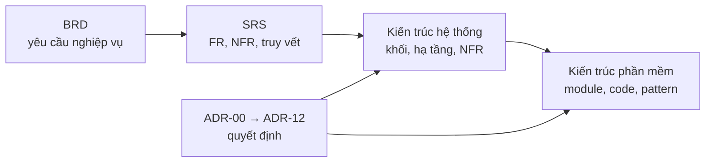

# Software Architecture Document (SAD) – HRHelper (HR Enterprise Platform)

SAD trả lời **hệ thống được xây thế nào**, lấy [SRS](../requirements/SRS.md) làm đầu vào (ISO/IEC/IEEE 42010). SAD gồm
file này (mục lục và danh sách ADR) và hai phần, mỗi phần một góc nhìn:

| Tài liệu | Trả lời câu hỏi | Dành cho |
|---|---|---|
| [SAD phần 1 – Kiến trúc hệ thống](SAD-1-system-architecture.md) | **Phần I – tổng quan** (không gắn công cụ) và **Phần II – hiện tại** (công cụ, framework, phiên bản, local và cloud). Hệ thống gồm những khối chạy riêng nào, nói chuyện với hệ thống ngoài nào, chạy ở đâu, mạng, bảo mật hạ tầng, sẵn sàng, phục hồi, quan sát, CI/CD, chi phí | Người vận hành, cloud, đánh giá NFR |
| [SAD phần 2 – Kiến trúc phần mềm](SAD-2-software-architecture.md) | Bên trong API, worker, web: cấu trúc code, module và phụ thuộc, luồng xử lý request, dữ liệu, pattern đảm bảo nghiệp vụ, API, frontend, kiểm thử, cách mở rộng | Người viết code, review code |
| [Phụ lục – Database schema](database-schema.md) | Sơ đồ ERD từng schema PostgreSQL; bảng, cột, kiểu, khóa chính, foreign key, unique, index, tham chiếu logic chéo schema, lịch sử migration | Người viết code, viết migration, review |

Liên quan: [BRD](../business/BRD.md) · [SRS](../requirements/SRS.md) · [ma trận phân quyền](../security/access-control-matrix.md) ·
[quy ước code](../CONVENTIONS.md) · [API](../openapi.yaml) · [danh sách ADR](adr/README.md).

## Quyết định kiến trúc (ADR)

Mỗi ADR là một file trong [`adr/`](adr/README.md) (mẫu, trạng thái, quy tắc viết ở đó).

| ADR | Quyết định | Góc nhìn | Trạng thái | File |
|---|---|---|---|---|
| ADR-00 | Managed services cho database, lưu file, đăng nhập | Hệ thống | Đã chấp nhận | [ADR-00-managed-services.md](adr/ADR-00-managed-services.md) |
| ADR-01 | Modular monolith | Phần mềm | Đã chấp nhận | [ADR-01-modular-monolith.md](adr/ADR-01-modular-monolith.md) |
| ADR-02 | PostgreSQL | Cả hai | Đã chấp nhận | [ADR-02-postgresql.md](adr/ADR-02-postgresql.md) |
| ADR-03 | Workflow đồng bộ, thông báo bất đồng bộ qua outbox + queue | Cả hai | Đã chấp nhận | [ADR-03-sync-workflow-async-notification.md](adr/ADR-03-sync-workflow-async-notification.md) |
| ADR-04 | NestJS + React + PostgreSQL + Keycloak | Phần mềm | Đã chấp nhận | [ADR-04-tech-stack.md](adr/ADR-04-tech-stack.md) |
| ADR-05 | Phạm vi MVP | Nghiệp vụ | Đã chấp nhận | [ADR-05-mvp-scope.md](adr/ADR-05-mvp-scope.md) |
| ADR-06 | 99,5%, 2 instance, thiết kế 50 RPS, không Kubernetes | Hệ thống | Đã chấp nhận | [ADR-06-availability-50-rps.md](adr/ADR-06-availability-50-rps.md) |
| ADR-07 | Không Redis, cache in-memory | Phần mềm | Đã chấp nhận | [ADR-07-no-redis.md](adr/ADR-07-no-redis.md) |
| ADR-08 | Mã hóa trường nhạy cảm ở tầng ứng dụng | Phần mềm | Đã chấp nhận | [ADR-08-field-encryption.md](adr/ADR-08-field-encryption.md) |
| ADR-09 | Audit log append-only khóa ở database | Phần mềm | Đã chấp nhận | [ADR-09-append-only-audit.md](adr/ADR-09-append-only-audit.md) |
| ADR-10 | Role MANAGER suy ra từ sơ đồ tổ chức | Phần mềm | Đã chấp nhận | [ADR-10-manager-role-derived.md](adr/ADR-10-manager-role-derived.md) |
| ADR-11 | Điều chỉnh phân vai | Dự án | Đã chấp nhận | [ADR-11-role-adjustment.md](adr/ADR-11-role-adjustment.md) |
| ADR-12 | Cloud provider | Hệ thống | Đã chấp nhận | [ADR-12-cloud-provider.md](adr/ADR-12-cloud-provider.md) |
| ADR-13 | Kho tài liệu: tải lên trực tiếp, tải xuống qua API, lọc phạm vi trong truy vấn | Phần mềm | Đã chấp nhận | [ADR-13-document-storage.md](adr/ADR-13-document-storage.md) |
