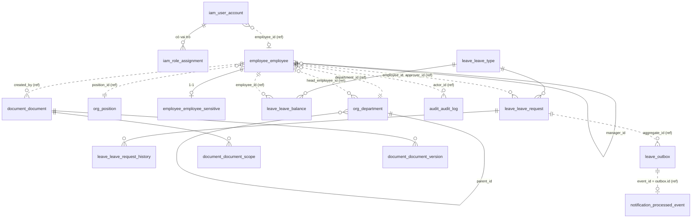
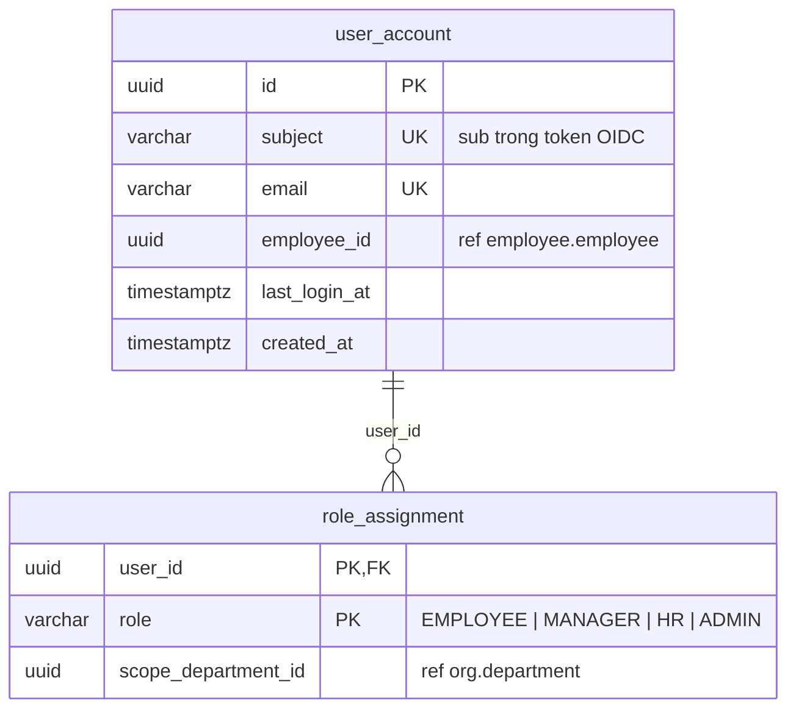
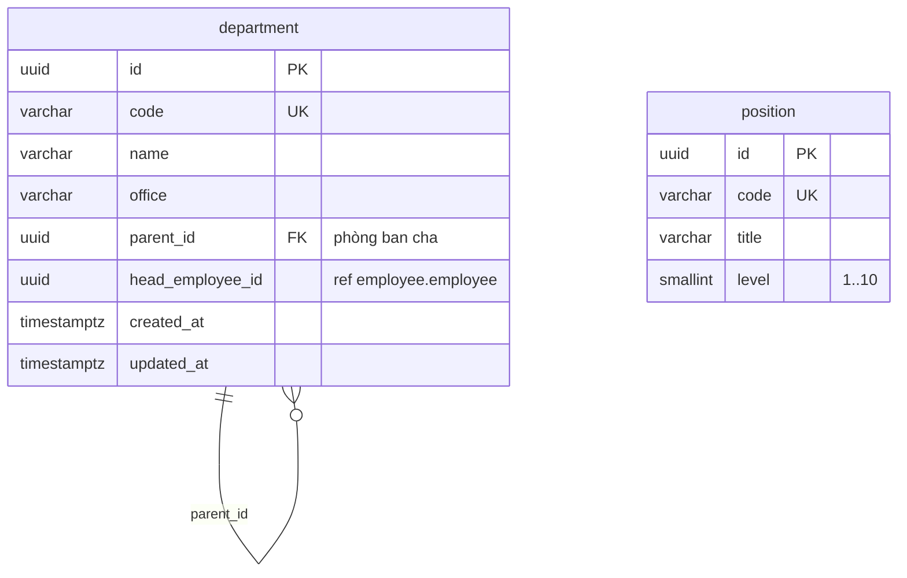
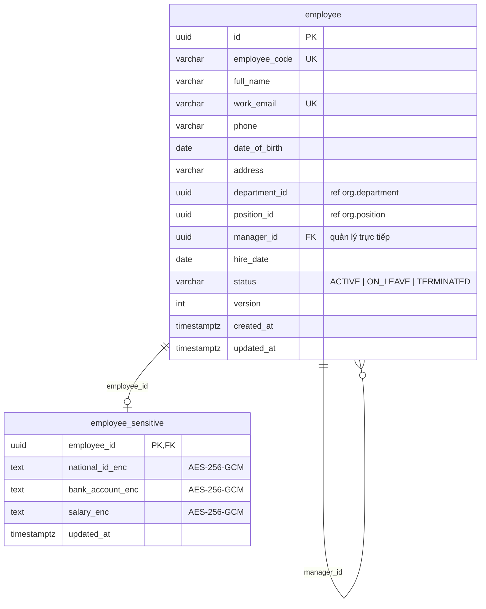
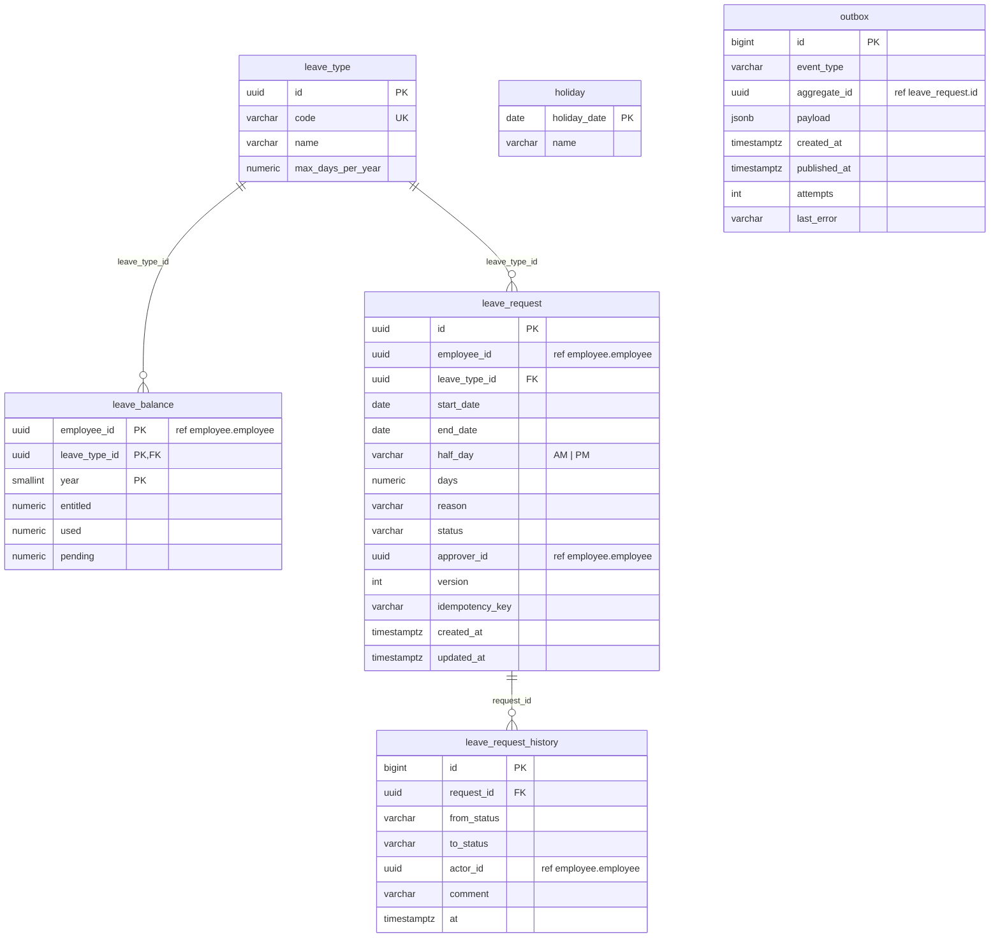
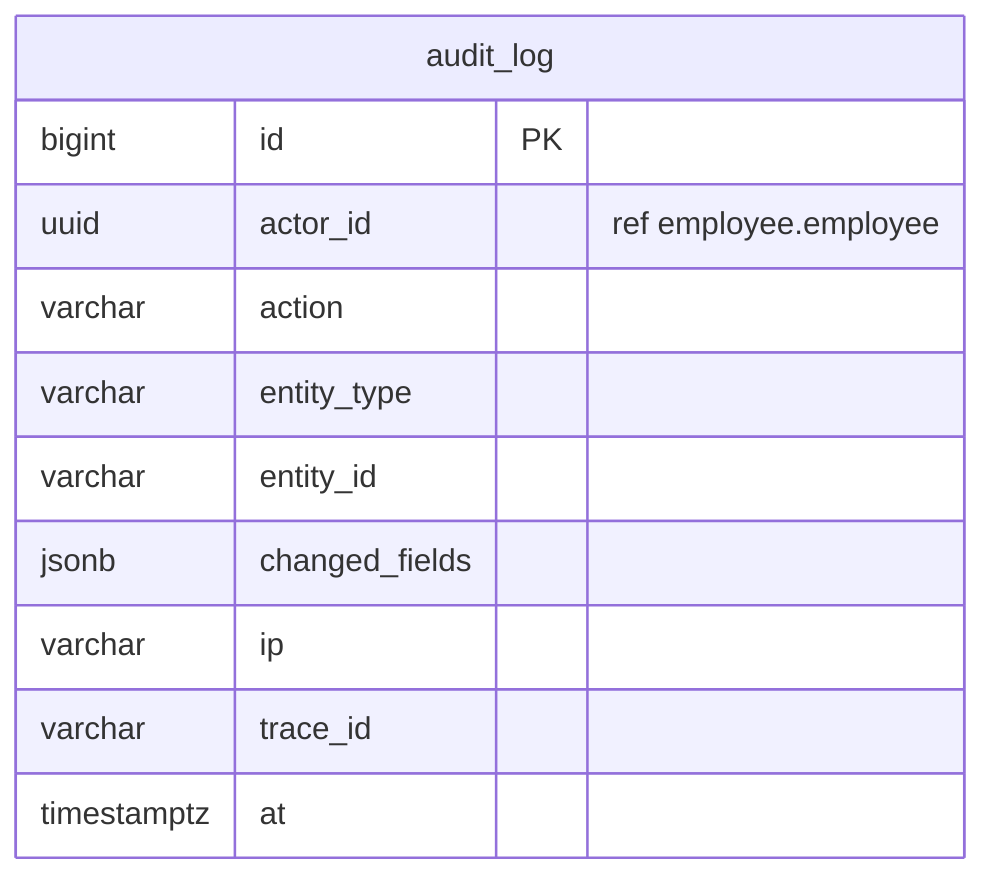
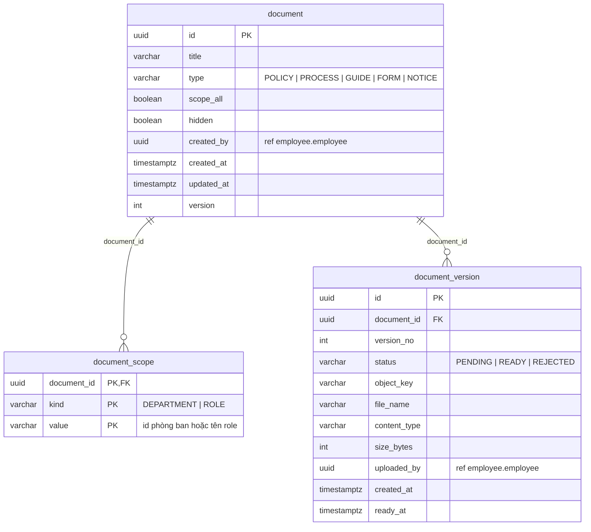

# Database schema – HRHelper (HR Enterprise Platform)

> Phụ lục của [SAD phần 2](SAD-2-software-architecture.md#6-dữ-liệu). Mô tả cấu trúc database **đúng như code hiện tại**:
> nguồn là các migration trong `backend/src/database/migrations/` và entity trong `backend/src/modules/**/*.entity.ts`.
> Khi hai nguồn lệch nhau, **migration là chuẩn** (database được tạo từ migration, `synchronize` luôn tắt).

| Phiên bản | Ngày | Người viết | Nội dung |
|---|---|---|---|
| 1.0 | 13/11/2026 | TV1 Duong | Bản đầu: 7 schema, 17 bảng, theo 4 migration tới `Documents` (tuần 10) |

## 1. Tổng quan

- **Một PostgreSQL 16, mỗi module một schema** (ADR-01 modular monolith, ADR-02 data ownership). Chạy local bằng
  docker-compose, staging dùng Amazon RDS.
- Extension: `pgcrypto` (hàm `gen_random_uuid()` sinh khóa uuid), `pg_trgm` (index trigram cho tìm kiếm danh bạ).
- Bảng tạo và đổi **chỉ qua migration** TypeORM (`npm run migration:run`), xem [mục 11](#11-lịch-sử-migration).

| Schema | Module sở hữu (`backend/src/modules/`) | Bảng | Tạo ở migration |
|---|---|---|---|
| `iam` | `identity` | `user_account`, `role_assignment` | InitSchemas |
| `org` | `organization` | `department`, `position` | InitSchemas |
| `employee` | `employee` | `employee`, `employee_sensitive` | InitSchemas |
| `leave` | `leave` | `leave_type`, `leave_balance`, `leave_request`, `leave_request_history`, `holiday`, `outbox` | InitSchemas, LeaveWorkflow, LeaveOutbox |
| `notification` | `worker` (notification worker) | `processed_event` | LeaveOutbox |
| `audit` | `audit` | `audit_log` | InitSchemas |
| `document` | `document` | `document`, `document_scope`, `document_version` | Documents |

## 2. Quy tắc thiết kế

1. **Không có foreign key chéo schema** ([CONVENTIONS mục 1](../CONVENTIONS.md#1-ranh-giới-module-quan-trọng-nhất), ADR-02).
   Cột trỏ sang bảng của module khác (ví dụ `employee.department_id` → `org.department`) chỉ là **tham chiếu logic**:
   kiểu `uuid`, không có `REFERENCES`, việc kiểm tra tồn tại do service của module sở hữu đảm nhận. Nhờ vậy sau này có
   thể chuyển một schema sang database riêng mà không phải gỡ ràng buộc. Danh sách đầy đủ ở [mục 9](#9-tham-chiếu-logic-chéo-schema).
2. **Foreign key trong cùng schema thì có** và được khai báo ở database (ví dụ `leave_request.leave_type_id` → `leave_type`).
3. **Khóa chính:** bảng nghiệp vụ dùng `uuid` sinh bằng `gen_random_uuid()`; bảng ghi nối tiếp (log, history, outbox) dùng
   `bigserial` để chèn nhanh và có thứ tự. Bảng quan hệ nhiều-nhiều hoặc theo năm dùng khóa chính ghép.
4. **Giá trị liệt kê** (status, role, loại…) lưu `varchar` + ràng buộc `CHECK (... IN (...))`, không dùng kiểu `enum` của
   PostgreSQL, để thêm giá trị chỉ cần một migration đổi `CHECK`.
5. **Thời gian** dùng `timestamptz` (lưu UTC); **ngày** (sinh nhật, ngày nghỉ) dùng `date`. **Số ngày phép** dùng
   `numeric(5,1)` để có nửa ngày (0.5) mà không sai số dấu phẩy động.
6. **Optimistic locking:** bảng sửa đồng thời được có cột `version` (`@VersionColumn` của TypeORM); request gửi `version` cũ
   thì API trả 409.
7. **Ràng buộc nghiệp vụ quan trọng đặt cả ở database** làm chốt chặn cuối nếu code sai: số dư phép không âm, audit không
   sửa được, ngày kết thúc không trước ngày bắt đầu… ([mục 10](#10-ràng-buộc-nghiệp-vụ-ở-database)).
8. Tên bảng, cột `snake_case`; entity map sang `camelCase` bằng `@Column({ name: ... })`.

Ký hiệu trong bảng cột bên dưới: **PK** khóa chính, **FK** foreign key (cùng schema), **UQ** unique, **ref** tham chiếu
logic chéo schema (không có ràng buộc), **NN** not null.

## 3. Sơ đồ ERD tổng thể

Đường liền là foreign key có trong database (cùng schema). Đường nét đứt là tham chiếu logic chéo schema, không có ràng buộc.
Sơ đồ chỉ ghi khóa; cột đầy đủ ở sơ đồ từng schema.

## 4. Schema `iam` – tài khoản và vai trò

Liên kết người đăng nhập (subject từ Keycloak/Cognito) với hồ sơ nhân viên, và lưu vai trò. Role `MANAGER` được suy ra từ
việc có cấp dưới trực tiếp (ADR-10), không bắt buộc phải có dòng trong `role_assignment`.

### `iam.user_account`

| Cột | Kiểu | Ràng buộc | Mô tả |
|---|---|---|---|
| `id` | uuid | PK, mặc định `gen_random_uuid()` | Mã tài khoản |
| `subject` | varchar(255) | UQ, cho phép NULL | Claim `sub` của token OIDC. NULL khi tài khoản mới tạo chưa đăng nhập lần nào; điền ở lần đăng nhập đầu |
| `email` | varchar(150) | NN, UQ | Email đăng nhập, dùng để ghép với hồ sơ nhân viên |
| `employee_id` | uuid | ref → `employee.employee.id` | Hồ sơ nhân viên của tài khoản; NULL với tài khoản kỹ thuật/admin không có hồ sơ |
| `last_login_at` | timestamptz | | Lần đăng nhập gần nhất |
| `created_at` | timestamptz | NN, mặc định `now()` | |

### `iam.role_assignment`

| Cột | Kiểu | Ràng buộc | Mô tả |
|---|---|---|---|
| `user_id` | uuid | PK (1/2), FK → `iam.user_account.id` `ON DELETE CASCADE` | Xóa tài khoản thì xóa luôn vai trò |
| `role` | varchar(20) | PK (2/2), CHECK `EMPLOYEE`, `MANAGER`, `HR`, `ADMIN` | Một tài khoản có nhiều vai trò, mỗi vai trò một dòng |
| `scope_department_id` | uuid | ref → `org.department.id` | Dự phòng cho vai trò giới hạn theo phòng ban; **hiện code chưa dùng** |

## 5. Schema `org` – cơ cấu tổ chức

### `org.department`

| Cột | Kiểu | Ràng buộc | Mô tả |
|---|---|---|---|
| `id` | uuid | PK, mặc định `gen_random_uuid()` | |
| `code` | varchar(20) | NN, UQ | Mã phòng ban, ví dụ `ENG` |
| `name` | varchar(150) | NN | Tên phòng ban |
| `office` | varchar(50) | NN | Văn phòng (HN, HCM…) |
| `parent_id` | uuid | FK → `org.department.id` | Phòng ban cha; NULL là gốc cây. Service chặn tạo vòng |
| `head_employee_id` | uuid | ref → `employee.employee.id` | Trưởng phòng |
| `created_at`, `updated_at` | timestamptz | NN, mặc định `now()` | |

Index: `ix_department_parent (parent_id)` để lấy cây tổ chức và phòng ban con.

### `org.position`

| Cột | Kiểu | Ràng buộc | Mô tả |
|---|---|---|---|
| `id` | uuid | PK, mặc định `gen_random_uuid()` | |
| `code` | varchar(20) | NN, UQ | Mã chức danh |
| `title` | varchar(100) | NN | Tên chức danh |
| `level` | smallint | NN, CHECK `level BETWEEN 1 AND 10` | Cấp bậc |

## 6. Schema `employee` – hồ sơ nhân viên

### `employee.employee`

| Cột | Kiểu | Ràng buộc | Mô tả |
|---|---|---|---|
| `id` | uuid | PK, mặc định `gen_random_uuid()` | |
| `employee_code` | varchar(20) | NN, UQ | Mã nhân viên |
| `full_name` | varchar(150) | NN | Họ tên |
| `work_email` | varchar(150) | NN, UQ | Email công ty |
| `phone` | varchar(20) | | Nhân viên tự sửa được |
| `date_of_birth` | date | | |
| `address` | varchar(255) | | Nhân viên tự sửa được |
| `department_id` | uuid | NN, ref → `org.department.id` | Phòng ban; kiểm tra qua `OrganizationService` |
| `position_id` | uuid | NN, ref → `org.position.id` | Chức danh |
| `manager_id` | uuid | FK → `employee.employee.id`, CHECK `manager_id <> id` | Quản lý trực tiếp; là cơ sở suy ra role MANAGER và người duyệt đơn nghỉ |
| `hire_date` | date | NN | Ngày vào làm |
| `status` | varchar(20) | NN, mặc định `ACTIVE`, CHECK `ACTIVE`, `ON_LEAVE`, `TERMINATED` | Trạng thái làm việc |
| `version` | integer | NN, mặc định 1 | Optimistic locking |
| `created_at`, `updated_at` | timestamptz | NN, mặc định `now()` | |

Index:

- `ix_employee_department (department_id)` – danh sách thành viên phòng ban, lọc danh bạ theo phòng.
- `ix_employee_manager (manager_id)` – lấy cấp dưới trực tiếp.
- `ix_employee_search` – GIN trigram trên `lower(full_name || ' ' || work_email || ' ' || employee_code)`, cho tìm kiếm
  danh bạ `ILIKE '%từ khóa%'` nhanh trên 2.000+ nhân viên.

### `employee.employee_sensitive`

Tách khỏi `employee` để query danh bạ không bao giờ đọc nhầm trường nhạy cảm. Giá trị được mã hóa AES-256-GCM bằng
`FieldCrypto` (`backend/src/common/field-crypto.ts`) trước khi ghi (ADR-08); audit chỉ ghi **tên** trường đã đổi.

| Cột | Kiểu | Ràng buộc | Mô tả |
|---|---|---|---|
| `employee_id` | uuid | PK, FK → `employee.employee.id` `ON DELETE CASCADE` | Quan hệ 1-1 với hồ sơ |
| `national_id_enc` | text | | Số CCCD đã mã hóa |
| `bank_account_enc` | text | | Số tài khoản ngân hàng đã mã hóa |
| `salary_enc` | text | | Lương đã mã hóa |
| `updated_at` | timestamptz | NN, mặc định `now()` | |

## 7. Schema `leave` – nghỉ phép và outbox

### `leave.leave_type`

| Cột | Kiểu | Ràng buộc | Mô tả |
|---|---|---|---|
| `id` | uuid | PK, mặc định `gen_random_uuid()` | |
| `code` | varchar(20) | NN, UQ | Mã loại phép (danh mục ở [leave-types-holidays](../business/leave-types-holidays.md)) |
| `name` | varchar(100) | NN | Tên loại phép |
| `max_days_per_year` | numeric(5,1) | NN, CHECK `>= 0` | Số ngày tối đa mỗi năm |

### `leave.leave_balance`

Mỗi nhân viên, mỗi loại phép, mỗi năm một dòng.

| Cột | Kiểu | Ràng buộc | Mô tả |
|---|---|---|---|
| `employee_id` | uuid | PK (1/3), ref → `employee.employee.id` | |
| `leave_type_id` | uuid | PK (2/3), FK → `leave.leave_type.id` | |
| `year` | smallint | PK (3/3) | Năm áp dụng |
| `entitled` | numeric(5,1) | NN, mặc định 0 | Số ngày được hưởng |
| `used` | numeric(5,1) | NN, mặc định 0 | Đã dùng (đơn đã duyệt) |
| `pending` | numeric(5,1) | NN, mặc định 0 | Đang giữ chỗ cho đơn `SUBMITTED` |

CHECK: `used >= 0 AND pending >= 0 AND used + pending <= entitled` – không bao giờ xin quá số dư, kể cả khi hai request chạy
song song.

### `leave.leave_request`

| Cột | Kiểu | Ràng buộc | Mô tả |
|---|---|---|---|
| `id` | uuid | PK, mặc định `gen_random_uuid()` | |
| `employee_id` | uuid | NN, ref → `employee.employee.id` | Người xin nghỉ |
| `leave_type_id` | uuid | NN, FK → `leave.leave_type.id` | |
| `start_date`, `end_date` | date | NN, CHECK `end_date >= start_date` | Khoảng nghỉ |
| `half_day` | varchar(2) | CHECK `AM`, `PM`; CHECK `ck_leave_request_half_day_single`: chỉ khi `start_date = end_date` | Nghỉ nửa ngày (BR-04); NULL là nghỉ cả ngày |
| `days` | numeric(5,1) | NN, CHECK `> 0` | Số ngày trừ phép, đã bỏ cuối tuần và ngày lễ (BR-03) |
| `reason` | varchar(500) | | Lý do |
| `status` | varchar(20) | NN, CHECK `SUBMITTED`, `APPROVED`, `REJECTED`, `COMPLETED`, `CANCELLED` | Trạng thái theo state machine (`leave-state-machine.ts`) |
| `approver_id` | uuid | ref → `employee.employee.id` | Người đã ra quyết định; NULL khi đơn còn chờ hoặc nhân viên chưa có người duyệt hợp lệ (BR-06) |
| `version` | integer | NN, mặc định 1 | Optimistic locking: hai người duyệt cùng lúc thì một người nhận 409 |
| `idempotency_key` | varchar(100) | NN; UQ `(employee_id, idempotency_key)` | Header `Idempotency-Key`: bấm gửi hai lần chỉ tạo một đơn |
| `created_at`, `updated_at` | timestamptz | NN, mặc định `now()` | |

Index: `ix_leave_request_employee (employee_id, status)` – "đơn của tôi"; `ix_leave_request_approver (approver_id, status)`
– tra đơn theo người duyệt.

### `leave.leave_request_history`

Lịch sử chuyển trạng thái của đơn, chỉ chèn thêm.

| Cột | Kiểu | Ràng buộc | Mô tả |
|---|---|---|---|
| `id` | bigserial | PK | |
| `request_id` | uuid | NN, FK → `leave.leave_request.id` | |
| `from_status` | varchar(20) | | NULL ở bước tạo đơn |
| `to_status` | varchar(20) | NN | |
| `actor_id` | uuid | NN, ref → `employee.employee.id` | Người thực hiện |
| `comment` | varchar(500) | | Ghi chú khi duyệt/từ chối |
| `at` | timestamptz | NN, mặc định `now()` | |

### `leave.holiday`

Ngày lễ không trừ phép (BR-03). Migration `LeaveWorkflow` nạp sẵn 13 ngày lễ năm 2026.

| Cột | Kiểu | Ràng buộc | Mô tả |
|---|---|---|---|
| `holiday_date` | date | PK | Ngày lễ |
| `name` | varchar(100) | NN | Tên ngày lễ |

### `leave.outbox`

Transactional outbox: event ghi **cùng transaction** với thao tác nghiệp vụ, publisher đọc dòng chưa gửi và đẩy lên
RabbitMQ (SQS trên staging), nên không có chuyện đơn đã duyệt mà mất thông báo.

| Cột | Kiểu | Ràng buộc | Mô tả |
|---|---|---|---|
| `id` | bigserial | PK | Cũng là id event gửi đi (dùng để chống trùng ở worker) |
| `event_type` | varchar(50) | NN | `LeaveRequested`, `LeaveApproved`, `LeaveRejected`, `LeaveCancelled`, `LeaveCompleted` |
| `aggregate_id` | uuid | NN, ref → `leave.leave_request.id` | Đơn phát sinh event |
| `payload` | jsonb | NN | Nội dung event (`leave-events.ts`) |
| `created_at` | timestamptz | NN, mặc định `now()` | |
| `published_at` | timestamptz | | NULL là chưa gửi |
| `attempts` | integer | NN, mặc định 0 | Số lần gửi thử |
| `last_error` | varchar(500) | | Lỗi lần gửi gần nhất |

Index một phần: `ix_leave_outbox_unpublished (id) WHERE published_at IS NULL` – publisher chỉ quét dòng chưa gửi, bảng
lớn dần cũng không chậm.

## 8. Schema `notification`, `audit`, `document`

### `notification.processed_event`

Notification worker ghi event đã xử lý để bỏ qua bản trùng (hàng đợi giao **ít nhất một lần**).

| Cột | Kiểu | Ràng buộc | Mô tả |
|---|---|---|---|
| `event_id` | varchar(100) | PK | = `leave.outbox.id` dạng chuỗi |
| `event_type` | varchar(50) | NN | |
| `processed_at` | timestamptz | NN, mặc định `now()` | |

### `audit.audit_log`

Append-only (ADR-09): trigger `trg_audit_append_only` gọi hàm `audit.forbid_change()` và báo lỗi với mọi `UPDATE`/`DELETE`.
Ghi trong cùng transaction với thao tác nghiệp vụ (`AuditService.record(entry, manager)`).

| Cột | Kiểu | Ràng buộc | Mô tả |
|---|---|---|---|
| `id` | bigserial | PK | |
| `actor_id` | uuid | ref → `employee.employee.id` | Người thực hiện; NULL với tác vụ hệ thống |
| `action` | varchar(50) | NN | Ví dụ `CREATE`, `UPDATE`, `VIEW_SENSITIVE`, `LEAVE_SUBMIT`, `DOCUMENT_PUBLISH` |
| `entity_type` | varchar(50) | NN | Loại đối tượng bị tác động |
| `entity_id` | varchar(64) | NN | Id đối tượng (chuỗi để chứa được cả uuid và số) |
| `changed_fields` | jsonb | | Trường đã đổi; với trường nhạy cảm chỉ ghi tên, không ghi giá trị |
| `ip` | varchar(64) | | IP client |
| `trace_id` | varchar(64) | | Trùng `traceId` trong log và response lỗi, để lần theo một request |
| `at` | timestamptz | NN, mặc định `now()` | |

Index: `ix_audit_entity (entity_type, entity_id, at)` – lịch sử một đối tượng; `ix_audit_actor (actor_id, at)` – việc một
người đã làm.

### Schema `document` – kho tài liệu HR (UC5)

Quy tắc nghiệp vụ ở [document-rules](../business/document-rules.md).

**`document.document`** – metadata tài liệu.

| Cột | Kiểu | Ràng buộc | Mô tả |
|---|---|---|---|
| `id` | uuid | PK, mặc định `gen_random_uuid()` | |
| `title` | varchar(200) | NN | |
| `type` | varchar(20) | NN, CHECK `POLICY`, `PROCESS`, `GUIDE`, `FORM`, `NOTICE` | Loại tài liệu |
| `scope_all` | boolean | NN, mặc định false | true: cả công ty xem được |
| `hidden` | boolean | NN, mặc định false | Ẩn thay vì xóa |
| `created_by` | uuid | ref → `employee.employee.id` | |
| `created_at`, `updated_at` | timestamptz | NN, mặc định `now()` | |
| `version` | integer | NN, mặc định 1 | Optimistic locking (khác `version_no` của file) |

**`document.document_scope`** – phạm vi được xem, cộng dồn (DR-02).

| Cột | Kiểu | Ràng buộc | Mô tả |
|---|---|---|---|
| `document_id` | uuid | PK (1/3), FK → `document.document.id` `ON DELETE CASCADE` | |
| `kind` | varchar(12) | PK (2/3), CHECK `DEPARTMENT`, `ROLE` | |
| `value` | varchar(64) | PK (3/3) | `kind = DEPARTMENT`: id `org.department` dạng chuỗi (ref); `kind = ROLE`: tên role |

Index: `ix_document_scope_value (kind, value)` – lọc tài liệu người dùng được xem theo phòng ban/role.

**`document.document_version`** – mỗi file tải lên là một phiên bản mới, không ghi đè (DR-04). File nằm ở object storage
(MinIO local, S3 staging), bảng chỉ giữ `object_key`.

| Cột | Kiểu | Ràng buộc | Mô tả |
|---|---|---|---|
| `id` | uuid | PK, mặc định `gen_random_uuid()` | |
| `document_id` | uuid | NN, FK → `document.document.id` `ON DELETE CASCADE` | |
| `version_no` | integer | NN; UQ `(document_id, version_no)` | Số phiên bản 1, 2, 3… |
| `status` | varchar(10) | NN, mặc định `PENDING`, CHECK `PENDING`, `READY`, `REJECTED` | `PENDING` khi đã cấp URL upload nhưng chưa xác nhận file |
| `object_key` | varchar(300) | NN | Khóa object trong bucket |
| `file_name` | varchar(255) | NN | Tên file gốc |
| `content_type` | varchar(100) | NN | MIME type |
| `size_bytes` | integer | NN | Dung lượng |
| `uploaded_by` | uuid | ref → `employee.employee.id` | |
| `created_at` | timestamptz | NN, mặc định `now()` | |
| `ready_at` | timestamptz | | Thời điểm chuyển `READY` |

## 9. Tham chiếu logic chéo schema

Không có foreign key, nên **service của module sở hữu cột** phải kiểm tra đối tượng tồn tại (qua service được `exports` của
module kia), và xóa/đổi ở module kia không tự lan sang. Hiện hệ thống không xóa cứng nhân viên hay phòng ban (nhân viên
nghỉ việc chuyển `TERMINATED`), nên không phát sinh tham chiếu treo.

| Cột | Trỏ tới | Ghi chú |
|---|---|---|
| `iam.user_account.employee_id` | `employee.employee.id` | Ghép theo email khi đăng nhập |
| `iam.role_assignment.scope_department_id` | `org.department.id` | Chưa dùng |
| `org.department.head_employee_id` | `employee.employee.id` | |
| `employee.employee.department_id` | `org.department.id` | Kiểm tra qua `OrganizationService` |
| `employee.employee.position_id` | `org.position.id` | Kiểm tra qua `OrganizationService` |
| `leave.leave_balance.employee_id` | `employee.employee.id` | |
| `leave.leave_request.employee_id`, `approver_id` | `employee.employee.id` | |
| `leave.leave_request_history.actor_id` | `employee.employee.id` | |
| `notification.processed_event.event_id` | `leave.outbox.id` | Dạng chuỗi |
| `audit.audit_log.actor_id` | `employee.employee.id` | |
| `audit.audit_log.entity_id` | Bảng theo `entity_type` | Đa hình |
| `document.document.created_by`, `document_version.uploaded_by` | `employee.employee.id` | |
| `document.document_scope.value` (khi `kind = DEPARTMENT`) | `org.department.id` | Dạng chuỗi |

## 10. Ràng buộc nghiệp vụ ở database

| Ràng buộc | Bảng | Bảo vệ điều gì |
|---|---|---|
| `used + pending <= entitled`, `used >= 0`, `pending >= 0` | `leave.leave_balance` | Không xin/duyệt quá số dư, kể cả khi code lỗi hoặc request song song |
| `end_date >= start_date`, `days > 0` | `leave.leave_request` | Đơn có khoảng ngày hợp lệ |
| `half_day` chỉ khi một ngày | `leave.leave_request` | Nửa ngày không áp cho đơn nhiều ngày |
| UQ `(employee_id, idempotency_key)` | `leave.leave_request` | Gửi trùng không tạo hai đơn |
| `manager_id <> id` | `employee.employee` | Không tự làm quản lý của mình |
| Trigger `trg_audit_append_only` | `audit.audit_log` | Không sửa, không xóa log |
| UQ `(document_id, version_no)` | `document.document_version` | Không có hai file cùng số phiên bản |

## 11. Lịch sử migration

| Migration | Tuần | Thay đổi |
|---|---|---|
| `1729900000000-InitSchemas` | 7 | Extension `pgcrypto`, `pg_trgm`; schema `iam`, `org`, `employee`, `leave`, `audit`; 11 bảng; trigger append-only cho audit |
| `1730200000000-LeaveWorkflow` | 8 | Bảng `leave.holiday` + dữ liệu lễ 2026; cột `leave_request.half_day`; `approver_id` cho phép NULL |
| `1730400000000-LeaveOutbox` | 8 | Bảng `leave.outbox` + index một phần; schema `notification`, bảng `processed_event` |
| `1731300000000-Documents` | 10 | Schema `document`: `document`, `document_scope`, `document_version` |

Lệnh: `npm run migration:run` (dev, ts-node), `npm run migration:run:prod` (bản build, dùng trên staging),
`npm run migration:revert` (lùi một migration). Dữ liệu mẫu: `npm run seed`.

**Khi viết migration mới:** theo [CONVENTIONS mục 5](../CONVENTIONS.md#5-database-và-migration), sửa entity tương ứng, và
**cập nhật file này trong cùng PR** (bảng cột, sơ đồ, mục 11).
