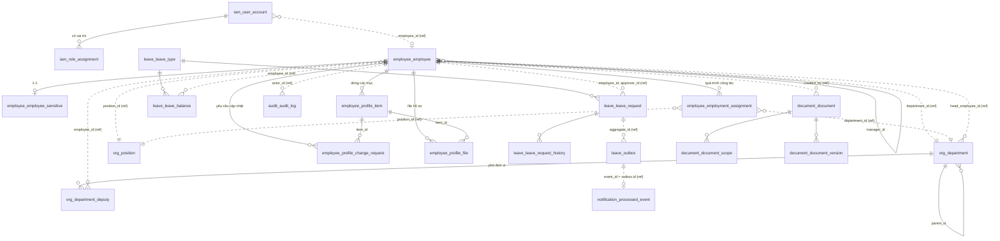
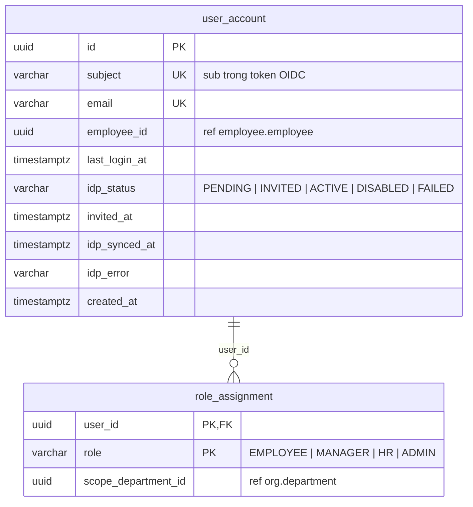
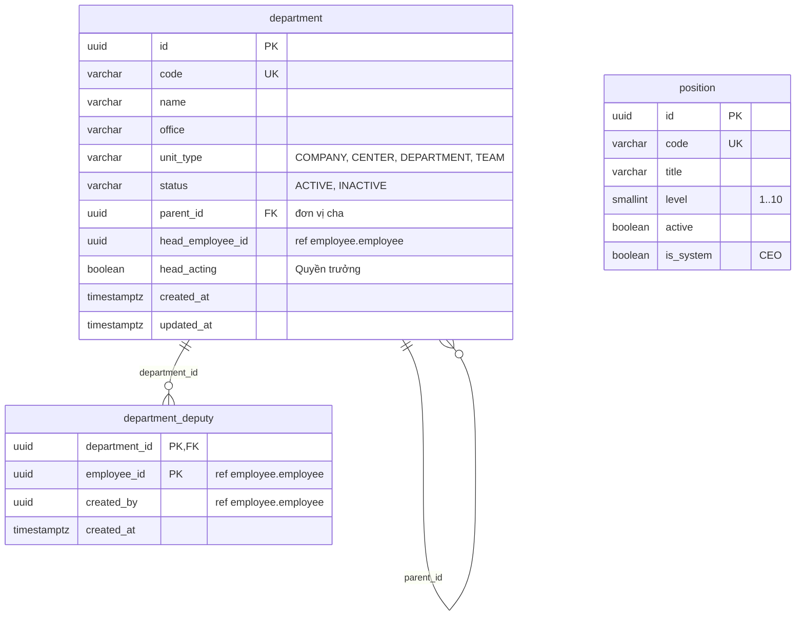
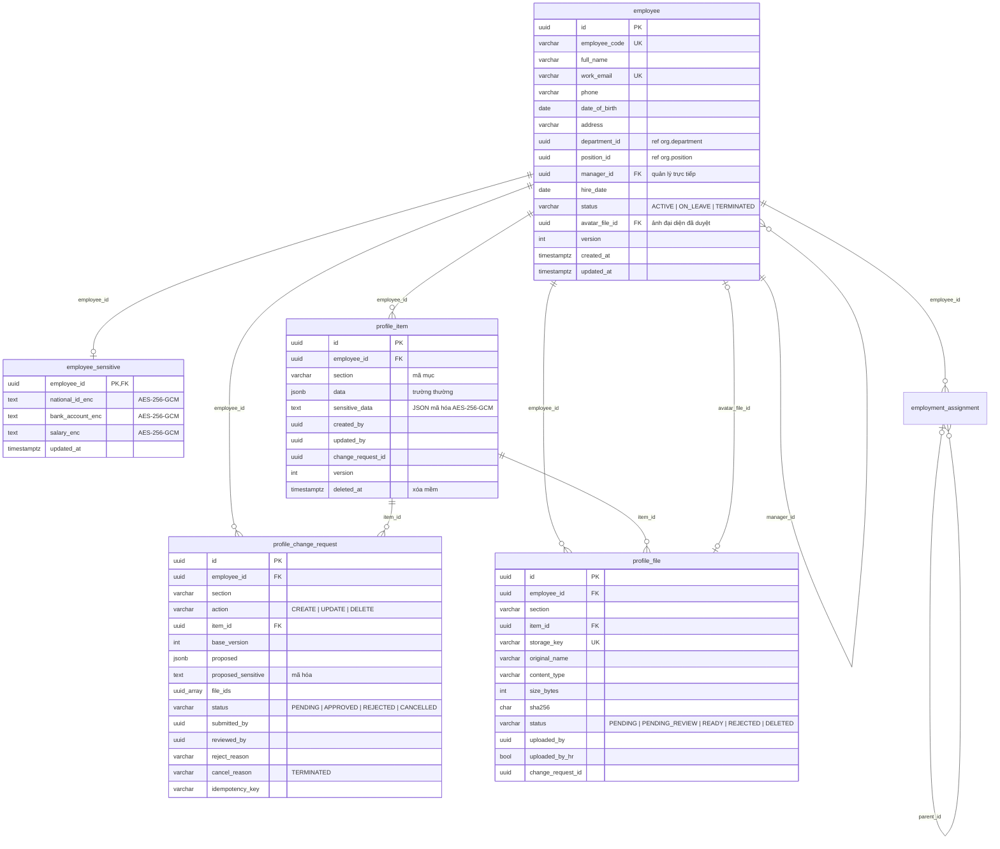
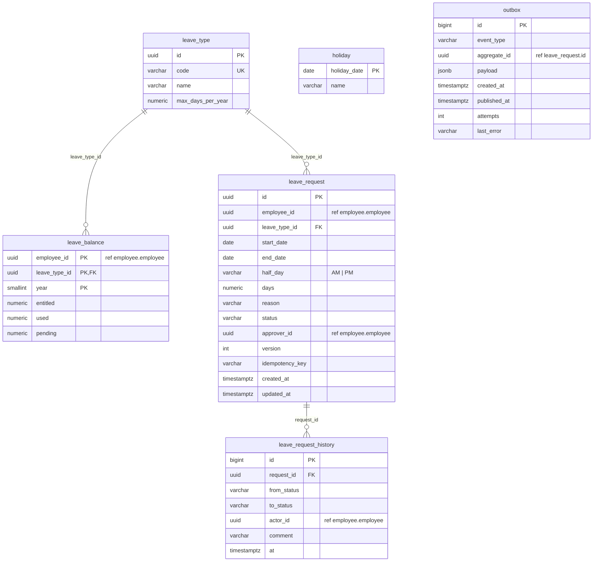
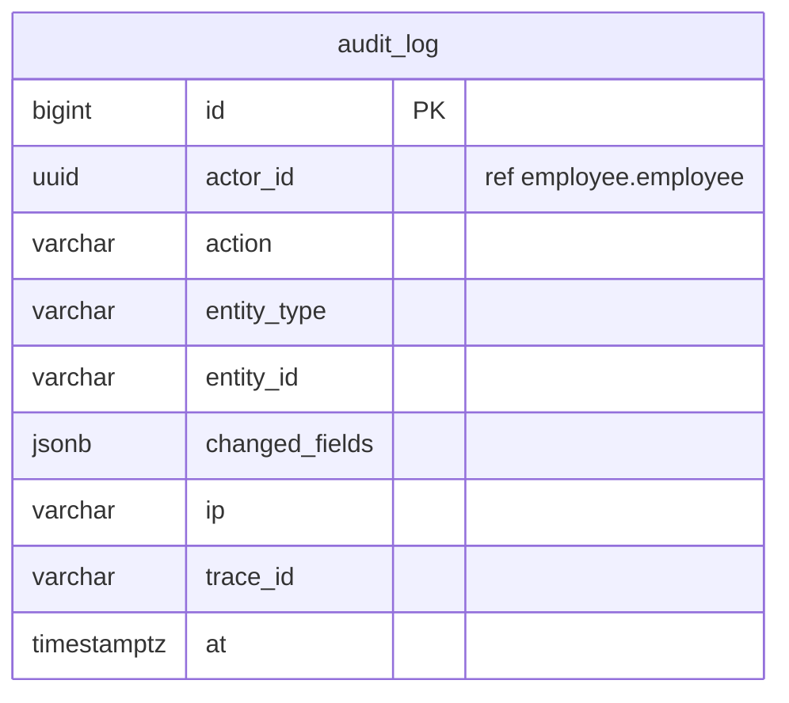
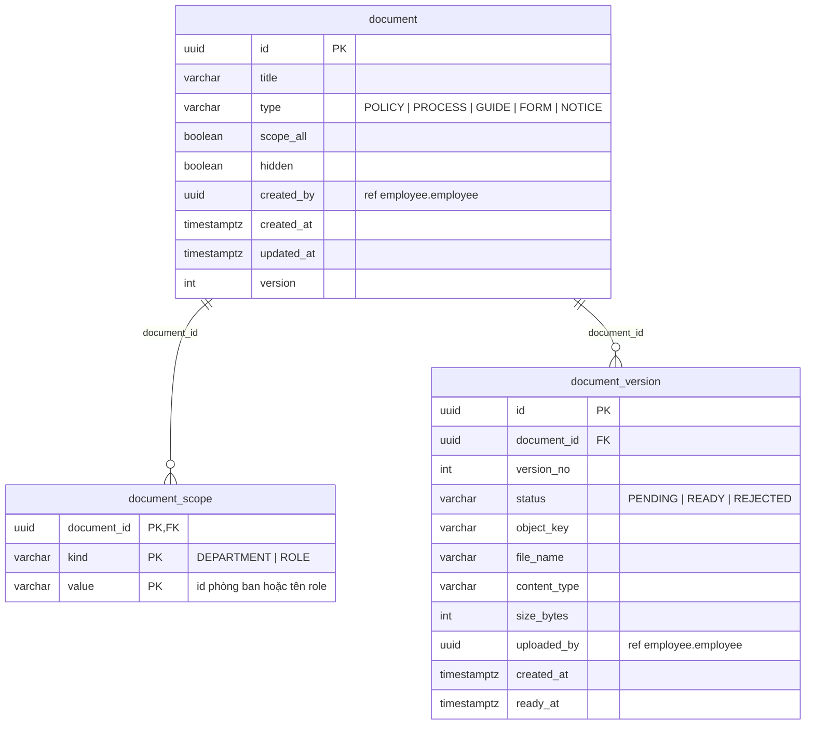

# Database schema – HRHelper (HR Enterprise Platform)

> Phụ lục của [SAD phần 2](SAD-2-software-architecture.md#6-dữ-liệu). Mô tả cấu trúc database **đúng như code hiện tại**:
> nguồn là các migration trong `backend/src/database/migrations/` và entity trong `backend/src/modules/**/*.entity.ts`.
> Khi hai nguồn lệch nhau, **migration là chuẩn** (database được tạo từ migration, `synchronize` luôn tắt).

| Phiên bản | Ngày | Người viết | Nội dung |
|---|---|---|---|
| 1.0 | 13/11/2026 | TV1 Duong | Bản đầu: 7 schema, 17 bảng, theo 4 migration tới `Documents` (tuần 10) |
| 1.1 | 18/11/2026 | TV1 Duong | UC1: thêm `iam.rate_limit_counter`, `employee.profile_item`, `employee.profile_change_request`, `employee.profile_file`, cột `employee.avatar_file_id` (3 migration, #85 → #87); đọc, ghi chéo schema trong code (mục 9) |
| 1.2 | 25/11/2026 | TV1 Duong (Claude viết) | Migration `ExceptionGuards`: trigger `trg_audit_no_truncate`, cột `employee.profile_change_request.cancel_reason` (UC7 E10, UC1 E29) |

## 1. Tổng quan

- **Một PostgreSQL 16, mỗi module một schema** (ADR-01 modular monolith, ADR-02 data ownership). Chạy local bằng
  docker-compose, staging dùng Amazon RDS.
- Extension: `pgcrypto` (hàm `gen_random_uuid()` sinh khóa uuid), `pg_trgm` (index trigram cho tìm kiếm danh bạ), `vector`
  (pgvector, embedding của trợ lý UC6), `unaccent` (full-text không dấu). Local dùng image `infra/postgres-pgvector`
  (postgres:16-alpine thêm pgvector).
- Bảng tạo và đổi **chỉ qua migration** TypeORM (`npm run migration:run`), xem [mục 11](#11-lịch-sử-migration).

| Schema | Module sở hữu (`backend/src/modules/`) | Bảng | Tạo ở migration |
|---|---|---|---|
| `iam` | `identity`; `common/rate-limit` | `user_account`, `role_assignment`, `rate_limit_counter` | InitSchemas, RateLimitCounter |
| `org` | `organization` | `department`, `department_deputy`, `position` | InitSchemas, OrgUnitTypes, OrgUnitRoles |
| `employee` | `employee` | `employee`, `employee_sensitive`, `profile_item`, `profile_change_request`, `profile_file`, `employment_assignment` | InitSchemas, ProfileChangeRequests, ProfileFiles, EmploymentAssignment |
| `leave` | `leave` | `leave_type`, `leave_balance`, `leave_request`, `leave_request_history`, `holiday`, `outbox` | InitSchemas, LeaveWorkflow, LeaveOutbox |
| `notification` | `worker` (notification worker) | `processed_event` | LeaveOutbox |
| `audit` | `audit` | `audit_log` | InitSchemas |
| `document` | `document` | `document`, `document_scope`, `document_version` | Documents |
| `assistant` | Assistant service (`services/assistant/`, ngoài backend) | `document`, `chunk`, `chunk_embedding`, `processed_event` | AssistantSchema |

## 2. Quy tắc thiết kế

1. **Không có foreign key chéo schema** ([CONVENTIONS mục 1](../CONVENTIONS.md#1-ranh-giới-module-quan-trọng-nhất), ADR-02).
   Cột trỏ sang bảng của module khác (ví dụ `employee.department_id` → `org.department`) chỉ là **tham chiếu logic**:
   kiểu `uuid`, không có `REFERENCES`, việc kiểm tra tồn tại do service của module sở hữu đảm nhận. Nhờ vậy sau này có
   thể chuyển một schema sang database riêng mà không phải gỡ ràng buộc. Danh sách đầy đủ ở [mục 9](#9-tham-chiếu-logic-chéo-schema).
2. **Foreign key trong cùng schema thì có** và được khai báo ở database (ví dụ `leave_request.leave_type_id` → `leave_type`).
3. **Khóa chính:** bảng nghiệp vụ dùng `uuid` sinh bằng `gen_random_uuid()`; bảng ghi nối tiếp (log, history, outbox) dùng
   `bigserial` để chèn nhanh và có thứ tự. Bảng quan hệ nhiều-nhiều hoặc theo năm dùng khóa chính ghép.
4. **Giá trị liệt kê** (status, role, loại…) lưu `varchar` + ràng buộc `CHECK (... IN (...))`, không dùng kiểu `enum` của
   PostgreSQL, để thêm giá trị chỉ cần một migration đổi `CHECK`.
5. **Thời gian** dùng `timestamptz` (lưu UTC); **ngày** (sinh nhật, ngày nghỉ) dùng `date`. **Số ngày phép** dùng
   `numeric(5,1)` để có nửa ngày (0.5) mà không sai số dấu phẩy động.
6. **Optimistic locking:** bảng sửa đồng thời được có cột `version` (`@VersionColumn` của TypeORM); request gửi `version` cũ
   thì API trả 409.
7. **Ràng buộc nghiệp vụ quan trọng đặt cả ở database** làm chốt chặn cuối nếu code sai: số dư phép không âm, audit không
   sửa được, ngày kết thúc không trước ngày bắt đầu… ([mục 10](#10-ràng-buộc-nghiệp-vụ-ở-database)).
8. Tên bảng, cột `snake_case`; entity map sang `camelCase` bằng `@Column({ name: ... })`.

Ký hiệu trong bảng cột bên dưới: **PK** khóa chính, **FK** foreign key (cùng schema), **UQ** unique, **ref** tham chiếu
logic chéo schema (không có ràng buộc), **NN** not null.

## 3. Sơ đồ ERD tổng thể

Đường liền là foreign key có trong database (cùng schema). Đường nét đứt là tham chiếu logic chéo schema, không có ràng buộc.
Sơ đồ chỉ ghi khóa; cột đầy đủ ở sơ đồ từng schema.

## 4. Schema `iam` – tài khoản và vai trò

Liên kết người đăng nhập (subject từ Keycloak/Cognito) với hồ sơ nhân viên, và lưu vai trò. Role `MANAGER` được suy ra từ
việc có cấp dưới trực tiếp (ADR-10), không bắt buộc phải có dòng trong `role_assignment`.

### `iam.user_account`

| Cột | Kiểu | Ràng buộc | Mô tả |
|---|---|---|---|
| `id` | uuid | PK, mặc định `gen_random_uuid()` | Mã tài khoản |
| `subject` | varchar(255) | UQ, cho phép NULL | Claim `sub` của token OIDC. NULL khi tài khoản mới tạo chưa đăng nhập lần nào; điền ở lần đăng nhập đầu |
| `email` | varchar(150) | NN, UQ | Email đăng nhập, dùng để ghép với hồ sơ nhân viên |
| `employee_id` | uuid | ref → `employee.employee.id` | Hồ sơ nhân viên của tài khoản; NULL với tài khoản kỹ thuật/admin không có hồ sơ |
| `last_login_at` | timestamptz | | Lần đăng nhập gần nhất |
| `idp_status` | varchar(10) | NN, mặc định `ACTIVE`, CHECK `PENDING`, `INVITED`, `ACTIVE`, `DISABLED`, `FAILED` | Trạng thái tài khoản trên IdP (UC8 FR-8.6). `PENDING` khi hồ sơ vừa tạo hoặc HR vừa bấm gửi lời mời; worker `identity-sync` chuyển sang `INVITED`, `ACTIVE` (email đã có trên IdP), `DISABLED` (nghỉ việc) hoặc `FAILED`. Đăng nhập lần đầu chuyển `PENDING`, `INVITED`, `FAILED` thành `ACTIVE`. Dòng có trước UC8 là `ACTIVE`. "Chưa có tài khoản" (`NONE`) không lưu: là khi hồ sơ chưa có dòng |
| `invited_at` | timestamptz | | Lần gửi thư mời gần nhất |
| `idp_synced_at` | timestamptz | | Lần đồng bộ IdP thành công gần nhất |
| `idp_error` | varchar(40) | | Mã lỗi lần đồng bộ hỏng gần nhất (`IDP_UNAVAILABLE`, `IDP_REJECTED`, `IDP_USER_NOT_FOUND`), không chứa thông báo gốc của IdP. Xóa khi đồng bộ thành công hoặc HR gửi lại lời mời |
| `created_at` | timestamptz | NN, mặc định `now()` | |

Index `ix_user_account_idp_status (idp_status)`. Migration `AccountLifecycle`.

### `iam.role_assignment`

| Cột | Kiểu | Ràng buộc | Mô tả |
|---|---|---|---|
| `user_id` | uuid | PK (1/2), FK → `iam.user_account.id` `ON DELETE CASCADE` | Xóa tài khoản thì xóa luôn vai trò |
| `role` | varchar(20) | PK (2/2), CHECK `EMPLOYEE`, `MANAGER`, `HR`, `ADMIN` | Một tài khoản có nhiều vai trò, mỗi vai trò một dòng |
| `scope_department_id` | uuid | ref → `org.department.id` | Dự phòng cho vai trò giới hạn theo phòng ban; **hiện code chưa dùng** |
| `granted_by` | uuid | FK → `iam.user_account.id` `ON DELETE SET NULL` | ADMIN đã cấp (UC8 FR-8.7). NULL với dòng seed, lệnh `grant-admin`, dòng có trước UC8 |
| `granted_at` | timestamptz | NN, mặc định `now()` | Lúc cấp |
| `reason` | varchar(200) | | Lý do cấp (5 – 200 ký tự khi cấp qua API) |

Index `ix_role_assignment_role (role)` cho trang Phân quyền. API chỉ ghi `HR`, `ADMIN`; `IdentityService` bỏ qua dòng `EMPLOYEE`,
`MANAGER` nếu có (hai vai trò này luôn suy ra, ADR-18). Thu hồi xóa dòng; lịch sử ở audit `ROLE_GRANT`, `ROLE_REVOKE`. Migration
`RoleAssignmentAudit`.

### `iam.rate_limit_counter`

Bộ đếm giới hạn tần suất theo **ngày** (NFR-5.21, UC1 FR-1.14). Giới hạn theo phút, giờ đếm trong bộ nhớ từng instance; giới
hạn ngày cần đúng khi App Runner chạy nhiều instance nên đếm ở đây (ADR-07 không dùng Redis). Không có dữ liệu nghiệp vụ;
`RateLimitService` thỉnh thoảng xóa cửa sổ cũ hơn 2 ngày.

| Cột | Kiểu | Ràng buộc | Mô tả |
|---|---|---|---|
| `key` | varchar(200) | PK (1/2) | `<userId>:<nhóm>:day`, ví dụ `…:profile-write:day` |
| `window_start` | timestamptz | PK (2/2) | Đầu ngày (UTC) của cửa sổ |
| `count` | integer | NN, mặc định 0 | Số lượt trong cửa sổ; tăng bằng `INSERT … ON CONFLICT DO UPDATE` |

Index: `ix_rate_limit_counter_window (window_start)` để dọn cửa sổ cũ.

## 5. Schema `org` – cơ cấu tổ chức

### `org.department`

| Cột | Kiểu | Ràng buộc | Mô tả |
|---|---|---|---|
| `id` | uuid | PK, mặc định `gen_random_uuid()` | |
| `code` | varchar(20) | NN, UQ | Mã phòng ban, ví dụ `ENG` |
| `name` | varchar(150) | NN | Tên phòng ban |
| `office` | varchar(50) | NN | Văn phòng (HN, HCM…) |
| `unit_type` | varchar(12) | NN, CHECK `COMPANY`/`CENTER`/`DEPARTMENT`/`TEAM` | Loại đơn vị ([ADR-14](adr/ADR-14-org-unit-types.md)). Luật loại cha, loại con kiểm ở service (`unit-rules.ts`) |
| `status` | varchar(10) | NN, mặc định `ACTIVE`, CHECK `ACTIVE`/`INACTIVE` | Đơn vị ngừng hoạt động ẩn khỏi cây (FR-2.10) |
| `parent_id` | uuid | FK → `org.department.id` | Đơn vị cha; NULL là gốc cây. Service chặn tạo vòng |
| `head_employee_id` | uuid | ref → `employee.employee.id` | Trưởng đơn vị (người của đơn vị hoặc đơn vị cha, kiểm ở service) |
| `head_acting` | boolean | NN, mặc định `false` | "Quyền trưởng" (FR-2.9) |
| `created_at`, `updated_at` | timestamptz | NN, mặc định `now()` | |

Index: `ix_department_parent (parent_id)` để lấy cây tổ chức và phòng ban con; `ix_department_head (head_employee_id) WHERE
head_employee_id IS NOT NULL` để tìm vai trò trưởng của một người (điều chuyển, nghỉ việc); `ux_department_company` (unique, chỉ dòng
`unit_type = 'COMPANY'`) bảo đảm đúng một Công ty. CHECK `ck_department_company_root`: Công ty khi và chỉ khi `parent_id` NULL.

### `org.department_deputy`

| Cột | Kiểu | Ràng buộc | Mô tả |
|---|---|---|---|
| `department_id` | uuid | PK, FK → `org.department.id` | Đơn vị |
| `employee_id` | uuid | PK, ref → `employee.employee.id` | Phó đơn vị; số phó tối đa theo loại kiểm ở service (Công ty 5, Trung tâm 3, Phòng 3, Nhóm 0) |
| `created_by` | uuid | ref → `employee.employee.id` | Người gán |
| `created_at` | timestamptz | NN, mặc định `now()` | |

Index: `ix_department_deputy_employee (employee_id)` để gỡ vai trò khi nghỉ việc (AC-2.9.8).

### `org.position`

| Cột | Kiểu | Ràng buộc | Mô tả |
|---|---|---|---|
| `id` | uuid | PK, mặc định `gen_random_uuid()` | |
| `code` | varchar(20) | NN, UQ | Mã chức danh |
| `title` | varchar(100) | NN | Tên chức danh |
| `level` | smallint | NN, CHECK `level BETWEEN 1 AND 10` | Cấp bậc |
| `active` | boolean | NN, mặc định `true` | Ngừng dùng thì không còn trong danh sách chọn; người đang giữ không đổi (AC-2.6.2) |
| `is_system` | boolean | NN, mặc định `false` | `CEO` = `true`: chỉ đổi được tên (AC-2.6.3) |

## 6. Schema `employee` – hồ sơ nhân viên

### `employee.employee`

| Cột | Kiểu | Ràng buộc | Mô tả |
|---|---|---|---|
| `id` | uuid | PK, mặc định `gen_random_uuid()` | |
| `employee_code` | varchar(20) | NN, UQ | Mã nhân viên |
| `full_name` | varchar(150) | NN | Họ tên |
| `work_email` | varchar(150) | NN, UQ | Email công ty |
| `phone` | varchar(20) | | Nhân viên đề xuất qua yêu cầu cập nhật, HR duyệt mới ghi (FR-1.9) |
| `date_of_birth` | date | | |
| `address` | varchar(255) | | Như `phone` |
| `department_id` | uuid | NN, ref → `org.department.id` | Phòng ban; kiểm tra qua `OrganizationService` |
| `position_id` | uuid | NN, ref → `org.position.id` | Chức danh |
| `manager_id` | uuid | FK → `employee.employee.id`, CHECK `manager_id <> id` | Quản lý trực tiếp; là cơ sở suy ra role MANAGER và người duyệt đơn nghỉ |
| `hire_date` | date | NN | Ngày vào làm |
| `status` | varchar(20) | NN, mặc định `ACTIVE`, CHECK `ACTIVE`, `ON_LEAVE`, `TERMINATED` | Trạng thái làm việc. Tài khoản gắn hồ sơ `TERMINATED` bị API từ chối (403) |
| `avatar_file_id` | uuid | FK → `employee.profile_file.id` | Ảnh đại diện đã được HR duyệt; NULL thì giao diện hiện chữ cái đầu |
| `version` | integer | NN, mặc định 1 | Optimistic locking. `PATCH` bắt buộc gửi `version`; đổi chỉ trường nhạy cảm cũng tăng |
| `created_at`, `updated_at` | timestamptz | NN, mặc định `now()` | |

Index:

- `ix_employee_department (department_id)` – danh sách thành viên phòng ban, lọc danh bạ theo phòng.
- `ix_employee_manager (manager_id)` – lấy cấp dưới trực tiếp.
- `ix_employee_search` – GIN trigram trên `lower(full_name || ' ' || work_email || ' ' || employee_code)`, cho tìm kiếm
  danh bạ `ILIKE '%từ khóa%'` nhanh trên 2.000+ nhân viên.

### `employee.employee_sensitive`

Tách khỏi `employee` để query danh bạ không bao giờ đọc nhầm trường nhạy cảm. Giá trị được mã hóa AES-256-GCM bằng
`FieldCrypto` (`backend/src/common/field-crypto.ts`) trước khi ghi (ADR-08); audit chỉ ghi **tên** trường đã đổi.

| Cột | Kiểu | Ràng buộc | Mô tả |
|---|---|---|---|
| `employee_id` | uuid | PK, FK → `employee.employee.id` `ON DELETE CASCADE` | Quan hệ 1-1 với hồ sơ |
| `national_id_enc` | text | | Số CCCD đã mã hóa |
| `bank_account_enc` | text | | Số tài khoản ngân hàng đã mã hóa |
| `salary_enc` | text | | Lương **đang hiệu lực** đã mã hóa. Từ #89 lịch sử lương nằm ở `profile_item` mục `salary`; cột này được đồng bộ theo mức có ngày hiệu lực muộn nhất không sau hôm nay |
| `updated_at` | timestamptz | NN, mặc định `now()` | |

### `employee.profile_item`

Một bảng chung cho **dòng của mọi mục hồ sơ** (UC1 spec 13.1), thay vì một bảng cho mỗi mục: thêm mục mới chỉ cần khai báo ở
`profile-schema.ts`, không cần migration. Trường của từng mục được kiểm ở API theo mô tả mục (kiểu, bắt buộc, độ dài, ai nhập).

| Cột | Kiểu | Ràng buộc | Mô tả |
|---|---|---|---|
| `id` | uuid | PK | |
| `employee_id` | uuid | NN, FK → `employee.employee.id` | |
| `section` | varchar(40) | NN | Mã mục: `emergency-contacts`, `relatives`, `qualifications`, `bank-account`, `contracts`, `salary`, `insurance-salary`, `tax`, `social-insurance`, `health-insurance`, `allowances`, `rewards-discipline`, `career-history` |
| `data` | jsonb | NN, mặc định `{}` | Trường thường của dòng |
| `sensitive_data` | text | | JSON các trường nhạy cảm của dòng (mã số thuế người phụ thuộc, mức lương, phụ cấp…), mã hóa AES-256-GCM |
| `created_by`, `updated_by` | uuid | | Nhân viên đề xuất, HR duyệt hoặc HR ghi thẳng |
| `change_request_id` | uuid | | Yêu cầu cập nhật đã tạo hoặc sửa dòng (NULL khi HR ghi thẳng) |
| `version` | integer | NN, mặc định 1 | Optimistic locking riêng từng dòng (AC-1.6.4) |
| `created_at`, `updated_at` | timestamptz | NN | |
| `deleted_at` | timestamptz | | Xóa mềm |

Index: `ix_profile_item_section (employee_id, section) WHERE deleted_at IS NULL`.

Số tài khoản ngân hàng không nằm trong `sensitive_data` của mục `bank-account` mà vẫn ở `employee_sensitive.bank_account_enc`
(dữ liệu có từ trước); dòng chỉ giữ ngân hàng, chi nhánh, chủ tài khoản.

### `employee.profile_change_request`

Yêu cầu cập nhật hồ sơ (FR-1.9): nhân viên đề xuất, HR duyệt hoặc từ chối. Duyệt dùng chung hàm ghi với HR sửa thẳng.

| Cột | Kiểu | Ràng buộc | Mô tả |
|---|---|---|---|
| `id` | uuid | PK | |
| `employee_id` | uuid | NN, FK → `employee.employee.id` | Chủ hồ sơ |
| `section` | varchar(40) | NN | Mã mục, `personal` là trường chính (điện thoại, địa chỉ), `cv`, `avatar` là mục chỉ gồm file |
| `action` | varchar(10) | NN, CHECK `CREATE`, `UPDATE`, `DELETE` | |
| `item_id` | uuid | FK → `employee.profile_item.id` | Dòng bị sửa, xóa; NULL với trường chính, mục một dòng chưa có, dòng mới |
| `base_version` | integer | | `version` của hồ sơ hoặc dòng lúc gửi; duyệt khi đã lệch thì 409 (E19) |
| `proposed` | jsonb | NN | Giá trị đề xuất (không có trường nhạy cảm) |
| `proposed_sensitive` | text | | JSON trường nhạy cảm đề xuất, mã hóa |
| `file_ids` | uuid[] | NN, mặc định `{}` | File đính kèm (hoặc file cần xóa với thao tác `DELETE` ở mục chỉ gồm file) |
| `status` | varchar(10) | NN, CHECK `PENDING`, `APPROVED`, `REJECTED`, `CANCELLED` | |
| `submitted_by`, `submitted_at` | uuid, timestamptz | NN | |
| `reviewed_by`, `reviewed_at` | uuid, timestamptz | | HR duyệt, từ chối |
| `reject_reason` | varchar(500) | | Chỉ chủ hồ sơ và HR thấy; **không** vào audit |
| `acknowledged_at` | timestamptz | | Nhân viên đã đóng thông báo bị từ chối |
| `cancel_reason` | varchar(20) | | `TERMINATED` khi hệ thống hủy vì chủ hồ sơ nghỉ việc (UC1 E29, migration `ExceptionGuards`); NULL khi người gửi tự hủy |
| `idempotency_key` | varchar(100) | NN, UQ `(submitted_by, idempotency_key)` | Gửi lại cùng khóa trả yêu cầu cũ (AC-1.9.12) |

Index:

- `uq_profile_change_pending_place (employee_id, section, item_id) WHERE status = 'PENDING' AND item_id IS NOT NULL` và
  `uq_profile_change_pending_main (employee_id, section) WHERE status = 'PENDING' AND item_id IS NULL AND action = 'UPDATE'`:
  mỗi chỗ chỉ một yêu cầu đang chờ (AC-1.9.7).
- `ix_profile_change_status (status, submitted_at)` cho danh sách của HR (cũ nhất trước); `ix_profile_change_employee
  (employee_id, status)`.

### `employee.profile_file`

File hồ sơ (FR-1.10): CV, bằng cấp, giấy tờ người phụ thuộc, hợp đồng, quyết định, ảnh đại diện. Object nằm ở bucket riêng
`PROFILE_STORAGE_BUCKET`, khóa `profiles/{employeeId}/{fileId}` (ngẫu nhiên, không chứa tên người); file không đi qua API khi
tải lên (presigned PUT 10 phút) và luôn đi qua API khi tải xuống (ADR-13).

| Cột | Kiểu | Ràng buộc | Mô tả |
|---|---|---|---|
| `id` | uuid | PK | |
| `employee_id` | uuid | NN, FK → `employee.employee.id` | |
| `section` | varchar(40) | NN | `cv`, `avatar`, `qualifications`, `relatives`, `contracts`, `rewards-discipline` |
| `item_id` | uuid | FK → `employee.profile_item.id` | Dòng gắn file (bằng cấp, người phụ thuộc, hợp đồng…) |
| `storage_key` | varchar(200) | NN, UQ | Khóa object |
| `original_name` | varchar(255) | NN | Chỉ hiện cho chủ hồ sơ và HR; không vào log, audit |
| `content_type` | varchar(100) | NN | PDF, DOCX, JPEG, PNG; ảnh đại diện sau xử lý luôn là JPEG |
| `size_bytes` | integer | NN, CHECK `> 0` | Tối đa 10 MiB, ảnh đại diện 2 MiB |
| `sha256` | char(64) | NN | Tính lại từ object khi xác nhận |
| `status` | varchar(20) | NN, CHECK `PENDING`, `PENDING_REVIEW`, `READY`, `REJECTED`, `DELETED` | `PENDING` chờ PUT; `PENDING_REVIEW` nhân viên tải, chờ HR duyệt yêu cầu kèm file; `READY` đang dùng; `DELETED` HR vẫn tải được 30 ngày |
| `uploaded_by` | uuid | NN | |
| `uploaded_by_hr` | boolean | NN, mặc định false | File HR tải lên: `READY` ngay, nhân viên không đề xuất xóa được |
| `change_request_id` | uuid | | Yêu cầu cập nhật kèm file |
| `created_at`, `deleted_at` | timestamptz | | |

Index: `ix_profile_file_employee (employee_id, section, status)`; `uq_profile_file_ready_sha (employee_id, section, sha256)
WHERE status = 'READY'` (cùng nội dung không lưu hai lần, AC-1.10.4). Hạn mức 50 file `READY`, 200 MiB mỗi người đếm từ bảng
này.

### `employee.employment_assignment`

Quá trình công tác và điều chuyển có ngày hiệu lực (UC2 FR-2.7, FR-2.8). Chỉ thêm dòng; dòng cũ chỉ đổi `status`,
`effective_to`. Cột `department_id`, `position_id`, `manager_id` của `employee.employee` vẫn là giá trị hiện tại.

| Cột | Kiểu | Ràng buộc | Mô tả |
|---|---|---|---|
| `id` | uuid | PK, mặc định `gen_random_uuid()` | |
| `employee_id` | uuid | NN, FK → `employee.employee.id` | Người được điều chuyển |
| `department_id` | uuid | NN, ref → `org.department.id` | Đơn vị |
| `position_id` | uuid | NN, ref → `org.position.id` | Chức danh |
| `manager_id` | uuid | ref → `employee.employee.id` | Quản lý trực tiếp; `NULL` chỉ với CEO |
| `effective_from` | date | NN | Ngày hiệu lực (giờ Việt Nam) |
| `effective_to` | date | CHECK `>= effective_from - 1` | Ngày cuối; `NULL` khi đang hiệu lực. Điều chuyển hai lần cùng ngày để lại dòng độ dài 0, không hiện |
| `reason` | varchar(20) | NN, CHECK `HIRE`, `TRANSFER`, `PROMOTION`, `MANAGER_CHANGE`, `CORRECTION` | Lý do |
| `note` | varchar(500) | | Ghi chú của HR |
| `status` | varchar(10) | NN, CHECK `SCHEDULED`, `ACTIVE`, `CLOSED`, `CANCELLED`, `FAILED` | |
| `failure_reason` | varchar(300) | | Lý do job không áp dụng được (AC-2.7.8) |
| `parent_id` | uuid | FK → `employee.employment_assignment.id` | Dòng đổi quản lý của cấp dưới đi theo điều chuyển này (AC-2.7.6) |
| `head_changes` | jsonb | | `[{departmentId, employeeId \| null}]`: trưởng mới cho đơn vị người này rời đi (AC-2.7.5) |
| `created_by` | uuid | ref → `employee.employee.id` | HR tạo |
| `created_at` | timestamptz | NN, mặc định `now()` | |
| `applied_at` | timestamptz | | Lúc áp dụng |

Index: `ux_assignment_active (employee_id) WHERE status = 'ACTIVE'` và `ux_assignment_scheduled (employee_id) WHERE status =
'SCHEDULED'` (mỗi người một dòng đang hiệu lực, một điều chuyển chờ); `ix_assignment_due (status, effective_from)` cho job;
`ix_assignment_employee (employee_id, effective_from DESC)` cho quá trình công tác.

## 7. Schema `leave` – nghỉ phép và outbox

> **Đã có migration `1732500000000-LeaveRules` (21/11/2026, `feat/leave-uc3-uc4`), theo thiết kế 18/11:** UC3, UC4 thêm `leave.leave_request_allocation` (số ngày của đơn theo từng
> năm), đổi số dư sang `numeric(5,2)`, thêm `carried_in` (phép năm chuyển từ năm trước, chốt 21/11), thêm `quota_kind` cho loại phép, `event_date`, `requires_hr_approval`, trạng thái
> `PENDING_HR`, các cột đề nghị hủy và nhắc đơn cho `leave_request`, cột `action` cho lịch sử, `kind` cho ngày lễ. Bảng đủ ở
> [UC3 spec mục 13.6](../features/UC3-create-leave-request/spec.md#136-thiết-kế-dữ-liệu-chung-uc3-uc4), mỗi cột ghi nhánh code
> sẽ thêm nó. Khi migration merge thì cập nhật các bảng dưới và sơ đồ.

### `leave.leave_type`

| Cột | Kiểu | Ràng buộc | Mô tả |
|---|---|---|---|
| `id` | uuid | PK, mặc định `gen_random_uuid()` | |
| `code` | varchar(20) | NN, UQ | Mã loại phép (danh mục ở [leave-types-holidays](../business/leave-types-holidays.md)) |
| `name` | varchar(100) | NN | Tên loại phép |
| `max_days_per_year` | numeric(5,1) | NN, CHECK `>= 0` | Số ngày tối đa mỗi năm |

### `leave.leave_balance`

Mỗi nhân viên, mỗi loại phép, mỗi năm một dòng.

| Cột | Kiểu | Ràng buộc | Mô tả |
|---|---|---|---|
| `employee_id` | uuid | PK (1/3), ref → `employee.employee.id` | |
| `leave_type_id` | uuid | PK (2/3), FK → `leave.leave_type.id` | |
| `year` | smallint | PK (3/3) | Năm áp dụng |
| `entitled` | numeric(5,1) | NN, mặc định 0 | Số ngày được hưởng |
| `used` | numeric(5,1) | NN, mặc định 0 | Đã dùng (đơn đã duyệt) |
| `pending` | numeric(5,1) | NN, mặc định 0 | Đang giữ chỗ cho đơn `SUBMITTED` |

CHECK: `used >= 0 AND pending >= 0 AND used + pending <= entitled` – không bao giờ xin quá số dư, kể cả khi hai request chạy
song song.

### `leave.leave_request`

| Cột | Kiểu | Ràng buộc | Mô tả |
|---|---|---|---|
| `id` | uuid | PK, mặc định `gen_random_uuid()` | |
| `employee_id` | uuid | NN, ref → `employee.employee.id` | Người xin nghỉ |
| `leave_type_id` | uuid | NN, FK → `leave.leave_type.id` | |
| `start_date`, `end_date` | date | NN, CHECK `end_date >= start_date` | Khoảng nghỉ |
| `half_day` | varchar(2) | CHECK `AM`, `PM`; CHECK `ck_leave_request_half_day_single`: chỉ khi `start_date = end_date` | Nghỉ nửa ngày (BR-04); NULL là nghỉ cả ngày |
| `days` | numeric(5,1) | NN, CHECK `> 0` | Số ngày trừ phép, đã bỏ cuối tuần và ngày lễ (BR-03) |
| `reason` | varchar(500) | | Lý do |
| `status` | varchar(20) | NN, CHECK `SUBMITTED`, `APPROVED`, `REJECTED`, `COMPLETED`, `CANCELLED` | Trạng thái theo state machine (`leave-state-machine.ts`) |
| `approver_id` | uuid | ref → `employee.employee.id` | Người đã ra quyết định; NULL khi đơn còn chờ hoặc nhân viên chưa có người duyệt hợp lệ (BR-06) |
| `version` | integer | NN, mặc định 1 | Optimistic locking: hai người duyệt cùng lúc thì một người nhận 409 |
| `idempotency_key` | varchar(100) | NN; UQ `(employee_id, idempotency_key)` | Header `Idempotency-Key`: bấm gửi hai lần chỉ tạo một đơn |
| `created_at`, `updated_at` | timestamptz | NN, mặc định `now()` | |

Index: `ix_leave_request_employee (employee_id, status)` – "đơn của tôi"; `ix_leave_request_approver (approver_id, status)`
– tra đơn theo người duyệt.

### `leave.leave_request_history`

Lịch sử chuyển trạng thái của đơn, chỉ chèn thêm.

| Cột | Kiểu | Ràng buộc | Mô tả |
|---|---|---|---|
| `id` | bigserial | PK | |
| `request_id` | uuid | NN, FK → `leave.leave_request.id` | |
| `from_status` | varchar(20) | | NULL ở bước tạo đơn |
| `to_status` | varchar(20) | NN | |
| `actor_id` | uuid | NN, ref → `employee.employee.id` | Người thực hiện |
| `comment` | varchar(500) | | Ghi chú khi duyệt/từ chối |
| `at` | timestamptz | NN, mặc định `now()` | |

### `leave.holiday`

Ngày lễ không trừ phép (BR-03). Migration `LeaveWorkflow` nạp sẵn 13 ngày lễ năm 2026.

| Cột | Kiểu | Ràng buộc | Mô tả |
|---|---|---|---|
| `holiday_date` | date | PK | Ngày lễ |
| `name` | varchar(100) | NN | Tên ngày lễ |

### `leave.outbox`

Transactional outbox: event ghi **cùng transaction** với thao tác nghiệp vụ, publisher đọc dòng chưa gửi và đẩy lên
RabbitMQ (SQS trên staging), nên không có chuyện đơn đã duyệt mà mất thông báo.

| Cột | Kiểu | Ràng buộc | Mô tả |
|---|---|---|---|
| `id` | bigserial | PK | Cũng là id event gửi đi (dùng để chống trùng ở worker) |
| `event_type` | varchar(50) | NN | `LeaveRequested`, `LeaveApproved`, `LeaveRejected`, `LeaveCancelled`, `LeaveCompleted` |
| `aggregate_id` | uuid | NN, ref → `leave.leave_request.id` | Đơn phát sinh event |
| `payload` | jsonb | NN | Nội dung event (`leave-events.ts`) |
| `created_at` | timestamptz | NN, mặc định `now()` | |
| `published_at` | timestamptz | | NULL là chưa gửi |
| `attempts` | integer | NN, mặc định 0 | Số lần gửi thử |
| `last_error` | varchar(500) | | Lỗi lần gửi gần nhất |

Index một phần: `ix_leave_outbox_unpublished (id) WHERE published_at IS NULL` – publisher chỉ quét dòng chưa gửi, bảng
lớn dần cũng không chậm.

## 8. Schema `notification`, `audit`, `document`

### `notification.processed_event`

Notification worker ghi event đã xử lý để bỏ qua bản trùng (hàng đợi giao **ít nhất một lần**).

| Cột | Kiểu | Ràng buộc | Mô tả |
|---|---|---|---|
| `event_id` | varchar(100) | PK | = `leave.outbox.id` dạng chuỗi |
| `event_type` | varchar(50) | NN | |
| `processed_at` | timestamptz | NN, mặc định `now()` | |

### `audit.audit_log`

Append-only (ADR-09): trigger `trg_audit_append_only` (theo dòng) gọi hàm `audit.forbid_change()` và báo lỗi với mọi
`UPDATE`/`DELETE`; trigger `trg_audit_no_truncate` (theo câu lệnh, migration `ExceptionGuards`, UC7 E10) chặn `TRUNCATE`. Chủ
bảng vẫn tắt được trigger (seed `--reset` ở dev làm vậy trong giao dịch); tách quyền database là NFR-5.14.
Ghi trong cùng transaction với thao tác nghiệp vụ (`AuditService.record(entry, manager)`).

| Cột | Kiểu | Ràng buộc | Mô tả |
|---|---|---|---|
| `id` | bigserial | PK | |
| `actor_id` | uuid | ref → `employee.employee.id` | Người thực hiện; NULL với tác vụ hệ thống |
| `action` | varchar(50) | NN | Ví dụ `CREATE`, `UPDATE`, `VIEW_SENSITIVE`, `TRANSFER`, `LEAVE_SUBMIT`, `DOCUMENT_PUBLISH`, `ROLE_GRANT`. Danh sách đủ: [UC7 spec mục 2](../features/UC7-audit-log/spec.md#2-tác-nhân-và-quyền) |
| `entity_type` | varchar(50) | NN | `employee`, `department`, `position`, `leave_request`, `leave_balance` (`entity_id` là id nhân viên), `holiday` (`entity_id` là ngày), `approval_delegation`, `document`, `user_account`, `role_assignment` |
| `entity_id` | varchar(64) | NN | Id đối tượng (chuỗi để chứa được cả uuid và số) |
| `changed_fields` | jsonb | | Trường đã đổi; với trường nhạy cảm chỉ ghi tên, không ghi giá trị |
| `ip` | varchar(64) | | IP client |
| `trace_id` | varchar(64) | | Trùng `traceId` trong log và response lỗi, để lần theo một request. NULL với job, worker |
| `at` | timestamptz | NN, mặc định `now()` | |

Index: `ix_audit_entity (entity_type, entity_id, at)` – lịch sử một đối tượng; `ix_audit_actor (actor_id, at)` – việc một
người đã làm. `ix_audit_at` BRIN `(at)` – tra cứu chỉ theo khoảng thời gian (migration `AuditTimeIndex`, UC7 D2). Lưu 5 năm
(BR-13); worker `identity-sync` và lệnh `grant-admin` ghi bằng SQL thẳng.

### Schema `document` – kho tài liệu HR (UC5)

Quy tắc nghiệp vụ ở [document-rules](../business/document-rules.md).

**`document.document`** – metadata tài liệu.

| Cột | Kiểu | Ràng buộc | Mô tả |
|---|---|---|---|
| `id` | uuid | PK, mặc định `gen_random_uuid()` | |
| `title` | varchar(200) | NN | |
| `type` | varchar(20) | NN, CHECK `POLICY`, `PROCESS`, `GUIDE`, `FORM`, `NOTICE` | Loại tài liệu |
| `scope_all` | boolean | NN, mặc định false | true: cả công ty xem được |
| `hidden` | boolean | NN, mặc định false | Ẩn thay vì xóa |
| `created_by` | uuid | ref → `employee.employee.id` | |
| `created_at`, `updated_at` | timestamptz | NN, mặc định `now()` | |
| `version` | integer | NN, mặc định 1 | Optimistic locking (khác `version_no` của file) |

**`document.document_scope`** – phạm vi được xem, cộng dồn (DR-02).

| Cột | Kiểu | Ràng buộc | Mô tả |
|---|---|---|---|
| `document_id` | uuid | PK (1/3), FK → `document.document.id` `ON DELETE CASCADE` | |
| `kind` | varchar(12) | PK (2/3), CHECK `DEPARTMENT`, `ROLE` | |
| `value` | varchar(64) | PK (3/3) | `kind = DEPARTMENT`: id `org.department` dạng chuỗi (ref); `kind = ROLE`: tên role |

Index: `ix_document_scope_value (kind, value)` – lọc tài liệu người dùng được xem theo phòng ban/role.

**`document.document_version`** – mỗi file tải lên là một phiên bản mới, không ghi đè (DR-04). File nằm ở object storage
(MinIO local, S3 staging), bảng chỉ giữ `object_key`.

| Cột | Kiểu | Ràng buộc | Mô tả |
|---|---|---|---|
| `id` | uuid | PK, mặc định `gen_random_uuid()` | |
| `document_id` | uuid | NN, FK → `document.document.id` `ON DELETE CASCADE` | |
| `version_no` | integer | NN; UQ `(document_id, version_no)` | Số phiên bản 1, 2, 3… |
| `status` | varchar(10) | NN, mặc định `PENDING`, CHECK `PENDING`, `READY`, `REJECTED` | `PENDING` khi đã cấp URL upload nhưng chưa xác nhận file |
| `object_key` | varchar(300) | NN | Khóa object trong bucket |
| `file_name` | varchar(255) | NN | Tên file gốc |
| `content_type` | varchar(100) | NN | MIME type |
| `size_bytes` | integer | NN | Dung lượng |
| `uploaded_by` | uuid | ref → `employee.employee.id` | |
| `created_at` | timestamptz | NN, mặc định `now()` | |
| `ready_at` | timestamptz | | Thời điểm chuyển `READY` |

### Schema `assistant` – index của trợ lý chính sách (UC6)

Thuộc assistant service (ADR-15, ADR-16), backend không đọc, ghi. Migration nằm ở backend vì chỉ user migration tạo được
extension và role. Service kết nối bằng role `assistant_svc` (tạo `NOLOGIN`, staging đặt mật khẩu ngoài migration), chỉ có
`SELECT, INSERT, UPDATE, DELETE` trên bảng của schema này (cả bảng tạo sau, nhờ `ALTER DEFAULT PRIVILEGES`; chỉ đúng khi migration luôn chạy bằng cùng một user, xem UC6 deploy bước 1). Dữ liệu ghi theo event tài liệu (UC5 spec 13.2), dựng lại được bằng
`npm run assistant:sync` ở backend.

**`assistant.document`** – bản sao metadata và phạm vi xem của tài liệu UC5, ghi đè theo event.

| Cột | Kiểu | Ràng buộc | Mô tả |
|---|---|---|---|
| `id` | uuid | PK | Trùng `document.document.id` (không FK, khác chủ sở hữu) |
| `title`, `type` | text, varchar(20) | NN | |
| `version_id`, `version_no` | uuid, int | | Phiên bản `READY` đang index; event phiên bản nhỏ hơn bị bỏ qua |
| `hidden` | boolean | NN | Tài liệu ẩn không dùng để trả lời |
| `scope_all`, `scope_department_ids`, `scope_roles` | boolean, uuid[], text[] | NN | Phạm vi xem (DR-06) |
| `index_status` | varchar(10) | CHECK `PENDING`, `INDEXED`, `FAILED` | `FAILED`: file không trích được chữ |
| `meta_event_id` | bigint | NN, mặc định 0 | Id outbox của event gần nhất đã ghi tiêu đề, loại, phạm vi; event id nhỏ hơn không ghi đè |
| `visibility_event_id` | bigint | NN, mặc định 0 | Id outbox của event gần nhất đã ghi `hidden` |
| `updated_at` | timestamptz | NN | |

**`assistant.chunk`** – đoạn văn bản của phiên bản đang index, khoảng 1.500 ký tự, không vượt ranh giới mục, điều.

| Cột | Kiểu | Ràng buộc | Mô tả |
|---|---|---|---|
| `id` | bigserial | PK | |
| `document_id` | uuid | NN, FK → `assistant.document` `ON DELETE CASCADE`; UQ `(document_id, ord)` | |
| `version_id` | uuid | NN | |
| `ord` | int | NN | Thứ tự trong tài liệu |
| `heading` | text | NN | Mục, điều hoặc trang, dùng để trích dẫn |
| `content` | text | NN | |
| `tsv` | tsvector | NN, GIN `ix_chunk_tsv` | `to_tsvector('simple', unaccent(heading ‖ ' ' ‖ content))`, tính lúc ghi |

**`assistant.chunk_embedding`** – vector theo model; cột `vector` không cố định số chiều để đổi model không phải sửa cột.

| Cột | Kiểu | Ràng buộc | Mô tả |
|---|---|---|---|
| `chunk_id` | bigint | PK `(chunk_id, model)`, FK → `assistant.chunk` `ON DELETE CASCADE` | |
| `model` | varchar(64) | | `id` của embedder, ví dụ `embeddinggemma-300m` |
| `embedding` | vector | NN | Đã chuẩn hóa độ dài 1 |

Mỗi model một chỉ mục HNSW một phần trên biểu thức ép kiểu, ví dụ
`ix_chunk_embedding_gemma USING hnsw ((embedding::vector(768)) vector_cosine_ops) WHERE model = 'embeddinggemma-300m'`.
Truy vấn phải viết đúng biểu thức và điều kiện đó thì mới dùng chỉ mục.

**`assistant.processed_event`** – `event_id` (PK), `event_type`, `processed_at`: chống xử lý trùng (queue giao ít nhất một lần).

**`assistant.llm_config`** – nhà cung cấp AI đang dùng, ADMIN chọn trên `/admin/assistant` (UC6 FR-6.4). Một dòng duy nhất.

| Cột | Kiểu | Ràng buộc | Mô tả |
|---|---|---|---|
| `id` | smallint | PK, CHECK `id = 1` | |
| `provider`, `model` | varchar(30), varchar(100) | NN | `id` trong registry nhà cung cấp (`services/assistant/src/llm/providers.ts`), model do ADMIN chọn |
| `base_url` | text | | Dự phòng cho nhà cung cấp tương thích OpenAI tự host; hiện luôn NULL (dùng URL mặc định của registry) |
| `api_key_ciphertext` | text | NN | `v1:` + base64(iv, tag, bản mã) AES-256-GCM bằng `ASSISTANT_CONFIG_KEY`, AAD là `provider` (ADR-08) |
| `api_key_last4` | varchar(4) | NN | Để hiển thị `••••abcd` (AC-6.4.4) |
| `enabled` | boolean | NN | Tắt thì nhân viên chỉ nhận danh sách tài liệu (AC-6.4.7) |
| `version` | int | NN | Tăng mỗi lần lưu; gửi `version` cũ thì 409 |
| `updated_by` | uuid | | `employee.employee.id` của ADMIN (không FK) |
| `updated_at` | timestamptz | NN | |

## 9. Tham chiếu logic chéo schema

Không có foreign key, nên **service của module sở hữu cột** phải kiểm tra đối tượng tồn tại (qua service được `exports` của
module kia), và xóa/đổi ở module kia không tự lan sang. Hiện hệ thống không xóa cứng nhân viên hay phòng ban (nhân viên
nghỉ việc chuyển `TERMINATED`), nên không phát sinh tham chiếu treo.

| Cột | Trỏ tới | Ghi chú |
|---|---|---|
| `iam.user_account.employee_id` | `employee.employee.id` | Ghép theo email khi đăng nhập. Module Employee ghi thẳng `iam.user_account` bằng SQL trong giao dịch lưu hồ sơ (`employee/account-events.ts`: tạo dòng `PENDING` khi tạo hồ sơ, đổi `email` khi đổi email công ty) vì Identity đã phụ thuộc Employee |
| `iam.role_assignment.scope_department_id` | `org.department.id` | Chưa dùng |
| `org.department.head_employee_id` | `employee.employee.id` | Kiểm đang làm việc, thuộc đơn vị hoặc đơn vị cha (`assertRoleHolders`) |
| `org.department_deputy.employee_id`, `created_by` | `employee.employee.id` | Như trưởng đơn vị; nghỉ việc, điều chuyển thì gỡ |
| `employee.employment_assignment.department_id`, `position_id` | `org.department.id`, `org.position.id` | Kiểm qua `OrganizationService` khi tạo điều chuyển; job kiểm lại trạng thái đơn vị lúc áp dụng |
| `employee.employee.department_id` | `org.department.id` | Kiểm tra qua `OrganizationService` |
| `employee.employee.position_id` | `org.position.id` | Kiểm tra qua `OrganizationService` |
| `leave.leave_balance.employee_id` | `employee.employee.id` | |
| `leave.leave_request.employee_id`, `approver_id` | `employee.employee.id` | |
| `leave.leave_request_history.actor_id` | `employee.employee.id` | |
| `notification.processed_event.event_id` | `leave.outbox.id` | Dạng chuỗi |
| `audit.audit_log.actor_id` | `employee.employee.id` | |
| `audit.audit_log.entity_id` | Bảng theo `entity_type` | Đa hình. Mọi thao tác trên mục, yêu cầu, file hồ sơ ghi `entity_type = employee`, `entity_id` là hồ sơ; mục, mã dòng, mã yêu cầu, mã file nằm trong `changed_fields` |
| `employee.profile_item.created_by`, `updated_by`; `profile_change_request.submitted_by`, `reviewed_by`; `profile_file.uploaded_by` | `employee.employee.id` | Cùng schema nhưng không khai báo FK (người làm có thể là HR không có hồ sơ) |
| `leave.outbox.aggregate_id` (event `Profile*`, `BankAccountChanged`) | `employee.profile_change_request.id` | Xem mục 9 bên dưới và hợp đồng event |
| `iam.rate_limit_counter.key` | `iam.user_account.id` | Ghép trong chuỗi khóa |
| `document.document.created_by`, `document_version.uploaded_by` | `employee.employee.id` | |
| `document.document_scope.value` (khi `kind = DEPARTMENT`) | `org.department.id` | Dạng chuỗi |

**Đọc, ghi chéo schema bằng SQL trực tiếp** (ngoại lệ có chủ đích với CONVENTIONS mục 1, ghi lại để khi tách service biết phải
đổi gì):

| Code | Đọc/ghi | Bảng | Lý do |
|---|---|---|---|
| `OrganizationService` (`assertRoleHolders`, `deputiesOf`, `headsOf`, `memberCounts`, `positionViews`, ngừng hoạt động đơn vị) | Đọc | `employee.employee` (`status`, `department_id`, `position_id`, `full_name`) | Kiểm trưởng, phó đang làm việc và thuộc đơn vị (AC-2.9.1), đếm người của đơn vị (AC-2.10.1) và người giữ chức danh; Employee đã phụ thuộc Organization nên không gọi ngược service |
| `TransferService.apply` | Đọc | `org.department.status` | Job kiểm đơn vị đích còn hoạt động ngay trong transaction áp dụng điều chuyển, không qua cache (AC-2.7.8) |
| `ProfileChangeService.computed` (`long-leaves`) | Đọc | `leave.leave_request`, `leave.leave_type` | Ngày nghỉ dài (AC-1.13.3); Leave phụ thuộc Employee nên không gọi ngược |
| `ProfileChangeService` (outbox) | Ghi | `leave.outbox` | Event email của yêu cầu cập nhật hồ sơ dùng chung outbox và publisher hiện có. **Nợ kỹ thuật:** quy tắc 3 của [hợp đồng event](event-contract.md#6-quy-tắc-khi-đổi-hợp-đồng) yêu cầu `employee.outbox` riêng |
| Worker `handleProfile` | Đọc | `iam.user_account`, `iam.role_assignment` | Lấy email HR để báo có yêu cầu mới |
| `RoleAdminService` (`list`, `grant`, `revoke`) | Đọc | `employee.employee` (`full_name`, `status`, `department_id`), `org.department.name` | Trang Phân quyền hiện tên, đơn vị (mức danh bạ); chặn cấp cho người đã nghỉ (UC8 E13), đếm ADMIN còn hoạt động (E12). Identity đã phụ thuộc Employee nhưng cần lọc, phân trang trong một câu SQL |
| `RoleAdminService`, `grant-admin.ts` | Ghi | `leave.outbox` | Event `RoleGranted`, `RoleRevoked` (cùng nợ kỹ thuật như dòng outbox ở trên) |
| `LeaveBalanceService.employeeFacts`, `LeaveService.facts`, `LeaveJobsService` | Đọc | `employee.employee` (`hire_date`, `status`, `manager_id`, `updated_at`), `employee.employment_assignment.effective_to` | Tính phép năm (BR-01), quản lý hiện tại lúc xử lý (BR-05), job hủy đơn của người đã nghỉ việc (UC3 AC-3.1.7) không dựa vào event `EmployeeTerminated` của UC8 |
| `TransferService.terminationImpact` | Đọc | `leave.leave_request` | Hộp xác nhận nghỉ việc nêu số đơn sẽ bị hủy (UC3 AC-3.1.7); Leave phụ thuộc Employee nên không gọi ngược |
| Worker `NotificationWorker.emailsOf` | Đọc | `leave.approval_delegation`, `iam.user_account`, `iam.role_assignment` | Người nhận email chung: người duyệt thay đang hiệu lực, nhóm HR |

## 10. Ràng buộc nghiệp vụ ở database

| Ràng buộc | Bảng | Bảo vệ điều gì |
|---|---|---|
| `used + pending <= entitled + carried_in`, các số `>= 0` (`ck_leave_balance_amounts`) | `leave.leave_balance` | Không xin/duyệt quá số dư, kể cả khi code lỗi hoặc request song song (BR-01, chuyển phép AC-3.1.8) |
| `ux_leave_request_event (employee_id, leave_type_id, event_date)` có điều kiện | `leave.leave_request` | Mỗi sự kiện một đơn còn hiệu lực (AC-3.2.6) |
| `end_date >= start_date`, `days > 0` | `leave.leave_request` | Đơn có khoảng ngày hợp lệ |
| `half_day` chỉ khi một ngày | `leave.leave_request` | Nửa ngày không áp cho đơn nhiều ngày |
| UQ `(employee_id, idempotency_key)` | `leave.leave_request` | Gửi trùng không tạo hai đơn |
| `manager_id <> id` | `employee.employee` | Không tự làm quản lý của mình |
| UQ một phần `ux_department_company`, CHECK `ck_department_company_root` | `org.department` | Đúng một Công ty, và Công ty là gốc duy nhất của cây (ADR-14) |
| UQ một phần `ux_assignment_active`, `ux_assignment_scheduled` | `employee.employment_assignment` | Mỗi người một dòng đang hiệu lực, tối đa một điều chuyển chờ |
| CHECK `effective_to >= effective_from - 1`, CHECK `reason`, `status` | `employee.employment_assignment` | Quá trình công tác không có khoảng ngày âm |
| Trigger `trg_audit_append_only`, `trg_audit_no_truncate` | `audit.audit_log` | Không sửa, xóa, `TRUNCATE` log |
| UQ `(document_id, version_no)` | `document.document_version` | Không có hai file cùng số phiên bản |
| UQ một phần `uq_profile_change_pending_place`, `uq_profile_change_pending_main` | `employee.profile_change_request` | Mỗi trường hoặc dòng chỉ một yêu cầu đang chờ |
| UQ `(submitted_by, idempotency_key)` | `employee.profile_change_request` | Gửi trùng không tạo hai yêu cầu |
| UQ một phần `(employee_id, section, sha256) WHERE status = 'READY'` | `employee.profile_file` | Không lưu hai file cùng nội dung trong một mục |
| `size_bytes > 0`, CHECK `status` | `employee.profile_file` | Trạng thái file hợp lệ |

## 11. Lịch sử migration

| Migration | Tuần | Thay đổi |
|---|---|---|
| `1729900000000-InitSchemas` | 7 | Extension `pgcrypto`, `pg_trgm`; schema `iam`, `org`, `employee`, `leave`, `audit`; 11 bảng; trigger append-only cho audit |
| `1730200000000-LeaveWorkflow` | 8 | Bảng `leave.holiday` + dữ liệu lễ 2026; cột `leave_request.half_day`; `approver_id` cho phép NULL |
| `1730400000000-LeaveOutbox` | 8 | Bảng `leave.outbox` + index một phần; schema `notification`, bảng `processed_event` |
| `1731300000000-Documents` | 10 | Schema `document`: `document`, `document_scope`, `document_version` |
| `1731700000000-RateLimitCounter` | 11 | Bảng `iam.rate_limit_counter` (#85) |
| `1731800000000-ProfileChangeRequests` | 11 | `employee.profile_item`, `employee.profile_change_request` (#86) |
| `1731900000000-ProfileFiles` | 11 | `employee.profile_file`, cột `employee.avatar_file_id` (#87) |
| `1732000000000-OrgUnitTypes` | 11 | `org.department`: `unit_type`, `status`, CHECK, index một Công ty; điền loại cho dữ liệu cũ (`feat/org-unit-types`) |
| `1732100000000-OrgUnitRoles` | 11 | `org.department.head_acting`, `org.department_deputy`, `org.position.active`, `is_system` (`feat/department-admin-ui`) |
| `1732200000000-EmploymentAssignment` | 11 | `employee.employment_assignment`; mỗi nhân viên đang có một dòng `HIRE` (`feat/employee-transfer`) |
| `1732300000000-RoleAssignmentAudit` | 11 | `iam.role_assignment`: `granted_by`, `granted_at`, `reason` (UC8 `feat/uc8-role-admin`) |
| `1732400000000-AccountLifecycle` | 11 | Trạng thái tài khoản trên IdP ở `iam.user_account` (UC8 `feat/uc8-account-lifecycle`) |
| `1732500000000-LeaveRules` | 11 | Loại phép theo `quota_kind`, seed loại mới, số dư thập phân, phân bổ theo năm, `PENDING_HR`, đề nghị hủy, ngày lễ có loại, duyệt thay (UC3, UC4 `feat/leave-uc3-uc4`) |
| `1732600000000-AuditTimeIndex` | 12 | Chỉ mục BRIN `audit.ix_audit_at (at)` (UC7 D2, `feat/audit-ui`) |
| `1732700000000-AssistantSchema` | 12 | Extension `vector`, `unaccent`; schema `assistant` (4 bảng), HNSW cho EmbeddingGemma, role `assistant_svc` (UC6 `feat/assistant-service`) |
| `1732750000000-AssistantEventOrder` | 12 | `assistant.document.meta_event_id`, `visibility_event_id` (thứ tự event); quyền mặc định của schema `assistant` cho `assistant_svc` |
| `1732800000000-AssistantLlmConfig` | 12 | Bảng `assistant.llm_config`: nhà cung cấp AI, khóa API đã mã hóa (UC6 FR-6.4, `feat/assistant-config`) |

Lệnh: `npm run migration:run` (dev, ts-node), `npm run migration:run:prod` (bản build, dùng trên staging),
`npm run migration:revert` (lùi một migration). Dữ liệu mẫu: `npm run seed`.

**Khi viết migration mới:** theo [CONVENTIONS mục 5](../CONVENTIONS.md#5-database-và-migration), sửa entity tương ứng, và
**cập nhật file này trong cùng PR** (bảng cột, sơ đồ, mục 11).
