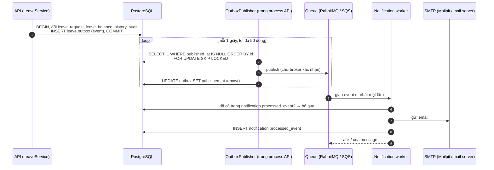

# Hợp đồng event và queue – HRHelper (HR Enterprise Platform)

> Phụ lục của [SAD phần 2](SAD-2-software-architecture.md#7-pattern-đảm-bảo-đúng-nghiệp-vụ). Mô tả event nghiệp vụ mà API
> phát ra qua transactional outbox và cách notification worker nhận chúng: tên event, payload, tên exchange/queue, bảo đảm
> giao nhận và chống trùng. Hợp đồng API đồng bộ (REST) nằm ở [`openapi.yaml`](../openapi.yaml).
>
> Nguồn trong code: `backend/src/modules/leave/outbox/` (event, publisher), `backend/src/messaging/` (driver RabbitMQ, SQS),
> `backend/src/worker/` (worker), `infra/staging/sqs_worker.tf` (queue trên AWS).

| Phiên bản | Ngày | Người viết | Nội dung |
|---|---|---|---|
| 1.0 | 13/11/2026 | TV1 Duong | Bản đầu: 5 event nghỉ phép, RabbitMQ (local) và SQS (staging) |

## 1. Luồng tổng quát



Điểm chính:

- **Không mất event:** event được ghi vào `leave.outbox` trong **cùng transaction** với thay đổi trạng thái đơn. Đơn đã đổi
  trạng thái thì chắc chắn có event; transaction rollback thì không có event.
- **Có thể trùng:** publisher chỉ đặt `published_at` sau khi broker xác nhận. Nếu API chết giữa "gửi xong" và "đánh dấu", lượt
  sau gửi lại event đó. Worker phải chống trùng ([mục 5](#5-bảo-đảm-giao-nhận-và-chống-trùng)).
- **Giữ thứ tự:** publisher gửi theo `id` tăng dần; gặp lỗi thì dừng lượt đó và thử lại từ chính event lỗi ở lượt sau.
- **Nhiều instance API** chạy song song an toàn nhờ `FOR UPDATE SKIP LOCKED`: mỗi dòng outbox chỉ một instance gửi.
- **Không cấu hình queue** (`QUEUE_DRIVER=none`, ví dụ khi chạy test): API vẫn ghi outbox, chỉ không đẩy đi. Khi bật queue,
  các event tồn đọng được gửi bù.

## 2. Danh sách event

Tất cả thuộc aggregate **đơn nghỉ phép** (`leave.leave_request`). Event chỉ phát khi trạng thái **thực sự đổi**: gửi lại
cùng một quyết định (bấm hai lần, retry) trả kết quả cũ và không tạo event mới.

| Event (`type`) | Phát khi | API gây ra | Chuyển trạng thái | `actorId` là | Email gửi tới |
|---|---|---|---|---|---|
| `LeaveRequested` | Nhân viên tạo đơn | `POST /leave-requests` | → `SUBMITTED` | Nhân viên tạo đơn | Quản lý trực tiếp của nhân viên |
| `LeaveApproved` | Quản lý (hoặc HR với đơn của CEO) duyệt | `POST /leave-requests/{id}/approve` | `SUBMITTED` → `APPROVED` | Người duyệt | Nhân viên |
| `LeaveRejected` | Quản lý (hoặc HR với đơn của CEO) từ chối | `POST /leave-requests/{id}/reject` | `SUBMITTED` → `REJECTED` | Người từ chối | Nhân viên |
| `LeaveCancelled` | Nhân viên tự hủy đơn đang chờ | `POST /leave-requests/{id}/cancel` | `SUBMITTED` → `CANCELLED` | Nhân viên | Quản lý trực tiếp |
| `LeaveCompleted` | HR xác nhận hoàn tất | `POST /leave-requests/{id}/complete` | `APPROVED` → `COMPLETED` | Nhân viên HR | Nhân viên |

Ánh xạ hành động → event: `EVENT_OF_ACTION` trong `leave-events.ts`; người nhận: `recipientOf()`. Nhân viên không có quản lý
trực tiếp (CEO) thì event loại "gửi quản lý" được đánh dấu đã xử lý mà không gửi email.

## 3. Payload

Body của message là JSON của `LeaveEventPayload` (`leave-events.ts`). Cả 5 event dùng chung một cấu trúc:

| Trường | Kiểu JSON | Bắt buộc | Mô tả |
|---|---|---|---|
| `requestId` | string (uuid) | Có | Id đơn nghỉ (`leave_request.id`), cũng là `aggregate_id` trong outbox |
| `employeeId` | string (uuid) | Có | Nhân viên xin nghỉ |
| `leaveType` | string | Có | **Mã** loại phép (`leave_type.code`), ví dụ `ANNUAL` |
| `startDate` | string `YYYY-MM-DD` | Có | Ngày bắt đầu |
| `endDate` | string `YYYY-MM-DD` | Có | Ngày kết thúc |
| `halfDay` | `"AM"` \| `"PM"` \| null | Có (có thể null) | Nghỉ nửa ngày buổi sáng/chiều; null là cả ngày |
| `days` | number | Có | Số ngày trừ phép (bội số 0.5) |
| `actorId` | string (uuid) | Có | Người thực hiện hành động (xem bảng mục 2) |
| `comment` | string \| null | Có (có thể null) | Ghi chú khi duyệt/từ chối/hủy/hoàn tất; null với `LeaveRequested` |
| `occurredAt` | string ISO 8601 (UTC) | Có | Thời điểm ghi event |

Ví dụ (`LeaveApproved`):

```json
{
  "requestId": "6f1c2c0e-8a1b-4c0e-9d3f-2b7a5e1d9c40",
  "employeeId": "0b8e7f3a-5c2d-4e61-a9f0-3d1c7b2e8a55",
  "leaveType": "ANNUAL",
  "startDate": "2026-11-24",
  "endDate": "2026-11-25",
  "halfDay": null,
  "days": 1,
  "actorId": "9a4d2e1f-7b3c-4d5e-8f6a-1c2b3d4e5f60",
  "comment": "Đồng ý",
  "occurredAt": "2026-11-13T03:30:00.000Z"
}
```

Ngày 24/11/2026 là ngày lễ nên khoảng 24–25/11 chỉ trừ 1 ngày.

**Metadata đi kèm message** (không nằm trong body):

| Thông tin | RabbitMQ | SQS |
|---|---|---|
| Id event (= `leave.outbox.id`, dạng chuỗi) | property `messageId` | message attribute `messageId` |
| Loại event | property `type` | message attribute `type` |
| Thời điểm tạo | property `timestamp` (giây Unix) | message attribute `createdAt` (ISO 8601) |
| Kiểu nội dung | `contentType: application/json`, `persistent: true` | – |

## 4. Exchange, queue và driver

Driver chọn bằng `QUEUE_DRIVER` ([bảng biến môi trường](../development/configuration.md#queue)). Code nghiệp vụ chỉ biết
interface `EventBus` (publish) và `EventConsumer` (consume) trong `backend/src/messaging/event-bus.ts`.

### RabbitMQ (local, docker-compose)

| Thành phần | Tên | Thuộc tính |
|---|---|---|
| Exchange | `hr.events` | `topic`, durable |
| Routing key | `leave.<type>` | ví dụ `leave.LeaveApproved` |
| Queue của worker | `notification.leave` | durable, bind `leave.*`, dead letter → `notification.leave.dlq` |
| Dead letter queue | `notification.leave.dlq` | durable |

- Publisher dùng **confirm channel**: `publish()` chỉ xong khi broker xác nhận đã nhận.
- Worker `prefetch(10)`; xử lý xong thì `ack`, lỗi thì `nack` không requeue → message vào DLQ ngay.
- Exchange, queue, binding do code tự khai báo khi kết nối (`assertExchange`, `assertQueue`), không cần tạo tay.
- Xem queue: RabbitMQ Management http://localhost:15672 (`hr` / `hr`).

### Amazon SQS (staging)

| Thành phần | Tên (Terraform, `infra/staging/sqs_worker.tf`) | Thuộc tính |
|---|---|---|
| Queue chính | `hr-platform-staging-leave-notifications` | standard, visibility timeout 60 giây, giữ 4 ngày, mã hóa KMS |
| Dead letter queue | `hr-platform-staging-leave-notifications-dlq` | giữ 14 ngày |
| Redrive | `maxReceiveCount = 5` | nhận lỗi 5 lần thì chuyển DLQ |

- Không có exchange: API gửi thẳng vào queue chính (`SQS_QUEUE_URL`), worker long polling 20 giây, tối đa 10 message/lần.
- Xử lý xong thì xóa message; lỗi thì **không xóa**, message hiện lại sau visibility timeout.
- Nếu đổi sang queue FIFO (URL đuôi `.fifo`), code tự đặt `MessageGroupId = leave` và `MessageDeduplicationId` = id event.
- Quyền gửi/nhận lấy từ IAM role của App Runner (API) và ECS task (worker), không dùng access key.

## 5. Bảo đảm giao nhận và chống trùng

| Bảo đảm | Cách làm |
|---|---|
| Không mất event khi API hoặc queue chết | Outbox trong cùng transaction; chỉ đánh dấu đã gửi sau khi broker xác nhận; queue durable |
| Giao **ít nhất một lần** | Cả RabbitMQ và SQS standard đều có thể giao lại |
| Không gửi email trùng | Worker tra `notification.processed_event` theo id event trước khi gửi; gửi xong mới ghi id (`ON CONFLICT DO NOTHING`) |
| Không lặp vô hạn khi lỗi | RabbitMQ: nack → DLQ ngay. SQS: sau 5 lần nhận → DLQ |
| Thứ tự | Publisher gửi theo `id` outbox. Worker không dựa vào thứ tự (mỗi event độc lập, chỉ để gửi email) |

Giới hạn hiện tại: nếu email đã gửi nhưng worker chết trước khi ghi `processed_event`, event được giao lại sẽ gửi email lần
hai. Chấp nhận được với email thông báo.

**Theo dõi và xử lý sự cố:**

- Event chưa gửi được: `SELECT id, event_type, attempts, last_error FROM leave.outbox WHERE published_at IS NULL ORDER BY id;`
- Event đã xử lý: `SELECT * FROM notification.processed_event ORDER BY processed_at DESC LIMIT 20;`
- Message lỗi nằm trong DLQ (`notification.leave.dlq` hoặc SQS `...-dlq`). Sửa nguyên nhân rồi chuyển lại queue chính
  (RabbitMQ: shovel/plugin; SQS: "Start DLQ redrive" trên console).

## 6. Quy tắc khi đổi hợp đồng

1. **Thêm trường** vào payload: được, worker cũ bỏ qua trường lạ. Cập nhật `LeaveEventPayload`, mục 3 của file này và test
   `leave-events.spec.ts` trong cùng PR.
2. **Đổi tên, xóa trường hoặc đổi kiểu**: không sửa tại chỗ. Thêm event mới (ví dụ `LeaveApprovedV2`) hoặc thêm trường mới,
   chạy song song đến khi worker cũ không còn, rồi mới bỏ cái cũ. Lý do: lúc deploy, outbox và queue có thể còn event dạng cũ.
3. **Thêm loại event mới**: thêm vào `LeaveEventType`, routing key theo dạng `<module>.<Event>`; thêm consumer nếu cần.
   Module khác phát event thì dùng outbox của schema mình (ví dụ `document.outbox`), không ghi vào `leave.outbox`.
4. Đổi tên exchange/queue phải sửa đồng thời code (`rabbitmq.ts`), Terraform (`sqs_worker.tf`) và file này.
