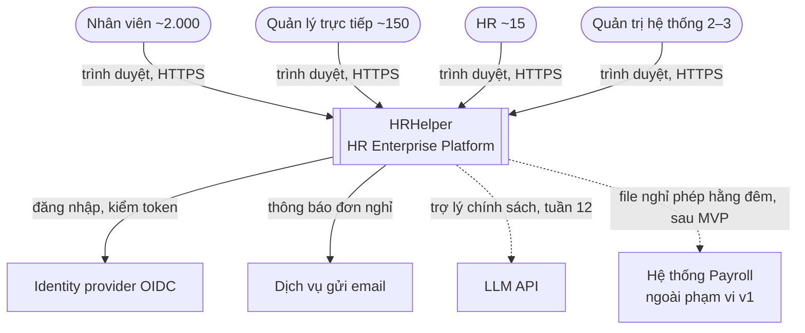
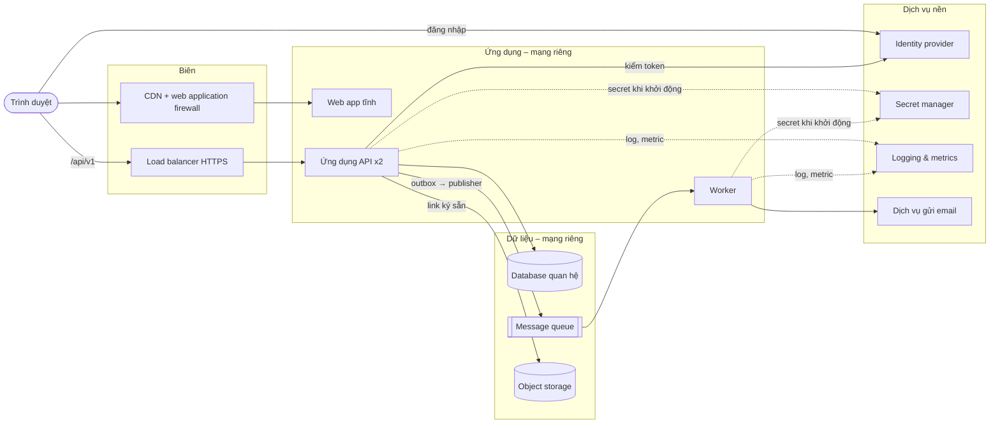
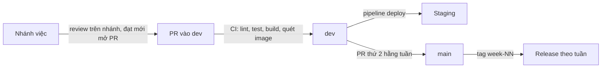
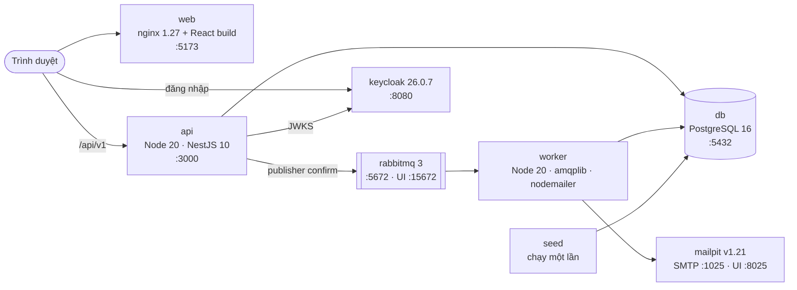
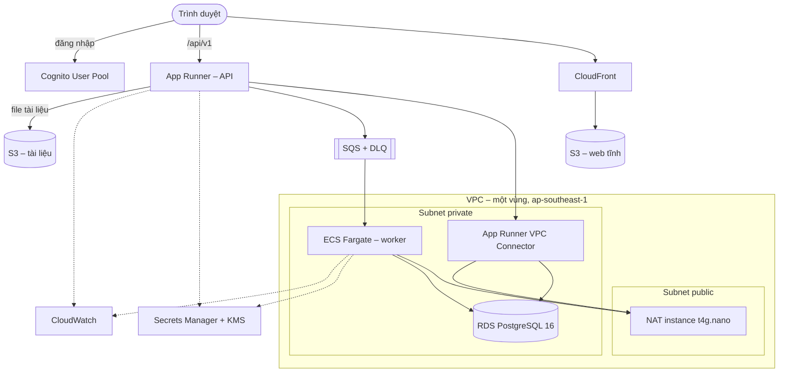

# Kiến trúc hệ thống – HRHelper (HR Enterprise Platform)

Tài liệu mô tả hệ thống **nhìn từ bên ngoài**: gồm những khối nào, nói chuyện với ai, chạy ở đâu, bảo mật hạ tầng, sẵn sàng,
phục hồi, quan sát, CI/CD và chi phí. Bên trong từng khối nằm ở [kiến trúc phần mềm](software-architecture.md).

Tài liệu có hai phần:

- **Phần I – Kiến trúc tổng quan:** chỉ nói khối nào làm chức năng gì, **không gắn công cụ**. Phần này ổn định, đổi công cụ
  (vd đổi cloud provider) không phải sửa.
- **Phần II – Kiến trúc hiện tại:** từng khối đang dùng **công cụ, framework, phiên bản** nào, ở local và trên cloud.

Cập nhật: 6/11/2026 (tuần 9). Trạng thái: ✅ đã chạy · 🟡 đang làm / đang review · ⬜ chưa làm.

---

# Phần I – Kiến trúc tổng quan

## 1. Yêu cầu dẫn dắt kiến trúc

| Yêu cầu | Giá trị | Ảnh hưởng tới kiến trúc |
|---|---|---|
| Quy mô | ~2.000 nhân viên, tăng tới 10.000 không đổi kiến trúc | Một database quan hệ, không cần chia nhỏ |
| Tải | Trung bình ≈ 0,5 request/giây, cao điểm ≈ 10, thiết kế cho 50 | 2 instance ứng dụng là đủ; không cần orchestrator phức tạp (ADR-06) |
| Hiệu năng | p95 < 300 ms đọc, < 500 ms ghi, tìm kiếm < 1 s | Ứng dụng và database cùng vùng; cache dữ liệu tham chiếu (ADR-07) |
| Sẵn sàng | 99,5%/tháng | 2 instance sau load balancer; database một vùng có backup (ADR-06) |
| Phục hồi | RPO ≤ 1 giờ, RTO ≤ 4 giờ, không mất đơn đã gửi | Database managed có backup tự động và khôi phục theo thời điểm (ADR-00) |
| Bảo mật | Dữ liệu nhạy cảm, 100% thao tác nhạy cảm có audit | Mã hóa tầng ứng dụng, audit append-only, TLS mọi kết nối (ADR-08, ADR-09) |
| Chi phí | < 100 USD/tháng cho staging | Dịch vụ tier nhỏ nhất, tắt môi trường ngoài giờ demo |
| Đội ngũ | 4 người, 10 tuần, không có người vận hành | Ưu tiên dịch vụ managed (ADR-00) |

Nguồn: [NFR và workload tuần 5](../progress/tuan-05/README.md), [SRS mục 6](../requirements/SRS.md#6-yêu-cầu-phi-chức-năng).

## 2. Ngữ cảnh hệ thống (C4 mức 1)

| Hệ thống ngoài | Cách tích hợp | Đồng bộ? | Khi lỗi |
|---|---|---|---|
| Identity provider (OIDC) | Redirect đăng nhập + kiểm chữ ký token bằng khóa công khai (JWKS) | Đồng bộ | Không đăng nhập mới được; token còn hạn vẫn dùng |
| Dịch vụ gửi email | Queue → worker gọi SMTP | Bất đồng bộ | Gửi lại; lỗi đưa vào hàng đợi chết (DLQ); trạng thái đơn không đổi |
| Object storage | Link tải lên/tải xuống ký sẵn (presigned URL) | Tải lên đồng bộ, xử lý sau bất đồng bộ | Metadata "pending" tới khi file có thật |
| LLM API | REST có timeout | Đồng bộ | Hết thời gian thì chỉ tới tài liệu gốc |
| Payroll | File CSV hằng đêm | Batch | Chạy lại được, idempotent theo ngày |

Chi tiết: [integration và xử lý lỗi tuần 6](../progress/tuan-06/TV4_Duy.md).

## 3. Các khối logic (C4 mức 2)

| Khối | Chức năng | Mở rộng |
|---|---|---|
| Web app | Giao diện cho 4 vai trò, build ra file tĩnh | CDN |
| Ứng dụng API | Toàn bộ nghiệp vụ, REST `/api/v1`, ghi outbox và đẩy event | 2 instance, không giữ phiên trong bộ nhớ |
| Worker | Nhận event, gửi email; sau này trích text tài liệu | Thêm instance khi queue dồn |
| Database quan hệ | Dữ liệu giao dịch, audit, outbox | Tăng tier; replica đọc khi cần |
| Message queue | Chuyển event từ outbox sang worker | Dịch vụ managed |
| Object storage | File tài liệu chính sách | Dịch vụ managed |
| Identity provider | Đăng nhập OIDC, nhóm người dùng | Dịch vụ managed |
| Secret manager | Mật khẩu database, khóa mã hóa trường nhạy cảm | Dịch vụ managed |
| Logging & metrics | Log tập trung, dashboard, cảnh báo | Dịch vụ managed |

API không giữ phiên đăng nhập (stateless JWT), nên thêm instance không cần sticky session.

## 4. Vùng triển khai

- **Biên (public):** chỉ CDN và load balancer nhận traffic từ internet, bắt buộc HTTPS.
- **Ứng dụng và dữ liệu (private):** API, worker, database, queue không có địa chỉ public; database chỉ nhận kết nối từ API và
  worker; ra internet (gọi identity provider, email) qua một cổng ra kiểm soát được.
- **Một vùng (region)** cho version 1; database một vùng có backup và khôi phục theo thời điểm. Nhiều vùng là việc sau MVP.

| Môi trường | Mục đích | Dữ liệu | Triển khai |
|---|---|---|---|
| Local | Phát triển, demo trên máy, e2e test | Giả lập 2.000 nhân viên | Container trên một máy |
| Staging | Kiểm thử trên cloud, demo cho giảng viên | Giả lập | Hạ tầng bằng code + pipeline deploy tự động |
| Production | Chỉ mô tả, không triển khai trong đồ án | – | Như staging, nhiều vùng |

## 5. Nguyên tắc xuyên suốt

**Bảo mật hạ tầng**

| Lớp | Nguyên tắc |
|---|---|
| Biên | HTTPS bắt buộc; web application firewall chặn tấn công phổ biến |
| Mạng | Database, worker ở mạng riêng; chỉ load balancer nhận traffic ngoài |
| Danh tính | OIDC + PKCE; ứng dụng không giữ mật khẩu người dùng |
| Dữ liệu | Mã hóa khi truyền (TLS) và khi lưu; trường nhạy cảm mã hóa thêm ở tầng ứng dụng (ADR-08) |
| Secret | Không nằm trong code hay image; lấy từ secret manager lúc khởi động; thiếu secret thì không khởi động |
| Pipeline | CI dùng danh tính tạm thời (OIDC), không có khóa truy cập lâu dài; image được quét lỗ hổng |
| Truy vết | Audit log append-only (ADR-09) |

**Sẵn sàng và phục hồi**

| Tình huống | Cách chịu đựng | Mục tiêu |
|---|---|---|
| Một instance API chết | Load balancer chuyển sang instance còn lại | Tỷ lệ lỗi < 1% |
| Deploy phiên bản mới | Thay lần lượt từng instance; migration chạy trước, tương thích ngược | Không dừng dịch vụ |
| Queue ngừng | Event chờ trong bảng outbox, gửi lại khi queue sống | Không mất thông báo |
| Dịch vụ email lỗi | Message vào DLQ, trạng thái đơn không đổi | Không ảnh hưởng duyệt đơn |
| Database hỏng | Khôi phục theo thời điểm từ backup tự động | RPO ≤ 1 giờ, RTO ≤ 4 giờ |
| Identity provider lỗi | Phiên còn hạn vẫn dùng; khóa công khai được cache | Chỉ ảnh hưởng đăng nhập mới |

**Quan sát:** mỗi request có mã truy vết (traceId) xuyên suốt log; metric request/giây, p95, tỷ lệ lỗi 5xx, độ dài queue,
event outbox chưa gửi; cảnh báo theo SLO 99,5% và theo chi phí.

**Phát hành:**

---

# Phần II – Kiến trúc hiện tại

## 6. Công cụ và framework theo khối

| Khối (Phần I) | Local (đang chạy) | Cloud staging (đề xuất ADR-12, đang review) | Trạng thái |
|---|---|---|---|
| Web app | React 18 + React Router 6, build bằng Vite 5, TypeScript 5; phục vụ bằng nginx 1.27 (alpine) | Amazon S3 + Amazon CloudFront | ✅ local · ⬜ cloud |
| Đăng nhập trên web | `oidc-client-ts` 3 (Authorization Code + PKCE, token trong `sessionStorage`) | như local, trỏ sang Cognito Hosted UI | ✅ · 🟡 hỗ trợ Cognito |
| Ứng dụng API | Node.js 20 (alpine), NestJS 10 + Express, TypeORM 0.3, `class-validator`, `@nestjs/swagger`, `jose` 5 (kiểm JWT) | AWS App Runner (0,5 vCPU, 1 GB) + VPC Connector | ✅ local · ⬜ cloud |
| Worker | Cùng image API, lệnh `node dist/worker/main.js`; `amqplib` (RabbitMQ), `nodemailer` (SMTP) | Amazon ECS Fargate (1 task 0,25 vCPU) | ✅ local · ⬜ cloud |
| Database quan hệ | PostgreSQL 16 (`postgres:16-alpine`) | Amazon RDS for PostgreSQL 16 (`db.t4g.micro`, 20 GB gp3, backup 7 ngày) | ✅ local · ⬜ cloud |
| Message queue | RabbitMQ 3 (`rabbitmq:3-management-alpine`) | Amazon SQS + DLQ (cần adapter, nhánh `feat/queue-adapter`) | ✅ local · ⬜ cloud |
| Identity provider | Keycloak 26.0.7, realm `hr`, client `hr-web` | Amazon Cognito User Pool, 4 nhóm `employee`, `manager`, `hr`, `admin` | ✅ local · 🟡 code hỗ trợ (`feat/auth-cognito`) |
| Dịch vụ gửi email | Mailpit v1.21 (hộp thư giả lập) | **Chưa chọn** dịch vụ SMTP | ✅ local · ⬜ cloud |
| Object storage | – | Amazon S3 (chặn public access, mã hóa SSE) | ⬜ tuần 10 |
| Secret manager | Biến môi trường trong `docker-compose.yml` (khóa dev) | AWS Secrets Manager + AWS KMS | 🟡 code fail-fast (`feat/secret-config`) |
| Logging & metrics | Log console của container, traceId (`X-Trace-Id`) | Amazon CloudWatch Logs + Alarms (retention 14 ngày) | ✅ traceId · ⬜ cloud |
| Cổng ra internet cho mạng riêng | – | NAT instance `t4g.nano` (thay NAT Gateway để giảm chi phí) | ⬜ |
| CDN + WAF | – | CloudFront; WAF **chưa quyết định** bật ở staging | ⬜ |
| Hạ tầng bằng code | – | Terraform (state trên S3 + DynamoDB lock) | 🟡 nhánh `infra/terraform-staging` |
| Kiểm soát chi phí | – | AWS Budgets, cảnh báo 25/40/50 USD | ⬜ |

Tên dịch vụ AWS là **đề xuất** của TV3 trong ADR-12 (nhánh `docs/adr-12-cloud-provider`), chưa chốt; Phần I không phụ thuộc
vào lựa chọn này.

## 7. Sơ đồ hiện tại – local

Chạy bằng `docker compose up -d --build` (project `hr-platform`):

| Service | Image / build | Cổng | Ghi chú |
|---|---|---|---|
| db | `postgres:16-alpine` | 5432 | Volume `db-data` |
| keycloak | `quay.io/keycloak/keycloak:26.0.7` | 8080 | Import `keycloak/realm-hr.json`, 4 tài khoản demo |
| rabbitmq | `rabbitmq:3-management-alpine` | 5672, 15672 | Healthcheck `rabbitmq-diagnostics ping` |
| mailpit | `axllent/mailpit:v1.21` | 1025, 8025 | Chấp nhận SMTP auth không TLS (chỉ local) |
| api | `backend/Dockerfile` (Node 20 alpine, user `node`) | 3000 | Chạy migration rồi khởi động; healthcheck `/api/v1/health` |
| worker | `backend/Dockerfile`, `node dist/worker/main.js` | – | `restart: unless-stopped` |
| web | `frontend/Dockerfile` (build Vite → nginx) | 5173 | Mọi đường dẫn trả `index.html` |
| seed | `backend/Dockerfile`, `node dist/database/seed.js` | – | Bỏ qua nếu đã có dữ liệu |

## 8. Sơ đồ đích – cloud staging (đề xuất AWS)

Dự toán theo bản đề xuất mới nhất của ADR-12: ~57 USD/tháng nếu chạy 24/7, dưới trần 100 USD; giảm thêm bằng cách tắt NAT và
worker ngoài giờ demo. Con số chốt khi ADR-12 được merge.

## 9. CI/CD hiện tại

| Bước | Công cụ | Trạng thái |
|---|---|---|
| Bảo vệ `dev`, `main` | GitHub ruleset (chỉ qua PR, chỉ nhóm trưởng merge), CODEOWNERS | ✅ |
| CI mọi PR | GitHub Actions `ci.yml`: Node 20, `npm ci`, `npm run lint`, `npm test` (backend), `npm run build` (frontend) | ✅ |
| Build + quét image | Docker Buildx, Trivy (chặn lỗ hổng CRITICAL) | 🟡 nhánh `ci/docker-images` |
| Deploy staging | GitHub Actions + OIDC vào AWS, push ECR, chạy migration trên ECS, cập nhật App Runner/ECS, upload S3, kiểm `/health` | 🟡 nhánh `ci/deploy-staging` |
| Phát hành | Tag `week-NN` + GitHub Release trên `main` (đã có `week-08`) | ✅ |

## 10. Bảo mật và quan sát hiện tại

| Nội dung | Đang có | Còn thiếu |
|---|---|---|
| Đăng nhập | Keycloak OIDC + PKCE; API kiểm chữ ký bằng `jose`, issuer, client `azp` | Cognito trên staging (🟡) |
| Phân quyền | `AuthGuard` toàn cục + `@Roles` + kiểm tra theo dữ liệu trong service; [ma trận](../security/access-control-matrix.md) | e2e cho mọi dòng ma trận (tuần 9) |
| Dữ liệu nhạy cảm | AES-256-GCM (`FieldCrypto`), audit `VIEW_SENSITIVE` | Khóa từ Secrets Manager/KMS |
| TLS | – (local) | TLS tới database (`DB_SSL`, 🟡), HTTPS ở CloudFront/App Runner |
| Image | User `node` không phải root (API) | Quét Trivy, web chạy non-root (🟡) |
| Log | Log console, traceId trong mọi response lỗi | CloudWatch, dashboard, cảnh báo |

## 11. Năng lực và chi phí

| Chỉ số | Ước tính | Đủ không |
|---|---|---|
| Lưu lượng | 50 request/giây thiết kế, 10 thực tế | App Runner 0,5 vCPU × 2 dư sức (kiểm bằng load test tuần 11) |
| Database | ~25.000 đơn/năm, ~1,25 triệu dòng audit/năm | `db.t4g.micro`, 20 GB |
| File | ~2 GB tài liệu | S3 tier chuẩn |
| Chi phí staging | ~57 USD/tháng (đề xuất) | Trần < 100 USD; AWS Budgets cảnh báo |

## 12. Chưa quyết định

| Chức năng | Cần chọn | Khi nào |
|---|---|---|
| Cloud provider và dịch vụ cụ thể | Chốt bảng mục 6 | ADR-12, tuần 9 |
| Dịch vụ gửi email trên cloud | Nhà cung cấp SMTP, xác thực domain gửi | Tuần 9–10 |
| Web application firewall | Bật ở staging hay chỉ production | Tuần 10 |
| Logging & metrics | Dashboard, ngưỡng cảnh báo cụ thể | Tuần 10–11 |
| LLM API và nơi lưu vector | Nhà cung cấp LLM; pgvector trên PostgreSQL hay dịch vụ riêng | Tuần 12 |
