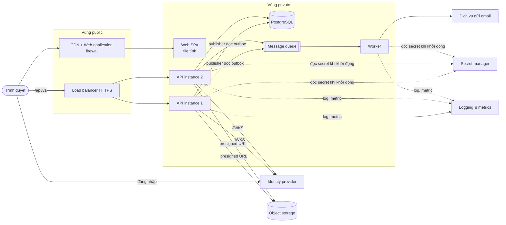
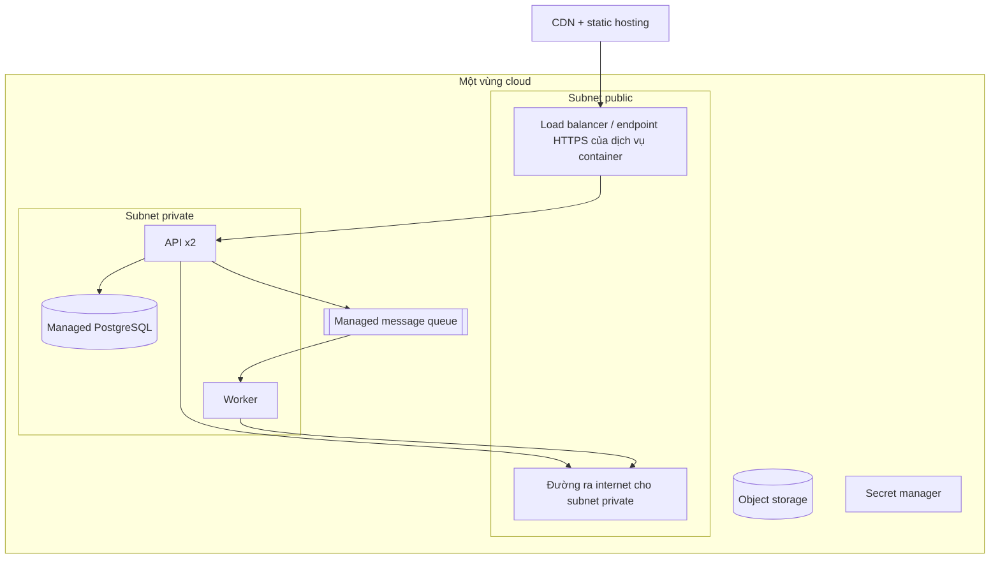
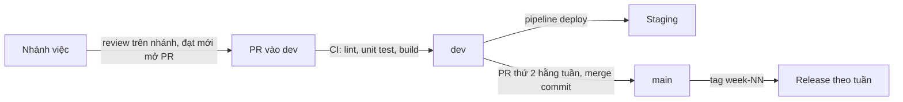

# Kiến trúc hệ thống – HRHelper (HR Enterprise Platform)

Tài liệu mô tả hệ thống **nhìn từ bên ngoài**: hệ thống gồm những khối chạy riêng (container) nào, nói chuyện với ai, chạy ở
đâu, mạng, bảo mật hạ tầng, sẵn sàng, phục hồi, quan sát, CI/CD và chi phí. Bên trong từng khối được viết ở
[kiến trúc phần mềm](software-architecture.md).

Cập nhật: 6/11/2026 (tuần 9). Quy ước: phần đã chọn công cụ ghi tên công cụ; phần **chưa quyết định ghi tên chức năng**.
Trạng thái: ✅ đã chạy · 🟡 đang làm / đang review · ⬜ chưa làm.

## 1. Yêu cầu dẫn dắt kiến trúc

| Yêu cầu | Giá trị | Ảnh hưởng tới kiến trúc |
|---|---|---|
| Quy mô | ~2.000 nhân viên, tăng tới 10.000 không đổi kiến trúc | Một database quan hệ, không cần chia nhỏ |
| Tải | Trung bình ≈ 0,5 request/giây, cao điểm ≈ 10, thiết kế cho 50 | 2 instance API là đủ; không Kubernetes (ADR-06) |
| Hiệu năng | p95 < 300 ms đọc, < 500 ms ghi, tìm kiếm < 1 s | API và database cùng vùng; cache dữ liệu tham chiếu (ADR-07) |
| Sẵn sàng | 99,5%/tháng | 2 instance sau load balancer; database một vùng có backup (ADR-06) |
| Phục hồi | RPO ≤ 1 giờ, RTO ≤ 4 giờ, không mất đơn đã gửi | Managed database có backup tự động và khôi phục theo thời điểm (ADR-00) |
| Bảo mật | Dữ liệu nhạy cảm, 100% thao tác nhạy cảm có audit | Mã hóa tầng ứng dụng, audit append-only, TLS mọi kết nối (ADR-08, ADR-09) |
| Chi phí | < 100 USD/tháng cho staging | Dịch vụ tier nhỏ nhất, tắt môi trường ngoài giờ demo |
| Đội ngũ | 4 người, 10 tuần, không có người vận hành | Ưu tiên dịch vụ managed (ADR-00) |

Nguồn: [NFR và workload tuần 5](../progress/tuan-05/README.md), [BRD mục 10](../business/BRD.md#10-yêu-cầu-phi-chức-năng).

## 2. Ngữ cảnh hệ thống (C4 mức 1)

| Hệ thống ngoài | Cách tích hợp | Đồng bộ? | Khi lỗi | Trạng thái |
|---|---|---|---|---|
| Identity provider (OIDC) | Redirect đăng nhập + kiểm chữ ký token bằng JWKS | Đồng bộ | Không đăng nhập mới được; token còn hạn vẫn dùng (JWKS được cache) | ✅ Keycloak local; 🟡 managed trên cloud |
| Dịch vụ gửi email | Queue → worker gọi SMTP | Bất đồng bộ | Gửi lại; lỗi đưa vào hàng đợi chết (DLQ); trạng thái đơn không đổi | ✅ Mailpit local |
| Object storage | Presigned URL, trình duyệt tải thẳng | Tải lên đồng bộ, xử lý sau bất đồng bộ | Metadata "pending" tới khi file có thật | ⬜ tuần 10 |
| LLM API | REST có timeout | Đồng bộ | Hết thời gian thì chỉ tới tài liệu gốc | ⬜ tuần 12 |
| Payroll | File CSV hằng đêm | Batch | Chạy lại được, idempotent theo ngày | Ngoài phạm vi v1 |

Chi tiết: [integration và xử lý lỗi tuần 6](../progress/tuan-06/TV4_Duy.md).

## 3. Các khối chạy riêng (C4 mức 2)

| Khối | Vai trò | Chạy bằng | Mở rộng | Trạng thái |
|---|---|---|---|---|
| Web SPA | Giao diện React, build ra file tĩnh | Local: nginx container; cloud: **static hosting + CDN** | CDN | ✅ local |
| API | REST `/api/v1`, toàn bộ nghiệp vụ, publisher outbox | Container Node.js; cloud: **dịch vụ chạy container managed** | 2 instance, không giữ trạng thái trong bộ nhớ ngoài cache tham chiếu | ✅ local |
| Worker | Nhận event từ queue, gửi email; sau này trích text tài liệu | Cùng image API, lệnh khác; cloud: **container chạy liên tục** | 1 instance; thêm instance khi queue dồn | ✅ local |
| Database | Dữ liệu giao dịch, audit, outbox | PostgreSQL 16; cloud: **managed PostgreSQL** | Tăng tier; read replica khi cần | ✅ local |
| Message queue | Chuyển event từ outbox sang worker | RabbitMQ local; cloud: **managed message queue** | Managed | ✅ local |
| Identity provider | Đăng nhập OIDC, PKCE, nhóm người dùng | Keycloak local; cloud: **managed identity provider** | Managed | ✅ local |
| Object storage | File tài liệu chính sách | Cloud: **object storage** | Managed | ⬜ tuần 10 |
| Secret manager | Mật khẩu DB, khóa mã hóa trường nhạy cảm | Local: biến môi trường; cloud: **secret manager + key management** | Managed | 🟡 tuần 9 |
| Logging & metrics | Log tập trung, dashboard, cảnh báo | **Chưa chọn công cụ** | Managed | ⬜ tuần 10–11 |

Mọi khối giao tiếp qua mạng bằng TLS (trừ môi trường local). API không giữ phiên đăng nhập (stateless JWT), nên thêm instance
không cần sticky session.

## 4. Triển khai

### 4.1 Môi trường

| Môi trường | Mục đích | Dữ liệu | Cách triển khai | Trạng thái |
|---|---|---|---|---|
| Local | Phát triển, demo trên máy, e2e test | Seed 2.000 nhân viên giả lập | `docker compose up` | ✅ |
| Staging | Kiểm thử trên cloud, demo cho giảng viên | Seed giả lập | Hạ tầng bằng code (IaC) + pipeline deploy khi `dev` có commit mới | 🟡 tuần 9 |
| Production | Mô tả trong tài liệu, không triển khai trong đồ án | – | Như staging, nhiều vùng | Ngoài phạm vi v1 |

### 4.2 Local (`docker-compose.yml`)

| Service | Image / build | Cổng | Ghi chú |
|---|---|---|---|
| db | `postgres:16-alpine` | 5432 | Volume `db-data` |
| keycloak | `quay.io/keycloak/keycloak:26.0.7` | 8080 | Realm `hr`, 4 tài khoản demo |
| rabbitmq | `rabbitmq:3-management-alpine` | 5672, 15672 | Trang quản trị ở 15672 |
| mailpit | `axllent/mailpit:v1.21` | 1025, 8025 | Hộp thư giả lập |
| api | `backend/Dockerfile` | 3000 | Chạy migration rồi khởi động; healthcheck `/api/v1/health` |
| worker | `backend/Dockerfile`, lệnh `node dist/worker/main.js` | – | Chờ api, rabbitmq |
| web | `frontend/Dockerfile` (nginx) | 5173 | SPA, mọi đường dẫn trả `index.html` |
| seed | `backend/Dockerfile`, chạy một lần | – | Bỏ qua nếu đã có dữ liệu |

### 4.3 Cloud (đích đến)

- Database chỉ nhận kết nối từ API và worker (security group), không có địa chỉ public, bắt buộc TLS.
- Một vùng, database một vùng có backup và khôi phục theo thời điểm (ADR-06); production nhiều vùng là việc sau MVP.
- Cloud provider và tên dịch vụ cụ thể: **ADR-12, đang review**. Đề xuất hiện tại là AWS
  (TV3 đề xuất ở nhánh `docs/adr-12-cloud-provider`); khi ADR-12 được merge, bảng này ghi thêm tên dịch vụ.

## 5. Bảo mật hạ tầng

| Lớp | Biện pháp | Trạng thái |
|---|---|---|
| Biên | HTTPS bắt buộc; CDN + web application firewall chặn tấn công phổ biến | ⬜ cloud |
| Mạng | Database, worker ở subnet private; chỉ API nhận traffic từ load balancer | ⬜ cloud |
| Danh tính | OIDC + PKCE; API kiểm chữ ký, issuer, client của token; không có mật khẩu trong ứng dụng | ✅ |
| Dữ liệu khi truyền | TLS client → CDN → API → database | 🟡 bật TLS tới DB ở tuần 9 |
| Dữ liệu khi lưu | Database mã hóa at rest (managed); trường nhạy cảm mã hóa thêm ở tầng ứng dụng (ADR-08) | ✅ tầng ứng dụng |
| Secret | Lấy từ secret manager lúc khởi động; production thiếu secret thì không chạy; CI dùng OIDC, không có khóa truy cập lâu dài | 🟡 tuần 9 |
| Image | Build và quét lỗ hổng trên CI; chạy bằng user không phải root | 🟡 tuần 9 |
| Truy vết | Audit log append-only trong database (ADR-09) | ✅ |
| Phân tích mối đe dọa | Threat model STRIDE | 🟡 tuần 9 |

## 6. Sẵn sàng và phục hồi

| Tình huống | Cách hệ thống chịu đựng | Mục tiêu |
|---|---|---|
| Một instance API chết | Load balancer chuyển sang instance còn lại | Tỷ lệ lỗi < 1% |
| Deploy phiên bản mới | Thay lần lượt từng instance; migration chạy trước, tương thích ngược | Không dừng dịch vụ |
| Queue ngừng | Event nằm trong bảng outbox, gửi lại khi queue sống (đã thử ở local) | Không mất thông báo |
| Dịch vụ email lỗi | Worker đưa message vào DLQ, trạng thái đơn không đổi | Không ảnh hưởng duyệt đơn |
| Database hỏng | Khôi phục theo thời điểm từ backup tự động | RPO ≤ 1 giờ, RTO ≤ 4 giờ |
| Identity provider lỗi | Phiên còn hạn vẫn dùng; JWKS được cache | Chỉ ảnh hưởng đăng nhập mới |

Mỗi dòng sẽ thành một kịch bản thử lỗi ở tuần 11.

## 7. Quan sát

| Nội dung | Hiện có | Kế hoạch |
|---|---|---|
| Log | Log console của container; mỗi request có `traceId` (header `X-Trace-Id`, trả trong mọi lỗi) | Log tập trung có tìm kiếm (tuần 10–11) |
| Metric | Healthcheck `/api/v1/health` | Request/giây, p95, tỷ lệ 5xx, độ dài queue, số event outbox chưa gửi |
| Cảnh báo | – | 5xx > 1%, p95 > 500 ms, outbox tồn đọng, cảnh báo chi phí |
| Dashboard | – | Theo SLO 99,5% (tuần 11) |

## 8. CI/CD và quy trình phát hành

| Bước | Công cụ | Trạng thái |
|---|---|---|
| Bảo vệ nhánh `dev`, `main` | GitHub ruleset: chỉ qua PR, chỉ nhóm trưởng merge | ✅ |
| CI trên mọi PR | GitHub Actions: lint, unit test backend, build frontend | ✅ |
| Build + quét image | GitHub Actions + công cụ quét lỗ hổng | 🟡 |
| Deploy staging | Pipeline khi `dev` có commit mới, chạy migration, kiểm `/health` | 🟡 |
| Phát hành | Tag `week-NN` trên `main` (đã có `week-08`) | ✅ |

## 9. Năng lực và chi phí

| Chỉ số | Ước tính | Đủ không |
|---|---|---|
| Lưu lượng | 50 request/giây thiết kế, 10 thực tế | 2 instance nhỏ dư sức |
| Database | ~25.000 đơn/năm, ~1,25 triệu dòng audit/năm | Tier nhỏ nhất, 20 GB |
| File | ~2 GB tài liệu | Object storage tier chuẩn |
| Chi phí staging | Đang chốt ở ADR-12 | Trần < 100 USD/tháng; cảnh báo ngân sách tự động |

## 10. Chưa quyết định

| Chức năng | Cần chọn | Khi nào |
|---|---|---|
| Cloud provider và dịch vụ cụ thể | Chạy container, managed PostgreSQL, identity, queue, secret, CDN | ADR-12, tuần 9 |
| Đường ra internet cho subnet private | NAT dịch vụ hay NAT tự quản (chi phí) | ADR-12, tuần 9 |
| Dịch vụ gửi email | Nhà cung cấp, xác thực domain gửi | Tuần 9–10 |
| Logging & metrics | Công cụ log tập trung, dashboard, cảnh báo | Tuần 10–11 |
| Web application firewall | Bật ở staging hay chỉ production | Tuần 10 |
| Object storage | Dịch vụ, mã hóa, vòng đời file | Tuần 10 |
| LLM API | Nhà cung cấp, giới hạn chi phí | Tuần 12 |
