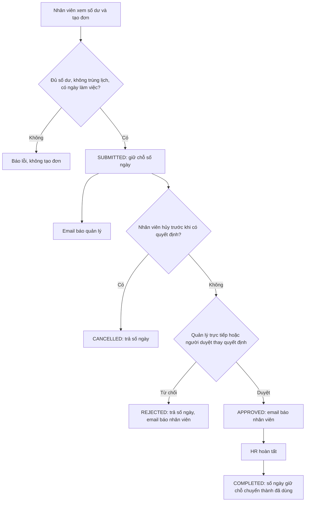

# Business Requirement Description (BRD) – HRHelper (HR Enterprise Platform)

| Mục | Nội dung |
|---|---|
| Dự án | HRHelper – HR Enterprise Platform (trước tuần 9 gọi là Enterprise HR Platform) – môn Cloud Application Development |
| Phiên bản tài liệu | 2.0 |
| Ngày | 12/11/2026 (tuần 10) |
| Người soạn | TV1 (Dương), tổng hợp từ tài liệu của cả nhóm tuần 4–9 |
| Trạng thái | Bản nộp, chờ nhóm và giảng viên góp ý |
| Tài liệu tiếp theo | [SRS – đặc tả yêu cầu phần mềm](../requirements/SRS.md) → [Kiến trúc hệ thống](../architecture/SAD-1-system-architecture.md) · [Kiến trúc phần mềm](../architecture/SAD-2-software-architecture.md) |
| Tài liệu liên quan | [Business rule nghỉ phép](leave-rules.md) · [Danh mục loại phép, ngày lễ](leave-types-holidays.md) · [Ma trận phân quyền](../security/access-control-matrix.md) · [Ca kiểm thử](leave-test-cases.md) · [API](../openapi.yaml) |

**Lịch sử thay đổi**

| Phiên bản | Ngày | Nội dung |
|---|---|---|
| 1.0 | 6/11/2026 | Bản đầu tiên, gom problem statement, functional requirements, NFR (tuần 5), data model (tuần 6), business rule (tuần 8–9) vào một tài liệu |
| 1.1 | 11/11/2026 | Chốt retention đơn nghỉ/audit, quyền xem lý do nghỉ ốm/thai sản và nội dung email (BR-13 → BR-15) |
| 2.0 | 12/11/2026 | Tách yêu cầu chức năng (mục 7), dữ liệu (mục 9), phi chức năng (mục 10) và ma trận truy vết (mục 14) sang [SRS](../requirements/SRS.md) theo ISO/IEC/IEEE 29148. BRD chỉ giữ yêu cầu ở mức nghiệp vụ; số mục giữ nguyên để link cũ không gãy |

**Cách đọc tài liệu:** BRD trả lời **doanh nghiệp cần gì và vì sao**: bối cảnh, mục tiêu, phạm vi, người dùng, quy trình,
business rule, rủi ro, nghiệm thu. **Hệ thống phải làm gì, đo thế nào** nằm ở [SRS](../requirements/SRS.md); **hệ thống được xây thế nào**
nằm ở kiến trúc hệ thống và kiến trúc phần mềm (SAD). Mã truy vết: `MT-n` mục tiêu kinh doanh (tài liệu này), `BR-nn` business
rule ([`leave-rules.md`](leave-rules.md)), `FR-x.y` và `NFR-n` yêu cầu chức năng và phi chức năng (SRS).

---

## 1. Tóm tắt

Doanh nghiệp (giả định) khoảng 2.000 nhân viên đang quản lý hồ sơ nhân sự bằng Excel và duyệt đơn nghỉ phép qua email. Hồ
sơ phân tán, đơn từ thất lạc, việc duyệt chậm và không truy vết được ai đã xem hay sửa dữ liệu nhạy cảm.

HRHelper (HR Enterprise Platform) là ứng dụng web nội bộ chạy trên cloud, tập trung **hồ sơ nhân viên, sơ đồ tổ chức, quy trình nghỉ
phép, kho tài liệu chính sách và lịch sử thao tác** vào một nơi, có phân quyền theo vai trò và theo quan hệ quản lý, mã hóa
dữ liệu nhạy cảm và ghi audit mọi thao tác quan trọng.

Bản MVP (version 1) gồm 7 use case, trong đó **luồng nghỉ phép được làm sâu từ đầu đến cuối** (ADR-05). Tính lương, chấm công,
tuyển dụng nằm ngoài phạm vi.

## 2. Bối cảnh và vấn đề

### 2.1 Doanh nghiệp (giả định)

| Chỉ số | Giá trị |
|---|---|
| Số nhân viên | ~2.000 (dự phòng tăng tới 10.000) |
| Phòng ban | 25, tổ chức dạng cây, gốc là Ban Giám đốc |
| Văn phòng | 3: Hà Nội, Đà Nẵng, TP.HCM |
| Quản lý trực tiếp | ~150 |
| Nhân sự HR | ~15 |

### 2.2 Hiện trạng (AS-IS)

| Vấn đề | Hậu quả |
|---|---|
| Hồ sơ nhân viên nằm ở nhiều file Excel, nhiều người giữ | Dữ liệu lệch nhau, không biết bản nào đúng |
| Đơn nghỉ đi qua email | Đơn thất lạc, duyệt mất khoảng 3 ngày, không ai biết đơn đang ở bước nào |
| Số dư phép tính tay | Sai số dư, nhân viên nghỉ vượt quỹ phép |
| Dữ liệu nhạy cảm (CCCD, tài khoản ngân hàng, lương) nằm trong file dùng chung | Không kiểm soát được ai xem, không có lịch sử |
| Tài liệu chính sách gửi qua email | Nhân viên không biết bản mới nhất, phải hỏi HR |

## 3. Mục tiêu kinh doanh

| Mã | Mục tiêu | Chỉ số đo | Hiện tại | Mục tiêu | Cách đo |
|---|---|---|---|---|---|
| MT-1 | Hồ sơ và tổ chức tập trung | Tỷ lệ nhân viên có hồ sơ trên hệ thống, đúng một quản lý trực tiếp | Không đo được (Excel) | 100% | Truy vấn dữ liệu nhân viên `ACTIVE` |
| MT-2 | Duyệt đơn nghỉ phép nhanh | Thời gian từ khi gửi đơn tới khi có quyết định | ~3 ngày | < 1 ngày làm việc | `leave_request_history`: thời điểm `SUBMITTED` → `APPROVED/REJECTED` |
| MT-3 | Kiểm soát dữ liệu nhạy cảm | Tỷ lệ lượt đọc/sửa trường nhạy cảm và lượt duyệt được ghi audit | 0% | 100% | Đối chiếu audit log với e2e test |
| MT-4 | Nhân viên tự phục vụ | Câu hỏi về thông tin, chính sách phải gửi HR | Không đo | Giảm rõ rệt (đo khi có kho tài liệu) | Số lượt tra cứu danh bạ, tài liệu, trợ lý |

## 4. Phạm vi

### 4.1 Trong phạm vi version 1 (MVP, đến tuần 13 – 7/12/2026)

| Use case | Nội dung | Mục tiêu |
|---|---|---|
| UC1 Hồ sơ nhân viên | Xem, cập nhật hồ sơ; trường nhạy cảm chỉ HR | MT-1, MT-3 |
| UC2 Thông tin tổ chức | Phòng ban, sơ đồ tổ chức, quản lý trực tiếp | MT-1 |
| UC3 Tạo đơn nghỉ | Nhân viên tạo, gửi, hủy đơn | MT-2 |
| UC4 Duyệt đơn | Quản lý trực tiếp duyệt/từ chối, HR hoàn tất | MT-2 |
| UC5 Kho tài liệu | HR đăng tài liệu chính sách, phân phạm vi xem | MT-4 |
| UC6 Tự tra cứu | Tìm đồng nghiệp, tài liệu; trợ lý chính sách (mở rộng) | MT-4 |
| UC7 Lịch sử thao tác | Audit log append-only, tra cứu cho HR/Admin | MT-3 |

### 4.2 Ngoài phạm vi version 1

- Tính lương, chấm công, tuyển dụng, đánh giá năng lực (ADR-05).
- Xuất dữ liệu nghỉ phép sang hệ thống Payroll (chỉ mô phỏng bằng file nếu còn thời gian).
- HR điều chỉnh hoặc hủy đơn đã duyệt (BR-08 ghi rõ chưa thuộc MVP).
- Ứng dụng di động riêng, đa ngôn ngữ, đa doanh nghiệp.
- Production nhiều vùng (multi-AZ); version 1 chạy staging một vùng (ADR-06).

## 5. Stakeholder và người dùng

| Vai trò | Số lượng | Nhu cầu chính | Phạm vi dữ liệu được xem |
|---|---|---|---|
| Nhân viên (EMPLOYEE) | ~2.000 | Xem, sửa liên hệ của mình; tạo, theo dõi, hủy đơn; tra cứu danh bạ và tài liệu | Dữ liệu của mình + danh bạ |
| Quản lý trực tiếp (MANAGER) | ~150 | Duyệt đơn của cấp dưới; xem thông tin cá nhân của cấp dưới | Thêm thông tin cá nhân của cấp dưới trực tiếp (không có trường nhạy cảm) |
| HR | ~15 | Quản lý hồ sơ, hoàn tất đơn, đăng tài liệu, xem audit | Toàn bộ hồ sơ, kể cả trường nhạy cảm (mỗi lần xem ghi audit) |
| Quản trị hệ thống (ADMIN) | 2–3 | Tài khoản, phòng ban, cấu hình, xem audit | Không xem hồ sơ cá nhân hay trường nhạy cảm của người khác |
| Ban giám đốc | – | Báo cáo tổng hợp | Ngoài phạm vi version 1 |
| Bộ phận Payroll | – | Nhận dữ liệu nghỉ phép | Ngoài phạm vi version 1 |

Vai trò MANAGER không gán tay mà **suy ra từ sơ đồ tổ chức**: người có ít nhất một cấp dưới đang làm việc là MANAGER (ADR-10).
HR và ADMIN được gán rõ ràng.

## 6. Quy trình nghiệp vụ mục tiêu (TO-BE): nghỉ phép

Mọi bước ghi lịch sử (ai, lúc nào, từ trạng thái nào sang trạng thái nào, ghi chú) và audit log trong cùng giao dịch với thay
đổi dữ liệu. Business rule chi tiết BR-01 → BR-12: [`leave-rules.md`](leave-rules.md).

## 7. Yêu cầu chức năng

Đã chuyển sang [SRS mục 4](../requirements/SRS.md#4-yêu-cầu-chức-năng-fr): 34 yêu cầu `FR-x.y`, mỗi yêu cầu có mức ưu tiên MoSCoW, tiêu chí chấp
nhận và trạng thái trên `dev`.

| Use case (mục 4.1) | Yêu cầu trong SRS |
|---|---|
| UC1 Hồ sơ nhân viên | FR-1.1 → FR-1.14 |
| UC2 Thông tin tổ chức | FR-2.1 → FR-2.5 |
| UC3 Tạo đơn nghỉ | FR-3.1 → FR-3.7 |
| UC4 Duyệt đơn | FR-4.1 → FR-4.8 |
| UC5 Kho tài liệu chính sách | FR-5.1 → FR-5.3 |
| UC6 Tự tra cứu | FR-6.1 → FR-6.3 |
| UC7 Lịch sử thao tác | FR-7.1 → FR-7.3 |

## 8. Business rule

| Nhóm | Quy tắc | Nguồn |
|---|---|---|
| Nghỉ phép | BR-01 số dư · BR-02 trùng lịch · BR-03 ngày làm việc, ngày lễ · BR-04 nửa ngày · BR-05 người duyệt hợp lệ · BR-06 người duyệt thay · BR-07, BR-08 hủy đơn · BR-09 từ chối · BR-10 HR hoàn tất · BR-11 lịch sử và thao tác lặp · BR-12 tạo đơn hộ | [`leave-rules.md`](leave-rules.md) |
| Loại phép | 8 loại: phép năm, nghỉ ốm, cưới, con cưới, tang, thai sản (nữ, nam), không lương; số ngày, có lương hay không, giấy tờ | [`leave-types-holidays.md`](leave-types-holidays.md) |
| Ngày lễ | Danh sách ngày lễ 2026 theo Bộ luật Lao động và thông báo của Bộ Nội vụ; ngày lễ không trừ phép | [`leave-types-holidays.md`](leave-types-holidays.md) |
| Hồ sơ | Nhân viên chỉ sửa liên hệ; trường nhạy cảm chỉ HR; mỗi nhân viên đúng một quản lý trực tiếp, trừ CEO | FR tuần 5, issue #22 |
| Phân quyền | 4 vai trò × 27 API, điều kiện theo dữ liệu | [Ma trận phân quyền](../security/access-control-matrix.md) |

## 9. Yêu cầu dữ liệu

Đã chuyển sang [SRS mục 5](../requirements/SRS.md#5-yêu-cầu-dữ-liệu) (nhóm dữ liệu, phân loại, quy mô). Ở mức nghiệp vụ: CCCD, số tài khoản
ngân hàng và lương là dữ liệu nhạy cảm, chỉ HR được xem và mọi lượt xem phải truy vết được (MT-3).

## 10. Yêu cầu phi chức năng

Đã chuyển sang [SRS mục 6](../requirements/SRS.md#6-yêu-cầu-phi-chức-năng-nfr) (`NFR-1` → `NFR-11`: hiệu năng, mở rộng, sẵn sàng, phục hồi, bảo mật,
truy vết, chi phí, vận hành, bảo trì, khả dụng, tuân thủ; kèm SLI/SLO/SLA và kịch bản lỗi). Các con số NFR suy ra từ quy mô doanh nghiệp ở mục 2.1 và mục tiêu ở mục 3.

## 11. Giả định, ràng buộc, phụ thuộc

**Giả định**
- Các con số doanh nghiệp (2.000 nhân viên, 25 phòng ban, 99,5%, < 100 USD/tháng) là giả định của nhóm, cần giảng viên xác nhận.
- Mỗi nhân viên có email công ty duy nhất, dùng để khớp tài khoản đăng nhập với hồ sơ.
- Doanh nghiệp áp dụng lịch nghỉ lễ như khu vực công (Tết 5 ngày, Quốc khánh 1–2/9).

**Ràng buộc**
- Nhóm 4 người, 10 tuần (28/9 – 7/12/2026); chỉ TV1 viết code ứng dụng từ tuần 7 (ADR-11).
- Dùng dịch vụ managed cho database, lưu file, đăng nhập (ADR-00); không Kubernetes, không microservices (ADR-01, ADR-06).
- Dữ liệu cá nhân phải tuân thủ quy định bảo vệ dữ liệu cá nhân của Việt Nam (Nghị định 13/2023/NĐ-CP và luật bảo vệ dữ liệu
  cá nhân mới); nhóm cần đối chiếu điều khoản cụ thể trước khi demo với dữ liệu thật. Version 1 chỉ dùng dữ liệu giả lập.

**Phụ thuộc**
- Cloud provider và tài khoản thanh toán (ADR-12, đang review).
- Dịch vụ gửi email trên cloud; nhà cung cấp LLM cho trợ lý (tuần 12).

## 12. Rủi ro

| Rủi ro | Ảnh hưởng | Cách giảm |
|---|---|---|
| Chỉ một người viết code (TV1) | Chậm cả nhóm khi TV1 bận | Phân nhỏ việc; thành viên khác lo hạ tầng, kiểm thử, tài liệu |
| Chi phí cloud vượt hạn mức thẻ | Tài khoản bị khóa, mất staging | AWS Budgets cảnh báo; tắt tài nguyên ngoài giờ demo; phương án dự phòng Azure |
| Lộ dữ liệu nhạy cảm | Vi phạm quy định, mất uy tín | Mã hóa tầng ứng dụng, phân quyền hai lớp, audit, threat model |
| Biên bản kiểm thử không phản ánh lần chạy thật | Lỗi lọt tới demo | Quy tắc chỉ ghi kết quả đã chạy, có ngày và commit; review trước khi merge |
| Phạm vi tuần 10–12 lớn (tài liệu, tìm kiếm, AI) | Không kịp tuần 13 | Ưu tiên M trước; FR-6.3 (C) có thể cắt |

## 13. Tiêu chí nghiệm thu version 1

1. Luồng nghỉ phép chạy trên staging: tạo → duyệt/từ chối → hoàn tất, có email, đúng BR-01 → BR-12.
2. Mọi yêu cầu mức **M** ở [SRS mục 4](../requirements/SRS.md#4-yêu-cầu-chức-năng-fr) đạt tiêu chí chấp nhận, có e2e test hoặc biên bản kiểm thử chức năng.
3. Mọi dòng của ma trận phân quyền có ca kiểm thử được phép và bị chặn.
4. Load test tuần 11 đạt NFR-1, NFR-3 (SRS mục 6).
5. Chi phí staging thực tế dưới NFR-7 (SRS mục 6).

## 14. Ma trận truy vết

Đã chuyển sang [SRS mục 7](../requirements/SRS.md#7-kiểm-chứng-và-truy-vết), thêm cột thiết kế (SAD): mục tiêu `MT-n` → yêu cầu `FR`/`NFR` →
module, ADR → ca kiểm thử.

## 15. Vấn đề còn mở và quyết định đã chốt

### Quyết định đã chốt

| Vấn đề | Quyết định | Theo dõi |
|---|---|---|
| Thời gian lưu audit log và đơn nghỉ | Mốc retention nội bộ: đơn nghỉ 5 năm từ khi kết thúc; audit 5 năm từ lúc ghi. Chưa khẳng định là thời hạn luật định; HR/pháp chế phải xác nhận trước production và áp dụng thời hạn bắt buộc dài hơn. Legal hold tạm dừng hủy; xử lý hết hạn qua archive bất biến hoặc hủy/khử định danh được phê duyệt, không cho ứng dụng quyền xóa thông thường. | BR-13 trong [`leave-rules.md`](leave-rules.md); đồng bộ ADR-09 và thiết kế retention trước production |
| Ai được xem lý do nghỉ ốm/thai sản | Chỉ nhân viên đứng tên đơn và HR xem lý do chi tiết trên mọi bề mặt; HR đọc tạo audit không chứa giá trị lý do. Không để lộ lý do/comment sức khỏe qua audit (kể cả quyền đọc audit của ADMIN), export hoặc email. | BR-14 trong [`leave-rules.md`](leave-rules.md); cần lọc response và audit payload |
| Email nghỉ phép (T-16) | Subject/body chỉ báo chung và link inbox chung cần đăng nhập; không có thông tin nhận diện/chi tiết đơn trong nội dung hay URL. Outbox/log cũng chỉ mang dữ liệu tối thiểu để định tuyến, không mang lý do, comment, loại phép hoặc ngày nghỉ không cần thiết. | BR-15 trong [`leave-rules.md`](leave-rules.md); cần cập nhật template, payload và kiểm thử |

### Còn mở

| Vấn đề | Ai quyết định | Hạn |
|---|---|---|
| Ngày hoán đổi làm bù của khu vực công có áp dụng cho doanh nghiệp không | TV2, TV4 | Trước khi có lịch 2027 |
| Cloud provider và dịch vụ cụ thể | TV3 (ADR-12) | Tuần 9 |

## 16. Thuật ngữ

| Thuật ngữ | Nghĩa |
|---|---|
| Quản lý trực tiếp | Người quản lý được ghi trên hồ sơ nhân viên trong sơ đồ tổ chức |
| Người duyệt thay | Quản lý được HR chỉ định thay quyền duyệt trong một khoảng ngày (BR-06) |
| Số dư khả dụng | Được hưởng − đã dùng − đang chờ duyệt |
| Trường nhạy cảm | CCCD, số tài khoản ngân hàng, lương |
| Audit log | Nhật ký thao tác chỉ được thêm; không sửa trong thời hạn lưu. Hết hạn thì archive/hủy theo retention được phê duyệt và legal hold (BR-13) |
| MVP | Bản sản phẩm tối thiểu nộp ở tuần 13 (version 1) |
| ADR | Architecture Decision Record: bản ghi một quyết định kiến trúc |
