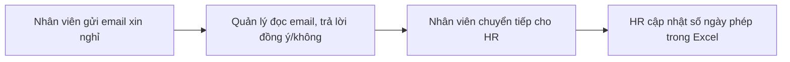
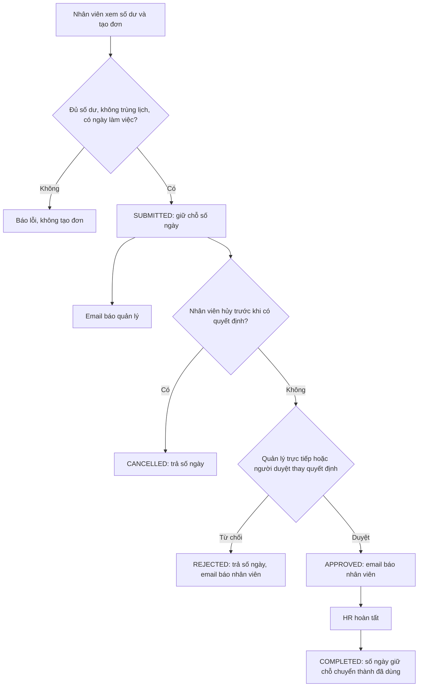

# Business Requirement Description (BRD) – Enterprise HR Platform

| Mục | Nội dung |
|---|---|
| Dự án | Enterprise HR Platform – môn Cloud Application Development |
| Phiên bản tài liệu | 1.0 |
| Ngày | 6/11/2026 (tuần 9) |
| Người soạn | TV1 (Dương), tổng hợp từ tài liệu của cả nhóm tuần 4–9 |
| Trạng thái | Bản nộp, chờ nhóm và giảng viên góp ý |
| Tài liệu liên quan | [Kiến trúc tổng quan](../architecture.md) · [Business rule nghỉ phép](leave-rules.md) · [Danh mục loại phép, ngày lễ](leave-types-holidays.md) · [Ma trận phân quyền](../security/access-control-matrix.md) · [Ca kiểm thử](leave-test-cases.md) · [API](../openapi.yaml) |

**Lịch sử thay đổi**

| Phiên bản | Ngày | Nội dung |
|---|---|---|
| 1.0 | 6/11/2026 | Bản đầu tiên, gom problem statement, functional requirements, NFR (tuần 5), data model (tuần 6), business rule (tuần 8–9) vào một tài liệu |

**Cách đọc tài liệu:** mỗi yêu cầu có mã để truy vết. `MT-n` là mục tiêu kinh doanh, `FR-x.y` là yêu cầu chức năng theo use
case, `NFR-n` là yêu cầu phi chức năng, `BR-nn` là business rule chi tiết trong [`leave-rules.md`](leave-rules.md). Cột
"Trạng thái" phản ánh hệ thống trên nhánh `dev` ngày 6/11/2026: **Đã có** (đã chạy và có test), **Một phần**, **Kế hoạch tuần N**.

---

## 1. Tóm tắt

Doanh nghiệp (giả định) khoảng 2.000 nhân viên đang quản lý hồ sơ nhân sự bằng Excel và duyệt đơn nghỉ phép qua email. Hồ
sơ phân tán, đơn từ thất lạc, việc duyệt chậm và không truy vết được ai đã xem hay sửa dữ liệu nhạy cảm.

Enterprise HR Platform là ứng dụng web nội bộ chạy trên cloud, tập trung **hồ sơ nhân viên, sơ đồ tổ chức, quy trình nghỉ
phép, kho tài liệu chính sách và lịch sử thao tác** vào một nơi, có phân quyền theo vai trò và theo quan hệ quản lý, mã hóa
dữ liệu nhạy cảm và ghi audit mọi thao tác quan trọng.

Bản MVP (version 1) gồm 7 use case, trong đó **luồng nghỉ phép được làm sâu từ đầu đến cuối** (ADR-05). Tính lương, chấm công,
tuyển dụng nằm ngoài phạm vi.

## 2. Bối cảnh và vấn đề

### 2.1 Doanh nghiệp (giả định)

| Chỉ số | Giá trị |
|---|---|
| Số nhân viên | ~2.000 (dự phòng tăng tới 10.000) |
| Phòng ban | 25, tổ chức dạng cây, gốc là Ban Giám đốc |
| Văn phòng | 3: Hà Nội, Đà Nẵng, TP.HCM |
| Quản lý trực tiếp | ~150 |
| Nhân sự HR | ~15 |

### 2.2 Hiện trạng (AS-IS)

| Vấn đề | Hậu quả |
|---|---|
| Hồ sơ nhân viên nằm ở nhiều file Excel, nhiều người giữ | Dữ liệu lệch nhau, không biết bản nào đúng |
| Đơn nghỉ đi qua email | Đơn thất lạc, duyệt mất khoảng 3 ngày, không ai biết đơn đang ở bước nào |
| Số dư phép tính tay | Sai số dư, nhân viên nghỉ vượt quỹ phép |
| Dữ liệu nhạy cảm (CCCD, tài khoản ngân hàng, lương) nằm trong file dùng chung | Không kiểm soát được ai xem, không có lịch sử |
| Tài liệu chính sách gửi qua email | Nhân viên không biết bản mới nhất, phải hỏi HR |

## 3. Mục tiêu kinh doanh

| Mã | Mục tiêu | Chỉ số đo | Hiện tại | Mục tiêu | Cách đo |
|---|---|---|---|---|---|
| MT-1 | Hồ sơ và tổ chức tập trung | Tỷ lệ nhân viên có hồ sơ trên hệ thống, đúng một quản lý trực tiếp | Không đo được (Excel) | 100% | Truy vấn dữ liệu nhân viên `ACTIVE` |
| MT-2 | Duyệt đơn nghỉ phép nhanh | Thời gian từ khi gửi đơn tới khi có quyết định | ~3 ngày | < 1 ngày làm việc | `leave_request_history`: thời điểm `SUBMITTED` → `APPROVED/REJECTED` |
| MT-3 | Kiểm soát dữ liệu nhạy cảm | Tỷ lệ lượt đọc/sửa trường nhạy cảm và lượt duyệt được ghi audit | 0% | 100% | Đối chiếu audit log với e2e test |
| MT-4 | Nhân viên tự phục vụ | Câu hỏi về thông tin, chính sách phải gửi HR | Không đo | Giảm rõ rệt (đo khi có kho tài liệu) | Số lượt tra cứu danh bạ, tài liệu, trợ lý |

## 4. Phạm vi

### 4.1 Trong phạm vi version 1 (MVP, đến tuần 13 – 7/12/2026)

| Use case | Nội dung | Mục tiêu |
|---|---|---|
| UC1 Hồ sơ nhân viên | Xem, cập nhật hồ sơ; trường nhạy cảm chỉ HR | MT-1, MT-3 |
| UC2 Thông tin tổ chức | Phòng ban, sơ đồ tổ chức, quản lý trực tiếp | MT-1 |
| UC3 Tạo đơn nghỉ | Nhân viên tạo, gửi, hủy đơn | MT-2 |
| UC4 Duyệt đơn | Quản lý trực tiếp duyệt/từ chối, HR hoàn tất | MT-2 |
| UC5 Kho tài liệu | HR đăng tài liệu chính sách, phân phạm vi xem | MT-4 |
| UC6 Tự tra cứu | Tìm đồng nghiệp, tài liệu; trợ lý chính sách (mở rộng) | MT-4 |
| UC7 Lịch sử thao tác | Audit log append-only, tra cứu cho HR/Admin | MT-3 |

### 4.2 Ngoài phạm vi version 1

- Tính lương, chấm công, tuyển dụng, đánh giá năng lực (ADR-05).
- Xuất dữ liệu nghỉ phép sang hệ thống Payroll (chỉ mô phỏng bằng file nếu còn thời gian).
- HR điều chỉnh hoặc hủy đơn đã duyệt (BR-08 ghi rõ chưa thuộc MVP).
- Ứng dụng di động riêng, đa ngôn ngữ, đa doanh nghiệp.
- Production nhiều vùng (multi-AZ); version 1 chạy staging một vùng (ADR-06).

## 5. Stakeholder và người dùng

| Vai trò | Số lượng | Nhu cầu chính | Phạm vi dữ liệu được xem |
|---|---|---|---|
| Nhân viên (EMPLOYEE) | ~2.000 | Xem, sửa liên hệ của mình; tạo, theo dõi, hủy đơn; tra cứu danh bạ và tài liệu | Dữ liệu của mình + danh bạ |
| Quản lý trực tiếp (MANAGER) | ~150 | Duyệt đơn của cấp dưới; xem thông tin cá nhân của cấp dưới | Thêm thông tin cá nhân của cấp dưới trực tiếp (không có trường nhạy cảm) |
| HR | ~15 | Quản lý hồ sơ, hoàn tất đơn, đăng tài liệu, xem audit | Toàn bộ hồ sơ, kể cả trường nhạy cảm (mỗi lần xem ghi audit) |
| Quản trị hệ thống (ADMIN) | 2–3 | Tài khoản, phòng ban, cấu hình, xem audit | Không xem hồ sơ cá nhân hay trường nhạy cảm của người khác |
| Ban giám đốc | – | Báo cáo tổng hợp | Ngoài phạm vi version 1 |
| Bộ phận Payroll | – | Nhận dữ liệu nghỉ phép | Ngoài phạm vi version 1 |

Vai trò MANAGER không gán tay mà **suy ra từ sơ đồ tổ chức**: người có ít nhất một cấp dưới đang làm việc là MANAGER (ADR-10).
HR và ADMIN được gán rõ ràng.

## 6. Quy trình nghiệp vụ mục tiêu (TO-BE): nghỉ phép

Mọi bước ghi lịch sử (ai, lúc nào, từ trạng thái nào sang trạng thái nào, ghi chú) và audit log trong cùng giao dịch với thay
đổi dữ liệu. Business rule chi tiết BR-01 → BR-12: [`leave-rules.md`](leave-rules.md).

## 7. Yêu cầu chức năng

Mức ưu tiên theo MoSCoW: **M** (bắt buộc), **S** (nên có), **C** (có thể có).

### UC1 – Hồ sơ nhân viên

| Mã | Yêu cầu | Ưu tiên | Tiêu chí chấp nhận | Trạng thái |
|---|---|---|---|---|
| FR-1.1 | Xem hồ sơ theo 3 mức: danh bạ (mọi người), cá nhân (chính mình, quản lý trực tiếp), đầy đủ (HR) | M | Người ngoài không thấy ngày sinh, địa chỉ; quản lý thấy thông tin cá nhân cấp dưới; ADMIN chỉ thấy mức danh bạ | Đã có |
| FR-1.2 | Nhân viên tự sửa số điện thoại, địa chỉ của mình | M | Sửa trường khác hoặc hồ sơ người khác bị từ chối (403) | Đã có |
| FR-1.3 | HR xem CCCD, số tài khoản, lương; mỗi lượt xem ghi audit | M | Vai trò khác bị 403; audit có `VIEW_SENSITIVE` | Đã có |
| FR-1.4 | HR sửa mọi trường hồ sơ, kể cả trường nhạy cảm | M | Audit chỉ ghi tên trường nhạy cảm, không ghi giá trị | Một phần: API có, giao diện tuần 10 |
| FR-1.5 | HR tạo nhân viên mới (phòng ban, chức danh, quản lý trực tiếp, trường nhạy cảm) | M | Thiếu dữ liệu bắt buộc trả 400; quản lý tạo vòng lặp bị chặn | Một phần: API có, giao diện tuần 10 |
| FR-1.6 | Hai người cùng sửa một hồ sơ không ghi đè nhau | S | Gửi `version` cũ trả 409 | Đã có |

### UC2 – Thông tin tổ chức

| Mã | Yêu cầu | Ưu tiên | Tiêu chí chấp nhận | Trạng thái |
|---|---|---|---|---|
| FR-2.1 | Danh bạ: tìm theo tên, email, mã; lọc phòng ban; phân trang | M | Không hiện nhân viên đã nghỉ việc; tối đa 100 dòng/trang | Đã có |
| FR-2.2 | Xem toàn bộ cây tổ chức và thành viên từng phòng ban | M | Cây có một gốc; quyết định issue #21: không cần nhập mã phòng ban | Đã có |
| FR-2.3 | Xem quản lý trực tiếp và nhân viên trực thuộc của một người | M | Danh sách cấp dưới đúng với dữ liệu | Đã có |
| FR-2.4 | HR, ADMIN tạo và sửa phòng ban | S | Đổi phòng ban cha không được tạo vòng | Một phần: API có |
| FR-2.5 | Mỗi nhân viên có đúng một quản lý trực tiếp, trừ CEO | M | Tạo/sửa nhân viên thiếu quản lý (không phải CEO) bị từ chối (issue #22) | Kế hoạch tuần 10 |

### UC3 – Tạo đơn nghỉ

| Mã | Yêu cầu | Ưu tiên | Tiêu chí chấp nhận | Trạng thái |
|---|---|---|---|---|
| FR-3.1 | Xem số dư phép theo loại: được hưởng, đã dùng, đang chờ, còn lại | M | Còn lại = được hưởng − đã dùng − đang chờ | Đã có |
| FR-3.2 | Tạo đơn: loại phép, khoảng ngày, nghỉ nửa ngày, lý do | M | Không đủ số dư trả 400 (BR-01) | Đã có |
| FR-3.3 | Không cho đơn trùng lịch với đơn đang chờ hoặc đã duyệt | M | Trùng ngày trả 409; hai nửa ngày khác buổi không trùng (BR-02, BR-04) | Đã có |
| FR-3.4 | Số ngày tính theo ngày làm việc, bỏ cuối tuần và ngày lễ | M | 29/4–4/5/2026 tính 2 ngày; đơn chỉ gồm ngày nghỉ bù 27/4 bị từ chối (BR-03) | Đã có |
| FR-3.5 | Gửi lại do mạng lỗi không tạo đơn thứ hai | M | Cùng `Idempotency-Key` trả lại đơn cũ (BR-11) | Đã có |
| FR-3.6 | Nhân viên hủy đơn chưa có quyết định; không tự hủy đơn đã duyệt | M | Hủy trả lại số ngày; hủy đơn đã duyệt trả 409 (BR-07, BR-08) | Đã có |
| FR-3.7 | HR và quản lý trực tiếp tạo đơn hộ nhân viên | S | Số dư là của nhân viên; nhân viên nhận email, vẫn tự hủy được; lịch sử ghi người tạo hộ (BR-12) | Kế hoạch tuần 10 |

### UC4 – Duyệt đơn

| Mã | Yêu cầu | Ưu tiên | Tiêu chí chấp nhận | Trạng thái |
|---|---|---|---|---|
| FR-4.1 | Quản lý xem danh sách đơn chờ duyệt của cấp dưới trực tiếp | M | Không thấy đơn của người không trực thuộc | Đã có |
| FR-4.2 | Duyệt hoặc từ chối kèm ghi chú; chỉ quản lý trực tiếp tại thời điểm xử lý | M | Người khác trả 403; duyệt lại lần hai không đổi gì; quyết định ngược lại trả 409 (BR-05, BR-09, BR-11) | Đã có |
| FR-4.3 | Người duyệt thay khi quản lý vắng mặt, do HR chỉ định theo khoảng ngày | S | Người thay thấy và xử lý đơn trong thời hạn được giao (BR-06) | Kế hoạch tuần 10 |
| FR-4.4 | HR duyệt đơn của CEO (người duy nhất không có quản lý) | S | Chỉ áp dụng cho đơn của CEO (issue #22) | Kế hoạch tuần 10 |
| FR-4.5 | HR hoàn tất đơn đã duyệt | M | Số ngày giữ chỗ chuyển thành đã dùng; đơn chưa duyệt trả 409 (BR-10) | Đã có |
| FR-4.6 | Email thông báo: đơn mới → quản lý; duyệt, từ chối, hoàn tất → nhân viên; hủy → quản lý | M | Email tới đúng người; không gửi trùng khi hệ thống gửi lại event | Đã có |
| FR-4.7 | Xem chi tiết đơn và lịch sử trạng thái | M | Chỉ chủ đơn, quản lý trực tiếp, HR xem được | Đã có |

### UC5 – Kho tài liệu chính sách

| Mã | Yêu cầu | Ưu tiên | Tiêu chí chấp nhận | Trạng thái |
|---|---|---|---|---|
| FR-5.1 | HR tải lên tài liệu PDF/DOCX kèm tiêu đề, loại, phạm vi xem (toàn công ty, phòng ban, vai trò) | M | Chỉ HR tải lên được; file không đi qua API mà tải thẳng lên object storage | Kế hoạch tuần 10 |
| FR-5.2 | Nhân viên chỉ xem, tải tài liệu thuộc phạm vi của mình | M | Tài liệu ngoài phạm vi không hiện trong danh sách và link tải bị từ chối | Kế hoạch tuần 10 |
| FR-5.3 | Tài liệu có phiên bản; mặc định hiện phiên bản mới nhất | S | Đăng bản mới không mất bản cũ | Kế hoạch tuần 10 |

### UC6 – Tự tra cứu

| Mã | Yêu cầu | Ưu tiên | Tiêu chí chấp nhận | Trạng thái |
|---|---|---|---|---|
| FR-6.1 | Tìm đồng nghiệp | M | Như FR-2.1 | Đã có |
| FR-6.2 | Tìm tài liệu theo từ khóa trong tiêu đề và nội dung, lọc theo quyền | M | Không trả tài liệu ngoài phạm vi | Kế hoạch tuần 10 |
| FR-6.3 | Trợ lý trả lời câu hỏi về chính sách HR, có trích dẫn tài liệu nguồn | C | Chỉ dùng tài liệu người hỏi được xem; không trả lời được thì chỉ tới tài liệu gốc | Kế hoạch tuần 12 |

### UC7 – Lịch sử thao tác

| Mã | Yêu cầu | Ưu tiên | Tiêu chí chấp nhận | Trạng thái |
|---|---|---|---|---|
| FR-7.1 | Ghi audit cho tạo/sửa hồ sơ, đọc trường nhạy cảm, mọi bước của đơn nghỉ | M | Audit ghi cùng giao dịch với thao tác; không ghi giá trị nhạy cảm | Đã có |
| FR-7.2 | Audit chỉ được thêm, không ai sửa/xóa | M | Lệnh UPDATE/DELETE trên bảng audit bị database chặn | Đã có |
| FR-7.3 | HR, ADMIN tra cứu audit theo đối tượng, người thực hiện, khoảng thời gian | M | Vai trò khác trả 403 | Một phần: API có, giao diện tuần 10 |

**Tổng hợp:** 34 yêu cầu chức năng; 21 đã có, 4 một phần (API có, chưa có giao diện), 9 theo kế hoạch tuần 10–12.

## 8. Business rule

| Nhóm | Quy tắc | Nguồn |
|---|---|---|
| Nghỉ phép | BR-01 số dư · BR-02 trùng lịch · BR-03 ngày làm việc, ngày lễ · BR-04 nửa ngày · BR-05 người duyệt hợp lệ · BR-06 người duyệt thay · BR-07, BR-08 hủy đơn · BR-09 từ chối · BR-10 HR hoàn tất · BR-11 lịch sử và thao tác lặp · BR-12 tạo đơn hộ | [`leave-rules.md`](leave-rules.md) |
| Loại phép | 8 loại: phép năm, nghỉ ốm, cưới, con cưới, tang, thai sản (nữ, nam), không lương; số ngày, có lương hay không, giấy tờ | [`leave-types-holidays.md`](leave-types-holidays.md) |
| Ngày lễ | Danh sách ngày lễ 2026 theo Bộ luật Lao động và thông báo của Bộ Nội vụ; ngày lễ không trừ phép | [`leave-types-holidays.md`](leave-types-holidays.md) |
| Hồ sơ | Nhân viên chỉ sửa liên hệ; trường nhạy cảm chỉ HR; mỗi nhân viên đúng một quản lý trực tiếp, trừ CEO | FR tuần 5, issue #22 |
| Phân quyền | 4 vai trò × 27 API, điều kiện theo dữ liệu | [Ma trận phân quyền](../security/access-control-matrix.md) |

## 9. Yêu cầu dữ liệu

### 9.1 Dữ liệu chính

| Nhóm dữ liệu | Nội dung | Phân loại |
|---|---|---|
| Hồ sơ nhân viên | Mã, họ tên, email công ty, điện thoại, ngày sinh, địa chỉ, phòng ban, chức danh, quản lý, ngày vào làm, trạng thái | Cá nhân |
| Trường nhạy cảm | CCCD, số tài khoản ngân hàng, lương | **Nhạy cảm:** mã hóa ở tầng ứng dụng, chỉ HR, đọc là ghi audit (ADR-08) |
| Tổ chức | Phòng ban (cây), chức danh, trưởng đơn vị | Nội bộ |
| Nghỉ phép | Loại phép, số dư theo năm, đơn, lịch sử trạng thái, ngày lễ | Cá nhân (đơn nghỉ ốm, thai sản cần hạn chế người xem) |
| Tài liệu | Metadata, file, phạm vi xem, phiên bản | Nội bộ |
| Audit | Ai, làm gì, trên đối tượng nào, lúc nào, trường nào đổi | Nhạy cảm (chỉ HR, ADMIN) |

Mô hình dữ liệu chi tiết: [data model tuần 6](../progress/tuan-06/TV2_Thanh.md#2-data-model--data-ownership).

### 9.2 Quy mô (ước tính tuần 5)

| Dữ liệu | Khối lượng |
|---|---|
| Đơn nghỉ phép | ~100 đơn/ngày (~25.000 đơn/năm) |
| Audit log | ~1,25 triệu bản ghi/năm |
| Tài liệu | ~500 file, ~2 GB |
| Lưu lượng | trung bình ≈ 0,5 request/giây, cao điểm ≈ 10, thiết kế cho 50 |

## 10. Yêu cầu phi chức năng

| Mã | Nhóm | Yêu cầu | Cách kiểm chứng |
|---|---|---|---|
| NFR-1 | Hiệu năng | p95 < 300 ms API đọc, < 500 ms API ghi, tìm kiếm p95 < 1 s | Load test tuần 11 ở 50 request/giây |
| NFR-2 | Mở rộng | ~500 người dùng đồng thời; tăng 5× (10.000 nhân viên) không đổi kiến trúc | Load test tuần 11 |
| NFR-3 | Sẵn sàng | 99,5%/tháng (≈ 3,6 giờ dừng); 2 instance API, mất 1 instance lỗi < 1% (ADR-06) | Tắt 1 instance trong load test |
| NFR-4 | Phục hồi | RPO ≤ 1 giờ, RTO ≤ 4 giờ; không mất đơn đã gửi | Khôi phục thử database về một thời điểm |
| NFR-5 | Bảo mật | Nhân viên không đọc được hồ sơ người khác; quản lý chỉ thấy cấp dưới; trường nhạy cảm mã hóa, chỉ HR; TLS mọi kết nối; secret không nằm trong code | e2e test phân quyền theo ma trận; threat model tuần 9 |
| NFR-6 | Truy vết | 100% thao tác duyệt và đọc trường nhạy cảm có audit | e2e test |
| NFR-7 | Chi phí | < 100 USD/tháng cho staging | AWS Budgets (ADR-12) |

## 11. Giả định, ràng buộc, phụ thuộc

**Giả định**
- Các con số doanh nghiệp (2.000 nhân viên, 25 phòng ban, 99,5%, < 100 USD/tháng) là giả định của nhóm, cần giảng viên xác nhận.
- Mỗi nhân viên có email công ty duy nhất, dùng để khớp tài khoản đăng nhập với hồ sơ.
- Doanh nghiệp áp dụng lịch nghỉ lễ như khu vực công (Tết 5 ngày, Quốc khánh 1–2/9).

**Ràng buộc**
- Nhóm 4 người, 10 tuần (28/9 – 7/12/2026); chỉ TV1 viết code ứng dụng từ tuần 7 (ADR-11).
- Dùng dịch vụ managed cho database, lưu file, đăng nhập (ADR-00); không Kubernetes, không microservices (ADR-01, ADR-06).
- Dữ liệu cá nhân phải tuân thủ quy định bảo vệ dữ liệu cá nhân của Việt Nam (Nghị định 13/2023/NĐ-CP và luật bảo vệ dữ liệu
  cá nhân mới); nhóm cần đối chiếu điều khoản cụ thể trước khi demo với dữ liệu thật. Version 1 chỉ dùng dữ liệu giả lập.

**Phụ thuộc**
- Cloud provider và tài khoản thanh toán (ADR-12, đang review).
- Dịch vụ gửi email trên cloud; nhà cung cấp LLM cho trợ lý (tuần 12).

## 12. Rủi ro

| Rủi ro | Ảnh hưởng | Cách giảm |
|---|---|---|
| Chỉ một người viết code (TV1) | Chậm cả nhóm khi TV1 bận | Phân nhỏ việc; thành viên khác lo hạ tầng, kiểm thử, tài liệu |
| Chi phí cloud vượt hạn mức thẻ | Tài khoản bị khóa, mất staging | AWS Budgets cảnh báo; tắt tài nguyên ngoài giờ demo; phương án dự phòng Azure |
| Lộ dữ liệu nhạy cảm | Vi phạm quy định, mất uy tín | Mã hóa tầng ứng dụng, phân quyền hai lớp, audit, threat model |
| Biên bản kiểm thử không phản ánh lần chạy thật | Lỗi lọt tới demo | Quy tắc chỉ ghi kết quả đã chạy, có ngày và commit; review trước khi merge |
| Phạm vi tuần 10–12 lớn (tài liệu, tìm kiếm, AI) | Không kịp tuần 13 | Ưu tiên M trước; FR-6.3 (C) có thể cắt |

## 13. Tiêu chí nghiệm thu version 1

1. Luồng nghỉ phép chạy trên staging: tạo → duyệt/từ chối → hoàn tất, có email, đúng BR-01 → BR-12.
2. Mọi yêu cầu mức **M** ở mục 7 đạt tiêu chí chấp nhận, có e2e test hoặc biên bản kiểm thử chức năng.
3. Mọi dòng của ma trận phân quyền có ca kiểm thử được phép và bị chặn.
4. Load test tuần 11 đạt NFR-1, NFR-3.
5. Chi phí staging thực tế dưới NFR-7.

## 14. Ma trận truy vết

| Mục tiêu | Use case | Yêu cầu | Business rule | Kiểm chứng |
|---|---|---|---|---|
| MT-1 | UC1, UC2 | FR-1.1 → FR-1.6, FR-2.1 → FR-2.5 | Quy tắc hồ sơ, issue #21, #22 | e2e `app.e2e-spec.ts`; biên bản kiểm thử tuần 7 |
| MT-2 | UC3, UC4 | FR-3.1 → FR-3.7, FR-4.1 → FR-4.7 | BR-01 → BR-12 | 22 ca kiểm thử `leave-test-cases.md`; e2e nhóm "workflow nghỉ phép" |
| MT-3 | UC1, UC7 | FR-1.3, FR-1.4, FR-7.1 → FR-7.3 | ADR-08, ADR-09 | e2e audit, `VIEW_SENSITIVE`; ma trận phân quyền |
| MT-4 | UC5, UC6 | FR-5.1 → FR-5.3, FR-6.1 → FR-6.3 | Phạm vi tài liệu | Kế hoạch kiểm thử tuần 10, 12 |

## 15. Vấn đề còn mở

| Vấn đề | Ai quyết định | Hạn |
|---|---|---|
| Thời gian lưu audit log và đơn nghỉ (retention) | TV2 với TV1 | Tuần 10 |
| Ai được xem lý do nghỉ của đơn nghỉ ốm, thai sản | TV2 | Tuần 10 |
| Ngày hoán đổi làm bù của khu vực công có áp dụng cho doanh nghiệp không | TV2, TV4 | Trước khi có lịch 2027 |
| Cloud provider và dịch vụ cụ thể | TV3 (ADR-12) | Tuần 9 |

## 16. Thuật ngữ

| Thuật ngữ | Nghĩa |
|---|---|
| Quản lý trực tiếp | Người quản lý được ghi trên hồ sơ nhân viên trong sơ đồ tổ chức |
| Người duyệt thay | Quản lý được HR chỉ định thay quyền duyệt trong một khoảng ngày (BR-06) |
| Số dư khả dụng | Được hưởng − đã dùng − đang chờ duyệt |
| Trường nhạy cảm | CCCD, số tài khoản ngân hàng, lương |
| Audit log | Nhật ký thao tác chỉ được thêm, không sửa, không xóa |
| MVP | Bản sản phẩm tối thiểu nộp ở tuần 13 (version 1) |
| ADR | Architecture Decision Record: bản ghi một quyết định kiến trúc |
