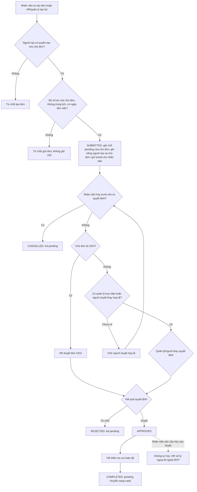

# Business rules – quy trình nghỉ phép

> Phụ lục của [BRD](BRD.md): business rule `BR-nn` của luồng nghỉ phép. Bộ tài liệu: [`docs/README.md`](../README.md).

Tài liệu này mô tả quy tắc nghiệp vụ cho luồng nghỉ phép MVP, đối chiếu với functional requirements UC3–UC4 tuần 5 và state machine trong `backend/src/modules/leave/leave-state-machine.ts`.

**Thuật ngữ thống nhất:** "quản lý trực tiếp" là người quản lý được ghi trong thông tin tổ chức; "người duyệt thay" là quản lý đang làm việc được HR ghi nhận thay quyền quản lý trực tiếp trong khoảng thời gian xác định (xem BR-06). Cả hai được gọi chung là "người duyệt hợp lệ". CEO là ngoại lệ duy nhất không có quản lý trực tiếp; HR duyệt đơn của CEO theo BR-05.

## Bảng business rule

| Mã | Quy tắc | Ví dụ |
|---|---|---|
| BR-01 | **Kiểm tra số dư trước khi gửi đơn.** Số ngày yêu cầu không được lớn hơn số dư khả dụng: `entitled - used - pending`; yêu cầu bằng đúng số dư vẫn hợp lệ. Đơn hợp lệ chuyển sang `SUBMITTED` và giữ chỗ số ngày trong `pending`; không trừ `used` ngay khi gửi. | Có 12 ngày được hưởng, 2 ngày đã dùng và 3 ngày đang chờ duyệt: còn 7 ngày khả dụng. Đơn 7 ngày được gửi; đơn 7,5 ngày bị từ chối. |
| BR-02 | **Không cho phép đơn trùng lịch.** Với cùng nhân viên, khoảng ngày nghỉ của đơn mới không được giao với một đơn khác đang `SUBMITTED` hoặc `APPROVED`. Đơn `REJECTED`, `CANCELLED` hoặc `COMPLETED` không giữ chỗ lịch. Hai khoảng ngày có chung một ngày được tính là trùng, trừ trường hợp hai đơn nửa ngày khác buổi trong cùng ngày (xem BR-04). | Đơn đang chờ duyệt từ 10–12/11; gửi đơn mới từ 12–13/11 phải bị từ chối vì cùng có ngày 12/11. |
| BR-03 | **Tính ngày nghỉ theo ngày làm việc.** Tính cả ngày bắt đầu và kết thúc, bỏ thứ Bảy, Chủ nhật và các ngày nghỉ lễ (kể cả ngày nghỉ bù) theo danh sách trong [`leave-types-holidays.md`](leave-types-holidays.md); ngày nghỉ lễ không trừ vào số dư phép. Số ngày nghỉ phải theo bước 0,5 ngày. Đơn có 0 ngày làm việc (khoảng nghỉ chỉ gồm thứ Bảy, Chủ nhật hoặc ngày nghỉ lễ) bị từ chối. | Nghỉ từ thứ Sáu đến thứ Hai tính là 2 ngày làm việc. Nghỉ từ thứ Tư 29/4/2026 đến thứ Hai 4/5/2026 tính 2 ngày (29/4 và 4/5), vì 30/4 và 1/5 là ngày lễ, 2–3/5 là cuối tuần. Đơn chỉ gồm thứ Hai 27/4/2026 (nghỉ bù Giỗ Tổ) hoặc chỉ gồm thứ Bảy, Chủ nhật tính 0 ngày nên bị từ chối. |
| BR-04 | **Nghỉ nửa ngày được tính là 0,5 ngày.** Nhân viên chọn buổi sáng hoặc buổi chiều cho một ngày làm việc. Hai yêu cầu nửa ngày khác buổi trong cùng ngày không trùng; yêu cầu cùng buổi hoặc một yêu cầu cả ngày thì trùng. Đây là ngoại lệ của BR-02. | Nhân viên A đã gửi đơn nghỉ buổi sáng thứ Hai. Đơn nghỉ buổi chiều thứ Hai không trùng; đơn nghỉ cả ngày thứ Hai bị từ chối. |
| BR-05 | **Chỉ người duyệt hợp lệ mới được duyệt hoặc từ chối.** Người duyệt phải là quản lý trực tiếp của nhân viên tại thời điểm xử lý (trường hợp vắng mặt xem BR-06). HR chỉ duyệt đơn của CEO, là chức danh duy nhất được miễn có quản lý trực tiếp. Mỗi đơn chỉ nhận một quyết định; đơn không còn ở `SUBMITTED` không thể nhận một quyết định khác. Gửi lặp cùng quyết định không tạo side effect (xem BR-11). | Quản lý trực tiếp chọn từ chối, đơn chuyển `SUBMITTED` → `REJECTED`; lần duyệt sau đó bị từ chối do xung đột trạng thái. |
| BR-06 | **Xử lý khi quản lý trực tiếp vắng mặt.** HR ghi nhận người duyệt thay đang làm việc cho một quản lý trực tiếp cụ thể, gồm ngày bắt đầu, ngày kết thúc (tính cả hai ngày) và người HR tạo/cập nhật phân công. Mỗi quản lý chỉ có tối đa một phân công hiệu lực tại một thời điểm; phân công không được tự chồng lấn. Người duyệt thay phải là quản lý đang làm việc và có quyền MANAGER. Trong thời gian hiệu lực, người này nhìn thấy các đơn `SUBMITTED` của cấp dưới trực tiếp của quản lý đó trong danh sách chờ duyệt và được duyệt/từ chối với cùng điều kiện trạng thái, version, audit và lịch sử như quản lý trực tiếp. Phân công chỉ thay quyền quyết định, không thay đổi `managerId` trong sơ đồ tổ chức; quyền được xác định theo ngày thực hiện quyết định. Nếu người duyệt thay cũng vắng mặt, HR kết thúc/thay phân công bằng một người duyệt thay khác; không ủy quyền nối tiếp hoặc để HR tự duyệt thay. Khi chưa có người thay hợp lệ, đơn giữ `SUBMITTED` và nhân viên vẫn có thể tự hủy theo BR-07. | Quản lý trực tiếp nghỉ từ 10–16/11; HR ghi nhận một quản lý khác làm người duyệt thay trong đúng khoảng ngày đó. Người thay thấy đơn chờ duyệt của cấp dưới trực tiếp của quản lý vắng mặt. Nếu người thay nghỉ ngày 12/11, HR cập nhật người thay khác; nếu chưa cập nhật, đơn tiếp tục chờ người duyệt hợp lệ. |
| BR-07 | **Nhân viên chỉ tự hủy đơn đang chờ quyết định.** Khi hủy đơn `SUBMITTED` (kể cả khi đang chờ người duyệt hợp lệ), trạng thái chuyển sang `CANCELLED` và số ngày giữ chỗ được trả lại `pending`. Hủy lại một đơn đã hủy không tạo thêm thay đổi số dư. | Đơn 2 ngày đang `SUBMITTED`; nhân viên hủy, `pending` giảm 2 ngày và đơn chuyển `CANCELLED`. |
| BR-08 | **Không tự hủy đơn đã duyệt.** Đơn `APPROVED` không thể được nhân viên hủy qua luồng tự phục vụ. Nhân viên liên hệ HR để xử lý ngoại lệ theo quy trình điều chỉnh được phê duyệt; không tự thay đổi số dư hoặc trạng thái đơn. Luồng điều chỉnh sau duyệt chưa thuộc MVP. | Đơn đã `APPROVED`; thao tác hủy của nhân viên bị từ chối. HR xử lý theo quy trình điều chỉnh ngoài luồng này nếu cần. |
| BR-09 | **Từ chối giải phóng số ngày đang giữ.** Khi người duyệt hợp lệ từ chối đơn `SUBMITTED`, trạng thái chuyển sang `REJECTED`; số ngày của đơn được trừ khỏi `pending`, không cộng vào `used`. | Đơn 1,5 ngày bị từ chối: `pending` giảm 1,5 ngày, `used` không đổi. |
| BR-10 | **HR hoàn tất đơn đã duyệt.** Chỉ HR được chuyển đơn `APPROVED` sang `COMPLETED`. Trong cùng một transaction, số ngày được trừ khỏi `pending` và cộng vào `used`; ghi lịch sử/audit cùng thay đổi nghiệp vụ. HR không hoàn tất đơn chưa được duyệt. | HR hoàn tất đơn 2 ngày: `pending` giảm 2, `used` tăng 2; đơn chuyển sang `COMPLETED`. |
| BR-11 | **Ghi nhận lịch sử và xử lý thao tác lặp an toàn.** Mỗi lần chuyển trạng thái hợp lệ phải lưu người thực hiện, trạng thái trước/sau và thời điểm; gửi lặp cùng quyết định không được áp dụng thay đổi số dư lần thứ hai. Gửi quyết định khác khi đơn đã có quyết định thì bị chặn. | Quản lý bấm duyệt hai lần: lần đầu chuyển đơn sang `APPROVED`; lần sau giữ nguyên trạng thái và không thay đổi số dư. Nếu gửi từ chối sau khi đơn đã duyệt, thao tác bị chặn. |
| BR-12 | **HR hoặc quản lý được tạo đơn hộ nhân viên trong phạm vi cho phép.** HR được tạo hộ cho mọi nhân viên; quản lý chỉ được tạo hộ cho cấp dưới trực tiếp của mình, không bao gồm nhân viên chỉ được phân công duyệt thay theo BR-06. Đơn tạo hộ áp dụng đầy đủ BR-01–BR-04; chủ đơn, số dư và ngày nghỉ là của nhân viên được tạo hộ. Đơn vẫn qua người duyệt hợp lệ theo BR-05/BR-06. Nếu quản lý tạo hộ cho cấp dưới trực tiếp thì chính quản lý đó vẫn có thể duyệt đơn; đây là trade-off được chấp nhận, không yêu cầu tách người tạo và người duyệt. Nhân viên đứng tên đơn nhận email và có thể tự hủy khi đơn còn `SUBMITTED` theo BR-07. Lịch sử và audit phải lưu riêng người tạo hộ và chủ đơn; không ghi người tạo hộ thành chủ đơn. | HR tạo hộ cho nhân viên A: đơn trừ số dư của A, gửi email cho A và chờ quản lý trực tiếp của A duyệt. Quản lý trực tiếp tạo hộ cho A: người đó vừa tạo vừa có thể duyệt; lịch sử/audit thể hiện rõ người tạo và A là chủ đơn. |
| BR-13 | **Lưu đơn nghỉ và audit theo thời hạn, có kiểm soát legal hold.** Đây là mốc retention nội bộ được chọn để thiết kế, không khẳng định là thời hạn luật định; HR/pháp chế phải xác nhận quy định pháp luật, hợp đồng và chính sách doanh nghiệp trước production, áp dụng thời hạn bắt buộc dài hơn nếu có. Lưu đơn nghỉ, gồm lý do, ghi chú và lịch sử trạng thái, trong 5 năm kể từ khi đơn vào trạng thái kết thúc (`COMPLETED`, `REJECTED` hoặc `CANCELLED`); đơn chưa kết thúc chưa bắt đầu tính hạn. Lưu mỗi bản ghi audit trong 5 năm kể từ thời điểm ghi. Legal hold đang hiệu lực thì tạm dừng hủy; khi hold kết thúc, dữ liệu đã quá hạn được xử lý theo quy trình đã duyệt, không bắt đầu lại chu kỳ 5 năm. Trong thời hạn lưu, audit không được sửa. Hết hạn, dữ liệu chỉ được archive bất biến hoặc hủy/khử định danh an toàn bởi quy trình có thẩm quyền, có phê duyệt và lưu dấu vết; đây là ngoại lệ vòng đời, không phải quyền sửa/xóa thông thường. | Đơn bị từ chối ngày 15/3/2026 bắt đầu tính 5 năm từ ngày kết thúc; log audit của thao tác tạo đơn có mốc riêng từ thời điểm ghi. Nếu legal hold còn hiệu lực sau khi hết hạn, chưa xử lý hủy; khi hold được gỡ, xử lý theo quy trình retention mà không gia hạn thêm 5 năm. |
| BR-14 | **Giới hạn người xem lý do sức khỏe trên mọi bề mặt.** Với đơn nghỉ ốm hoặc thai sản, chỉ nhân viên đứng tên đơn và HR được xem trường lý do chi tiết qua API chi tiết/danh sách, lịch sử hay giao diện; HR xem lý do phải tạo audit chỉ ghi nhận ai, lúc nào, đơn nào/trường nào được đọc, tuyệt đối không ghi nội dung lý do. Manager/người duyệt thay chỉ xem dữ liệu tối thiểu cần để quyết định; ADMIN và người khác không được xem lý do qua audit log, export, email hay đường dẫn khác. Không đưa lý do sức khỏe hoặc comment tự do có nội dung sức khỏe vào `changedFields`/audit payload. Chỉ thu thập thông tin cần thiết, không yêu cầu chẩn đoán y khoa không cần thiết. | Nhân viên gửi đơn nghỉ ốm với lý do chi tiết: nhân viên và HR được phép xem; quản lý xử lý đơn nhưng mọi response/list/history đều bỏ trường lý do, còn audit của HR chỉ ghi “đọc trường reason” mà không chứa giá trị đó. |
| BR-15 | **Email và thông báo nghỉ phép chỉ chứa thông báo chung.** Subject/body chỉ báo có yêu cầu hoặc cập nhật nghỉ phép và dẫn tới inbox chung trong ứng dụng cần đăng nhập; URL không chứa mã đơn, thông tin cá nhân hay token truy cập. Không đưa tên, loại phép, ngày/buổi, số ngày, lý do, comment/ghi chú, mã đơn hoặc dữ liệu nhận diện khác vào subject/body/URL. Outbox payload và log của worker chỉ mang dữ liệu tối thiểu để định tuyến/gửi thông báo, không mang lý do, comment, loại phép hay chi tiết ngày nghỉ không cần thiết. Áp dụng cho mọi người nhận và mọi loại phép theo T-16. | Email cho quản lý chỉ báo “Có yêu cầu nghỉ phép cần xử lý” và link inbox chung sau đăng nhập; thông tin nhân viên và đơn chỉ được tải từ ứng dụng sau khi xác thực/phân quyền, không nằm trong email, URL hoặc log gửi thư. |

## Sơ đồ quy trình

Ghi chú: thao tác lặp cùng quyết định trên đơn đã ở trạng thái đích là idempotent, không đổi số dư; quyết định ngược lại bị chặn do xung đột trạng thái (BR-05, BR-11).

## Đối chiếu với hiện thực hiện tại

- Đã có state machine cho `SUBMITTED`, `APPROVED`, `REJECTED`, `COMPLETED`, `CANCELLED`; quyền duyệt/từ chối của quản lý trực tiếp; quyền hủy của chủ đơn khi `SUBMITTED`; quyền hoàn tất của HR; hiệu ứng `pending`/`used`; và hàm `workingDays` đếm ngày làm việc bỏ cuối tuần. Hàm này chưa loại trừ ngày nghỉ lễ (BR-03), cần nhận thêm danh sách ngày lễ; chỉ trả số nguyên, chưa hỗ trợ nửa ngày; trả 0 khi khoảng ngày không hợp lệ.
- State machine trả `unchanged` khi gửi lặp cùng quyết định nên không đổi số dư (BR-07, BR-10, BR-11); transaction và ghi lịch sử/audit do module Leave đảm nhiệm, cần đối chiếu riêng ở tầng service.
- State machine hiện không hỗ trợ hủy đơn `APPROVED`, đúng với BR-08.
- Entity hiện có `days` với độ chính xác 0,1 nên có thể lưu bước 0,5, nhưng cần validation để chỉ nhận bội số của 0,5 (BR-03) và từ chối đơn 0 ngày làm việc. Vì `workingDays` trả 0 cả khi khoảng ngày chỉ có cuối tuần và khi ngày kết thúc trước ngày bắt đầu, tầng gọi cần từ chối mọi đơn có kết quả 0.
- Kiểm tra trùng lịch (BR-02), biểu diễn buổi nghỉ nửa ngày (BR-04; entity chưa lưu buổi sáng/chiều) và phân công người duyệt thay (BR-06) chưa được thể hiện trong state machine hiện tại, cần triển khai/đối chiếu khi hoàn thiện API và mô hình dữ liệu. State machine hiện chỉ cho phép quan hệ `DIRECT_MANAGER` duyệt hoặc từ chối. Bảng số dư lưu `entitled`, `used`, `pending`.
- **Quyết định cho UC2.3 / issue #22:** chỉ người giữ chức danh CEO là gốc duy nhất của sơ đồ và được phép có `managerId = null`; mọi nhân viên khác phải có đúng một quản lý trực tiếp đang làm việc. Người giữ chức danh CEO duy nhất không có quản lý được HR duyệt đơn. Đã thực thi từ tuần 10: tạo/sửa nhân viên kiểm tra quy tắc này, HR chỉ duyệt/từ chối được đơn của CEO (e2e nhóm "quản lý trực tiếp và CEO").
- **Thiết kế nghiệp vụ BR-06:** lưu phân công người duyệt thay tách biệt với `employee.managerId`, gồm quản lý được thay, người thay, ngày bắt đầu/kết thúc và HR tạo/cập nhật. Ràng buộc không chồng lấn theo từng quản lý; người thay phải là MANAGER đang làm việc. Inbox hiển thị các đơn `SUBMITTED` của cấp dưới trực tiếp của quản lý được thay trong thời hạn phân công. Người thay được ghi nhận là actor quyết định trong history/audit/approver; hết hạn thì không còn quyền. Nếu người thay vắng, HR thay người trong cùng phân công; không cho phép ủy quyền dây chuyền. Chưa có bảng/API/logic này trong code.
- **BR-12 chưa được triển khai:** API hiện chỉ tạo đơn cho chính người gọi; chưa hỗ trợ HR tạo hộ mọi nhân viên hoặc quản lý tạo hộ cấp dưới trực tiếp. Cần xác thực phạm vi tạo hộ, tính BR-01–BR-04 và cập nhật số dư theo chủ đơn, gửi email cho chủ đơn, đồng thời lưu riêng người tạo và chủ đơn trong history/audit. Phê duyệt vẫn theo BR-05/BR-06; cho phép quản lý vừa tạo hộ vừa duyệt đơn của cấp dưới là trade-off nghiệp vụ đã chấp nhận.
- **Quyết định cho UC2.2 / issue #21:** sửa FR thay vì thêm endpoint. `GET /departments/tree` tiếp tục trả toàn bộ cây, không yêu cầu mã phòng ban; UUID dùng cho chi tiết phòng ban và danh sách thành viên. Điều này khớp API hiện có và tránh thêm một endpoint trùng lặp; nếu sau này cần cây con theo mã, ghi thành yêu cầu riêng.
- Lịch ngày lễ thuộc MVP (BR-03): cần lưu danh sách ngày nghỉ lễ theo năm (dữ liệu năm 2026 lấy từ `leave-types-holidays.md`) để tính số ngày nghỉ.
- Quy trình điều chỉnh đơn đã duyệt chưa thuộc MVP.
- **BR-13 chưa được triển khai:** chưa có chính sách retention/hủy dữ liệu. Audit hiện append-only và database chặn UPDATE/DELETE; cần thiết kế archive bất biến hoặc hủy hết hạn như ngoại lệ vòng đời được phê duyệt, không cấp quyền xóa thường cho ứng dụng, bảo toàn legal hold và được HR/pháp chế xác nhận trước production.
- **BR-14 chưa được triển khai đầy đủ:** `LeaveService.get` hiện cho chủ đơn, quản lý trực tiếp và HR xem cùng một detail; cần loại trường `reason` khỏi mọi response/list/history của manager/người duyệt thay với đơn ốm/thai sản, audit lượt HR đọc nhưng không ghi giá trị lý do. Audit hiện cho HR và ADMIN truy cập, vì vậy không được chép lý do hoặc comment sức khỏe vào `changedFields`/audit payload.
- **BR-15 chưa được triển khai:** `buildEmail` hiện đưa tên, loại phép, ngày/buổi nghỉ, số ngày và comment vào subject/body; event payload cũng mang loại phép, ngày và comment. Cần chuyển sang email/inbox link chung không kèm ID/token và tối thiểu hóa outbox/log để không mang dữ liệu chi tiết không cần cho việc định tuyến.
