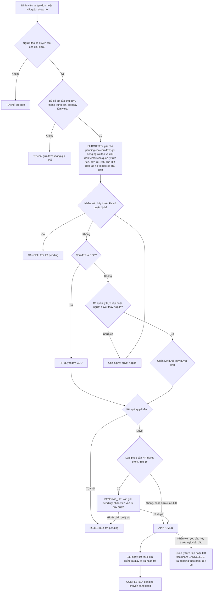

# Business rules – quy trình nghỉ phép

> Phụ lục của [BRD](BRD.md): business rule `BR-nn` của luồng nghỉ phép. Bộ tài liệu: [`docs/README.md`](../README.md).

Tài liệu này là nơi định nghĩa quy tắc nghiệp vụ `BR-nn` của luồng nghỉ phép. Luồng, API và tiêu chí chấp nhận ở đặc tả [UC3](../features/UC3-create-leave-request/spec.md) và [UC4](../features/UC4-approve-leave-request/spec.md); tình trạng code so với quy tắc ghi ở mục 12 của hai đặc tả đó, không ghi ở đây.

**Thuật ngữ thống nhất:** "quản lý trực tiếp" là người quản lý được ghi trong thông tin tổ chức; "người duyệt thay" là quản lý đang làm việc được HR ghi nhận thay quyền quản lý trực tiếp trong khoảng thời gian xác định (xem BR-06). Cả hai được gọi chung là "người duyệt hợp lệ". CEO là ngoại lệ duy nhất không có quản lý trực tiếp; HR duyệt đơn của CEO theo BR-05.

## Bảng business rule

| Mã | Quy tắc | Ví dụ |
|---|---|---|
| BR-01 | **Kiểm tra số dư và tính phép năm.** Số ngày yêu cầu không được lớn hơn số dư khả dụng: `entitled + carried_in - used - pending` (`carried_in` chỉ có ở phép năm, xem chuyển phép bên dưới); yêu cầu bằng đúng số dư vẫn hợp lệ. Đơn hợp lệ chuyển sang `SUBMITTED` và giữ chỗ số ngày trong `pending`; không trừ `used` ngay khi gửi. Với phép năm, ngày chuẩn là 12 ngày/năm ở điều kiện lao động bình thường; trường hợp công việc/điều kiện thuộc diện 14 hoặc 16 ngày dùng mức tương ứng trong danh mục nhân viên. Thâm niên: cộng 1 ngày cho mỗi đủ 5 năm làm việc cho cùng người sử dụng lao động. Làm chưa đủ 12 tháng trong năm: `(ngày phép năm chuẩn + ngày cộng thâm niên) / 12 × số tháng làm việc thực tế trong năm`. Tháng làm chưa đủ tháng được tính là một tháng nếu tổng ngày làm việc và ngày nghỉ hưởng lương đạt ít nhất 50% ngày làm việc bình thường của tháng; trường hợp dưới 50% không tính tháng đó. Số dư lưu 2 chữ số thập phân, không làm tròn giảm; một đơn vẫn chỉ xin theo bước 0,5 ngày (BR-04). **Chuyển phép (chốt 21/11/2026):** phần phép năm của năm N chưa dùng được chuyển sang năm N+1 và dùng được tới hết 31/12 năm N+1; đơn phép năm trừ phần chuyển sang trước, phần chuyển sang không dùng hết thì hết hạn, không chuyển tiếp lần hai (trong giới hạn nghỉ gộp tối đa 3 năm của Điều 113 khoản 4 BLLĐ 2019). Thanh toán tiền phép chưa nghỉ khi nghỉ việc nằm ngoài phạm vi (ADR-05). Nghỉ theo sự kiện tính theo từng sự kiện đủ điều kiện, theo mức trong [danh mục loại phép](leave-types-holidays.md), không trừ vào phép năm; mỗi sự kiện chỉ được yêu cầu tối đa một lần, vượt số ngày tối đa của loại sự kiện thì từ chối 400, không tự đổi sang nghỉ không lương hoặc phép năm. Không đặt hạn mức tổng số sự kiện hợp lệ trong năm; HR kiểm tra giấy tờ khi hoàn tất. Đơn qua năm mới vẫn là một đơn; tách ngày phép năm theo năm lịch, kiểm và giữ chỗ ở số dư từng năm; nếu bất kỳ năm nào thiếu số dư thì từ chối cả đơn. | Nhân viên vào làm 1/7, mức chuẩn 12 ngày, không có ngày thâm niên: năm đó được 6 ngày. Có 12 ngày được hưởng, 2 ngày đã dùng và 3 ngày đang chờ: còn 7 ngày khả dụng. |
| BR-02 | **Không cho phép đơn trùng lịch.** Với cùng nhân viên, khoảng ngày nghỉ của đơn mới không được giao với một đơn khác đang `SUBMITTED`, `PENDING_HR` hoặc `APPROVED`. Đơn `REJECTED`, `CANCELLED` hoặc `COMPLETED` không giữ chỗ lịch. Hai khoảng ngày có chung một ngày được tính là trùng, trừ trường hợp hai đơn nửa ngày khác buổi trong cùng ngày (xem BR-04). | Đơn đang chờ duyệt từ 10–12/11; gửi đơn mới từ 12–13/11 phải bị từ chối vì cùng có ngày 12/11. |
| BR-03 | **Tính ngày nghỉ theo ngày làm việc.** Tính cả ngày bắt đầu và kết thúc, bỏ thứ Bảy, Chủ nhật và các ngày nghỉ lễ (kể cả ngày nghỉ bù) theo danh sách trong [`leave-types-holidays.md`](leave-types-holidays.md); ngày nghỉ lễ không trừ vào số dư phép. Số ngày nghỉ phải theo bước 0,5 ngày. Đơn có 0 ngày làm việc (khoảng nghỉ chỉ gồm thứ Bảy, Chủ nhật hoặc ngày nghỉ lễ) bị từ chối. | Nghỉ từ thứ Sáu đến thứ Hai tính là 2 ngày làm việc. Nghỉ từ thứ Tư 29/4/2026 đến thứ Hai 4/5/2026 tính 2 ngày (29/4 và 4/5), vì 30/4 và 1/5 là ngày lễ, 2–3/5 là cuối tuần. Đơn chỉ gồm thứ Hai 27/4/2026 (nghỉ bù Giỗ Tổ) hoặc chỉ gồm thứ Bảy, Chủ nhật tính 0 ngày nên bị từ chối. |
| BR-04 | **Nghỉ nửa ngày được tính là 0,5 ngày.** Nhân viên chọn buổi sáng hoặc buổi chiều cho một ngày làm việc. Hai yêu cầu nửa ngày khác buổi trong cùng ngày không trùng; yêu cầu cùng buổi hoặc một yêu cầu cả ngày thì trùng. Đây là ngoại lệ của BR-02. | Nhân viên A đã gửi đơn nghỉ buổi sáng thứ Hai. Đơn nghỉ buổi chiều thứ Hai không trùng; đơn nghỉ cả ngày thứ Hai bị từ chối. |
| BR-05 | **Chỉ người duyệt hợp lệ mới được duyệt hoặc từ chối.** Người duyệt phải là quản lý trực tiếp của nhân viên tại thời điểm xử lý (trường hợp vắng mặt xem BR-06). HR chỉ duyệt đơn của CEO, là chức danh duy nhất được miễn có quản lý trực tiếp. Mỗi đơn chỉ nhận một quyết định; đơn không còn ở `SUBMITTED` không thể nhận một quyết định khác của người duyệt (bước HR duyệt thêm với đơn `PENDING_HR` xem BR-16). Gửi lặp cùng quyết định không tạo side effect (xem BR-11). | Quản lý trực tiếp chọn từ chối, đơn chuyển `SUBMITTED` → `REJECTED`; lần duyệt sau đó bị từ chối do xung đột trạng thái. |
| BR-06 | **Xử lý khi quản lý trực tiếp vắng mặt.** HR ghi nhận người duyệt thay đang làm việc cho một quản lý trực tiếp cụ thể, gồm ngày bắt đầu, ngày kết thúc (tính cả hai ngày) và người HR tạo/cập nhật phân công. Mỗi quản lý chỉ có tối đa một phân công hiệu lực tại một thời điểm; phân công không được tự chồng lấn. Người duyệt thay phải là quản lý đang làm việc và có quyền MANAGER. Trong thời gian hiệu lực, người này nhìn thấy các đơn `SUBMITTED` của cấp dưới trực tiếp của quản lý đó trong danh sách chờ duyệt và được duyệt/từ chối với cùng điều kiện trạng thái, version, audit và lịch sử như quản lý trực tiếp. Phân công chỉ thay quyền quyết định, không thay đổi `managerId` trong sơ đồ tổ chức; quyền được xác định theo ngày thực hiện quyết định. Nếu người duyệt thay cũng vắng mặt, HR kết thúc/thay phân công bằng một người duyệt thay khác; không ủy quyền nối tiếp hoặc để HR tự duyệt thay. Khi chưa có người thay hợp lệ, đơn giữ `SUBMITTED` và nhân viên vẫn có thể tự hủy theo BR-07. | Quản lý trực tiếp nghỉ từ 10–16/11; HR ghi nhận một quản lý khác làm người duyệt thay trong đúng khoảng ngày đó. Người thay thấy đơn chờ duyệt của cấp dưới trực tiếp của quản lý vắng mặt. Nếu người thay nghỉ ngày 12/11, HR cập nhật người thay khác; nếu chưa cập nhật, đơn tiếp tục chờ người duyệt hợp lệ. |
| BR-07 | **Nhân viên chỉ tự hủy đơn đang chờ trước ngày bắt đầu.** Chủ đơn được tự hủy `SUBMITTED` hoặc `PENDING_HR` trước `startDate`; trạng thái chuyển `CANCELLED`, số ngày giữ chỗ được trả lại `pending` theo từng năm. Từ `startDate` trở đi nhân viên không tự hủy được (409). HR xác minh thực tế nghỉ và xử lý hủy/điều chỉnh có lý do theo quy trình được phân quyền; không tự trả số dư chỉ vì người dùng hủy sau ngày bắt đầu. Hủy lại đơn đã hủy không tạo side effect. | Đơn đang `SUBMITTED` bắt đầu ngày 15/12: chủ đơn tự hủy đến hết ngày 14/12; từ 15/12 trở đi phải HR xác minh và xử lý. |
| BR-08 | **Hủy đơn đã duyệt theo yêu cầu của nhân viên.** Nhân viên không tự hủy đơn `APPROVED`. Trước ngày bắt đầu nghỉ, chủ đơn có thể đề nghị hủy; quản lý trực tiếp hiện tại hoặc HR xác nhận và hủy. Lý do bắt buộc; lưu người đề nghị, người xác nhận, thời điểm và lý do trong lịch sử; audit chỉ ghi tên trường/thao tác, không ghi nội dung ghi chú tự do. Đơn chuyển `CANCELLED`; số ngày được giải phóng khỏi `pending` theo từng năm, `used` không đổi; gửi thông báo chung theo BR-15. Từ ngày bắt đầu nghỉ trở đi không hủy theo luồng này; nếu thực tế nghỉ ít hơn đã duyệt thì HR xử lý điều chỉnh số dư bằng quy trình riêng có phê duyệt, không sửa trạng thái/lịch sử của đơn đã hoàn tất. Đơn `SUBMITTED` hoặc `PENDING_HR` tiếp tục áp dụng quyền tự hủy của nhân viên theo BR-07. | Đơn đã duyệt từ 10–12/12; nhân viên xin hủy ngày 8/12, quản lý hoặc HR xác nhận, trả số ngày khỏi `pending`. Nếu ngày hiện tại đã là 10/12, yêu cầu hủy theo BR-08 bị từ chối; HR xử lý điều chỉnh riêng nếu nhân viên không nghỉ. |
| BR-09 | **Từ chối giải phóng số ngày đang giữ.** Khi người duyệt hợp lệ từ chối đơn `SUBMITTED`, trạng thái chuyển sang `REJECTED`; số ngày của đơn được trừ khỏi `pending`, không cộng vào `used`. | Đơn 1,5 ngày bị từ chối: `pending` giảm 1,5 ngày, `used` không đổi. |
| BR-10 | **HR hoàn tất đơn đã duyệt.** Chỉ HR được chuyển đơn `APPROVED` sang `COMPLETED`, khi ngày hiện tại theo múi giờ doanh nghiệp đã sau `endDate` (sớm nhất là ngày kế tiếp). Không hoàn tất trong chính ngày kết thúc. HR kiểm tra giấy tờ nếu loại phép yêu cầu; thiếu giấy tờ thì giữ đơn `APPROVED`. Trong cùng một transaction, số ngày được trừ khỏi `pending` và cộng vào `used` theo từng năm; ghi lịch sử/audit cùng thay đổi nghiệp vụ. Không hoàn tất đơn chưa duyệt, `PENDING_HR` hoặc chưa qua ngày kết thúc. | Đơn kết thúc ngày 12/12 chỉ được hoàn tất từ ngày 13/12 theo giờ Việt Nam; khi hoàn tất 2 ngày, `pending` giảm 2, `used` tăng 2. |
| BR-11 | **Ghi nhận lịch sử và xử lý thao tác lặp an toàn.** Mỗi lần chuyển trạng thái hợp lệ phải lưu người thực hiện, trạng thái trước/sau và thời điểm; gửi lặp cùng quyết định không được áp dụng thay đổi số dư lần thứ hai. Gửi quyết định khác khi đơn đã có quyết định thì bị chặn. | Quản lý bấm duyệt hai lần: lần đầu chuyển đơn sang `APPROVED`; lần sau giữ nguyên trạng thái và không thay đổi số dư. Nếu gửi từ chối sau khi đơn đã duyệt, thao tác bị chặn. |
| BR-12 | **HR hoặc quản lý được tạo đơn hộ nhân viên trong phạm vi cho phép.** HR được tạo hộ cho mọi nhân viên; quản lý chỉ được tạo hộ cho cấp dưới trực tiếp của mình, không bao gồm nhân viên chỉ được phân công duyệt thay theo BR-06. Đơn tạo hộ áp dụng đầy đủ BR-01–BR-04; chủ đơn, số dư và ngày nghỉ là của nhân viên được tạo hộ. Đơn vẫn qua người duyệt hợp lệ theo BR-05/BR-06. Nếu quản lý tạo hộ cho cấp dưới trực tiếp thì chính quản lý đó vẫn có thể duyệt đơn; đây là trade-off được chấp nhận, không yêu cầu tách người tạo và người duyệt. Nhân viên đứng tên đơn nhận email và có thể tự hủy khi đơn còn `SUBMITTED` theo BR-07. Lịch sử và audit phải lưu riêng người tạo hộ và chủ đơn; không ghi người tạo hộ thành chủ đơn. | HR tạo hộ cho nhân viên A: đơn trừ số dư của A, gửi email cho A và chờ quản lý trực tiếp của A duyệt. Quản lý trực tiếp tạo hộ cho A: người đó vừa tạo vừa có thể duyệt; lịch sử/audit thể hiện rõ người tạo và A là chủ đơn. |
| BR-13 | **Lưu đơn nghỉ và audit theo thời hạn, có kiểm soát legal hold.** Đây là mốc retention nội bộ được chọn để thiết kế, không khẳng định là thời hạn luật định; HR/pháp chế phải xác nhận quy định pháp luật, hợp đồng và chính sách doanh nghiệp trước production, áp dụng thời hạn bắt buộc dài hơn nếu có. Lưu đơn nghỉ, gồm lý do, ghi chú và lịch sử trạng thái, trong 5 năm kể từ khi đơn vào trạng thái kết thúc (`COMPLETED`, `REJECTED` hoặc `CANCELLED`); đơn chưa kết thúc chưa bắt đầu tính hạn. Lưu mỗi bản ghi audit trong 5 năm kể từ thời điểm ghi. Legal hold đang hiệu lực thì tạm dừng hủy; khi hold kết thúc, dữ liệu đã quá hạn được xử lý theo quy trình đã duyệt, không bắt đầu lại chu kỳ 5 năm. Trong thời hạn lưu, audit không được sửa. Hết hạn, dữ liệu chỉ được archive bất biến hoặc hủy/khử định danh an toàn bởi quy trình có thẩm quyền, có phê duyệt và lưu dấu vết; đây là ngoại lệ vòng đời, không phải quyền sửa/xóa thông thường. | Đơn bị từ chối ngày 15/3/2026 bắt đầu tính 5 năm từ ngày kết thúc; log audit của thao tác tạo đơn có mốc riêng từ thời điểm ghi. Nếu legal hold còn hiệu lực sau khi hết hạn, chưa xử lý hủy; khi hold được gỡ, xử lý theo quy trình retention mà không gia hạn thêm 5 năm. |
| BR-16 | **HR duyệt thêm với một số loại phép.** Mỗi loại phép có cấu hình "Cần HR duyệt thêm" ở [danh mục loại phép](leave-types-holidays.md): `Không`, `Luôn` hoặc `Khi trên N ngày làm việc`. Cấu hình được chụp vào đơn lúc gửi (`requiresHrApproval`); HR đổi cấu hình sau đó không ảnh hưởng đơn đang chạy. Với đơn cần HR duyệt thêm, khi người duyệt hợp lệ (BR-05, BR-06) duyệt thì đơn sang `PENDING_HR` (chờ HR duyệt), chưa `APPROVED`; số ngày vẫn giữ trong `pending`, đơn vẫn giữ lịch như `SUBMITTED` (BR-02) và nhân viên vẫn tự hủy được (BR-07). Bất kỳ tài khoản HR nào, trừ chính chủ đơn, duyệt (`PENDING_HR` → `APPROVED`) hoặc từ chối (`PENDING_HR` → `REJECTED`, trả `pending` như BR-09, **bắt buộc ghi lý do**). Quản lý từ chối thì đơn kết thúc luôn, không sang HR. Đơn của CEO đã do HR duyệt (BR-05) nên không có bước thứ hai. Đơn chờ HR có nhãn "Quá hạn" từ cùng mốc nhắc của BR-17 (một ngày làm việc đầy đủ). Email báo HR theo BR-15 (chỉ báo chung). | Đơn nghỉ không lương 5 ngày (vượt ngưỡng 3 ngày): quản lý duyệt → `PENDING_HR`; HR duyệt → `APPROVED`; sau ngày kết thúc HR hoàn tất. Đơn nghỉ không lương 2 ngày: quản lý duyệt → `APPROVED` ngay. HR tên Lan xin nghỉ thai sản: quản lý của Lan duyệt, rồi một HR khác duyệt; Lan không tự duyệt được. |
| BR-17 | **Nhắc đơn chờ quá một ngày làm việc.** Khi đã trôi qua một ngày làm việc đầy đủ mà đơn vẫn `SUBMITTED`, gửi một email nhắc chung cho người đang có quyền duyệt (quản lý trực tiếp hoặc người duyệt thay theo BR-06). Nếu vẫn `PENDING_HR` sau một ngày làm việc đầy đủ kể từ lúc vào trạng thái đó, gửi một email nhắc chung tới nhóm HR. Chỉ gửi một nhắc cho mỗi giai đoạn chờ; chuyển giai đoạn bắt đầu tính lại thời hạn. Không gửi nếu đơn đã được quyết định, hủy hoặc hoàn tất. Email không chứa tên nhân viên, loại phép, ngày, số ngày, lý do, ghi chú hoặc mã đơn (BR-15). Không có người duyệt hợp lệ thì báo HR xử lý cấu hình tổ chức, không tự chuyển người duyệt. Nhắc việc không tự duyệt, từ chối hay thay đổi số dư. | Đơn gửi 09:00 thứ Hai; nếu đến 09:00 thứ Ba làm việc vẫn `SUBMITTED`, gửi một nhắc tới người duyệt. Nếu chuyển sang `PENDING_HR`, thời hạn nhắc HR tính lại từ lúc chuyển trạng thái. |
| BR-18 | **Không tự suy số dư nghỉ ốm từ thâm niên công ty.** Quyền lợi/ngày nghỉ ốm phụ thuộc thời gian đóng BHXH và nhóm điều kiện lao động; `hireDate` không thay thế được quá trình đóng BHXH. Khi hệ thống chưa có hồ sơ BHXH đã xác minh và nhóm điều kiện lao động, HR nhập/cập nhật hạn mức từ hồ sơ hợp lệ; hệ thống không tự suy số ngày từ ngày vào công ty. HR kiểm giấy tờ trước khi hoàn tất (BR-10). Tự động tính chỉ được triển khai khi có dữ liệu BHXH đủ tin cậy và HR/pháp chế xác nhận. | Nhân viên làm tại công ty 2 năm nhưng có 16 năm đóng BHXH không được suy hạn mức nghỉ ốm là 2 năm; HR căn cứ hồ sơ đóng BHXH và nhóm điều kiện lao động. |
| BR-19 | **Thay đổi lịch nghỉ lễ sau khi gửi đơn.** Lịch năm phải được HR cập nhật trước khi gửi đơn; mỗi đơn chụp lịch áp dụng tại thời điểm gửi. Thay đổi lịch không âm thầm viết lại đơn `SUBMITTED`, `PENDING_HR` hoặc `APPROVED`. Nếu ngày nghỉ lễ/ngày nghỉ bù mới được công bố ảnh hưởng đơn đã gửi, HR rà soát và ghi điều chỉnh số ngày/`pending` cùng audit, lịch sử và thông báo chung; giữ quyết định phê duyệt trừ khi cần đổi ngày nghỉ. Đơn mới dùng lịch đã cập nhật. | Đơn đã gửi 29/4–4/5; sau đó HR thêm ngày nghỉ bù. Đơn cũ giữ nguyên tới khi HR rà soát và ghi điều chỉnh; đơn mới tính theo lịch cập nhật. |
| BR-14 | **Giới hạn người xem lý do sức khỏe trên mọi bề mặt.** Với đơn nghỉ ốm hoặc thai sản, chỉ nhân viên đứng tên đơn và HR được xem trường lý do chi tiết qua API chi tiết/danh sách, lịch sử hay giao diện; HR xem lý do phải tạo audit chỉ ghi nhận ai, lúc nào, đơn nào/trường nào được đọc, tuyệt đối không ghi nội dung lý do. Manager/người duyệt thay chỉ xem dữ liệu tối thiểu cần để quyết định; ADMIN và người khác không được xem lý do qua audit log, export, email hay đường dẫn khác. Không đưa lý do hoặc bất kỳ comment/ghi chú tự do nào vào `changedFields`/audit payload; ghi chú chỉ nằm trong lịch sử đơn. Chỉ thu thập thông tin cần thiết, không yêu cầu chẩn đoán y khoa không cần thiết. | Nhân viên gửi đơn nghỉ ốm với lý do chi tiết: nhân viên và HR được phép xem; quản lý xử lý đơn nhưng mọi response/list/history đều bỏ trường lý do, còn audit của HR chỉ ghi “đọc trường reason” mà không chứa giá trị đó. |
| BR-15 | **Email và thông báo nghỉ phép chỉ chứa thông báo chung.** Subject/body chỉ báo có yêu cầu hoặc cập nhật nghỉ phép và dẫn tới inbox chung trong ứng dụng cần đăng nhập; URL không chứa mã đơn, thông tin cá nhân hay token truy cập. Không đưa tên, loại phép, ngày/buổi, số ngày, lý do, comment/ghi chú, mã đơn hoặc dữ liệu nhận diện khác vào subject/body/URL. Outbox payload và log của worker chỉ mang dữ liệu tối thiểu để định tuyến/gửi thông báo, không mang lý do, comment, loại phép hay chi tiết ngày nghỉ không cần thiết. Áp dụng cho mọi người nhận và mọi loại phép theo T-16. | Email cho quản lý chỉ báo “Có yêu cầu nghỉ phép cần xử lý” và link inbox chung sau đăng nhập; thông tin nhân viên và đơn chỉ được tải từ ứng dụng sau khi xác thực/phân quyền, không nằm trong email, URL hoặc log gửi thư. |

**Quy tắc thử việc trong BR-01:** thời gian thử việc được tính vào thời gian làm việc để tính phép năm nếu người lao động tiếp tục làm việc cho doanh nghiệp sau khi hết thử việc ([Nghị định 145/2020/NĐ-CP, Điều 65](https://vanban.chinhphu.vn/default.aspx?docid=201967&pageid=27160)). Chính sách MVP cho phép nhân viên sử dụng số dư đã phát sinh trong thời gian thử việc theo cùng hạn mức, kiểm tra số dư và luồng duyệt như nhân viên khác.

## Sơ đồ quy trình

Ghi chú: thao tác lặp cùng quyết định trên đơn đã ở trạng thái đích là idempotent, không đổi số dư; quyết định ngược lại bị chặn do xung đột trạng thái (BR-05, BR-11).

## Quyết định liên quan đã chốt

- **UC2.3 / issue #22:** chỉ người giữ chức danh CEO là gốc duy nhất của sơ đồ và được có `managerId = null`; mọi nhân viên
  khác có đúng một quản lý trực tiếp đang làm việc. HR duyệt đơn của CEO (BR-05).
- **UC2.2 / issue #21:** `GET /departments/tree` trả toàn bộ cây; UUID dùng cho chi tiết phòng ban và danh sách thành viên.
- **BR-16 HR duyệt thêm (14/11/2026):** loại phép nào cần HR duyệt thêm ghi ở cột "Cần HR duyệt thêm" của
  [danh mục loại phép](leave-types-holidays.md). Claude soạn thay phần chốt của TV2 theo yêu cầu của TV1 (Duong); TV1, TV2 rà lại.
- **Retention (BR-13)** là mốc nội bộ, HR/pháp chế xác nhận trước production; ngoài MVP, ghi ở SRS mục 8.

Tình trạng code so với từng BR: xem mục 12 của [UC3](../features/UC3-create-leave-request/spec.md) và
[UC4](../features/UC4-approve-leave-request/spec.md).
