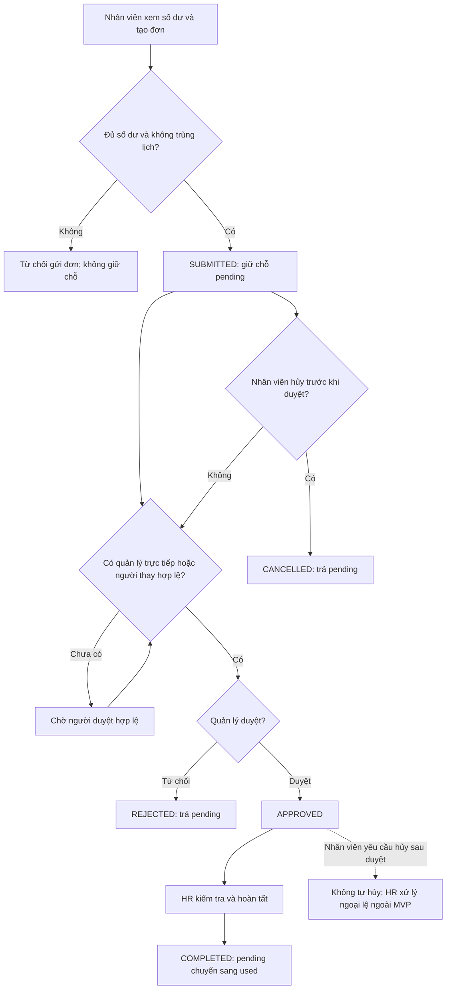

# Business rules – quy trình nghỉ phép

Tài liệu này mô tả quy tắc nghiệp vụ cho luồng nghỉ phép MVP, đối chiếu với functional requirements UC3–UC4 tuần 5 và state machine trong `backend/src/modules/leave/leave-state-machine.ts`.

## Bảng business rule

| Mã | Quy tắc | Ví dụ |
|---|---|---|
| BR-01 | **Kiểm tra số dư trước khi gửi đơn.** Số ngày yêu cầu không được lớn hơn số dư khả dụng: `entitled - used - pending`. Đơn hợp lệ chuyển sang `SUBMITTED` và giữ chỗ số ngày trong `pending`; không trừ `used` ngay khi gửi. | Có 12 ngày được hưởng, 2 ngày đã dùng và 3 ngày đang chờ duyệt: còn 7 ngày khả dụng. Đơn 7 ngày được gửi; đơn 7,5 ngày bị từ chối. |
| BR-02 | **Không cho phép đơn trùng lịch.** Với cùng nhân viên, khoảng ngày nghỉ của đơn mới không được giao với một đơn khác đang `SUBMITTED` hoặc `APPROVED`. Đơn `REJECTED`, `CANCELLED` hoặc `COMPLETED` không giữ chỗ lịch. Hai khoảng ngày có chung một ngày được tính là trùng. | Đơn đang chờ duyệt từ 10–12/11; gửi đơn mới từ 12–13/11 phải bị từ chối vì cùng có ngày 12/11. |
| BR-03 | **Tính ngày nghỉ theo ngày làm việc.** Tính cả ngày bắt đầu và kết thúc, bỏ thứ Bảy và Chủ nhật. Trong MVP, chưa có lịch ngày lễ để loại trừ. Số ngày được lưu theo bước 0,5 ngày. | Nghỉ từ thứ Sáu đến thứ Hai tính là 2 ngày làm việc; nghỉ riêng nửa ngày tính là 0,5 ngày. |
| BR-04 | **Nghỉ nửa ngày được tính là 0,5 ngày.** Nhân viên chọn buổi sáng hoặc buổi chiều cho một ngày làm việc. Hai yêu cầu nửa ngày khác buổi trong cùng ngày không trùng; yêu cầu cùng buổi hoặc một yêu cầu cả ngày thì trùng. | Nhân viên A đã gửi đơn nghỉ buổi sáng thứ Hai. Đơn nghỉ buổi chiều thứ Hai không trùng; đơn nghỉ cả ngày thứ Hai bị từ chối. |
| BR-05 | **Chỉ quản lý trực tiếp duyệt hoặc từ chối.** Người duyệt phải là quản lý trực tiếp của nhân viên tại thời điểm xử lý. Mỗi đơn chỉ nhận một quyết định; đơn không còn ở `SUBMITTED` không thể được duyệt/từ chối lần nữa. | Quản lý trực tiếp chọn từ chối, đơn chuyển `SUBMITTED` → `REJECTED`; lần duyệt sau đó bị từ chối do xung đột trạng thái. |
| BR-06 | **Xử lý khi quản lý trực tiếp vắng mặt.** Người được giao thay quyền quản lý trực tiếp phải được HR ghi nhận/cập nhật là người duyệt thay trong thông tin tổ chức trước khi xử lý đơn. Người duyệt thay thực hiện quyết định với cùng quyền và trách nhiệm kiểm tra như quản lý trực tiếp; HR không tự duyệt thay. Nếu chưa có người thay được ghi nhận, đơn giữ `SUBMITTED` cho đến khi có người duyệt hợp lệ. | Quản lý trực tiếp nghỉ phép một tuần; HR cập nhật người quản lý thay trong thời gian đó. Người thay duyệt đơn; một quản lý khác không được tự ý duyệt. |
| BR-07 | **Nhân viên chỉ tự hủy đơn đang chờ duyệt.** Khi hủy đơn `SUBMITTED`, trạng thái chuyển sang `CANCELLED` và số ngày giữ chỗ được trả lại `pending`. Hủy lại một đơn đã hủy không tạo thêm thay đổi số dư. | Đơn 2 ngày đang `SUBMITTED`; nhân viên hủy, `pending` giảm 2 ngày và đơn chuyển `CANCELLED`. |
| BR-08 | **Không tự hủy đơn đã duyệt.** Đơn `APPROVED` không thể được nhân viên hủy qua luồng tự phục vụ. Nhân viên liên hệ HR để xử lý ngoại lệ theo quy trình điều chỉnh được phê duyệt; không tự thay đổi số dư hoặc trạng thái đơn. Luồng điều chỉnh sau duyệt chưa thuộc MVP. | Đơn đã `APPROVED`; thao tác hủy của nhân viên bị từ chối. HR xử lý theo quy trình điều chỉnh ngoài luồng này nếu cần. |
| BR-09 | **Từ chối giải phóng số ngày đang giữ.** Khi quản lý trực tiếp từ chối đơn `SUBMITTED`, trạng thái chuyển sang `REJECTED`; số ngày của đơn được trừ khỏi `pending`, không cộng vào `used`. | Đơn 1,5 ngày bị từ chối: `pending` giảm 1,5 ngày, `used` không đổi. |
| BR-10 | **HR hoàn tất đơn đã duyệt.** Chỉ HR được chuyển đơn `APPROVED` sang `COMPLETED`. Trong cùng một transaction, số ngày được trừ khỏi `pending` và cộng vào `used`; ghi lịch sử/audit cùng thay đổi nghiệp vụ. HR không hoàn tất đơn chưa được duyệt. | HR hoàn tất đơn 2 ngày: `pending` giảm 2, `used` tăng 2; đơn chuyển sang `COMPLETED`. |
| BR-11 | **Ghi nhận lịch sử và xử lý thao tác lặp an toàn.** Mỗi lần chuyển trạng thái hợp lệ phải lưu người thực hiện, trạng thái trước/sau và thời điểm; gửi lặp cùng quyết định không được áp dụng thay đổi số dư lần thứ hai. | Quản lý bấm duyệt hai lần: lần đầu chuyển đơn sang `APPROVED`; lần sau giữ nguyên trạng thái và không thay đổi số dư. |

## Sơ đồ quy trình

## Đối chiếu với hiện thực hiện tại

- Đã có state machine cho `SUBMITTED`, `APPROVED`, `REJECTED`, `COMPLETED`, `CANCELLED`; quyền duyệt/từ chối của quản lý trực tiếp; quyền hủy của chủ đơn khi `SUBMITTED`; quyền hoàn tất của HR; hiệu ứng `pending`/`used`; và hàm đếm ngày làm việc bỏ cuối tuần.
- State machine hiện không hỗ trợ hủy đơn `APPROVED`, đúng với BR-08.
- Các quy tắc kiểm tra trùng lịch, biểu diễn buổi nghỉ nửa ngày và phân công người duyệt thay cần được triển khai/đối chiếu ở bước hoàn thiện API và mô hình dữ liệu. Entity hiện có `days` với độ chính xác 0,1 nhưng chưa lưu buổi nghỉ; bảng số dư lưu `entitled`, `used`, `pending`.
- Lịch ngày lễ và quy trình điều chỉnh đơn đã duyệt chưa thuộc MVP.
