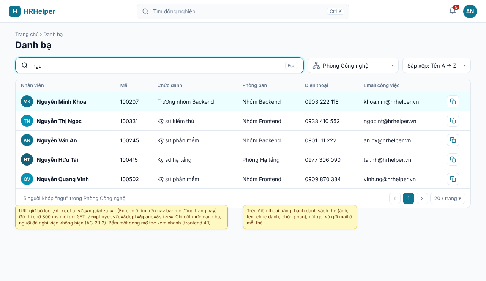
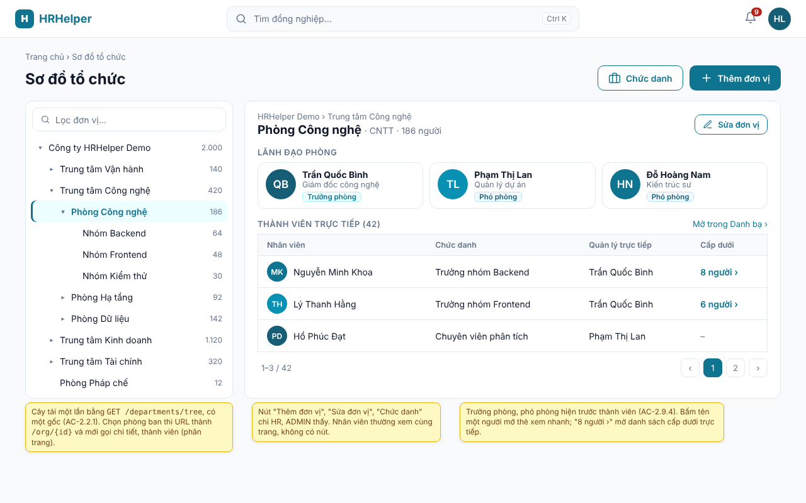
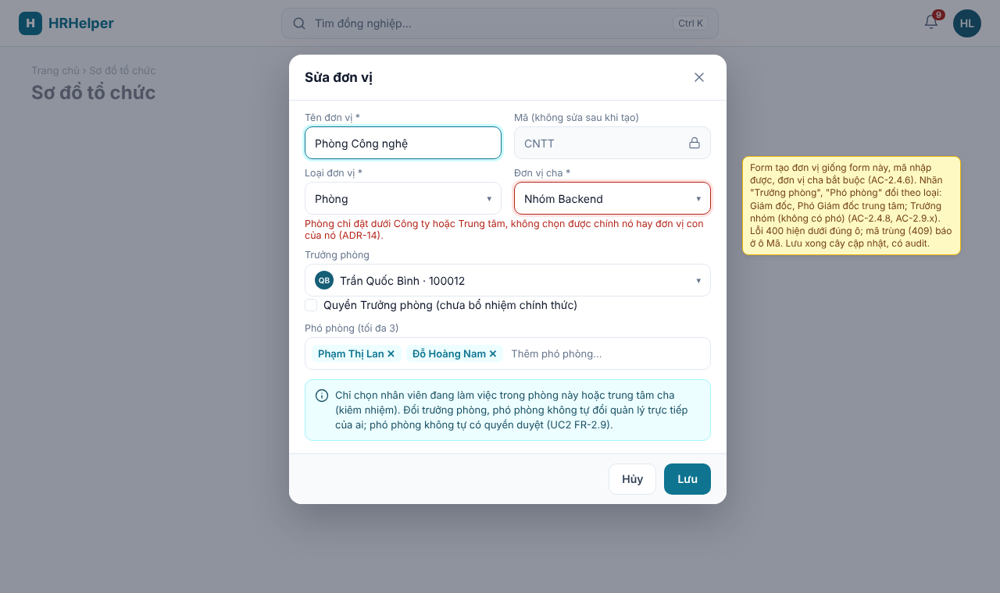
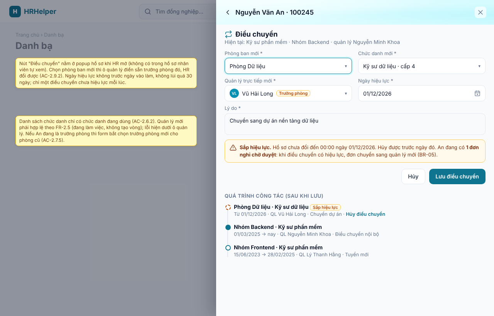
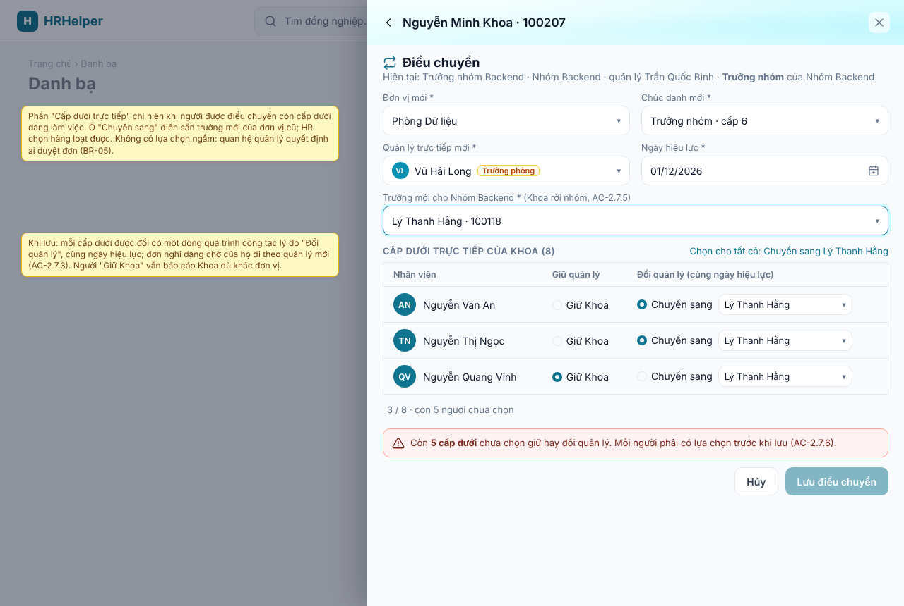
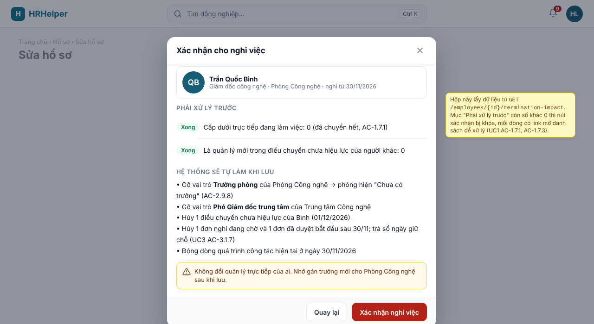
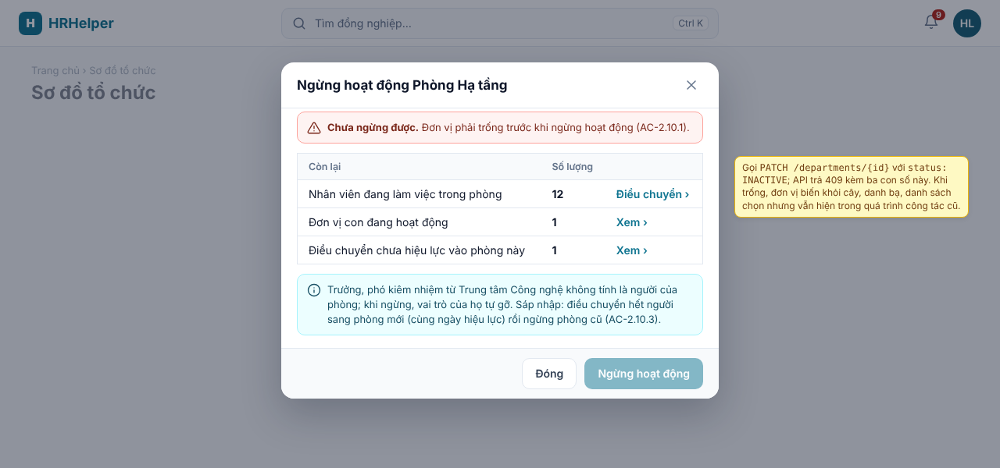
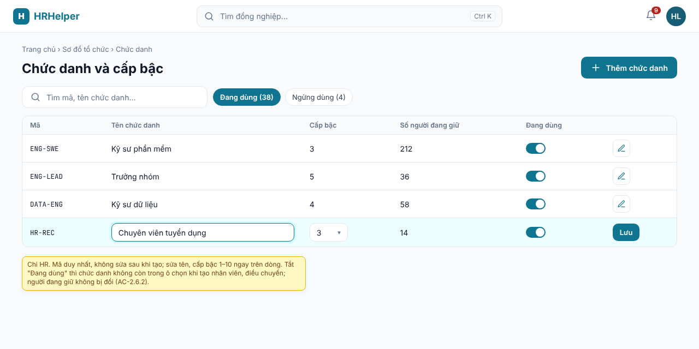
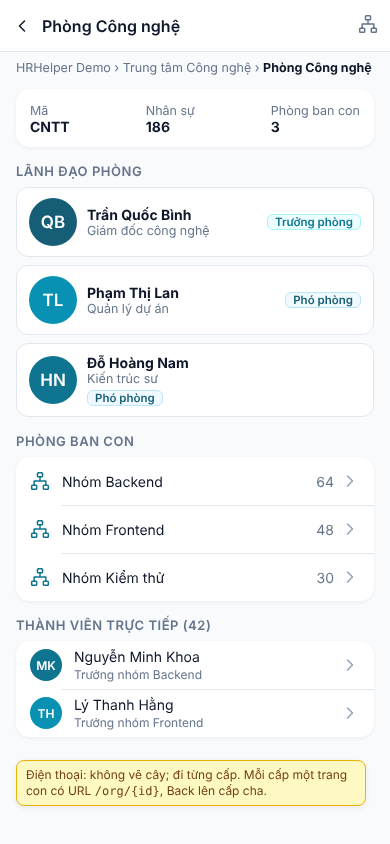
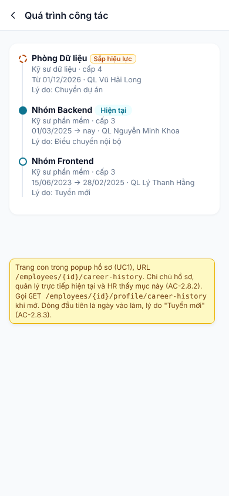

# UC2 – Thông tin tổ chức

| Mục | Nội dung |
|---|---|
| Mục tiêu kinh doanh | MT-1 (hồ sơ và tổ chức tập trung, đúng một quản lý trực tiếp) |
| Tác nhân chính | Mọi người dùng đã đăng nhập (xem); HR, ADMIN (quản lý phòng ban); HR (chức danh, điều chuyển, trưởng/phó phòng) |
| Tác nhân phụ, hệ thống ngoài | Module Identity (suy ra vai trò MANAGER từ quan hệ quản lý, ADR-10) |
| Yêu cầu (SRS) | FR-2.1 → FR-2.10 |
| Quy tắc | Issue #21 (xem toàn bộ cây, không tra theo mã), issue #22 (một quản lý trừ CEO), ADR-10, ADR-14 (loại đơn vị) |
| Mức ưu tiên | M (FR-2.4, FR-2.6 → FR-2.9 là S; FR-2.10 là C) |
| Trạng thái | Đã có; tạo, sửa phòng ban mới có API, chưa có giao diện |
| Phiên bản | 1.3 – 18/11/2026 (sơ đồ luồng `flows/`, bản vẽ điều chuyển có cấp dưới, nghỉ việc, ngừng đơn vị; hợp đồng API mục 9.2; thiết kế dữ liệu mục 13). 1.2 – 15/11/2026 (ADR-14: loại đơn vị Công ty, Trung tâm, Phòng, Nhóm; trưởng, phó mọi cấp; quyền trưởng, kiêm nhiệm; ngừng hoạt động đơn vị). 1.1 – 14/11/2026 (chức danh, điều chuyển, quá trình công tác, trưởng/phó phòng) |

## 1. Mô tả ngắn

Công ty được tổ chức thành cây đơn vị có loại (ADR-14): **Công ty** (Tổng Giám đốc, CEO) → **Trung tâm** (Giám đốc trung tâm) →
**Phòng** (Trưởng phòng, Phó phòng) → **Nhóm** (Trưởng nhóm). Số cấp không cố định: phòng có thể nằm thẳng dưới Công ty (Pháp
chế), phòng không bắt buộc có nhóm. Trong code và API, đơn vị vẫn là `department` (`/departments`).

Mọi người dùng xem được danh bạ, sơ đồ tổ chức, thành viên từng phòng ban, quản lý trực tiếp và cấp dưới của một người. Đây là
danh bạ nội bộ có chủ ý: mọi tài khoản đã đăng nhập đều xem được, nhưng không bao giờ thấy trường nhạy cảm. HR và ADMIN
tạo, sửa phòng ban. HR quản lý danh mục chức danh, gán trưởng phòng và phó phòng, điều chuyển nhân viên từ một ngày hiệu lực;
mỗi lần điều chuyển thành một dòng trong quá trình công tác. Quan hệ quản lý trực tiếp quyết định ai duyệt đơn nghỉ (UC4) và
ai có vai trò MANAGER; trưởng, phó phòng là vai trò của phòng ban, không tự cho quyền duyệt.

## 2. Tác nhân và quyền

| Tác nhân | Được làm gì | Giới hạn theo dữ liệu |
|---|---|---|
| Mọi người dùng đã đăng nhập | Tìm danh bạ; xem cây tổ chức, chi tiết và thành viên phòng ban, chức danh, quản lý trực tiếp, cấp dưới | Không thấy nhân viên `TERMINATED`; chỉ trường danh bạ |
| HR, ADMIN | Thêm: tạo, sửa đơn vị (loại, tên, mã, văn phòng, đơn vị cha, trưởng đơn vị) | Không tạo vòng; đúng luật loại cha, loại con (ADR-14) |
| HR | Gán quản lý trực tiếp khi tạo, sửa hồ sơ (UC1); điều chuyển; quản lý chức danh; gán trưởng, phó đơn vị; ngừng hoạt động đơn vị | Đúng một quản lý đang làm việc, trừ CEO; trưởng, phó thuộc chính đơn vị đó hoặc đơn vị cha |
| Chủ hồ sơ, quản lý trực tiếp | Xem quá trình công tác của mình, của cấp dưới trực tiếp | – |

## 3. Điều kiện

- **Điều kiện trước:** người dùng đã đăng nhập; cây tổ chức có đúng một gốc (CEO).
- **Kích hoạt:** mở "Danh bạ" hoặc "Sơ đồ tổ chức"; HR, ADMIN tạo hoặc sửa phòng ban.
- **Điều kiện sau khi thành công (sửa phòng ban):**
  - Cây phòng ban vẫn có một gốc, không có vòng.
  - Có audit `CREATE` hoặc `UPDATE` với `entityType = department`.
  - Cache dữ liệu tham chiếu được xóa (ADR-07).
- **Điều kiện sau khi thất bại:** cây phòng ban giữ nguyên.

## 4. Luồng chính

### 4.1 Tìm đồng nghiệp trong danh bạ (FR-2.1)

| Bước | Tác nhân | Hệ thống |
|---|---|---|
| 1 | Người dùng mở "Danh bạ", nhập tên, email hoặc mã; có thể chọn phòng ban | Gọi `GET /employees?q=&dept=&page=&size=` |
| 2 | | Lọc nhân viên khác `TERMINATED`, tìm theo tên, email, mã; sắp xếp ổn định; tối đa 100 dòng mỗi trang |
| 3 | Xem danh sách, bấm vào một người | Mở hồ sơ ở mức danh bạ (UC1, luồng A1) |

### 4.2 Xem sơ đồ tổ chức (FR-2.2, FR-2.3)

| Bước | Tác nhân | Hệ thống |
|---|---|---|
| 1 | Người dùng mở "Sơ đồ tổ chức" | Gọi `GET /departments/tree`, trả toàn bộ cây (một gốc) |
| 2 | Chọn một phòng ban | Gọi `GET /departments/{id}` và `GET /departments/{id}/members` (phân trang) |
| 3 | Chọn một nhân viên | Hiện quản lý trực tiếp (trong hồ sơ) và gọi `GET /employees/{id}/direct-reports` |

### 4.3 HR, ADMIN tạo hoặc sửa phòng ban (FR-2.4)

| Bước | Tác nhân | Hệ thống |
|---|---|---|
| 1 | Chọn loại đơn vị, nhập tên, mã, chọn đơn vị cha, trưởng đơn vị | Gửi `POST /departments` hoặc `PATCH /departments/{id}` |
| 2 | | Kiểm vai trò HR hoặc ADMIN; đơn vị cha tồn tại, đang hoạt động; mã không trùng; luật loại cha, loại con (bảng ở mục 7) |
| 3 | | Khi đổi phòng ban cha: kiểm không tạo vòng |
| 4 | | Lưu, ghi audit, xóa cache dữ liệu tham chiếu |
| 5 | Thấy cây đã cập nhật | Trả phòng ban |

### 4.4 HR điều chuyển nhân viên (FR-2.7, FR-2.8)

| Bước | Tác nhân | Hệ thống |
|---|---|---|
| 1 | HR mở hồ sơ nhân viên, bấm "Điều chuyển"; chọn phòng ban, chức danh, quản lý mới (điền sẵn trưởng phòng mới), ngày hiệu lực, lý do | Gửi `POST /employees/{id}/transfers` |
| 2 | | Kiểm FR-2.5 với quản lý mới; ngày hiệu lực không trước ngày vào làm, không lùi quá 30 ngày; không có điều chuyển chưa hiệu lực khác của cùng người; nếu A còn cấp dưới thì mỗi cấp dưới phải có lựa chọn giữ A hoặc quản lý mới (AC-2.7.6), áp dụng cùng ngày hiệu lực |
| 3 | | Hiệu lực hôm nay hoặc quá khứ: trong một giao dịch đóng dòng công tác cũ, mở dòng mới, đổi `department_id`, `position_id`, `manager_id`, ghi audit `TRANSFER`, event `EmployeeTransferred` |
| 4 | | Hiệu lực tương lai: lưu dòng "Sắp hiệu lực"; job chạy 00:05 giờ Việt Nam áp dụng như bước 3 (chạy lại không áp dụng hai lần) |
| 5 | Thấy quá trình công tác cập nhật | Đơn nghỉ `SUBMITTED` của người này tự sang quản lý mới vì quyền duyệt tính theo quản lý hiện tại (BR-05); worker gửi email chung cho quản lý mới |

### 4.5 HR gán trưởng, phó đơn vị (FR-2.9)

| Bước | Tác nhân | Hệ thống |
|---|---|---|
| 1 | HR mở đơn vị, chọn trưởng (có thể đánh dấu "Quyền") và các phó trong danh sách người của đơn vị đó và đơn vị cha | Gửi `PATCH /departments/{id}` với `headEmployeeId`, `headActing`, `deputyEmployeeIds` |
| 2 | | Kiểm từng người đang làm việc, thuộc đơn vị đó hoặc đơn vị cha; số phó không quá giới hạn theo loại; lưu, ghi audit; không đổi quản lý trực tiếp của ai |

### 4.6 HR ngừng hoạt động đơn vị (FR-2.10)

| Bước | Tác nhân | Hệ thống |
|---|---|---|
| 1 | HR điều chuyển hết người sang đơn vị khác (4.4), mở đơn vị, bấm "Ngừng hoạt động" | Gửi `PATCH /departments/{id}` với `status = INACTIVE` |
| 2 | | Kiểm không còn nhân viên đang làm việc, không còn đơn vị con đang hoạt động, không có điều chuyển chưa hiệu lực vào đơn vị này; lưu, ghi audit, xóa cache |

## 5. Luồng thay thế

- **A1 (4.1 bước 1):** không nhập từ khóa. Trả toàn bộ danh bạ có phân trang.
- **A2 (4.2 bước 3):** nhân viên là CEO. Không có quản lý trực tiếp; cấp dưới thường là các Phó Tổng Giám đốc, Giám đốc trung
  tâm và trưởng các phòng nằm thẳng dưới Công ty.
- **A3 (4.2 bước 1):** cần cây con theo mã phòng ban. Ngoài phạm vi theo quyết định issue #21; dùng chi tiết phòng ban bằng UUID.

## 6. Ngoại lệ

| Mã | Tình huống | Hệ thống phản hồi |
|---|---|---|
| E1 | Chưa đăng nhập | 401 `UNAUTHENTICATED` |
| E2 | Nhân viên, quản lý tạo hoặc sửa phòng ban | 403 `FORBIDDEN` |
| E3 | Đổi phòng ban cha tạo vòng, hoặc phòng ban cha không tồn tại | 400 `BAD_REQUEST` |
| E4 | Mã phòng ban đã tồn tại | 409 `CONFLICT` |
| E5 | Phòng ban hoặc nhân viên không tồn tại | 404 `NOT_FOUND` |
| E6 | `size` lớn hơn 100 | 400 `BAD_REQUEST` |
| E7 | Tạo phòng ban không có `parentId`, hoặc sửa `parentId` thành `null` (tạo gốc thứ hai) | 400 `BAD_REQUEST` |
| E8 | Trưởng hoặc phó không phải nhân viên đang làm việc, không thuộc đơn vị đó hoặc đơn vị cha, hoặc quá số phó theo loại | 400 `BAD_REQUEST` |
| E9 | Điều chuyển vi phạm FR-2.5, hiệu lực trước ngày vào làm hoặc lùi quá 30 ngày | 400 `BAD_REQUEST` |
| E10 | Đã có điều chuyển chưa hiệu lực cho cùng người | 409 `CONFLICT`; hủy điều chuyển cũ trước |
| E11 | Xóa chức danh đang được dùng hoặc có trong lịch sử | 409 `CONFLICT`; chỉ ngừng dùng được |
| E12 | Sai luật loại cha, loại con; tạo đơn vị Công ty thứ hai | 400 `BAD_REQUEST` |
| E13 | Ngừng hoạt động đơn vị còn người đang làm việc hoặc còn đơn vị con đang hoạt động | 409 `CONFLICT` |

## 7. Quy tắc áp dụng

- **Một quản lý trực tiếp (FR-2.5, issue #22):** chỉ người giữ chức danh CEO được không có quản lý và là gốc duy nhất. Mọi
  người khác có đúng một quản lý đang làm việc. Kiểm khi tạo, sửa hồ sơ (UC1 luồng 4.2, 4.3).
- **Loại đơn vị ([ADR-14](../../architecture/adr/ADR-14-org-unit-types.md)):**

  | Loại (`unitType`) | Cha hợp lệ | Trưởng | Phó (tối đa) |
  |---|---|---|---|
  | `COMPANY` Công ty | Không, đúng một, là gốc | Tổng Giám đốc (CEO) | Phó Tổng Giám đốc (5) |
  | `CENTER` Trung tâm | `COMPANY` | Giám đốc trung tâm | Phó Giám đốc trung tâm (3) |
  | `DEPARTMENT` Phòng | `COMPANY`, `CENTER` | Trưởng phòng | Phó phòng (3) |
  | `TEAM` Nhóm | `DEPARTMENT` | Trưởng nhóm | Không có |

- **Nhân viên thuộc đơn vị:** mỗi người thuộc đúng một đơn vị đang hoạt động, loại bất kỳ (CEO thuộc Công ty, Giám đốc trung
  tâm thuộc Trung tâm, người không trong nhóm nào thuộc Phòng). Phòng ban, chức danh, quản lý chỉ đặt khi tạo nhân viên (UC1
  luồng 4.4); sau đó chỉ đổi qua điều chuyển (AC-2.7.7).
- **Ca biên (18/11/2026):** người nghỉ việc hoặc đơn vị ngừng hoạt động thì vai trò trưởng, phó tự gỡ, có audit (AC-2.9.8,
  AC-2.10.1); quan hệ quản lý trực tiếp không bao giờ tự đổi, HR chọn rõ (AC-1.7.1, AC-2.7.6). Chức danh `CEO` không ngừng dùng,
  không đổi cấp bậc (AC-2.6.3).
- **Trưởng đơn vị khác quản lý trực tiếp:** trưởng là vai trò của đơn vị; quản lý trực tiếp là quan hệ giữa hai người và là thứ
  duy nhất quyết định quyền duyệt (BR-05). Gợi ý quản lý mặc định là trưởng của đơn vị, hoặc trưởng đơn vị cha nếu người đó là
  trưởng (AC-2.9.2).
- **Xem toàn bộ cây (issue #21):** không tra cây theo mã phòng ban.
- **Danh bạ mở cho mọi tài khoản đã đăng nhập:** quyết định có chủ ý, ghi ở
  [ma trận phân quyền – Điểm lệch và quyết định](../../security/access-control-matrix.md#điểm-lệch-và-quyết-định-nghiệp-vụ).
- [ADR-10](../../architecture/adr/ADR-10-manager-role-derived.md): người có ít nhất một cấp dưới đang làm việc có vai trò MANAGER.
- [ADR-07](../../architecture/adr/ADR-07-no-redis.md): dữ liệu tham chiếu (phòng ban, chức danh) cache 10 phút trong bộ nhớ.

## 8. Dữ liệu vào

| Trường | Bắt buộc | Kiểm tra |
|---|---|---|
| `q` (danh bạ) | Không | Tìm trong tên, email, mã |
| `dept` (danh bạ) | Không | UUID phòng ban |
| `page`, `size` | Không | `size` tối đa 100 |
| `name`, `code` (phòng ban) | Có khi tạo | `code` gồm chữ in hoa, số, gạch ngang, 2–20 ký tự, duy nhất; không sửa sau khi tạo |
| `office` | Không | Văn phòng của phòng ban |
| `unitType` | Có khi tạo | `COMPANY`, `CENTER`, `DEPARTMENT`, `TEAM`; đúng luật ở mục 7 |
| `parentId` | Có, trừ đơn vị Công ty đã có sẵn | Đơn vị tồn tại, đang hoạt động, đúng loại cha, không tạo vòng |
| `headEmployeeId` | Không | Nhân viên đang làm việc, thuộc đơn vị đó hoặc đơn vị cha |
| `headActing` | Không | `true` là "Quyền trưởng", mặc định `false` |
| `deputyEmployeeIds` | Không | Như trưởng; số lượng theo loại (mục 7) |
| `status` | Không | `ACTIVE`, `INACTIVE` (FR-2.10) |

## 9. Giao diện và API

| Luồng | Màn hình | API (chi tiết ở 9.2) |
|---|---|---|
| 4.1 | `/directory` | `GET /employees` |
| 4.2 | `/org`, `/org/{id}` | `GET /departments/tree`, `GET /departments/{id}`, `GET /departments/{id}/members`, `GET /employees/{id}/direct-reports` |
| 4.3, 4.5, 4.6 | `/org/{id}`: nút "Thêm đơn vị", "Sửa đơn vị", "Ngừng hoạt động" (chỉ HR, ADMIN thấy) | `POST /departments`, `PATCH /departments/{id}` |
| 4.4 | Nút "Điều chuyển" trong popup hồ sơ (chế độ HR); mục "Quá trình công tác" (UC1) | `POST /employees/{id}/transfers`, `GET /employees/{id}/transfers`, `DELETE /employees/{id}/transfers/{transferId}`, `GET /employees/{id}/profile/career-history` |
| Nghỉ việc (UC1 AC-1.7.3) | Hộp xác nhận khi HR chọn trạng thái "Nghỉ việc" | `GET /employees/{id}/termination-impact`, `PATCH /employees/{id}` |
| FR-2.6 | `/org/positions` (HR) | `GET /positions`, `POST /positions`, `PATCH /positions/{id}` |

**Sơ đồ luồng** (bấm "Chạy" để xem từng bước): [`flows/flows.html`](flows/flows.html), ảnh PNG cùng thư mục, xuất lại bằng
`flows/render.js` (Playwright) hoặc `flows/render.ps1` (Windows).

| Luồng | Sơ đồ |
|---|---|
| Xem sơ đồ tổ chức, danh bạ (4.1, 4.2) | [uc2-f1.png](flows/uc2-f1.png) |
| Tạo, sửa đơn vị (4.3) | [uc2-f2.png](flows/uc2-f2.png) |
| Gán trưởng, phó (4.5) | [uc2-f3.png](flows/uc2-f3.png) |
| Điều chuyển (4.4) | [uc2-f4.png](flows/uc2-f4.png) |
| Job áp dụng điều chuyển (mục 13) | [uc2-f5.png](flows/uc2-f5.png) |
| Ngừng hoạt động đơn vị (4.6) | [uc2-f6.png](flows/uc2-f6.png) |
| Cho nghỉ việc người đang là trưởng (UC1 AC-1.7.3) | [uc2-f7.png](flows/uc2-f7.png) |
| Luật loại đơn vị (mục 7) | [uc2-g1.png](flows/uc2-g1.png) |
| Trạng thái điều chuyển (mục 13) | [uc2-g2.png](flows/uc2-g2.png) |
| Gợi ý quản lý trực tiếp (AC-2.9.2) | [uc2-g3.png](flows/uc2-g3.png) |

### 9.1 Bản vẽ giao diện

Bản vẽ để duyệt bố cục trước khi code (15/11/2026), cùng phong cách với bản vẽ UC1 ở
[giao diện chung mục 10](../frontend.md#10-bản-vẽ-giao-diện). Nguồn ở [`mockups.html`](../mockups/mockups.html), dữ liệu là người
mẫu. Ô vàng là ghi chú cho người đọc. Chỗ nào bản vẽ khác chữ trong spec thì chữ đúng.

**Danh bạ `/directory` (4.1)**

**Sơ đồ tổ chức `/org/{id}` (4.2, FR-2.9): cây bên trái, phòng ban đang chọn bên phải, trưởng phòng và phó phòng lên đầu**

**HR sửa phòng ban, gán trưởng phòng, phó phòng (4.3, 4.5)**

**HR điều chuyển trong popup hồ sơ (4.4, FR-2.7)**

**Điều chuyển người còn cấp dưới: chọn trưởng mới cho đơn vị cũ, giữ hoặc đổi quản lý cho từng cấp dưới (AC-2.7.5, AC-2.7.6)**

**Hộp xác nhận nghỉ việc với người đang là trưởng, phó (UC1 AC-1.7.3, AC-2.9.8)**

**Ngừng hoạt động đơn vị chưa trống (AC-2.10.1)**

**Danh mục chức danh `/org/positions` (FR-2.6)**

**Trên điện thoại: phòng ban theo từng cấp; mục "Quá trình công tác" trong hồ sơ (FR-2.8)**

| Phòng ban | Quá trình công tác |
|---|---|
|  |  |

### 9.2 Hợp đồng API

Tất cả dưới `/api/v1`, cần đăng nhập (E1). `docs/openapi.yaml` sinh từ code (`npm run openapi`) nên chỉ cập nhật khi code merge;
bảng dưới là hợp đồng để code theo. Lỗi theo dạng chung `{code, message, traceId, fields?}`
([error-codes.md](../../development/error-codes.md)). "HR+" là HR hoặc ADMIN.

**Đơn vị**

| API | Ai gọi | Vào | Ra | Lỗi |
|---|---|---|---|---|
| `GET /departments/tree` | Mọi người | – | `{id, code, name, unitType, office, memberCount, head: {id, fullName, acting} \| null, children[]}` gốc là `COMPANY`; chỉ `ACTIVE` | – |
| `GET /departments/{id}` | Mọi người | – | Như trên (không `children`) + `path[]: {id, name, unitType, headEmployeeId}` từ gốc tới đơn vị, `deputies[]: {id, fullName, positionTitle}`, `status`, `parentId` | 404 (E5; đơn vị `INACTIVE` chỉ HR+ thấy) |
| `GET /departments/{id}/members?page=&size=&includeChildren=false` | Mọi người | – | Trang nhân viên (trường danh bạ) | E6 |
| `POST /departments` | HR+ | `{unitType, code, name, office, parentId, headEmployeeId?, headActing?, deputyEmployeeIds?}` | 201 đơn vị | E2, E3, E4, E7, E8, E12 |
| `PATCH /departments/{id}` | HR+ | Bất kỳ trường: `name, office, parentId, unitType, headEmployeeId (null = bỏ), headActing, deputyEmployeeIds (thay cả danh sách), status` | 200 đơn vị | E2, E3, E7, E8, E12, E13 (`details: {members, activeChildren, scheduledTransfers}`) |

`code` không sửa sau khi tạo. Danh sách chọn trưởng, phó dùng `GET /employees?dept={id}&includeAncestors=true&status=ACTIVE`.

**Danh bạ**

| API | Thay đổi |
|---|---|
| `GET /employees?q=&dept=&includeChildren=true&page=&size=` | Thêm `includeChildren` (mặc định `true`, AC-2.1.5); thêm `includeAncestors` (chỉ HR+, dùng cho danh sách chọn trưởng, phó) |

**Chức danh**

| API | Ai gọi | Vào | Ra | Lỗi |
|---|---|---|---|---|
| `GET /positions?active=true` | Mọi người | – | `{id, code, title, level, active, system, holderCount}` | – |
| `POST /positions` | HR | `{code, title, level}` | 201 | 403, 400, 409 (mã trùng) |
| `PATCH /positions/{id}` | HR | `{title?, level?, active?}` | 200 | 400 (chức danh hệ thống `CEO`: đổi `level`, `active`, AC-2.6.3), 403 |

Không có `DELETE /positions`: chỉ ngừng dùng (E11 giữ cho trường hợp sau này mở xóa).

**Điều chuyển và quá trình công tác**

| API | Ai gọi | Vào | Ra | Lỗi |
|---|---|---|---|---|
| `POST /employees/{id}/transfers` | HR | `{effectiveDate, departmentId, positionId, managerId, reason: TRANSFER\|PROMOTION\|MANAGER_CHANGE\|CORRECTION, note?, newHeadForOldUnit?: {departmentId, employeeId \| null}, reports?: [{employeeId, managerId}]}`; `reports` bắt buộc đủ mọi cấp dưới đang làm việc khi có (giữ = `managerId` là chính người này) | 201 `{id, status: ACTIVE\|SCHEDULED, effectiveDate, …, reports[]}` | 400 (E9, `fields`), 409 (E10) |
| `GET /employees/{id}/transfers` | HR | – | Các điều chuyển (mọi trạng thái), mới nhất trước | 403 |
| `DELETE /employees/{id}/transfers/{transferId}` | HR | – | 204; chỉ khi `SCHEDULED` (kéo theo dòng của cấp dưới) | 409 nếu đã `ACTIVE`, `FAILED` |
| `GET /employees/{id}/profile/career-history` | Mức QL (UC1) | – | `[{from, to, departmentName, unitType, positionTitle, managerName, reason, status}]` mới nhất trước; đọc từ bảng quá trình công tác | 404 (UC1 E7) |
| `GET /employees/{id}/termination-impact` | HR | – | `{activeReports, headRoles: [{departmentId, name, role: HEAD\|DEPUTY}], scheduledTransfers, pendingAsNewManager: [{transferId, employeeName}]}` | 403 |

`PATCH /employees/{id}` (UC1): khi có điều chuyển, gửi `departmentId`, `positionId`, `managerId` thì 400 (AC-2.7.7); chuyển
`TERMINATED` làm thêm các việc ở UC1 AC-1.7.3 trong cùng giao dịch.

**Audit** (`entityType`): `department` (`CREATE`, `UPDATE`); `position` (`CREATE`, `UPDATE`); `employee` (`TRANSFER`,
`TRANSFER_SCHEDULE`, `TRANSFER_CANCEL`, `TRANSFER_FAIL`), `changedFields` ghi id đơn vị, chức danh, quản lý cũ và mới (nhóm trường
tổ chức, UC1 AC-1.4.3). **Event** (outbox, ADR-15): `EmployeeTransferred {employeeId, oldManagerId, newManagerId, effectiveDate}`,
`TransferFailed {transferId, employeeId, reason}`.

## 10. Yêu cầu phi chức năng liên quan

- NFR-1.3: tìm đồng nghiệp p95 < 1 s với 2.000 nhân viên. NFR-1.6: phân trang tối đa 100 dòng.
- NFR-2.4: truy vấn vẫn nhanh khi tăng tới 10.000 nhân viên.
- NFR-5.21: giới hạn 20 request tìm kiếm mỗi phút cho mỗi người dùng (kế hoạch tuần 11), chống quét danh bạ (T-11).

## 11. Kiểm thử

Chiến lược, test đã có, bảng phủ tiêu chí và ca còn thiếu: [test.md](test.md). Cách triển khai: [deploy.md](deploy.md).

## 12. Hiện trạng và việc còn lại

| Nội dung | Trạng thái | Việc còn lại |
|---|---|---|
| Danh bạ, cây, thành viên, cấp dưới | Đã có | – |
| Quy tắc một quản lý, CEO | Đã có (PR #60, tuần 10) | – |
| Tạo, sửa phòng ban | Có API, chưa có giao diện | Làm giao diện nếu còn thời gian (mức S) |
| Ý nghĩa `headEmployeeId` và quan hệ với quản lý trực tiếp | Đã chốt 14/11 (FR-2.9, soạn thay TV2, chờ TV2 rà) | – |
| Trưởng, phó đơn vị (FR-2.9) | Chưa có: có cột `head_employee_id`, chưa có phó, chưa có quyền trưởng, chưa kiểm thuộc đơn vị | TV1, tuần 13 |
| Danh mục chức danh (FR-2.6) | Chỉ có `GET /positions` và seed | TV1, tuần 13 |
| Điều chuyển, quá trình công tác (FR-2.7, FR-2.8) | Chưa có: sửa hồ sơ ghi đè phòng ban, quản lý, không giữ lịch sử | TV1, `feat/employee-transfer` tuần 13 |
| Gán quản lý đã nghỉ việc | Đã chặn (400, PR #60) | – |
| Chặn gốc thứ hai (E7), kiểm `headEmployeeId` (E8) | Đã có (#84) | Kiểm trưởng thuộc đơn vị: `feat/department-admin-ui` |
| Giải thể, sáp nhập đơn vị | Đã đưa vào FR-2.10 (ADR-14, mức C): ngừng hoạt động thay cho xóa | TV1, `feat/department-admin-ui` |
| Loại đơn vị, luật cha con (ADR-14) | Đã có (`feat/org-unit-types`): migration, luật cha con, cây có loại, trưởng, số người; chi tiết có `path`; lọc danh bạ gồm đơn vị con; seed Công ty, Trung tâm, Nhóm | – |
| Audit phòng ban | Đã có | `changedFields` ghi giá trị mới (tên, mã, văn phòng, cha, trưởng đơn vị); không có dữ liệu cá nhân |

## 13. Thiết kế đề xuất cho phần chưa có

Ba nhánh code theo thứ tự, mỗi nhánh một PR, mỗi PR sửa `database-schema.md`, `test.md` và mục 12 cùng lúc:

| Nhánh | Nội dung | Tiêu chí |
|---|---|---|
| `feat/org-unit-types` | Migration loại đơn vị, trạng thái; luật cha con; seed mới; cây, chi tiết đơn vị có `path`, `head`; lọc danh bạ gồm đơn vị con; sơ đồ tổ chức hiện loại | AC-2.2.3, AC-2.4.6, AC-2.4.8, AC-2.4.9, AC-2.1.5 |
| `feat/department-admin-ui` | Trưởng, phó, quyền trưởng, kiêm nhiệm; ngừng hoạt động; danh mục chức danh; form "Thêm, sửa đơn vị"; trang `/org/positions` | AC-2.4.5, AC-2.4.7, AC-2.6.x, AC-2.9.x, AC-2.10.x |
| `feat/employee-transfer` | Bảng quá trình công tác, điều chuyển, job, hộp xác nhận nghỉ việc; "Quá trình công tác" của UC1 đọc từ bảng mới | AC-2.7.x, AC-2.8.x, UC1 AC-1.7.3 |

**Dữ liệu** (migration mới, không sửa migration cũ):

- **`org.department`** thêm `unit_type varchar(12) NOT NULL` (CHECK `COMPANY`, `CENTER`, `DEPARTMENT`, `TEAM`), `status
  varchar(10) NOT NULL DEFAULT 'ACTIVE'` (CHECK `ACTIVE`, `INACTIVE`), `head_acting boolean NOT NULL DEFAULT false`; unique index
  `ux_department_company ON org.department((1)) WHERE unit_type = 'COMPANY'` để chỉ có một Công ty. Luật cha con kiểm ở service
  (cần đọc đơn vị cha). Migration điền sẵn: gốc thành `COMPANY`, đơn vị có con và cha là gốc thành `CENTER`, còn lại `DEPARTMENT`.
- **`org.department_deputy`** (`department_id` FK, `employee_id` ref, `created_by`, `created_at`, PK hai cột đầu); số dòng tối đa
  theo loại kiểm ở service.
- **`org.position`** thêm `active boolean NOT NULL DEFAULT true`, `is_system boolean NOT NULL DEFAULT false` (`CEO` = `true`).
- **`employee.employment_assignment`** (quá trình công tác; thuộc module Employee vì điều chuyển đổi `employee.employee` trong cùng
  giao dịch): `id`, `employee_id` FK, `department_id`, `position_id`, `manager_id` (ref, không FK chéo schema), `effective_from date`,
  `effective_to date NULL`, `reason` (`HIRE`, `TRANSFER`, `PROMOTION`, `MANAGER_CHANGE`, `CORRECTION`), `note`, `status`
  (`SCHEDULED`, `ACTIVE`, `CLOSED`, `CANCELLED`, `FAILED`), `failure_reason`, `parent_id` (dòng của cấp dưới trỏ về điều chuyển của
  quản lý để hủy cùng), `created_by`, `created_at`, `applied_at`. Unique index có điều kiện: một `ACTIVE` mỗi người, một
  `SCHEDULED` mỗi người; index `(status, effective_from)` cho job. Chỉ thêm dòng; dòng đã đóng chỉ được đổi `status`,
  `effective_to`.
- `employee.employee.department_id`, `position_id`, `manager_id` vẫn là **giá trị hiện tại** để danh bạ, quyền duyệt (BR-05),
  ADR-10 không đổi; điều chuyển cập nhật cả hai trong một giao dịch.
- **Migration dữ liệu:** một dòng `HIRE` `ACTIVE` cho mỗi nhân viên từ `hire_date` với giá trị hiện tại (người `TERMINATED`: `CLOSED`).
  Các dòng "Quá trình công tác" dựng từ audit (UC1 #90) không chuyển sang; UC1 đọc bảng mới và giữ phần HR nhập tay.
- **Seed mới:** gốc `HQ` "Công ty Cổ phần HRHelper Demo" (CEO); các "Khối" thành Trung tâm ("Trung tâm Công nghệ", "Trung tâm
  Nhân sự", "Trung tâm Tài chính", "Trung tâm Kinh doanh"), "Chăm sóc khách hàng", "Vận hành" cũng là Trung tâm vì có phòng con
  (chức danh `DIR` đổi tên "Giám đốc trung tâm"); Marketing, Pháp chế là Phòng thẳng dưới Công ty; thêm 3 Nhóm trong Web
  Engineering (Backend, Frontend, Kiểm thử) cho đúng bản vẽ; mỗi Trung tâm lớn một Phó Giám đốc, một số Phòng có Phó phòng; thêm
  2 Phó Tổng Giám đốc. Sửa test e2e đang tìm mã `BOD`.

**Job áp dụng điều chuyển:** trong worker, mỗi 5 phút gọi `applyDueTransfers()`: lấy dòng `SCHEDULED` có `effective_from <=
hôm nay (Asia/Ho_Chi_Minh)` bằng `FOR UPDATE SKIP LOCKED`, mỗi dòng một giao dịch, kiểm lại quy tắc (AC-2.7.8). Chạy mỗi 5 phút
thay vì đúng một lần lúc 00:05 để worker khởi động lại vẫn không bỏ sót; dòng đã xử lý không còn `SCHEDULED` nên không áp dụng
hai lần. Nhiều instance worker chạy cùng lúc vẫn an toàn nhờ `SKIP LOCKED`.

**Cache** (ADR-07): cây, chức danh cache 10 phút trong bộ nhớ; mọi lệnh ghi đơn vị, chức danh, điều chuyển xóa cache.
