# UC3 – Tạo đơn nghỉ

| Mục | Nội dung |
|---|---|
| Mục tiêu kinh doanh | MT-2 (duyệt đơn nghỉ dưới 1 ngày làm việc) |
| Tác nhân chính | Nhân viên (chủ đơn) |
| Tác nhân phụ, hệ thống ngoài | Quản lý trực tiếp (nhận email); HR, quản lý trực tiếp (tạo đơn hộ, BR-12); queue và dịch vụ email |
| Yêu cầu (SRS) | FR-3.1 → FR-3.7 |
| Quy tắc | [BR-01 → BR-04, BR-07 → BR-08, BR-11 → BR-19](../../business/leave-rules.md), [loại phép, ngày lễ](../../business/leave-types-holidays.md), ADR-03 |
| Mức ưu tiên | M (FR-3.7 là S) |
| Trạng thái | Đã có toàn bộ FR-3.1 → FR-3.8 (`feat/leave-uc3-uc4`, 21/11/2026) |
| Phiên bản | 1.1 – 18/11/2026 (sơ đồ luồng `flows/`, hợp đồng API mục 9.3, thiết kế 13.2 → 13.6, kiểm chéo với UC1, UC2, UC8 mục 14). 1.0 – 13/11/2026 |

## 1. Mô tả ngắn

Nhân viên xem số dư phép, tạo đơn nghỉ theo ngày hoặc nửa ngày, theo dõi và tự hủy đơn khi chưa có quyết định. Hệ thống tính
số ngày theo ngày làm việc (bỏ cuối tuần và ngày lễ), kiểm số dư, chặn trùng lịch, giữ chỗ số ngày và báo quản lý trực tiếp
qua email. Gửi lại do mạng lỗi không tạo đơn thứ hai.

## 2. Tác nhân và quyền

| Tác nhân | Được làm gì | Giới hạn theo dữ liệu |
|---|---|---|
| Nhân viên (mọi vai trò có hồ sơ) | Xem số dư, tạo đơn cho mình, xem đơn của mình, hủy đơn `SUBMITTED` của mình | Chỉ đơn và số dư của chính mình |
| Quản lý trực tiếp | Tạo đơn hộ cấp dưới trực tiếp (FR-3.7, chưa có) | Không tính quan hệ chỉ được giao duyệt thay (BR-06) |
| HR | Tạo đơn hộ mọi nhân viên (FR-3.7, chưa có) | Đơn vẫn qua người duyệt hợp lệ |

## 3. Điều kiện

- **Điều kiện trước:**
  - Người dùng đã đăng nhập, tài khoản gắn với hồ sơ đang làm việc.
  - Số dư theo [danh mục loại phép](../../business/leave-types-holidays.md):
    - `ANNUAL`: mức chuẩn 12 ngày/năm ở điều kiện bình thường; mức 14/16 ngày cho nhóm công việc/điều kiện tương ứng.
      Cứ đủ 5 năm làm việc cho cùng người sử dụng lao động cộng 1 ngày. Chưa đủ 12 tháng trong năm thì tính theo tỷ lệ
      tháng làm việc thực tế và quy tắc tháng lẻ ở BR-01. Số dư lưu 2 chữ số thập phân, không làm tròn giảm; hệ thống cấp
      số dư từ `hireDate` (UC1). Phép năm chưa dùng được chuyển sang năm sau, dùng tới hết 31/12 năm sau (BR-01, 13.2).
    - Nghỉ theo sự kiện (`MARRIAGE`, `CHILD_MARRIAGE`, `BEREAVEMENT`, `MATERNITY`, `PATERNITY`): theo từng sự kiện và
      giới hạn trong danh mục loại phép, không trừ vào số dư phép năm.
    - `SICK`: hạn mức do HR nhập/cập nhật từ dữ liệu BHXH và nhóm điều kiện lao động đã xác minh; không suy từ `hireDate`.
      HR kiểm giấy chứng nhận khi hoàn tất (UC4, BR-18).
  - Danh sách ngày lễ của năm đã có.
- **Kích hoạt:** nhân viên bấm "Tạo đơn nghỉ".
- **Điều kiện sau khi thành công:**
  - Đơn ở trạng thái `SUBMITTED`; số ngày của đơn được cộng vào `pending` của chủ đơn.
  - Có một dòng lịch sử (`null` → `SUBMITTED`) và audit `LEAVE_SUBMIT`.
  - Có event `LeaveRequested` trong outbox. Tất cả ghi trong **một giao dịch**.
  - Sau đó worker gửi email cho quản lý trực tiếp ([hợp đồng event](../../architecture/event-contract.md)).
- **Điều kiện sau khi thất bại:** không có đơn, số dư không đổi, không có event.

## 4. Luồng chính: tạo đơn

```mermaid
sequenceDiagram
  actor NV as Nhân viên
  participant W as Web
  participant API
  participant DB as Database
  participant Q as Queue + Worker
  NV->>W: Mở "Tạo đơn nghỉ"
  W->>API: GET /leave-balances/me, /leave-types, /leave-holidays
  NV->>W: Chọn loại phép, ngày, buổi, lý do; bấm Gửi
  W->>API: POST /leave-requests (Idempotency-Key)
  API->>DB: Giao dịch: khóa theo nhân viên, kiểm số dư, trùng lịch, ghi đơn + pending + lịch sử + audit + outbox
  API-->>W: 201 đơn SUBMITTED
  Q-->>NV: (sau vài giây) email cho quản lý trực tiếp
```

| Bước | Tác nhân | Hệ thống |
|---|---|---|
| 1 | Nhân viên mở "Tạo đơn nghỉ" | Hiện số dư từng loại phép: được hưởng, chuyển từ năm trước (phép năm), đã dùng, đang chờ, còn lại = được hưởng + chuyển sang − đã dùng − đang chờ (FR-3.1) |
| 2 | Chọn loại phép, ngày bắt đầu, ngày kết thúc; nếu nghỉ nửa ngày thì chọn buổi sáng hoặc chiều (chỉ khi một ngày); nhập lý do (tùy chọn) | Kiểm định dạng ở form |
| 3 | Bấm Gửi | Gửi `POST /leave-requests` kèm header `Idempotency-Key` sinh mới cho mỗi lần mở form |
| 4 | | Nếu key đã dùng cho đơn trước của cùng nhân viên: trả lại đơn đó, không tạo mới (FR-3.5, BR-11) |
| 5 | | Mở giao dịch, khóa theo nhân viên để hai request song song không cùng vượt qua kiểm tra |
| 6 | | Tính số ngày: đếm ngày làm việc, bỏ thứ Bảy, Chủ nhật, ngày lễ và ngày nghỉ bù; nửa ngày tính 0,5 (BR-03, BR-04) |
| 7 | | Kiểm không trùng với đơn `SUBMITTED`, `PENDING_HR` hoặc `APPROVED` khác của chủ đơn; hai nửa ngày khác buổi không trùng (BR-02, BR-04) |
| 8 | | Kiểm số ngày ≤ số dư còn lại (BR-01) |
| 9 | | Ghi đơn `SUBMITTED`, cộng `pending`, chụp `requiresHrApproval` theo cấu hình loại phép (BR-16, UC4 A6), ghi lịch sử, audit, event outbox |
| 10 | Thấy đơn mới trong "Đơn của tôi" | Trả 201 kèm đơn; worker gửi email cho quản lý trực tiếp |

**Giao diện và sơ đồ luồng**

Chạy từng bước: [f1](flows/flows.html#f1), [g1](flows/flows.html#g1), [g2](flows/flows.html#g2) (mở `flows.html` bằng trình duyệt).

*Màn hình: form đăng ký nghỉ, số dư bên phải*

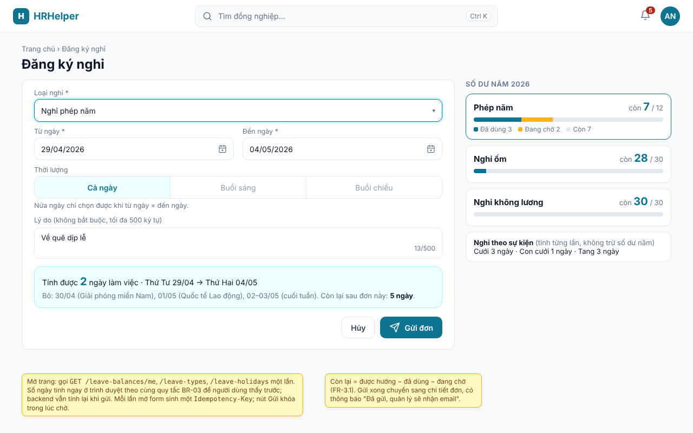

*Màn hình: đăng ký nghỉ trên điện thoại, lỗi trùng lịch*

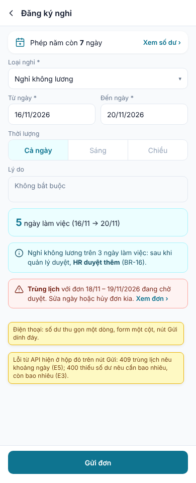

*Màn hình: đăng ký nghỉ theo sự kiện (nghỉ cưới)*

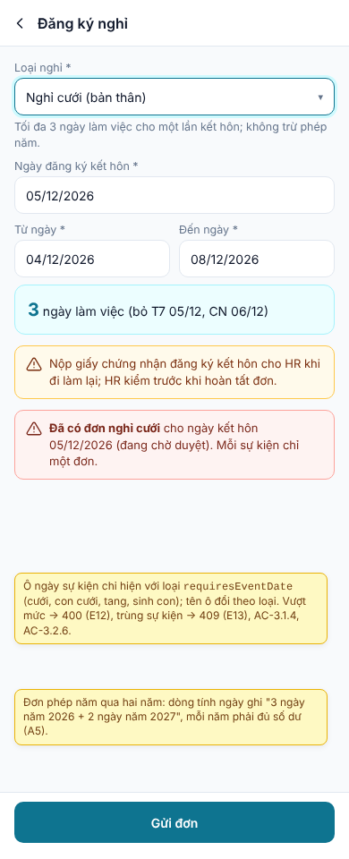

*Sơ đồ f1: tạo đơn nghỉ (luồng chính, A5)*

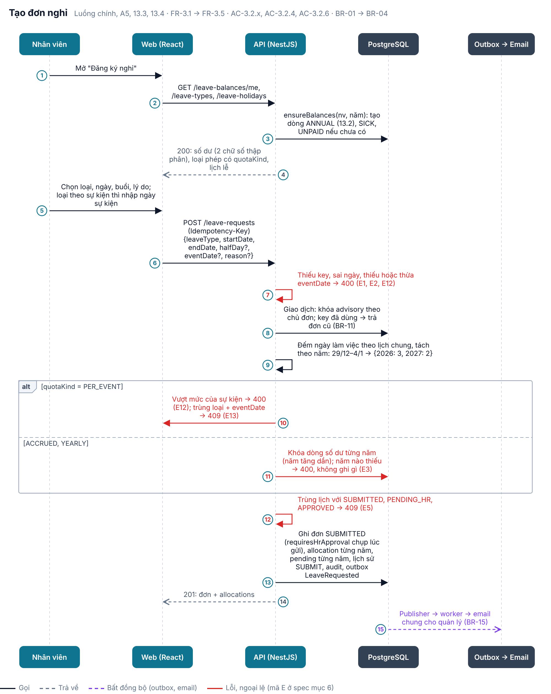

*Sơ đồ g1: cách tính phép năm (BR-01)*

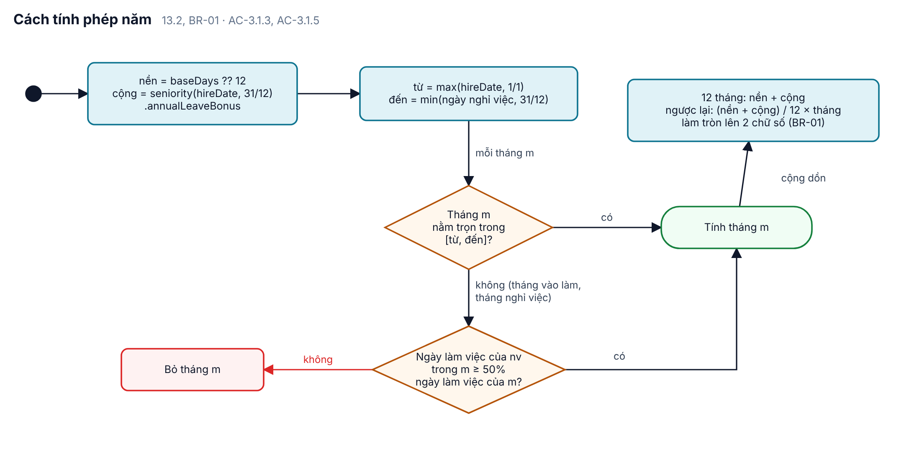

*Sơ đồ g2: loại phép theo cách tính số dư*

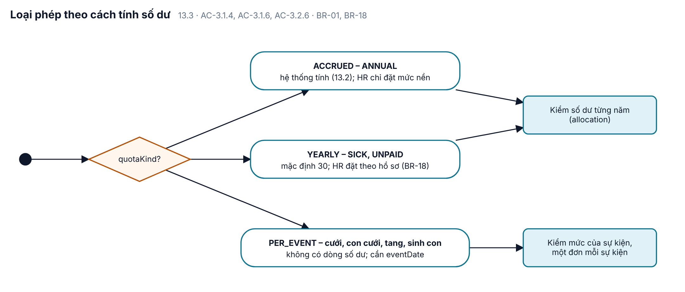

## 5. Luồng thay thế

- **A1, nhân viên hủy đơn (FR-3.6):**
  1. Trước ngày bắt đầu nghỉ, nhân viên mở đơn `SUBMITTED` hoặc `PENDING_HR` (đã qua quản lý, chờ HR, BR-16) của mình và bấm Hủy. Web gửi `POST /leave-requests/{id}/cancel` kèm `version`.
  2. Hệ thống chuyển đơn sang `CANCELLED` và trả số ngày khỏi `pending` (BR-07).
  3. Hệ thống ghi lịch sử, audit `LEAVE_CANCEL` và event `LeaveCancelled`, rồi email báo quản lý trực tiếp.
  4. Bấm hủy lần hai không đổi gì (BR-11).
- **A6, hủy đơn đã duyệt (BR-08):** Chủ đơn đề nghị; trước ngày bắt đầu nghỉ, quản lý trực tiếp hiện tại hoặc HR xác nhận
  với lý do bắt buộc. Đơn chuyển `CANCELLED`, trả `pending` theo từng năm, `used` không đổi; lịch sử ghi người đề nghị,
  người xác nhận và lý do, audit không chứa lý do tự do; email chỉ báo chung. Nhân viên không tự hủy đơn `APPROVED`.
  Từ ngày bắt đầu nghỉ, không dùng luồng hủy này; điều chỉnh số ngày nghỉ thực tế thuộc quy trình HR riêng.
- **A2, xem đơn của mình:** `GET /leave-requests/me`, lọc theo trạng thái, có phân trang. Mở chi tiết thì thấy lịch sử
  trạng thái (FR-4.7).
- **A3, HR hoặc quản lý tạo đơn hộ (FR-3.7, BR-12, chưa có):**
  1. Người tạo chọn nhân viên là chủ đơn. Hệ thống kiểm phạm vi: HR được chọn mọi nhân viên, quản lý chỉ chọn cấp dưới trực tiếp.
  2. Bước 4–9 của luồng chính áp dụng theo **chủ đơn**.
  3. Lịch sử và audit ghi riêng người tạo và chủ đơn. Chủ đơn nhận email và vẫn tự hủy được.
- **A4 (từ bước 2), nghỉ nửa ngày vào ngày nghỉ:** số ngày bằng 0, đi tới ngoại lệ E4.
- **A5 (từ bước 6), đơn qua hai năm, ví dụ 29/12/2026 – 4/1/2027:** hệ thống tách số ngày theo từng năm và trừ vào số dư của
  năm tương ứng; mỗi năm phải đủ số dư. Nhân viên vẫn gửi một đơn.
- **A7, tự hủy đơn chờ sau ngày bắt đầu (BR-07):** nhân viên nhận 409. HR xác minh ngày nghỉ thực tế, sau đó dùng quy trình
  điều chỉnh/hủy có lý do; số dư chỉ được trả theo ngày chưa nghỉ đã xác minh, không tự trả toàn bộ số ngày.

**Minh họa luồng thay thế: A1, A2, A7**

Chạy từng bước: [f2](flows/flows.html#f2) (mở `flows.html` bằng trình duyệt).

*Màn hình: đơn nghỉ của tôi, chi tiết đơn (A2)*

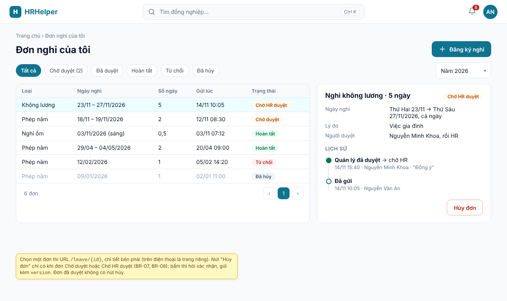

*Màn hình: xác nhận hủy đơn trên điện thoại*

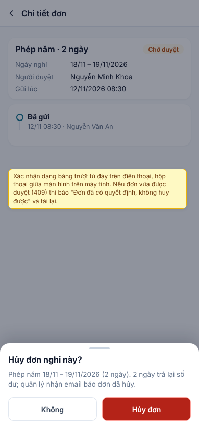

*Sơ đồ f2: tự hủy đơn chờ (A1, A7)*

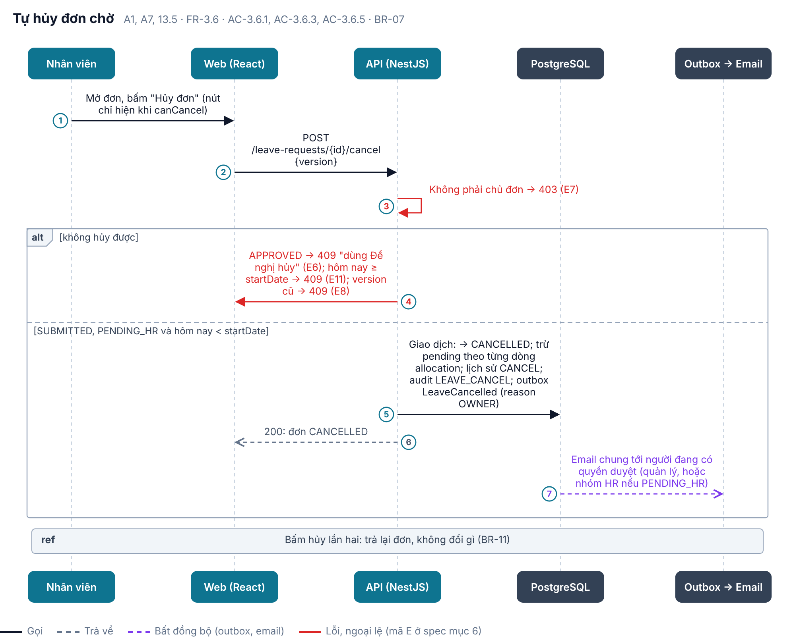

**Minh họa luồng thay thế: A6**

Chạy từng bước: [f3](flows/flows.html#f3) (mở `flows.html` bằng trình duyệt).

*Màn hình: đề nghị hủy đơn đã duyệt*

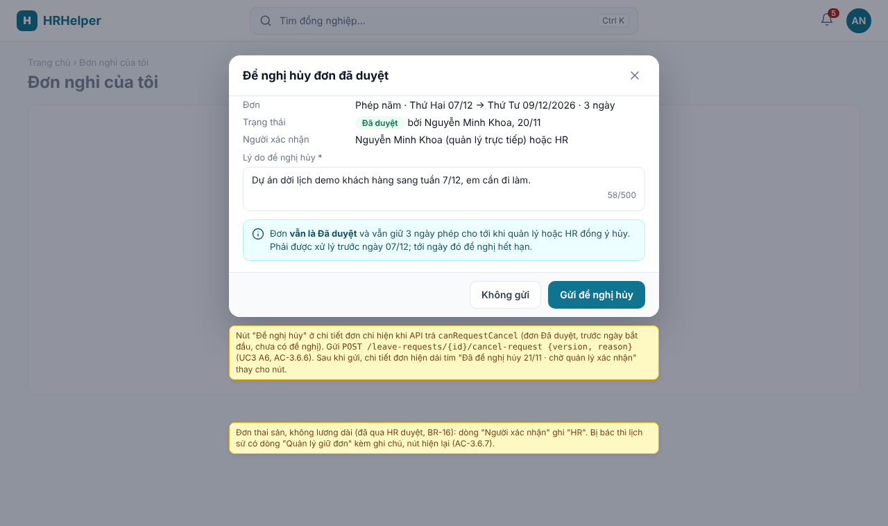

*Sơ đồ f3: đề nghị hủy đơn đã duyệt (A6)*

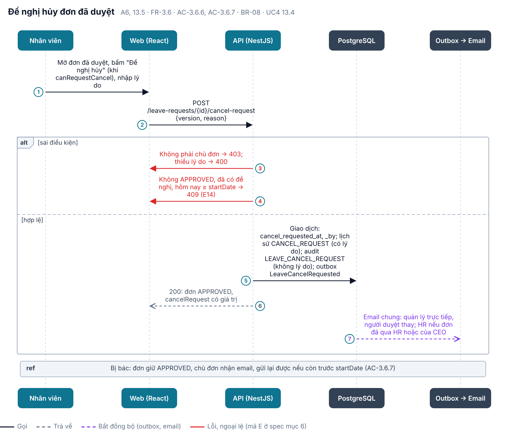

**Minh họa luồng thay thế: A3**

Chạy từng bước: [f4](flows/flows.html#f4) (mở `flows.html` bằng trình duyệt).

*Sơ đồ f4: tạo đơn hộ (A3)*

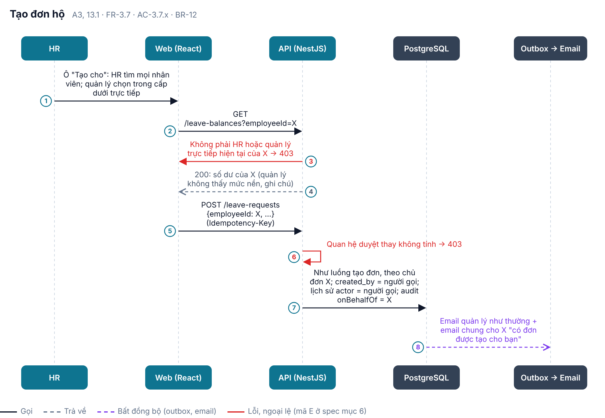

**Minh họa thêm: số dư phép**

Chạy từng bước: [f5](flows/flows.html#f5), [f6](flows/flows.html#f6) (mở `flows.html` bằng trình duyệt).

*Màn hình: số dư nhân viên, HR chỉnh hạn mức*

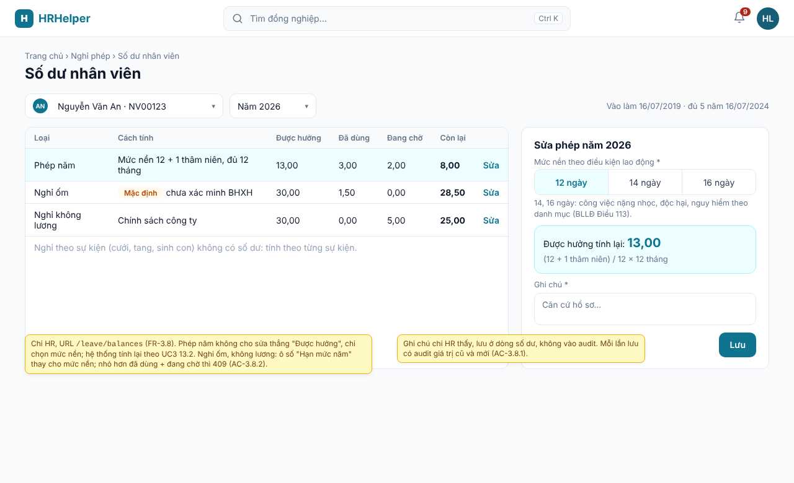

*Sơ đồ f5: cấp và tính lại số dư (A5, 13.2)*

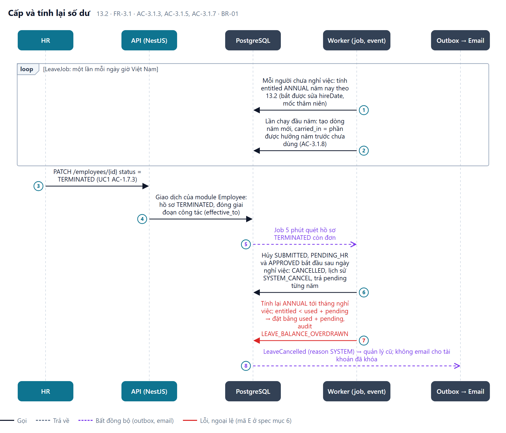

*Sơ đồ f6: HR chỉnh hạn mức (FR-3.8)*

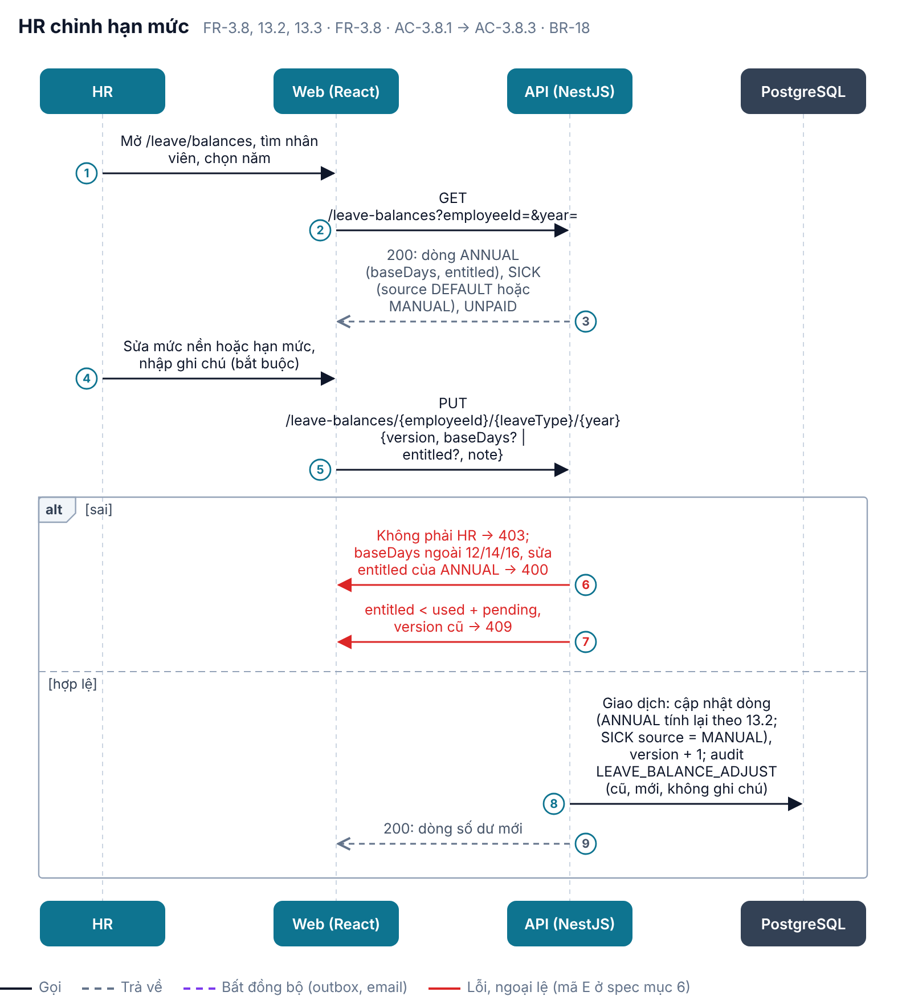

## 6. Ngoại lệ

Ngoại lệ chung của mọi API không lặp lại ở đây ([error-codes.md](../../development/error-codes.md#lỗi-chung)): 401 chưa đăng nhập hoặc token hết hạn; 403 tài khoản đã nghỉ việc (UC8 E4); 400 khi gửi trường lạ (chống gán hàng loạt) hoặc ID không phải UUID; 413 body quá 64 KiB; 500 kèm `traceId`. Cách rà ngoại lệ: [README mục "Rà ngoại lệ"](../README.md#rà-ngoại-lệ).

| Mã | Tình huống | Hệ thống phản hồi |
|---|---|---|
| E1 | Thiếu header `Idempotency-Key` hoặc dài quá 100 ký tự | 400 `BAD_REQUEST` |
| E2 | Ngày sai định dạng, ngày kết thúc trước ngày bắt đầu, nửa ngày nhưng hai ngày khác nhau, loại phép không tồn tại, lý do quá 500 ký tự | 400 `BAD_REQUEST` kèm `fields` |
| E3 | Không đủ số dư (BR-01) | 400 `BAD_REQUEST`, câu báo cần bao nhiêu ngày, còn bao nhiêu |
| E4 | Khoảng nghỉ có 0 ngày làm việc: chỉ cuối tuần, ngày lễ hoặc ngày nghỉ bù (BR-03) | 400 `BAD_REQUEST` |
| E5 | Trùng lịch với đơn đang chờ hoặc đã duyệt (BR-02) | 409 `CONFLICT`, nêu khoảng ngày của đơn bị trùng |
| E6 | Hủy đơn đã duyệt (BR-08) hoặc đã có quyết định khác | 409 `CONFLICT` |
| E7 | Hủy đơn của người khác | 403 `FORBIDDEN` |
| E8 | Hủy với `version` cũ | 409 `CONFLICT` |
| E9 | Tài khoản chưa gắn hồ sơ | 403 `FORBIDDEN` |
| E10 | Dùng lại `Idempotency-Key` cũ cho đơn khác (loại phép, ngày hoặc buổi khác) | 409 `CONFLICT` |
| E11 | Chủ đơn tự hủy `SUBMITTED`/`PENDING_HR` từ ngày bắt đầu nghỉ trở đi | 409 `CONFLICT`; HR xử lý sau khi xác minh thực tế nghỉ (BR-07) |
| E12 | Loại phép theo sự kiện mà thiếu `eventDate`, loại khác mà có `eventDate`; số ngày vượt mức của sự kiện (AC-3.1.4) | 400 `BAD_REQUEST` kèm `fields` |
| E13 | Đã có đơn cùng loại phép, cùng `eventDate` chưa bị từ chối, chưa bị hủy (AC-3.2.6) | 409 `CONFLICT` |
| E14 | Gửi đề nghị hủy khi đơn không `APPROVED`, đã có đề nghị hoặc đã tới `startDate` | 409 `CONFLICT` |

### 6.1 Ngoại lệ bổ sung (rà 24/11/2026)

Rà theo các nhóm ở [README](../README.md#rà-ngoại-lệ). Cột "Code" là hiện trạng: **Có** đã đối chiếu code hoặc thiết kế đã chốt; **Cần kiểm** chưa đối chiếu, test phải xác nhận; **Chưa đạt** code chưa làm đúng (mục 12); **Đề xuất** cần TV2 chốt nghiệp vụ.

| Mã | Nhóm | Tình huống | Hệ thống phản hồi | Code |
|---|---|---|---|---|
| E15 | Tranh chấp | Hai đơn gửi gần như cùng lúc (hai tab, hai thiết bị) cùng dùng số dư cuối hoặc trùng ngày | Khóa dòng số dư trong giao dịch (`pessimistic_write`); đơn sau nhận E3 hoặc E5 | Có |
| E16 | Dữ liệu vào | Khoảng nghỉ dài quá 1 năm, ngày bắt đầu sau 31/12 năm sau, hoặc trước ngày vào làm | 400 `BAD_REQUEST` kèm `fields` | Đề xuất, TV2 chốt |
| E17 | Vòng đời dữ liệu | Chủ đơn bị cho nghỉ việc khi đơn còn chờ | Hệ thống hủy đơn (`LEAVE_SYSTEM_CANCEL`, lý do `TERMINATED`), trả số ngày khỏi `pending` | Có |
| E18 | Vòng đời dữ liệu | Loại phép đã ngừng dùng | 400 `BAD_REQUEST` `fields.leaveTypeId` | Cần kiểm |
| E19 | Phân quyền | Quản lý tạo đơn hộ cho người không phải cấp dưới trực tiếp; HR tạo đơn hộ cho chính mình | 403 `FORBIDDEN` | Cần kiểm |
| E20 | Dữ liệu vào | Năm sau chưa có dòng số dư (đơn tháng 12 cho tháng 1) | Tạo dòng số dư năm sau ngay trong giao dịch theo 13.2, không lỗi | Cần kiểm |
| E21 | Bảo mật | Lý do có thông tin sức khỏe (nghỉ ốm, thai sản) | Không đưa vào email, audit, danh sách của người không có quyền (BR-14); HR đọc thì ghi `VIEW_LEAVE_REASON` | Có |

## 7. Quy tắc áp dụng

- [BR-01](../../business/leave-rules.md) số dư.
- BR-02 trùng lịch, BR-03 ngày làm việc và ngày lễ, BR-04 nửa ngày.
- BR-07 hủy đơn chờ trước ngày bắt đầu; BR-08 người duyệt xác nhận hủy đơn đã duyệt trước ngày bắt đầu.
- BR-11 thao tác lặp, BR-12 tạo đơn hộ.
- BR-17 nhắc đơn chờ; BR-18 nguồn hạn mức nghỉ ốm; BR-19 thay đổi lịch lễ sau khi gửi đơn.
- BR-13 thời hạn lưu, BR-14 người xem lý do nghỉ ốm, BR-15 email không chứa chi tiết.
- Loại phép, số ngày được hưởng, ngày lễ 2026: [`leave-types-holidays.md`](../../business/leave-types-holidays.md).
- [ADR-03](../../architecture/adr/ADR-03-sync-workflow-async-notification.md): ghi đơn đồng bộ, email bất đồng bộ qua outbox.

## 8. Dữ liệu vào

| Trường | Bắt buộc | Kiểm tra |
|---|---|---|
| Header `Idempotency-Key` | Có | 1–100 ký tự; web sinh mới cho mỗi lần tạo |
| `leaveType` | Có | Mã loại phép, ví dụ `ANNUAL` (`GET /leave-types`) |
| `startDate`, `endDate` | Có | `YYYY-MM-DD`, `endDate` ≥ `startDate` |
| `halfDay` | Không | `AM` hoặc `PM`, chỉ khi `startDate = endDate` |
| `reason` | Không | Tối đa 500 ký tự; với nghỉ ốm, thai sản chỉ chủ đơn và HR được xem (BR-14) |
| `eventDate` | Với loại `PER_EVENT` | `YYYY-MM-DD`: ngày cưới, ngày mất, ngày sinh con; không quá 1 năm trước hoặc sau `startDate` (13.3) |
| `version` (khi hủy) | Có | Version hiện tại của đơn |
| `reason` (khi đề nghị hủy) | Có | 1–500 ký tự; chỉ lưu ở lịch sử đơn |

## 9. Giao diện và API

| Luồng | Màn hình | API |
|---|---|---|
| Chính | `/leave/new` | `GET /leave-balances/me`, `GET /leave-types`, `GET /leave-holidays`, `POST /leave-requests` |
| A1, A2, A6 | `/leave`, `/leave/:id` | `GET /leave-requests/me`, `GET /leave-requests/{id}`, `POST /leave-requests/{id}/cancel`, `POST /leave-requests/{id}/cancel-request` |
| FR-3.8 | `/leave/balances` (HR) | `GET /leave-balances`, `PUT /leave-balances/{employeeId}/{leaveType}/{year}` |
| A3 | `/leave/new`, ô "Tạo cho" (13.1) | `GET /leave-balances?employeeId=`, `POST /leave-requests` có `employeeId` |

### 9.1 Bản vẽ giao diện

Bản vẽ để duyệt bố cục trước khi code (15/11/2026), cùng phong cách với bản vẽ UC1 ở
[giao diện chung mục 10](../frontend.md#10-bản-vẽ-giao-diện). Nguồn ở [`mockups.html`](../mockups/mockups.html), dữ liệu là người
mẫu. Ô vàng là ghi chú cho người đọc. Chỗ nào bản vẽ khác chữ trong spec thì chữ đúng.

**Đăng ký nghỉ `/leave/new`: form bên trái, số dư bên phải, số ngày tính sẵn trước khi gửi**


**Đơn nghỉ của tôi `/leave`, chi tiết `/leave/{id}` (A1, A2)**


**Trên điện thoại: form có lỗi trùng lịch và ghi chú BR-16; xác nhận hủy đơn**

| Đăng ký nghỉ | Hủy đơn |
|---|---|
|  |  |

**Bản vẽ thêm 18/11/2026 (thiết kế mục 13)**

Đề nghị hủy đơn đã duyệt (A6, AC-3.6.6):


HR xem, chỉnh số dư nhân viên `/leave/balances` (FR-3.8):


| Nghỉ theo sự kiện, có ngày sự kiện (AC-3.1.4, AC-3.2.6) |
|---|
|  |

### 9.2 Sơ đồ luồng

Bấm "Chạy" để xem từng bước: [`flows/flows.html`](flows/flows.html). Ảnh PNG nằm cùng thư mục, xuất lại bằng `flows/render.js`
(Playwright) hoặc `flows/render.ps1` (Windows). Luồng duyệt, hoàn tất, nhắc đơn và lịch lễ ở [UC4 mục 9.2](../UC4-approve-leave-request/spec.md#92-sơ-đồ-luồng).

| Luồng | Sơ đồ |
|---|---|
| Tạo đơn: số ngày, tách theo năm, nghỉ theo sự kiện, giữ chỗ (luồng chính, A5) | [uc3-f1.png](flows/uc3-f1.png) |
| Tự hủy đơn chờ, trước và từ ngày bắt đầu (A1, A7) | [uc3-f2.png](flows/uc3-f2.png) |
| Đề nghị hủy đơn đã duyệt (A6, BR-08) | [uc3-f3.png](flows/uc3-f3.png) |
| Tạo đơn hộ (A3, FR-3.7) | [uc3-f4.png](flows/uc3-f4.png) |
| Cấp và tính lại số dư phép năm: job đầu năm, nhân viên mới, sửa ngày vào làm, nghỉ việc (13.2) | [uc3-f5.png](flows/uc3-f5.png) |
| HR chỉnh hạn mức (FR-3.8) | [uc3-f6.png](flows/uc3-f6.png) |
| Cách tính phép năm (BR-01, 13.2) | [uc3-g1.png](flows/uc3-g1.png) |
| Loại phép theo cách tính số dư (13.3) | [uc3-g2.png](flows/uc3-g2.png) |

### 9.3 Hợp đồng API

Tất cả dưới `/api/v1`, cần đăng nhập (UC8). `docs/openapi.yaml` sinh từ code (`npm run openapi`), nên chỉ được cập nhật khi code merge.
Bảng dưới là hợp đồng để code theo. Lỗi theo dạng chung `{code, message, traceId, fields?}`
([error-codes.md](../../development/error-codes.md)). Endpoint duyệt, hoàn tất, lịch lễ ở [UC4 mục 9.3](../UC4-approve-leave-request/spec.md#93-hợp-đồng-api).

| API | Ai gọi | Vào | Ra | Lỗi |
|---|---|---|---|---|
| `GET /leave-types` | Mọi người | – | Thêm `quotaKind` (`ACCRUED`, `YEARLY`, `PER_EVENT`), `maxDaysPerEvent`, `requiresEventDate`, `requiresDocument`, `hrApproval`, `hrApprovalMinDays` | – |
| `GET /leave-balances/me?year=` | Có hồ sơ | – | `[{leaveType, year, entitled, carriedIn, used, pending, available, source: AUTO\|DEFAULT\|MANUAL}]`; `carriedIn` khác 0 chỉ với `ANNUAL`, hết hạn 31/12 của `year`; chỉ loại `ACCRUED`, `YEARLY`. Số có 2 chữ số thập phân | E9 |
| `GET /leave-balances?employeeId=&year=` | HR; quản lý trực tiếp hiện tại (chỉ cấp dưới trực tiếp, để tạo đơn hộ) | – | Như trên + `baseDays` (chỉ HR), `note` (chỉ HR) | 403 |
| `PUT /leave-balances/{employeeId}/{leaveType}/{year}` | HR | `{version, baseDays?, entitled?, note}`: `baseDays` (12, 14, 16) chỉ cho `ANNUAL`; `entitled` chỉ cho loại `YEARLY`; `note` 1–200 ký tự, bắt buộc | 200 dòng số dư mới | 400 (`fields`), 403, 409 (`version` cũ; `entitled` < `used + pending`) |
| `POST /leave-requests` | Có hồ sơ | Thêm `eventDate` (`YYYY-MM-DD`; bắt buộc với loại `PER_EVENT`, cấm với loại khác); thêm `employeeId` (tạo đơn hộ, 13.1) | 201 đơn + `allocations: [{year, days}]` | E1 → E5, E10, E12, E13 |
| `GET /leave-requests/{id}` | Chủ đơn, quản lý trực tiếp hiện tại, người duyệt thay, HR | – | Thêm `allocations`, `eventDate`, `createdBy`, `requiresHrApproval`, `cancelRequest: {requestedAt, requestedBy} \| null`, `canCancel`, `canRequestCancel`, `canConfirmCancel` (giao diện chỉ hiện nút theo các cờ này); lịch sử có `action` | 403, 404 |
| `POST /leave-requests/{id}/cancel` | Chủ đơn | `{version, comment?}` | 200 đơn `CANCELLED`. Chỉ `SUBMITTED`, `PENDING_HR` và hôm nay < `startDate` | E6, E7, E8, E11 |
| `POST /leave-requests/{id}/cancel-request` | Chủ đơn | `{version, reason}` (1–500 ký tự) | 200 đơn (vẫn `APPROVED`, có `cancelRequest`) | 400; 403 (không phải chủ đơn); 409 (E14) |

**Audit** (`entityType = leave_request`): thêm `LEAVE_CANCEL_REQUEST`, `LEAVE_CANCEL_APPROVED`, `LEAVE_CANCEL_REQUEST_REJECT`;
`entityType = leave_balance`: `LEAVE_BALANCE_ADJUST` (giá trị cũ và mới của `baseDays`, `entitled`, không ghi `note`),
`LEAVE_BALANCE_OVERDRAWN` (13.2). Lý do và ghi chú tự do chỉ nằm trong lịch sử đơn, không vào audit (BR-14). **Event**
(`leave.outbox`, payload tối thiểu theo [UC4 13.2](../UC4-approve-leave-request/spec.md#132-riêng-tư-đơn-nghỉ-br-14-br-15)):
`LeaveCancelRequested` → người có quyền xác nhận; `LeaveCancelRequestRejected` → chủ đơn.

## 10. Yêu cầu phi chức năng liên quan

- NFR-1.2: tạo, hủy đơn p95 < 500 ms. NFR-1.4: email tới hộp thư p95 < 1 phút.
- NFR-3.4: queue hoặc email lỗi không chặn việc tạo đơn. NFR-4.3: đơn đã nhận 201 không bao giờ mất.
- NFR-5.18: email, log không chứa lý do nghỉ (BR-15).

## 11. Kiểm thử

Chiến lược, test đã có, bảng phủ tiêu chí và ca còn thiếu: [test.md](test.md). Cách triển khai: [deploy.md](deploy.md).

## 12. Hiện trạng và việc còn lại

Code lại toàn bộ UC3, UC4 trong một PR `feat/leave-uc3-uc4` (21/11/2026) theo mục 13 (thay cho bảy nhánh ở 13.6), sau kiểm chéo
lần 2 (mục 15). Unit test: `leave-rules.spec.ts`, `leave-state-machine.spec.ts`, `leave-access.spec.ts`, `leave-events.spec.ts`,
`notification-worker.spec.ts`; e2e: khối "UC3, UC4 nghỉ phép" trong `app.e2e-spec.ts`.

| Nội dung | Trạng thái | Việc còn lại |
|---|---|---|
| Số dư, tạo đơn, ngày lễ, nửa ngày, trùng lịch, idempotency, hủy | Đã có | – |
| Phép năm theo tỉ lệ, tháng lẻ, thâm niên, mức nền, chuyển phép (BR-01, AC-3.1.3, AC-3.1.8, FR-3.8) | Đã có | – |
| Nghỉ theo sự kiện, `eventDate`, hạn mức nghỉ ốm `DEFAULT`/`MANUAL` (AC-3.1.4, AC-3.1.6, AC-3.2.6) | Đã có | Thai sản sinh đôi: HR kiểm giấy tờ ở bước HR duyệt |
| Đơn qua hai năm (A5, AC-3.2.4) | Đã có | Lịch lễ 2027 chưa nạp: HR nhập ở `/leave/holidays` |
| Tạo đơn hộ (FR-3.7, BR-12) | Đã có | – |
| Tự hủy trước `startDate`, đề nghị hủy đơn đã duyệt (BR-07, BR-08) | Đã có | HR điều chỉnh đơn đã bắt đầu: ngoài MVP (13.5) |
| Email chung, ẩn lý do nghỉ ốm (BR-14, BR-15) | Đã có | – |
| Nghỉ việc hủy đơn (AC-3.1.7), lịch lễ thay đổi (AC-3.4.3), 403 khi chưa gắn hồ sơ (E9) | Đã có | – |
| Lưu trữ 5 năm, legal hold (BR-13) | Chưa có | Thiết kế sau MVP; ghi trong SRS mục 8 |
| Bản vẽ `uc3-balances.png` chưa có cột "Chuyển từ năm trước" | Giao diện đã có cột | Vẽ lại khi rảnh |
| Ngoại lệ bổ sung mục 6.1 (E15 → E21) | Rà 24/11/2026 | cần kiểm: E18, E19, E20; chờ TV2 chốt: E16. TV4 viết test cho cả bảng, sửa code ca chưa đạt |

## 13. Thiết kế

> Đã code trong PR #120 (`feat/leave-uc3-uc4`, 21/11/2026). Đổi thiết kế thì sửa mục này cùng PR code.

### 13.1 Tạo đơn hộ (FR-3.7, BR-12)

- **API:** dùng lại `POST /leave-requests`, thêm trường tùy chọn `employeeId` (chủ đơn). Không gửi thì chủ đơn là người gọi như hiện nay.
- **Kiểm quyền:** có `employeeId` khác người gọi thì người gọi phải là HR, hoặc là quản lý trực tiếp hiện tại của chủ đơn. Quan hệ
  duyệt thay (BR-06) không tính. Sai thì 403.
- **Dữ liệu:** thêm cột `leave_request.created_by` (người tạo, mặc định bằng chủ đơn). Lịch sử dòng đầu ghi `actorId` = người tạo.
  Audit `LEAVE_SUBMIT`: `actorId` = người tạo, `changedFields` thêm `onBehalfOf` = chủ đơn.
- **Khóa và idempotency:** khóa advisory theo **chủ đơn**; `Idempotency-Key` duy nhất theo (chủ đơn, key) như hiện tại.
- **Email:** event `LeaveRequested` gửi quản lý như thường, thêm một email báo chủ đơn "có đơn nghỉ được tạo cho bạn" (nội dung
  chung theo BR-15).
- **Giao diện:** `/leave/new` thêm ô "Tạo cho" chỉ hiện với HR (tìm mọi nhân viên) và quản lý (chọn trong cấp dưới trực tiếp).
  Số dư hiển thị là số dư của người được chọn: cần API `GET /leave-balances?employeeId=` cho HR và quản lý trực tiếp.

### 13.2 Cấp và tính phép năm (BR-01, AC-3.1.3, AC-3.1.5, AC-3.1.7)

> Thiết kế 18/11/2026, theo các quy tắc PR #96 đã chốt. (a), (b), (c) Duong **chốt 21/11** (không chờ TV2):
> (a) tháng lẻ tính theo **lịch làm việc** từ `hireDate` hoặc ngày nghỉ việc, không theo chấm công (ADR-05), trừ các ngày
> nghỉ không lương (`UNPAID`) đã duyệt trong tháng đó vì BR-01 chỉ đếm ngày làm việc và ngày nghỉ hưởng lương;
> (b) đủ mốc 5 năm trong năm nào thì **cả năm đó** được cộng; (c) phép năm chưa dùng **được chuyển** sang năm sau, dùng tới
> hết năm sau (mục "Chuyển phép" bên dưới).

Phép năm (`quotaKind = ACCRUED`) luôn do hệ thống tính, HR không sửa trực tiếp `entitled`. HR chỉ đặt mức nền `baseDays`
(12, 14, 16) cho người thuộc nhóm điều kiện lao động tương ứng (FR-3.8):

```text
entitled(nv, năm) =
  nền     = leave_balance.base_days ?? 12
  cộng    = seniority(hireDate, năm-12-31).annualLeaveBonus      // cùng hàm UC1 (profile-computed.ts)
  từ      = max(hireDate, năm-01-01);  đến = min(ngày nghỉ việc ?? năm-12-31, năm-12-31)
  tháng   = số tháng m trong [từ, đến] mà
            (tháng đủ) hoặc ((ngày làm việc của nv trong m − ngày UNPAID đã duyệt trong m)
                             ÷ ngày làm việc của m ≥ 0,5)                       // bỏ T7, CN, ngày lễ
  nếu tháng = 12: nền + cộng
  ngược lại:      làm tròn lên 2 chữ số ((nền + cộng) / 12 × tháng)   // BR-01: không làm tròn giảm
```

Ví dụ: vào làm 01/7/2026 có 6 tháng, được 6,00 ngày. Vào làm 16/7/2026: tháng 7 có 23 ngày làm việc, người này làm 12 ngày
(≥ 11,5) nên tháng 7 được tính, năm 2026 được 6,00. Vào làm 20/7/2026: làm 10 ngày (< 11,5), chỉ còn 5 tháng, được 5,00.
Vào làm 15/8/2021 thì năm 2026 đủ 5 năm, được 13,00. Mức 14 ngày, đủ 10 năm, làm cả năm: 16,00. Mức 14 ngày, làm 7 tháng:
14 / 12 × 7 = 8,1666…, được 8,17. Mức 13 ngày (12 + 1 thâm niên), làm 1 tháng: 1,0833…, được 1,09 (làm tròn lên,
không phải 1,08).

**Khi nào tính lại** (đều trong module Leave, không để module Employee gọi ngược):

| Lúc | Việc |
|---|---|
| Đọc số dư, tạo đơn | `ensureBalances(nv, năm)`: chưa có dòng `ANNUAL` thì tạo theo công thức; dòng `SICK`, `UNPAID` chưa có thì tạo theo mặc định của loại phép (`source = DEFAULT`) |
| Job hằng ngày (worker `LeaveJob` chạy 5 phút một lần, việc này một lần mỗi ngày giờ Việt Nam; đánh dấu ngày trong `notification.processed_event` sau khi chạy xong, `pg_try_advisory_lock` chống chạy trùng; chết giữa chừng thì lần sau chạy lại) | Tính lại `ANNUAL` năm hiện tại cho người chưa nghỉ việc. Bắt được việc sửa `hireDate` (UC1 AC-1.4.4) và mốc thâm niên |
| Lần chạy đầu tiên của năm (cùng job) | Tạo dòng năm mới cho mọi người đang làm việc, đặt `carried_in` theo công thức chuyển phép bên dưới |
| Số dư năm trước đổi (đơn năm trước bị từ chối, hủy, tính lại; job hằng ngày) | Tính lại `carried_in` của năm hiện tại trong cùng transaction |
| Job 5 phút (worker) quét hồ sơ `TERMINATED` còn đơn chưa xử lý | Hủy đơn chờ, hủy đơn đã duyệt bắt đầu sau ngày nghỉ việc (AC-3.1.7), rồi tính lại `ANNUAL` tới tháng nghỉ việc. Ngày nghỉ việc là `effective_to` của giai đoạn công tác vừa đóng (UC2 FR-2.8). Không dùng event `EmployeeTerminated`: event đó là của UC8 (payload `accountId`, chỉ phát khi hồ sơ có tài khoản, worker `identity-sync` xử lý) |

Tính lại mà `entitled` mới nhỏ hơn `used + pending` (người nghỉ việc đã dùng quá số được hưởng) thì đặt `entitled = used + pending`
để giữ CHECK của bảng, ghi audit `LEAVE_BALANCE_OVERDRAWN` kèm số tính được, và HR xử lý ngoài hệ thống (lương nằm ngoài
phạm vi, ADR-05).

**Chuyển phép** (BR-01, AC-3.1.8, chốt 21/11/2026). Chỉ loại `ANNUAL`. Mỗi dòng số dư có thêm `carried_in` là số ngày
chuyển từ năm trước; đơn trừ phần chuyển sang trước:

```text
khả dụng(N)       = entitled(N) + carried_in(N) − used(N) − pending(N)
carried_in(N + 1) = max(0, entitled(N) − max(0, used(N) + pending(N) − carried_in(N)))
```

Nghĩa là chỉ phần được hưởng **của chính năm N** còn lại mới được chuyển; phần `carried_in(N)` không dùng hết thì hết hạn
31/12 năm N, không chuyển lần hai. `pending` của năm N (đơn chờ có ngày trong năm N, xem 13.4) vẫn tính là đã giữ chỗ; khi
đơn đó bị từ chối hoặc hủy sau 01/01 thì `carried_in(N + 1)` tăng lại. Ví dụ: năm 2026 được 12, dùng 9, không có chuyển
sang: 2027 có `carried_in` 3, được 12, khả dụng 15. Năm 2027 dùng 5: 3 ngày chuyển sang dùng trước, 2 ngày trừ vào phần 2027,
nên 2028 có `carried_in` 10. Năm 2027 chỉ dùng 2: 1 ngày chuyển sang hết hạn, 2028 có `carried_in` 12.

Nếu tính lại làm `carried_in` mới nhỏ hơn số đã dùng (năm trước bị tính lại giảm) thì xử lý như trường hợp `entitled` giảm ở
trên: giữ CHECK bằng cách không giảm dưới `used + pending − entitled`, ghi audit `LEAVE_BALANCE_OVERDRAWN`.

### 13.3 Loại phép theo cách tính số dư (BR-01, BR-18, AC-3.1.4, AC-3.1.6)

| `quotaKind` | Loại | Có dòng `leave_balance` | Kiểm khi tạo đơn |
|---|---|---|---|
| `ACCRUED` | `ANNUAL` | Có, tính theo 13.2 | Số ngày từng năm ≤ số dư khả dụng năm đó |
| `YEARLY` | `SICK` (mặc định 30, HR sửa theo hồ sơ BHXH, BR-18), `UNPAID` (30, chính sách công ty) | Có, `entitled` do HR đặt hoặc mặc định | Như trên |
| `PER_EVENT` | `MARRIAGE` 3, `CHILD_MARRIAGE` 1, `BEREAVEMENT` 3, `PATERNITY` 14, `MATERNITY` 6 tháng | Không | Có `eventDate`; số ngày ≤ `max_days_per_event` (thai sản: `endDate` ≤ `startDate` + 6 tháng − 1 ngày, sinh đôi HR kiểm giấy tờ ở bước HR duyệt); không trùng (nhân viên, loại phép, `eventDate`) với đơn chưa bị từ chối, chưa bị hủy |

Dòng `SICK` mặc định 30 ngày (mức thấp nhất của điều kiện bình thường) có `source = DEFAULT`. Giao diện ghi "Mặc định, HR chưa
xác minh hồ sơ BHXH"; HR sửa thì thành `MANUAL`. Mặc định không suy ra từ `hireDate` (BR-18). `PATERNITY` lấy mức cao nhất (14);
quản lý và HR đối chiếu giấy tờ khi duyệt, hoàn tất. Code hiện tạo số dư cho mọi loại theo `max_days_per_year` (spec 12); bỏ
cách đó cho loại `PER_EVENT`.

### 13.4 Đơn qua hai năm (A5, AC-3.2.4)

Bảng `leave.leave_request_allocation (request_id, year, days)` giữ số ngày của đơn theo từng năm, chỉ cho loại `ACCRUED`,
`YEARLY`. Tạo đơn: tính số ngày từng năm theo BR-03, khóa các dòng số dư (thứ tự năm tăng dần để không khóa chéo), mỗi năm phải đủ
số dư, không thì 400 và không ghi gì. Hủy, từ chối, hoàn tất, tính lại (UC4 13.6) đều cộng, trừ theo từng dòng phân bổ. Đơn
`leave_request.days` vẫn là tổng. Năm sau chưa có dòng số dư thì `ensureBalances` tạo trước khi kiểm.

### 13.5 Hủy đơn (A1, A6, A7; BR-07, BR-08)

| Trạng thái | Trước `startDate` | Từ `startDate` trở đi |
|---|---|---|
| `SUBMITTED`, `PENDING_HR` | Chủ đơn tự hủy (`POST …/cancel`) | Chủ đơn nhận 409. Đơn vẫn đi tiếp luồng duyệt: nếu nhân viên không nghỉ thì người duyệt từ chối và `pending` được trả. HR điều chỉnh từng phần nằm ngoài MVP (review #96 điểm 11, Duong **chốt 21/11**) |
| `APPROVED` | Chủ đơn gửi đề nghị (`POST …/cancel-request`); người có quyền xác nhận hoặc bác ([UC4 13.4](../UC4-approve-leave-request/spec.md#134-xác-nhận-hoặc-bác-đề-nghị-hủy-br-08)) | Không hủy qua hệ thống; HR hoàn tất theo số ngày thực tế đã đăng ký |

Đề nghị hủy chỉ có một tại một thời điểm. Chủ đơn không rút lại đề nghị (đơn giản cho MVP); người duyệt bác thì chủ đơn gửi lại
được. Đơn đang có đề nghị vẫn là `APPROVED`, vẫn giữ lịch (BR-02) và vẫn giữ `pending`.

### 13.6 Thiết kế dữ liệu chung UC3, UC4

Mỗi nhánh code thêm migration của phần mình (không sửa migration cũ), sửa `database-schema.md` mục 7 và `test.md` trong cùng PR.

| Bảng | Thay đổi | Nhánh |
|---|---|---|
| `leave.leave_type` | `quota_kind varchar(10) NOT NULL` (CHECK `ACCRUED`, `YEARLY`, `PER_EVENT`); `max_days_per_event numeric(5,1) NULL`; `max_months_per_event smallint NULL`; `requires_event_date boolean`, `requires_document boolean`; `hr_approval`, `hr_approval_min_days` (UC4 13.3). Seed thêm `CHILD_MARRIAGE`, `BEREAVEMENT`, `MATERNITY`, `PATERNITY` | `feat/leave-balance-rules` (cột HR duyệt ở `feat/leave-hr-approval`) |
| `leave.leave_balance` | `entitled`, `used`, `pending` đổi sang `numeric(5,2)`; thêm `base_days numeric(5,2) NULL`, `source varchar(8) NOT NULL DEFAULT 'AUTO'` (CHECK `AUTO`, `DEFAULT`, `MANUAL`), `note varchar(200)`, `carried_in numeric(5,2) NOT NULL DEFAULT 0` (CHECK `>= 0`; CHECK số dư thành `used + pending <= entitled + carried_in`), `version int NOT NULL DEFAULT 1`, `updated_by uuid`, `updated_at timestamptz`. Xóa các dòng của loại `PER_EVENT` mà `used = 0 AND pending = 0` | `feat/leave-balance-rules` |
| `leave.leave_request_allocation` (mới) | `request_id uuid FK`, `year smallint`, `days numeric(5,1) CHECK > 0`, PK `(request_id, year)`. Migration điền một dòng cho mỗi đơn cũ của loại có số dư | `feat/leave-balance-rules` |
| `leave.leave_request` | `event_date date NULL`, unique index có điều kiện `ux_leave_request_event (employee_id, leave_type_id, event_date) WHERE event_date IS NOT NULL AND status IN ('SUBMITTED','PENDING_HR','APPROVED','COMPLETED')` | `feat/leave-balance-rules` |
| | `created_by uuid` (13.1) | `feat/leave-delegation` |
| | `requires_hr_approval boolean NOT NULL DEFAULT false`, CHECK `status` thêm `PENDING_HR`, `stage_entered_at timestamptz NOT NULL DEFAULT now()` | `feat/leave-hr-approval` |
| | `cancel_requested_at timestamptz NULL`, `cancel_requested_by uuid NULL` | `feat/leave-cancel-rules` |
| | `reminded_at timestamptz NULL`; index `ix_leave_request_stage (status, stage_entered_at) WHERE reminded_at IS NULL` | `feat/leave-reminders` |
| `leave.leave_request_history` | `action varchar(30) NOT NULL` (`SUBMIT`, `APPROVE`, `MANAGER_APPROVE`, `HR_APPROVE`, `REJECT`, `CANCEL`, `CANCEL_REQUEST`, `CANCEL_APPROVE`, `CANCEL_REQUEST_REJECT`, `COMPLETE`, `RECALCULATE`, `SYSTEM_CANCEL`); migration điền từ `to_status`. Đề nghị hủy, bác đề nghị, tính lại không đổi trạng thái nên cần cột này | `feat/leave-cancel-rules` |
| `leave.holiday` | `kind varchar(12) NOT NULL DEFAULT 'HOLIDAY'` (CHECK `HOLIDAY`, `COMPENSATORY`), `created_by uuid`, `created_at timestamptz` | `feat/leave-holidays` |

`stage_entered_at` đặt bằng `now()` khi đơn vào `SUBMITTED` và khi vào `PENDING_HR`; `reminded_at` về `NULL` mỗi lần đổi giai
đoạn. `actor_id` của dòng lịch sử do hệ thống tạo (`SYSTEM_CANCEL`, nhắc việc) là `NULL`, nên bỏ `NOT NULL` của cột này.

**Thứ tự nhánh code** (sau UC8; mỗi nhánh một PR, theo lát cắt dọc API, giao diện, test):

| Thứ tự | Nhánh | Nội dung | Tiêu chí |
|---|---|---|---|
| 1 | `feat/leave-balance-rules` | Loại phép theo `quotaKind`, phép năm 13.2, đơn qua năm, nghỉ theo sự kiện, HR chỉnh hạn mức, xử lý nghỉ việc | AC-3.1.3 → AC-3.1.7, AC-3.2.4, AC-3.2.6, AC-3.8.x |
| 2 | `feat/leave-hr-approval` | `PENDING_HR`, cấu hình loại phép (UC4 13.3) | AC-4.8.x |
| 3 | `feat/leave-cancel-rules` | Tự hủy trước `startDate`, đề nghị hủy, xác nhận hoặc bác; chỉ hoàn tất sau `endDate` | AC-3.6.x, AC-4.5.3 → AC-4.5.7 |
| 4 | `feat/leave-privacy` | Email chung, ẩn lý do nghỉ ốm, email đơn CEO cho HR (UC4 13.2) | AC-4.6.3, AC-4.6.5, AC-4.7.3, AC-4.7.4 |
| 5 | `feat/leave-reminders` | Job nhắc đơn chờ (UC4 13.5) | AC-4.6.6 |
| 6 | `feat/leave-delegation` | Người duyệt thay, tạo đơn hộ (13.1, UC4 13.1) | AC-3.7.x, AC-4.3.x |
| 7 | `feat/leave-holidays` | HR quản lý lịch lễ, tính lại đơn bị ảnh hưởng, lịch dùng chung cho UC1 (UC4 13.6) | AC-3.4.3, AC-4.9.x |

Nếu thiếu thời gian trước feature freeze 2/12 thì cắt từ dưới lên: 7, rồi 6.

## 14. Kiểm chéo với UC1, UC2, UC8 (18/11/2026)

Rà sau khi UC1, UC2 đã code xong (#80 → #90, #106 → #110). Mỗi dòng có tiêu chí hoặc mục thiết kế tương ứng.

| Điểm chạm | Hiện trạng | Quyết định cho UC3, UC4 |
|---|---|---|
| Thâm niên (UC1 "Các mốc", `seniority()`) | UC1 hiện số ngày phép cộng theo thâm niên | Phép năm dùng cùng hàm, tính ở ngày 31/12 của năm (13.2) |
| Sửa `hireDate` (UC1 AC-1.4.4) | HR sửa được | Job 00:10 tính lại `ANNUAL` năm hiện tại (13.2). Không sửa đơn đã gửi |
| Nghỉ việc (UC1 AC-1.7.1, AC-1.7.3; UC2 hộp xác nhận) | Chặn khi còn cấp dưới; gỡ trưởng, phó; hủy điều chuyển chờ. Chưa đụng tới đơn nghỉ | Đơn `SUBMITTED`, `PENDING_HR` của người nghỉ việc bị hệ thống hủy, trả `pending`; đơn `APPROVED` bắt đầu sau ngày nghỉ việc cũng bị hủy; đơn đang diễn ra để HR xử lý. `termination-impact` thêm `leave: {pending, approvedFuture}` để hộp xác nhận nêu trước (AC-3.1.7) |
| Người nghỉ việc là quản lý | Không cho nghỉ việc khi còn cấp dưới (UC1 AC-1.7.1) | Không có đơn chờ nào bị mồ côi; không cần luồng chuyển người duyệt riêng |
| Điều chuyển đổi quản lý (UC2 AC-2.7.3, UC4 AC-4.2.6) | Đơn `SUBMITTED` đi theo quản lý mới; điều chuyển tương lai chỉ có hiệu lực khi job áp dụng | Người duyệt luôn là `manager_id` **lúc xử lý** (BR-05). Đề nghị hủy cũng theo quản lý mới. Đơn `PENDING_HR` không đổi |
| Trưởng, phó đơn vị (UC2 FR-2.9) | Là vai trò của đơn vị, không cho quyền duyệt | Giữ nguyên: trưởng, phó không phải quản lý trực tiếp thì không xem, không duyệt đơn. Phó chỉ được ưu tiên trong danh sách chọn người duyệt thay (AC-2.9.3) |
| Quản lý gián tiếp (UC1 AC-1.1.4, #110) | Xem hồ sơ mức QL của cấp dưới gián tiếp | Không mở rộng sang đơn nghỉ: quản lý gián tiếp không xem chi tiết, không thấy trong danh sách chờ (AC-4.7.5) |
| Trạng thái `ON_LEAVE` (UC1) | HR đổi tay; "Ngày nghỉ dài" của UC1 đọc đơn ≥ 14 ngày đã duyệt, hoàn tất | Duyệt đơn thai sản không tự đổi `ON_LEAVE` trong MVP. Mục "Ngày nghỉ dài" vẫn chỉ đọc đơn `APPROVED`, `COMPLETED` |
| Ngày làm việc của UC1 (hạn 2 ngày, AC-1.9.13) | `workdaysBetween` chỉ bỏ T7, CN, tính theo ngày UTC, không bỏ ngày lễ | Gom thành một dịch vụ lịch dùng chung (`common/calendar`) đọc `leave.holiday`, múi giờ Asia/Ho_Chi_Minh; UC1, UC3 (BR-03), UC4 (nhắc đơn, hoàn tất) cùng dùng (nhánh 7) |
| Event hồ sơ ghi chung `leave.outbox` (UC1 spec 12); `EmployeeTerminated` của UC8 (#115) | Nợ kỹ thuật; `EmployeeTerminated` mang `accountId`, chỉ phát khi có tài khoản | Leave không nghe `EmployeeTerminated`; job của Leave quét hồ sơ `TERMINATED` (13.2, kiểm chéo lần 2 ngày 21/11) |
| Đăng nhập (UC8, ADR-17) | UC8 làm trước UC3, UC4 | API nghỉ phép cần `employeeId` lấy từ tài khoản: tài khoản chưa gắn hồ sơ trả 403 (E9, code đang trả 404); hồ sơ `TERMINATED` trả 403 (UC1 AC-1.7.2) |
| Phân quyền (ADR-18) | Điều kiện duyệt nằm rải trong `LeaveService` | Gom về `leave-access.ts` ở nhánh 3; thêm các dòng mới vào [ma trận phân quyền](../../security/access-control-matrix.md) |
| Trang "Việc cần duyệt" (UC1 `/approvals`) | Mỗi loại một tab | Đề nghị hủy hiện trong tab "Đơn nghỉ" cùng đơn chờ duyệt, có nhãn "Đề nghị hủy", không thêm tab |

## 15. Kiểm chéo lần 2 trước khi code (21/11/2026)

Rà lại sau khi UC8 đã merge (#111 → #116) và quy tắc chuyển phép đã chốt (#118). Các chỗ lệch nhau và cách đã sửa:

| Chỗ lệch | Sửa |
|---|---|
| #118 merge vào nhánh `docs/uc3-uc4-design` sau khi nhánh đó đã vào `dev`, nên quy tắc chuyển phép chưa có trên `dev` | Gộp lại vào `dev` cùng PR này |
| `EmployeeTerminated` có hai payload khác nhau trong hợp đồng event (UC8: `accountId`, `email`; dòng dự kiến của UC3: `effectiveDate`); event của UC8 chỉ phát khi hồ sơ có tài khoản | Leave không nghe event này; job 5 phút của Leave quét hồ sơ `TERMINATED` (13.2). Bỏ dòng dự kiến trong hợp đồng event mục 8 |
| BR-01, AC-3.1.1, luồng chính bước 1: số dư khả dụng chưa cộng `carried_in` | Sửa công thức `entitled + carried_in − used − pending` |
| BR-02 chỉ nêu `SUBMITTED`, `APPROVED` giữ lịch; BR-16, UC4 13.3 nói `PENDING_HR` cũng giữ lịch | BR-02 thêm `PENDING_HR` |
| BR-16 "quá 2 ngày làm việc" có nhãn Quá hạn; BR-17, UC4 13.5 dùng mốc một ngày làm việc đầy đủ | BR-16 dùng mốc của BR-17 |
| UC4 A7 xác nhận hủy qua `POST …/cancel`; hợp đồng API 9.3 dùng `…/cancel-request/approve` | A7 theo 9.3 |
| UC4 13.1 giao diện duyệt thay `/leave/delegations`; bảng mục 9 dùng `/approvals/delegations` | Dùng `/approvals/delegations` |
| Sơ đồ trạng thái UC4 có "HR hủy đơn chờ từ `startDate`"; 13.5 ghi HR điều chỉnh từng phần nằm ngoài MVP | Bỏ hai cạnh đó; thêm cạnh hệ thống hủy khi nghỉ việc (AC-3.1.7) |
| Từ chối đơn: UC4 mục 8 cho ghi chú tùy chọn; giao diện chung AC-0.6.3, UC1 FR-1.9, AC-4.8.4 bắt buộc lý do; E12 dùng mã `VALIDATION_ERROR` không có trong [error-codes.md](../../development/error-codes.md) | Từ chối, bác đề nghị hủy bắt buộc lý do (400 `BAD_REQUEST`), sửa AC-4.2.2 |

Không lệch: vai trò `MANAGER` suy từ cấp dưới trực tiếp (ADR-10, UC8 #112) khớp quyền duyệt; nghỉ việc chặn khi còn cấp dưới
(UC1) nên không có đơn chờ mồ côi; hồ sơ `TERMINATED` đã bị chặn đăng nhập ở `IdentityService` (403); `vnToday()` của UC2 dùng
lại cho mốc "hôm nay" theo giờ Việt Nam; thâm niên dùng `seniority()` của UC1.

Đề xuất (a), (b) ở 13.2 và hai điểm ở 13.5 (đơn chờ tới `startDate` vẫn đi tiếp luồng duyệt; đơn đã qua HR thì chỉ HR xác
nhận hủy) Duong chốt ngày 21/11/2026, không chờ TV2; code đã làm theo.
