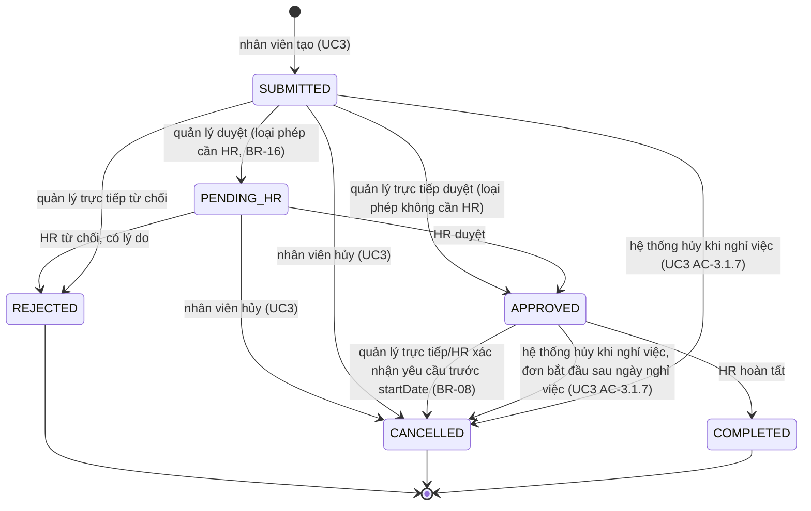
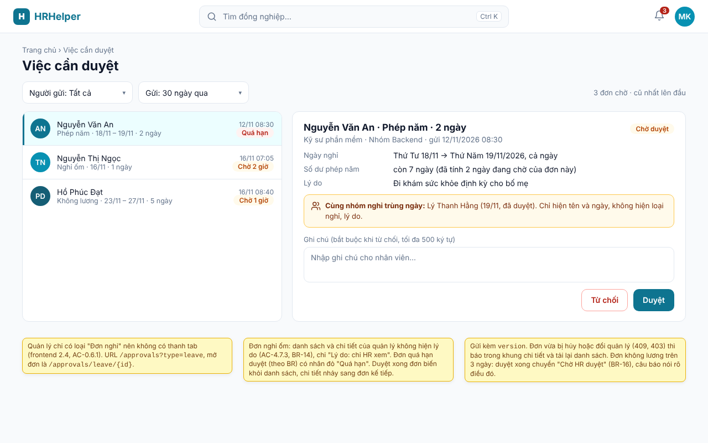
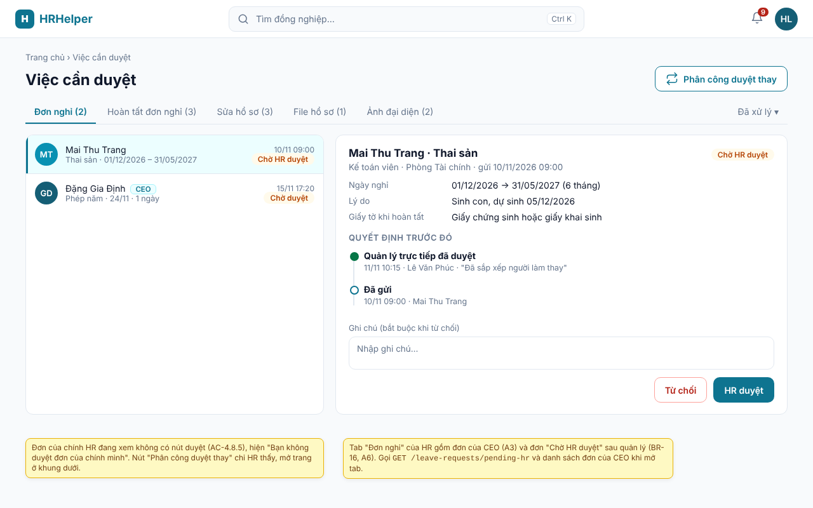
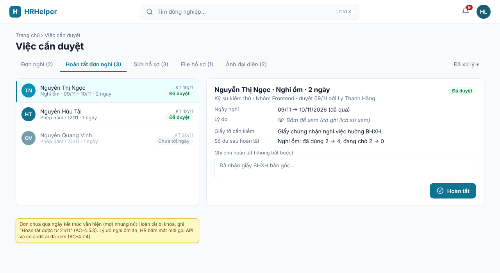
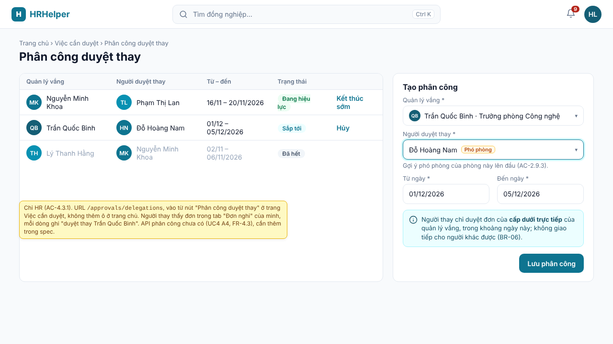
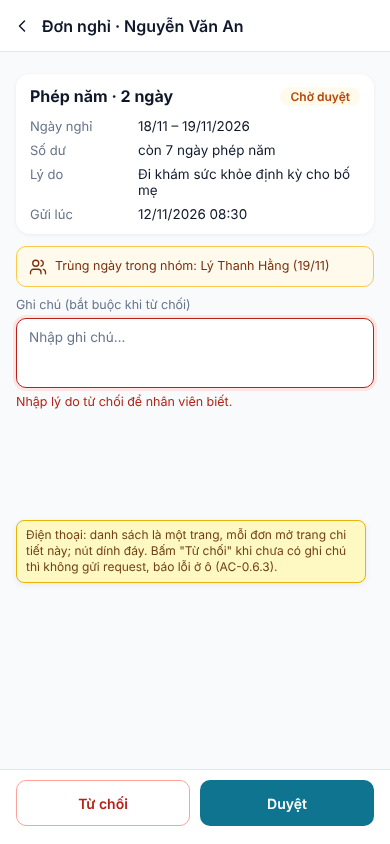
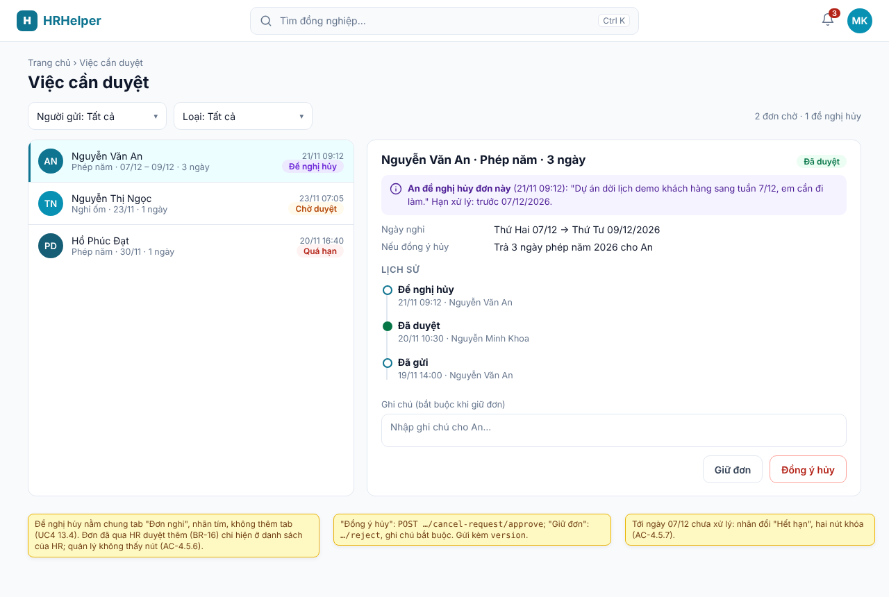
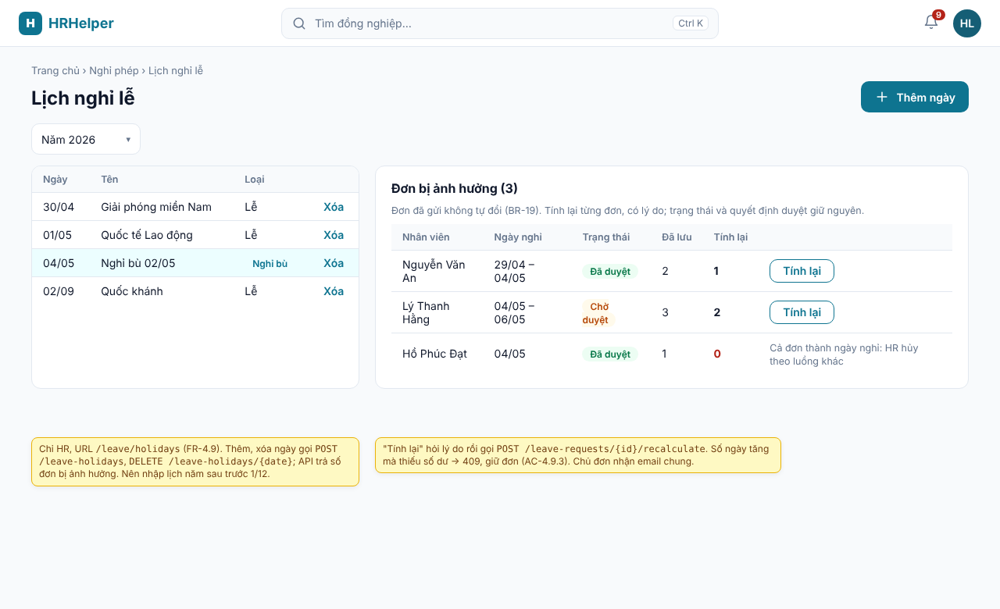

# UC4 – Duyệt đơn nghỉ

| Mục | Nội dung |
|---|---|
| Mục tiêu kinh doanh | MT-2 (duyệt đơn nghỉ dưới 1 ngày làm việc), MT-3 (lượt duyệt có audit) |
| Tác nhân chính | Quản lý trực tiếp (duyệt, từ chối); HR (duyệt thêm loại phép cần HR duyệt, BR-16; hoàn tất; duyệt đơn của CEO) |
| Tác nhân phụ, hệ thống ngoài | Người duyệt thay (BR-06, chưa có); nhân viên (nhận email); queue và dịch vụ email |
| Yêu cầu (SRS) | FR-4.1 → FR-4.9 |
| Quy tắc | [BR-05 → BR-11, BR-14 → BR-19](../../business/leave-rules.md), ADR-03, ADR-09, ADR-10 |
| Mức ưu tiên | M (FR-4.3, FR-4.4 là S) |
| Trạng thái | Đã có toàn bộ FR-4.1 → FR-4.9 (`feat/leave-uc3-uc4`, 21/11/2026) |
| Phiên bản | 1.3 – 18/11/2026 (sơ đồ luồng `flows/`, hợp đồng API 9.3, thiết kế 13.4 → 13.7: xác nhận đề nghị hủy, nhắc đơn chờ, lịch lễ, quyền xử lý). 1.2 – 17/11/2026 (chốt hạn hoàn tất, hủy sau duyệt, nhắc đơn chờ; BR-08, BR-10, BR-17) |

## 1. Mô tả ngắn

Quản lý trực tiếp xem các đơn đang chờ của cấp dưới và duyệt hoặc từ chối kèm ghi chú. Khi quản lý vắng, HR chỉ định người
duyệt thay. HR duyệt đơn của CEO, người duy nhất không có quản lý. Với một số loại phép (thai sản, nghỉ không lương trên 3
ngày, BR-16), quản lý duyệt xong thì HR duyệt thêm một lần rồi đơn mới được duyệt. Sau khi duyệt, HR hoàn tất đơn để số ngày giữ chỗ thành số
ngày đã dùng. Mỗi bước gửi email cho người liên quan và ghi lịch sử, audit trong cùng giao dịch.

## 2. Tác nhân và quyền

| Tác nhân | Được làm gì | Giới hạn theo dữ liệu |
|---|---|---|
| Quản lý trực tiếp | Xem danh sách chờ duyệt; xem chi tiết; duyệt hoặc từ chối | Chỉ đơn `SUBMITTED` của cấp dưới trực tiếp **tại thời điểm xử lý** |
| Người duyệt thay (chưa có) | Như quản lý trực tiếp, cho cấp dưới của quản lý được thay | Chỉ trong khoảng ngày HR giao; không ủy quyền nối tiếp |
| HR | Xem mọi đơn; hoàn tất đơn `APPROVED`; duyệt, từ chối đơn của CEO; duyệt, từ chối đơn `PENDING_HR` (BR-16) | Bước đầu chỉ duyệt đơn của CEO; bước HR duyệt thêm không được duyệt đơn của chính mình |
| Nhân viên | Nhận email kết quả; xem chi tiết và lịch sử đơn của mình | – |
| ADMIN | Không tham gia | Không xem đơn của người khác |
| Quản lý gián tiếp; trưởng, phó đơn vị không phải quản lý trực tiếp | Không tham gia (BR-05; UC2 FR-2.9; kiểm chéo UC3 mục 14) | 403 khi xem chi tiết đơn (AC-4.7.5) |

## 3. Điều kiện

- **Điều kiện trước:** có đơn ở `SUBMITTED` (duyệt, từ chối) hoặc `APPROVED` (hoàn tất); người xử lý đã đăng nhập.
- **Kích hoạt:** quản lý mở email "có đơn cần xử lý" hoặc mở trang "Đơn chờ duyệt"; HR mở trang "Đơn cần hoàn tất".
- **Điều kiện sau khi thành công:**

  | Thao tác | Trạng thái | Số dư | Audit | Event, email tới |
  |---|---|---|---|---|
  | Duyệt | `SUBMITTED` → `APPROVED` | Không đổi (vẫn giữ trong `pending`) | `LEAVE_APPROVE` | `LeaveApproved` → nhân viên |
  | Từ chối | `SUBMITTED` → `REJECTED` | `pending` giảm (BR-09) | `LEAVE_REJECT` | `LeaveRejected` → nhân viên |
  | Hủy đơn đã duyệt | `APPROVED` → `CANCELLED` trước `startDate`, do quản lý trực tiếp/HR xác nhận theo đề nghị của chủ đơn | `pending` giảm theo từng năm, `used` không đổi (BR-08) | `LEAVE_CANCEL_APPROVED` | `LeaveCancelled` → nhân viên, quản lý |
  | Hoàn tất | `APPROVED` → `COMPLETED` sau `endDate` theo giờ Việt Nam | `pending` giảm, `used` tăng (BR-10) | `LEAVE_COMPLETE` | `LeaveCompleted` → nhân viên |

  Mọi thao tác thêm một dòng lịch sử (người xử lý, trạng thái trước và sau, ghi chú, thời điểm) và tăng `version`.
- **Điều kiện sau khi thất bại:** đơn, số dư, `version` giữ nguyên; không có event.

## 4. Luồng chính: quản lý duyệt đơn

| Bước | Tác nhân | Hệ thống |
|---|---|---|
| 1 | Quản lý mở "Đơn chờ duyệt" | `GET /leave-requests/pending-approval`: đơn `SUBMITTED` của cấp dưới trực tiếp, có phân trang (FR-4.1) |
| 2 | Mở một đơn | `GET /leave-requests/{id}`: chi tiết và lịch sử trạng thái (FR-4.7) |
| 3 | Bấm Duyệt, nhập ghi chú (tùy chọn) | Gửi `POST /leave-requests/{id}/approve` kèm `version` |
| 4 | | Kiểm người gọi là quản lý trực tiếp hiện tại của chủ đơn (BR-05) |
| 5 | | Đưa vào state machine: `SUBMITTED` → `APPROVED`, hoặc → `PENDING_HR` nếu đơn có `requiresHrApproval` (A6). Đơn đã ở trạng thái đích thì trả lại đơn, không đổi gì (BR-11) |
| 6 | | Kiểm `version`; ghi trạng thái, lịch sử, audit, event outbox trong một giao dịch |
| 7 | Thấy đơn đã duyệt, biến khỏi danh sách chờ | Trả đơn; worker gửi email cho nhân viên (FR-4.6) |

## 5. Luồng thay thế

- **A1 (bước 3), từ chối:** gọi `POST /leave-requests/{id}/reject`. Đơn sang `REJECTED`, trả số ngày khỏi `pending` (BR-09).
- **A2, HR hoàn tất (FR-4.5):**
  1. HR mở "Đơn cần hoàn tất". Hệ thống gọi `GET /leave-requests` với mặc định `status=APPROVED`.
  2. HR bấm Hoàn tất. Web gửi `POST /leave-requests/{id}/complete` kèm `version`.
  3. Hệ thống chuyển số ngày từ `pending` sang `used` (BR-10).
  4. HR chỉ hoàn tất từ ngày kế tiếp `endDate` theo múi giờ Việt Nam, khi nhân viên đã thật sự nghỉ. Với loại phép cần giấy
     tờ (ốm, cưới, tang, thai sản), HR kiểm giấy tờ trước khi hoàn tất ([danh mục loại phép](../../business/leave-types-holidays.md));
     thiếu giấy tờ thì giữ `APPROVED` (BR-10).
- **A3, đơn của CEO (FR-4.4):** đơn hiện trong danh sách chờ của HR. HR duyệt hoặc từ chối như bước 3–7.
- **A4, người duyệt thay (FR-4.3, BR-06, chưa có):**
  1. HR tạo phân công gồm quản lý vắng, người thay và khoảng ngày.
  2. Trong khoảng đó, người thay thấy đơn chờ của cấp dưới quản lý vắng và xử lý như bước 3–7. Lịch sử ghi người thay là người quyết định.
  3. Hết hạn thì người thay mất quyền.
- **A6, HR duyệt thêm (FR-4.8, BR-16):**
  1. Lúc nhân viên gửi đơn (UC3), hệ thống chụp cấu hình của loại phép vào đơn: `requiresHrApproval = true` nếu loại phép là
     `Luôn`, hoặc `Khi trên N ngày` và số ngày làm việc của đơn lớn hơn N.
  2. Quản lý duyệt (bước 3–6). Đơn có `requiresHrApproval` thì sang `PENDING_HR`, audit `LEAVE_APPROVE`, email chung báo nhân viên
     "đơn đã qua quản lý, chờ HR" và báo mọi tài khoản HR "có đơn cần xử lý" (BR-15).
  3. HR mở "Việc cần duyệt", tab Đơn nghỉ (`GET /leave-requests/pending-hr`), mở đơn, thấy cả quyết định và ghi chú của quản lý.
  4. HR duyệt: `POST /leave-requests/{id}/hr-approve` kèm `version` → `APPROVED`, audit `LEAVE_HR_APPROVE`, email cho nhân viên.
  5. HR từ chối: `POST /leave-requests/{id}/hr-reject` kèm `version` và `comment` bắt buộc → `REJECTED`, trả `pending` (BR-09),
     audit `LEAVE_HR_REJECT` (không chứa `comment`, BR-14), email cho nhân viên và quản lý.
  6. Trong lúc `PENDING_HR`, nhân viên vẫn tự hủy được (UC3 A1, BR-07); đơn vẫn giữ lịch (BR-02).
- **A7, hủy đơn đã duyệt (BR-08):** Chủ đơn đề nghị hủy trước ngày bắt đầu. Quản lý trực tiếp hiện tại hoặc HR xác nhận
  qua `POST /leave-requests/{id}/cancel-request/approve` (bác: `…/cancel-request/reject`, 13.4), gửi `version`; lý do là của
  đề nghị chủ đơn đã gửi. Hệ thống chuyển `APPROVED` → `CANCELLED`, trả
  `pending` theo từng năm, không cộng `used`, ghi người đề nghị/người xử lý/lý do vào lịch sử (không đưa lý do tự do vào
  audit), gửi email chung. Nhân viên gọi `…/cancel` trên đơn `APPROVED` nhận 409 (UC3 AC-3.6.2).
- **A8, nhắc đơn chờ (BR-17):** Sau một ngày làm việc đầy đủ, nếu `SUBMITTED` thì nhắc người duyệt đang có quyền; nếu
  `PENDING_HR` thì nhắc nhóm HR. Chỉ nhắc một lần cho mỗi giai đoạn, dùng email chung; không tự duyệt/hủy.
- **A9, HR sửa lịch lễ (FR-4.9, BR-19):** HR thêm hoặc xóa ngày lễ, ngày nghỉ bù; hệ thống báo số đơn bị ảnh hưởng, không tự
  sửa đơn. HR mở danh sách đơn bị ảnh hưởng và bấm "Tính lại" từng đơn, kèm lý do (13.6).
- **A5 (bước 5), bấm duyệt hai lần:** lần hai trả lại đơn, không đổi số dư, không gửi email lần nữa (BR-11).

## 6. Ngoại lệ

| Mã | Tình huống | Hệ thống phản hồi |
|---|---|---|
| E1 | Người gọi không phải quản lý trực tiếp hiện tại (hoặc HR với đơn không phải của CEO) | 403 `FORBIDDEN` |
| E2 | Vai trò không có quyền (nhân viên gọi pending-approval; ADMIN duyệt; quản lý hoàn tất) | 403 `FORBIDDEN` |
| E3 | Quyết định ngược với quyết định đã có (từ chối đơn đã duyệt) | 409 `CONFLICT` |
| E4 | Hoàn tất đơn chưa duyệt | 409 `CONFLICT` |
| E5 | `version` cũ (người khác vừa xử lý) | 409 `CONFLICT`; tải lại đơn |
| E6 | Đơn không tồn tại | 404 `NOT_FOUND` |
| E7 | Xem chi tiết đơn khi không phải chủ đơn, quản lý trực tiếp hoặc HR | 403 `FORBIDDEN` |
| E8 | Chủ đơn không có quản lý trực tiếp | CEO: email "có đơn cần xử lý" gửi tới HR. Người khác (dữ liệu lỗi, vì FR-2.5 bắt buộc có quản lý): đơn chờ, worker ghi cảnh báo để HR sửa sơ đồ tổ chức |
| E10 | HR hoàn tất đơn khi chưa qua ngày kết thúc | 409 `CONFLICT` |
| E14 | HR hoàn tất trong chính ngày kết thúc hoặc trước `endDate` theo giờ Việt Nam | 409 `CONFLICT` (BR-10) |
| E15 | Quản lý/HR hủy đơn `APPROVED` từ ngày bắt đầu trở đi theo luồng hủy trước ngày nghỉ | 409 `CONFLICT`; HR dùng quy trình xác minh/điều chỉnh thực tế |
| E11 | HR duyệt thêm đơn của chính mình | 403 `FORBIDDEN` |
| E12 | Từ chối (quản lý, HR duyệt thêm) hoặc bác đề nghị hủy mà không có lý do | 400 `BAD_REQUEST`, `fields: ["comment"]` |
| E13 | Hoàn tất đơn `PENDING_HR`; quản lý gọi `hr-approve` | 409 `CONFLICT`; 403 `FORBIDDEN` |
| E16 | Xác nhận, bác đề nghị hủy khi không có quyền: không phải quản lý trực tiếp hiện tại, người duyệt thay hoặc HR; quản lý xử lý đơn có `requiresHrApproval`; chủ đơn tự xác nhận | 403 `FORBIDDEN` |
| E17 | Xác nhận, bác khi đơn không có đề nghị hủy, không còn `APPROVED`, hoặc đã tới `startDate` | 409 `CONFLICT` |
| E18 | Tính lại đơn `COMPLETED`, `CANCELLED`, `REJECTED`; số ngày mới bằng 0; số ngày tăng mà không đủ số dư | 409 `CONFLICT` |
| E9 | Queue hoặc dịch vụ email lỗi | Quyết định vẫn được lưu; event chờ trong outbox hoặc vào DLQ (NFR-3.4) |

## 7. Quy tắc áp dụng

- [BR-05](../../business/leave-rules.md) người duyệt hợp lệ, BR-06 người duyệt thay.
- BR-09 từ chối trả số ngày, BR-10 HR hoàn tất, BR-11 lịch sử và thao tác lặp.
- BR-07 hủy đơn chờ trước ngày bắt đầu, BR-08 hủy đơn đã duyệt theo đề nghị.
- BR-14 chỉ chủ đơn và HR xem lý do nghỉ ốm, BR-15 email không chứa chi tiết đơn, BR-16 HR duyệt thêm theo loại phép,
  BR-17 nhắc đơn chờ, BR-18 hạn mức nghỉ ốm, BR-19 cập nhật lịch lễ.
- [ADR-10](../../architecture/adr/ADR-10-manager-role-derived.md): vai trò MANAGER suy ra từ sơ đồ tổ chức.
- [ADR-09](../../architecture/adr/ADR-09-append-only-audit.md): audit chỉ thêm, cùng giao dịch.
- [Hợp đồng event](../../architecture/event-contract.md): payload, người nhận, chống gửi trùng.

## 8. Dữ liệu vào

| Trường | Bắt buộc | Kiểm tra |
|---|---|---|
| `version` | Có | Version hiện tại của đơn (optimistic locking) |
| `comment` | Không | Tối đa 500 ký tự; ghi vào lịch sử |
| `status` (lọc danh sách HR) | Không | Một trong 6 trạng thái; mặc định `APPROVED` |
| `comment` khi `reject`, `hr-reject`, `cancel-request/reject` | Có | 1–500 ký tự (cùng quy tắc từ chối của UC1 FR-1.9 và giao diện AC-0.6.3) |

## 9. Giao diện và API

| Luồng | Màn hình | API |
|---|---|---|
| Chính, A1, A5 | Trang "Việc cần duyệt" tab Đơn nghỉ: `/approvals?type=leave`, `/approvals/leave/:id` ([giao diện chung mục 2.4](../frontend.md#24-trang-việc-cần-duyệt-approvals)) | `GET /leave-requests/pending-approval`, `GET /leave-requests/{id}`, `POST …/approve`, `POST …/reject` |
| A2 | Tab Hoàn tất đơn nghỉ: `/approvals?type=leave-complete`, `/approvals/leave-complete/:id` | `GET /leave-requests`, `POST …/complete` |
| A3 | `/approvals?type=leave` (HR) | Như luồng chính |
| A6 | `/approvals?type=leave` (HR), `/approvals/leave/:id` | `GET /leave-requests/pending-hr`, `POST …/hr-approve`, `POST …/hr-reject` |
| A4 | `/approvals/delegations` (HR, vào từ nút "Phân công duyệt thay") | `POST /leave-delegations`, `GET /leave-delegations`, `POST /leave-delegations/{id}/end` |
| A7 | Tab "Đơn nghỉ" của `/approvals`, dòng có nhãn "Đề nghị hủy" | `POST …/cancel-request/approve`, `POST …/cancel-request/reject` |
| A9 | `/leave/holidays` (HR) | `POST /leave-holidays`, `DELETE /leave-holidays/{date}`, `GET /leave-requests/affected-by-holidays`, `POST …/recalculate` |

Hiện code có `/leave/approvals`, `/leave/hr` là trang riêng; khi làm trang `/approvals` thì hai đường dẫn này chuyển tiếp sang
tab tương ứng.

### 9.1 Bản vẽ giao diện

Bản vẽ để duyệt bố cục trước khi code (15/11/2026), cùng phong cách với bản vẽ UC1 ở
[giao diện chung mục 10](../frontend.md#10-bản-vẽ-giao-diện). Nguồn ở [`mockups.html`](../mockups/mockups.html), dữ liệu là người
mẫu. Ô vàng là ghi chú cho người đọc. Chỗ nào bản vẽ khác chữ trong spec thì chữ đúng.

**Quản lý duyệt đơn: chỉ một loại nên không có thanh tab (luồng chính, A1)**

**HR, tab "Đơn nghỉ": đơn Chờ HR duyệt kèm quyết định của quản lý (A3, A6)**

**HR, tab "Hoàn tất đơn nghỉ" (A2)**

**HR phân công duyệt thay `/approvals/delegations` (A4, FR-4.3)**

**Trên điện thoại: chi tiết đơn, từ chối bắt buộc ghi chú**

**Đề nghị hủy trong tab "Đơn nghỉ" (A7, 13.4; thêm 18/11/2026)**

**HR quản lý lịch nghỉ lễ và tính lại đơn `/leave/holidays` (A9, FR-4.9, 13.6; thêm 18/11/2026)**

### 9.2 Sơ đồ luồng

Bấm "Chạy" để xem từng bước: [`flows/flows.html`](flows/flows.html). Ảnh PNG nằm cùng thư mục, xuất lại bằng `flows/render.js`
hoặc `flows/render.ps1`. Luồng tạo, hủy đơn và cách tính số dư ở [UC3 mục 9.2](../UC3-create-leave-request/spec.md#92-sơ-đồ-luồng).

| Luồng | Sơ đồ |
|---|---|
| Quản lý duyệt, từ chối (luồng chính, A1, A5) | [uc4-f1.png](flows/uc4-f1.png) |
| HR duyệt thêm (A6, BR-16) | [uc4-f2.png](flows/uc4-f2.png) |
| Xác nhận hoặc bác đề nghị hủy (A7, BR-08) | [uc4-f3.png](flows/uc4-f3.png) |
| HR hoàn tất sau ngày kết thúc (A2, BR-10) | [uc4-f4.png](flows/uc4-f4.png) |
| Job nhắc đơn chờ (A8, BR-17) | [uc4-f5.png](flows/uc4-f5.png) |
| Người duyệt thay (A4, BR-06) | [uc4-f6.png](flows/uc4-f6.png) |
| HR sửa lịch lễ, tính lại đơn bị ảnh hưởng (A9, BR-19) | [uc4-f7.png](flows/uc4-f7.png) |
| Trạng thái đơn nghỉ (mục 4) | [uc4-g1.png](flows/uc4-g1.png) |
| Ai được xử lý đơn (BR-05, BR-06, BR-16, ADR-18) | [uc4-g2.png](flows/uc4-g2.png) |

### 9.3 Hợp đồng API

Quy ước như [UC3 mục 9.3](../UC3-create-leave-request/spec.md#93-hợp-đồng-api). Mọi thao tác đổi đơn gửi `version` và trả lại
đơn sau khi đổi (có `version` mới).

| API | Ai gọi | Vào | Ra | Lỗi |
|---|---|---|---|---|
| `GET /leave-requests/pending-approval?page=&size=` | Quản lý trực tiếp, người duyệt thay; HR (đơn của CEO) | – | Trang đơn `SUBMITTED` **và** đơn `APPROVED` có đề nghị hủy mà người gọi được xác nhận; mỗi dòng có `kind: DECISION \| CANCEL_REQUEST`, `viaDelegation`, `overdue` | E2 |
| `GET /leave-requests/pending-hr?page=&size=` | HR | – | Đơn `PENDING_HR` và đơn có đề nghị hủy chỉ HR xác nhận (BR-16) | E2 |
| `POST /leave-requests/{id}/approve`, `/reject` | Như hiện nay | `{version, comment?}` (`comment` bắt buộc khi từ chối, AC-0.6.3) | 200 đơn | E1 → E5 |
| `POST /leave-requests/{id}/hr-approve`, `/hr-reject` | HR, không phải chủ đơn | `{version, comment?}` | 200 đơn | E11 → E13 (13.3) |
| `POST /leave-requests/{id}/cancel-request/approve` | Quản lý trực tiếp hiện tại, người duyệt thay hoặc HR; đơn có `requiresHrApproval` thì chỉ HR | `{version, comment?}` | 200 đơn `CANCELLED` | E16, E17, E5 |
| `POST /leave-requests/{id}/cancel-request/reject` | Như trên | `{version, comment}` (bắt buộc) | 200 đơn `APPROVED`, `cancelRequest = null` | E16, E17, E12, E5 |
| `GET /leave-requests?status=&from=&to=&page=` | HR | – | Mặc định `APPROVED`; mỗi dòng thêm `completableFrom` (= `endDate` + 1) | E2 |
| `POST /leave-requests/{id}/complete` | HR | `{version, comment?}` | 200 đơn `COMPLETED` | E4, E5, E14 |
| `POST /leave-holidays` | HR | `{date, name, kind: HOLIDAY \| COMPENSATORY}` | 201 `{date, name, kind, affectedRequests}` | 400, 403, 409 (ngày đã có) |
| `DELETE /leave-holidays/{date}` | HR | – | 200 `{affectedRequests}` | 403, 404 |
| `GET /leave-requests/affected-by-holidays?year=` | HR | – | Đơn `SUBMITTED`, `PENDING_HR`, `APPROVED` mà số ngày đã lưu khác số ngày tính theo lịch hiện tại: `{id, employeeName, startDate, endDate, storedDays, recalculatedDays}` | E2 |
| `POST /leave-requests/{id}/recalculate` | HR | `{version, reason}` | 200 đơn với `days`, `allocations` mới | E18, E5 |
| `POST /leave-delegations`, `GET /leave-delegations`, `POST /leave-delegations/{id}/end` | HR | Theo 13.1 | | 403, 400, 409 (chồng lấn) |

**Audit** thêm `LEAVE_CANCEL_APPROVED`, `LEAVE_CANCEL_REQUEST_REJECT`, `LEAVE_RECALCULATE` (`entityType = leave_request`),
`HOLIDAY_CREATE`, `HOLIDAY_DELETE` (`entityType = holiday`), `DELEGATION_CREATE`, `DELEGATION_END`. **Event**: `LeaveCancelled`
(thêm lý do `CANCEL_REQUEST_APPROVED`, `SYSTEM`), `LeaveCancelRequestRejected`, `LeaveReminder`, `LeaveRecalculated`. Danh sách đủ
ở [hợp đồng event](../../architecture/event-contract.md) mục 8.

## 10. Yêu cầu phi chức năng liên quan

- NFR-1.2: duyệt, từ chối, hoàn tất p95 < 500 ms. NFR-1.4: email p95 < 1 phút.
- NFR-3.4, NFR-3.5: lỗi email không ảnh hưởng quyết định; thử lại có giãn cách rồi vào DLQ.
- NFR-6.1: 100% thao tác duyệt có audit.
- SLI "Đơn đã nhận bị mất = 0" (SRS mục 6.13).

## 11. Kiểm thử

Chiến lược, test đã có, bảng phủ tiêu chí và ca còn thiếu: [test.md](test.md). Cách triển khai: [deploy.md](deploy.md).

## 12. Hiện trạng và việc còn lại

| Nội dung | Trạng thái | Việc còn lại |
|---|---|---|
| Danh sách chờ, duyệt, từ chối (bắt buộc lý do), hoàn tất sau `endDate`, lịch sử có `action` | Đã có | – |
| HR duyệt đơn của CEO; email "có đơn" của CEO tới nhóm HR (E8) | Đã có | – |
| Người duyệt thay (FR-4.3, BR-06), trang `/approvals/delegations` | Đã có | Danh sách chọn người thay chưa đưa phó đơn vị lên đầu (UC2 AC-2.9.3) |
| HR duyệt thêm theo loại phép (FR-4.8, BR-16) | Đã có | Chưa có màn HR đổi cấu hình loại phép (`LEAVE_TYPE_UPDATE`); đổi bằng migration |
| Xác nhận, bác đề nghị hủy (BR-08, 13.4) | Đã có | – |
| Nhắc đơn chờ (BR-17), nhãn "Quá hạn" | Đã có (`LeaveJob`) | – |
| Lịch lễ, tính lại đơn (FR-4.9, BR-19) | Đã có | UC1 hạn 2 ngày làm việc (AC-1.9.13) vẫn dùng `workdaysBetween` chưa bỏ ngày lễ |
| Email chung, payload tối thiểu, audit không chứa ghi chú (BR-14, BR-15) | Đã có | – |
| Trang "Việc cần duyệt" gộp đơn nghỉ, hoàn tất; link cũ `/leave/approvals`, `/leave/hr` chuyển tiếp (AC-0.6.4) | Đã có | – |
| Đo MT-2 (thời gian gửi → quyết định) | Chưa có báo cáo | Truy vấn trên `leave_request_history` khi có dữ liệu staging |

## 13. Thiết kế đề xuất cho phần chưa có

> Đề xuất để có chỗ bám khi code. TV1 chốt trong PR `feat/leave-delegation` và `feat/leave-privacy`.

### 13.1 Người duyệt thay (FR-4.3, BR-06)

- **Bảng** `leave.approval_delegation`: `id`, `manager_id` (quản lý vắng), `delegate_id` (người thay), `start_date`, `end_date`
  (tính cả hai ngày), `created_by`, `created_at`, `ended_at` (HR kết thúc sớm).
- **Ràng buộc:** `delegate_id` ≠ `manager_id`; người thay đang làm việc và đang có cấp dưới (vai trò MANAGER, ADR-10); không
  chồng lấn khoảng ngày của cùng một `manager_id` (exclusion constraint trên `daterange`). Không ủy quyền nối tiếp: chỉ xét
  phân công của **quản lý trực tiếp** của chủ đơn, không xét phân công của người thay.
- **API (chỉ HR):** `POST /leave-delegations`, `GET /leave-delegations?managerId=&activeOn=`, `POST /leave-delegations/{id}/end`.
  Mỗi thao tác có audit `DELEGATION_CREATE`, `DELEGATION_END`.
- **Quyền duyệt:** trong `relation()`, thêm quan hệ `DELEGATE` khi người gọi là `delegate_id` của phân công hiệu lực **hôm nay**
  với `manager_id` = quản lý trực tiếp hiện tại của chủ đơn. State machine cho `DELEGATE` quyền như `DIRECT_MANAGER`.
- **Danh sách chờ duyệt:** `GET /leave-requests/pending-approval` gộp thêm cấp dưới của các quản lý đang giao cho người gọi;
  mỗi đơn có cờ `viaDelegation` để giao diện ghi "duyệt thay cho …".
- **Giao diện:** `/approvals/delegations` cho HR (mục 9): bảng phân công, nút tạo (chọn quản lý, người thay, khoảng ngày), nút kết thúc.

### 13.2 Riêng tư đơn nghỉ (BR-14, BR-15)

- **Ẩn lý do:** với loại phép ốm, thai sản, `reason` chỉ trả cho chủ đơn và HR ở chi tiết, danh sách, lịch sử. HR đọc lý do thì
  ghi audit `VIEW_LEAVE_REASON` (chỉ ID đơn, không giá trị).
- **Audit:** bỏ `comment` khỏi `changedFields` của duyệt, từ chối, hủy, hoàn tất; ghi chú vẫn nằm trong lịch sử đơn.
- **Outbox và email:** payload chỉ còn `eventId`, `eventType`, `requestId`, `employeeId`, `occurredAt`. Email: tiêu đề và nội dung
  chung, link `/leave` hoặc `/approvals?type=leave` (không có mã đơn). Đổi [hợp đồng event](../../architecture/event-contract.md)
  theo mục 6 của file đó.
- **Đơn của CEO:** worker gửi email "có đơn cần xử lý" tới mọi tài khoản HR khi chủ đơn là CEO.

### 13.3 HR duyệt thêm theo loại phép (FR-4.8, BR-16)

- **Cấu hình loại phép:** thêm vào `leave.leave_type` cột `hr_approval` (`NEVER`, `ALWAYS`, `OVER_DAYS`) và `hr_approval_min_days`
  (số, chỉ dùng với `OVER_DAYS`). Seed theo [danh mục loại phép](../../business/leave-types-holidays.md): `MATERNITY` = `ALWAYS`,
  `UNPAID` = `OVER_DAYS` 3, còn lại `NEVER`. Chỉ HR đổi được, có audit `LEAVE_TYPE_UPDATE`.
- **Đơn:** thêm `leave.leave_request.requires_hr_approval` (boolean, đặt lúc gửi, không đổi sau đó) và trạng thái `PENDING_HR`
  trong enum và state machine. Truy vấn trùng lịch (BR-02) và hủy (BR-07) coi `PENDING_HR` như `SUBMITTED`.
- **Quyền:** `hr-approve`, `hr-reject` chỉ cho vai trò HR và `actor.employeeId ≠ request.employeeId`. Đơn của CEO đặt
  `requires_hr_approval = false` vì HR đã là người duyệt.
- **Event:** `LeaveManagerApproved` (người nhận: nhân viên, nhóm HR), `LeaveHrApproved`, `LeaveHrRejected`; payload tối thiểu
  theo 13.2. Cập nhật [hợp đồng event](../../architecture/event-contract.md).
- **Migration:** đơn đang `SUBMITTED` lúc triển khai giữ `requires_hr_approval = false` (không áp dụng ngược).

### 13.4 Xác nhận hoặc bác đề nghị hủy (BR-08)

> Thiết kế 18/11/2026. Bổ sung phần còn thiếu của A7 (review #96, điểm 5): chủ đơn gửi đề nghị ở UC3, người có quyền xử lý ở đây.

- **Ai xác nhận:** quản lý trực tiếp **hiện tại** của chủ đơn hoặc người duyệt thay đang hiệu lực (BR-05, BR-06), hoặc HR. Đơn
  có `requires_hr_approval` (thai sản, nghỉ không lương dài, BR-16) thì **chỉ HR**, vì HR đã lập hồ sơ BHXH, lương theo đơn.
  Đơn của CEO: HR. Người xác nhận không được là chủ đơn.
- **Điều kiện:** đơn `APPROVED`, có `cancel_requested_at`, hôm nay (Asia/Ho_Chi_Minh) < `startDate`. Tới `startDate` mà chưa xử
  lý thì đề nghị hết hiệu lực: API trả 409 (E17), danh sách hiện nhãn "Hết hạn", đơn đi tiếp tới hoàn tất như thường.
- **Xác nhận:** một giao dịch: `APPROVED` → `CANCELLED`; trả `pending` theo từng dòng phân bổ (UC3 13.4); lịch sử
  `CANCEL_APPROVE` (người xác nhận, ghi chú); audit `LEAVE_CANCEL_APPROVED` (không có lý do); outbox `LeaveCancelled`
  (`reason = CANCEL_REQUEST_APPROVED`) gửi chủ đơn, quản lý trực tiếp; nếu đơn đã qua HR thì gửi thêm nhóm HR.
- **Bác:** ghi chú bắt buộc; xóa `cancel_requested_at`, `cancel_requested_by`; lịch sử `CANCEL_REQUEST_REJECT`; audit
  `LEAVE_CANCEL_REQUEST_REJECT`; outbox `LeaveCancelRequestRejected` gửi chủ đơn.
- **Giao diện:** đề nghị hủy hiện trong tab "Đơn nghỉ" của trang "Việc cần duyệt", có nhãn tím "Đề nghị hủy". Chi tiết hiện lý
  do của chủ đơn (lấy từ lịch sử), hai nút "Đồng ý hủy" và "Giữ đơn" ([bản vẽ](mockups/uc4-cancel-request.png)).

### 13.5 Nhắc đơn chờ (BR-17, AC-4.6.6)

- **Mốc "một ngày làm việc đầy đủ":** đơn vào giai đoạn chờ (`stage_entered_at`) ở ngày N. Ngày làm việc kế tiếp sau N là ngày
  đầy đủ đầu tiên. Nhắc lúc **08:00 của ngày làm việc tiếp theo nữa** (giờ Việt Nam, bỏ T7, CN, ngày lễ theo dịch vụ lịch chung).
  Ví dụ: gửi thứ Sáu 16:00 thì thứ Hai là ngày đầy đủ, nhắc 08:00 thứ Ba. Gửi thứ Tư 28/4/2026 thì 29/4 là ngày đầy đủ, 30/4,
  1/5 là lễ, 2–3/5 là cuối tuần, nhắc 08:00 thứ Hai 4/5.
- **Job** trong worker mỗi 15 phút: lấy đơn `SUBMITTED`, `PENDING_HR` có `reminded_at IS NULL` và đã tới mốc, bằng `FOR UPDATE
  SKIP LOCKED`; mỗi đơn một giao dịch: ghi `reminded_at = now()` và outbox `LeaveReminder {requestId, stage}`. Không ghi lịch sử
  đơn, không audit (không phải thao tác nghiệp vụ).
- **Người nhận:** `SUBMITTED` gửi quản lý trực tiếp hiện tại, kèm người duyệt thay nếu đang hiệu lực; chủ đơn là CEO thì gửi nhóm
  HR. `PENDING_HR` gửi nhóm HR. Không có người duyệt hợp lệ thì gửi nhóm HR với câu "có đơn chưa có người duyệt, kiểm tra sơ đồ
  tổ chức" (UC4 E8).
- **Nội dung:** theo BR-15: "Bạn có đơn nghỉ đang chờ xử lý quá một ngày làm việc", link `/approvals?type=leave`, không có tên,
  ngày, loại phép, mã đơn.
- Đổi giai đoạn (`SUBMITTED` → `PENDING_HR`) thì đặt lại `stage_entered_at`, `reminded_at = NULL`. Đơn đã có quyết định không
  còn ở hai trạng thái trên nên job tự bỏ qua.
- Danh sách chờ duyệt có cờ `overdue` cùng mốc này để hiện nhãn "Quá hạn".

### 13.6 Lịch lễ thay đổi sau khi gửi đơn (BR-19, A9, FR-4.9)

- **HR quản lý lịch** ở `/leave/holidays`: thêm ngày lễ hoặc ngày nghỉ bù, xóa ngày đã nhập. Mỗi thao tác có audit. Lịch năm
  sau nên nhập trước 1/12 (đầu việc của HR, không chặn trong hệ thống).
- **Không tự sửa đơn** (BR-19). Thêm hoặc xóa ngày thì API trả số đơn bị ảnh hưởng; trang hiện danh sách từ
  `GET /leave-requests/affected-by-holidays`, so số ngày đã lưu với số ngày tính lại.
- **Tính lại từng đơn:** HR bấm "Tính lại", nhập lý do. Một giao dịch: tính lại số ngày, phân bổ theo năm; chênh lệch cộng hoặc
  trừ vào `pending` từng năm; lịch sử `RECALCULATE` (số ngày cũ, mới, lý do); audit `LEAVE_RECALCULATE` (số ngày cũ, mới);
  outbox `LeaveRecalculated` gửi chủ đơn (email chung). Trạng thái và quyết định duyệt giữ nguyên.
- **Từ chối tính lại (E18):** đơn `COMPLETED`, `CANCELLED`, `REJECTED`; số ngày mới bằng 0 (cả khoảng thành ngày nghỉ, HR hủy
  theo luồng khác); số ngày tăng mà năm đó không đủ số dư (HR liên hệ nhân viên, không tự vượt số dư).
- **Lịch dùng chung:** gom việc đếm ngày làm việc về `common/calendar` (đọc `leave.holiday`, cache theo năm, xóa cache khi HR sửa
  lịch). UC1 (hạn 2 ngày làm việc), UC3 (BR-03, tháng lẻ ở 13.2), UC4 (hoàn tất, nhắc đơn) cùng gọi.

### 13.7 Quyền xử lý đơn (ADR-18)

Gom vào `leave-access.ts` (đã có, [authorization.md](../../security/authorization.md)), một hàm `relation(actor, request)`
trả về tập quan hệ: `OWNER`, `DIRECT_MANAGER`, `DELEGATE`, `HR`. Mỗi endpoint kiểm theo bảng:

| Thao tác | Được khi |
|---|---|
| Xem chi tiết | `OWNER`, `DIRECT_MANAGER`, `DELEGATE`, `HR`. Quản lý gián tiếp, trưởng, phó đơn vị không có quan hệ nào nên nhận 403 (AC-4.7.5) |
| Duyệt, từ chối | (`DIRECT_MANAGER` hoặc `DELEGATE`) và không phải `OWNER`; hoặc `HR` khi chủ đơn là CEO |
| HR duyệt thêm | `HR` và không phải `OWNER` |
| Hủy đơn chờ | `OWNER` |
| Đề nghị hủy | `OWNER` |
| Xác nhận, bác đề nghị hủy | Không có `requires_hr_approval`: (`DIRECT_MANAGER`, `DELEGATE` hoặc `HR`) và không phải `OWNER`. Có `requires_hr_approval`: `HR` và không phải `OWNER` |
| Hoàn tất, tính lại | `HR` và không phải `OWNER` |
