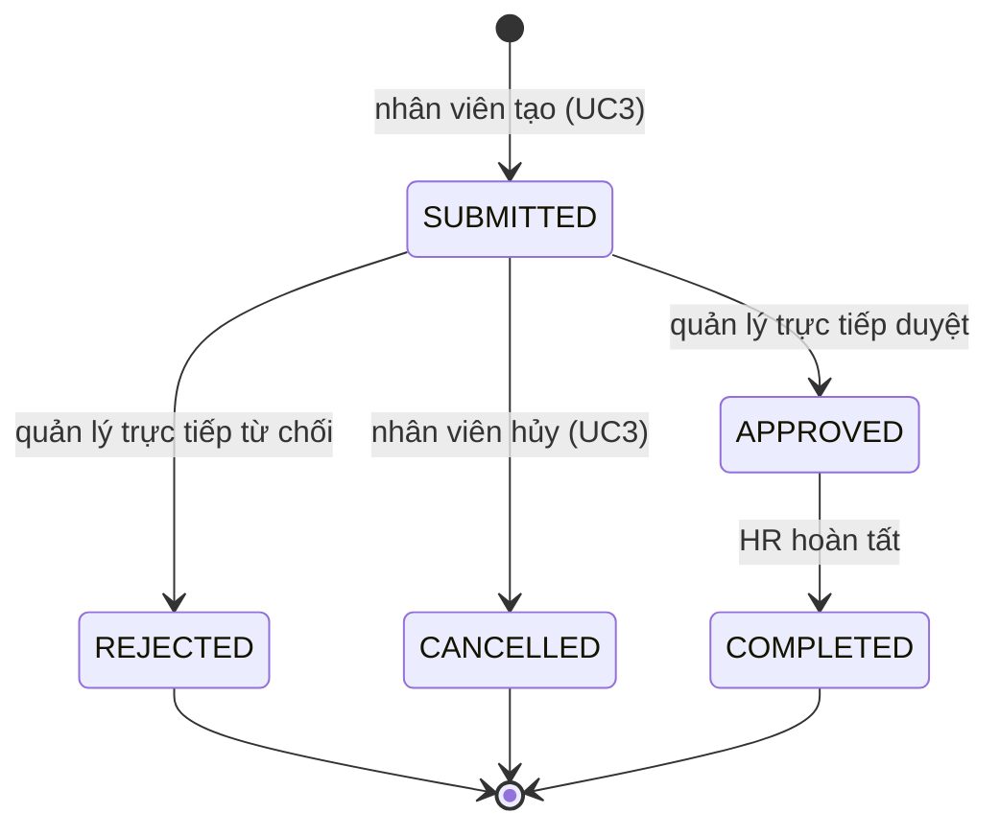

# UC4 – Duyệt đơn nghỉ

| Mục | Nội dung |
|---|---|
| Mục tiêu kinh doanh | MT-2 (duyệt đơn nghỉ dưới 1 ngày làm việc), MT-3 (lượt duyệt có audit) |
| Tác nhân chính | Quản lý trực tiếp (duyệt, từ chối); HR (hoàn tất; duyệt đơn của CEO) |
| Tác nhân phụ, hệ thống ngoài | Người duyệt thay (BR-06, chưa có); nhân viên (nhận email); queue và dịch vụ email |
| Yêu cầu (SRS) | FR-4.1 → FR-4.7 |
| Quy tắc | [BR-05, BR-06, BR-09 → BR-11, BR-14, BR-15](../../business/leave-rules.md), ADR-03, ADR-09, ADR-10 |
| Mức ưu tiên | M (FR-4.3, FR-4.4 là S) |
| Trạng thái | Đã có; người duyệt thay (FR-4.3) kế hoạch tuần 10 |
| Phiên bản | 1.0 – 13/11/2026 |

## 1. Mô tả ngắn

Quản lý trực tiếp xem các đơn đang chờ của cấp dưới và duyệt hoặc từ chối kèm ghi chú. Khi quản lý vắng, HR chỉ định người
duyệt thay. HR duyệt đơn của CEO, người duy nhất không có quản lý. Sau khi duyệt, HR hoàn tất đơn để số ngày giữ chỗ thành số
ngày đã dùng. Mỗi bước gửi email cho người liên quan và ghi lịch sử, audit trong cùng giao dịch.

## 2. Tác nhân và quyền

| Tác nhân | Được làm gì | Giới hạn theo dữ liệu |
|---|---|---|
| Quản lý trực tiếp | Xem danh sách chờ duyệt; xem chi tiết; duyệt hoặc từ chối | Chỉ đơn `SUBMITTED` của cấp dưới trực tiếp **tại thời điểm xử lý** |
| Người duyệt thay (chưa có) | Như quản lý trực tiếp, cho cấp dưới của quản lý được thay | Chỉ trong khoảng ngày HR giao; không ủy quyền nối tiếp |
| HR | Xem mọi đơn; hoàn tất đơn `APPROVED`; duyệt, từ chối đơn của CEO | Không duyệt đơn của người khác ngoài CEO |
| Nhân viên | Nhận email kết quả; xem chi tiết và lịch sử đơn của mình | – |
| ADMIN | Không tham gia | Không xem đơn của người khác |

## 3. Điều kiện

- **Điều kiện trước:** có đơn ở `SUBMITTED` (duyệt, từ chối) hoặc `APPROVED` (hoàn tất); người xử lý đã đăng nhập.
- **Kích hoạt:** quản lý mở email "có đơn cần xử lý" hoặc mở trang "Đơn chờ duyệt"; HR mở trang "Đơn cần hoàn tất".
- **Điều kiện sau khi thành công:**

  | Thao tác | Trạng thái | Số dư | Audit | Event, email tới |
  |---|---|---|---|---|
  | Duyệt | `SUBMITTED` → `APPROVED` | Không đổi (vẫn giữ trong `pending`) | `LEAVE_APPROVE` | `LeaveApproved` → nhân viên |
  | Từ chối | `SUBMITTED` → `REJECTED` | `pending` giảm (BR-09) | `LEAVE_REJECT` | `LeaveRejected` → nhân viên |
  | Hoàn tất | `APPROVED` → `COMPLETED` | `pending` giảm, `used` tăng (BR-10) | `LEAVE_COMPLETE` | `LeaveCompleted` → nhân viên |

  Mọi thao tác thêm một dòng lịch sử (người xử lý, trạng thái trước và sau, ghi chú, thời điểm) và tăng `version`.
- **Điều kiện sau khi thất bại:** đơn, số dư, `version` giữ nguyên; không có event.

## 4. Luồng chính: quản lý duyệt đơn

| Bước | Tác nhân | Hệ thống |
|---|---|---|
| 1 | Quản lý mở "Đơn chờ duyệt" | `GET /leave-requests/pending-approval`: đơn `SUBMITTED` của cấp dưới trực tiếp, có phân trang (FR-4.1) |
| 2 | Mở một đơn | `GET /leave-requests/{id}`: chi tiết và lịch sử trạng thái (FR-4.7) |
| 3 | Bấm Duyệt, nhập ghi chú (tùy chọn) | Gửi `POST /leave-requests/{id}/approve` kèm `version` |
| 4 | | Kiểm người gọi là quản lý trực tiếp hiện tại của chủ đơn (BR-05) |
| 5 | | Đưa vào state machine: `SUBMITTED` → `APPROVED`. Đơn đã `APPROVED` sẵn thì trả lại đơn, không đổi gì (BR-11) |
| 6 | | Kiểm `version`; ghi trạng thái, lịch sử, audit, event outbox trong một giao dịch |
| 7 | Thấy đơn đã duyệt, biến khỏi danh sách chờ | Trả đơn; worker gửi email cho nhân viên (FR-4.6) |

## 5. Luồng thay thế

- **A1 (bước 3), từ chối:** gọi `POST /leave-requests/{id}/reject`. Đơn sang `REJECTED`, trả số ngày khỏi `pending` (BR-09).
- **A2, HR hoàn tất (FR-4.5):**
  1. HR mở "Đơn cần hoàn tất". Hệ thống gọi `GET /leave-requests` với mặc định `status=APPROVED`.
  2. HR bấm Hoàn tất. Web gửi `POST /leave-requests/{id}/complete` kèm `version`.
  3. Hệ thống chuyển số ngày từ `pending` sang `used` (BR-10).
  4. HR chỉ hoàn tất sau ngày kết thúc của đơn, khi nhân viên đã thật sự nghỉ. Với loại phép cần giấy tờ (ốm, cưới, tang, thai
     sản), HR kiểm giấy tờ trước khi hoàn tất ([danh mục loại phép](../../business/leave-types-holidays.md)).
- **A3, đơn của CEO (FR-4.4):** đơn hiện trong danh sách chờ của HR. HR duyệt hoặc từ chối như bước 3–7.
- **A4, người duyệt thay (FR-4.3, BR-06, chưa có):**
  1. HR tạo phân công gồm quản lý vắng, người thay và khoảng ngày.
  2. Trong khoảng đó, người thay thấy đơn chờ của cấp dưới quản lý vắng và xử lý như bước 3–7. Lịch sử ghi người thay là người quyết định.
  3. Hết hạn thì người thay mất quyền.
- **A5 (bước 5), bấm duyệt hai lần:** lần hai trả lại đơn, không đổi số dư, không gửi email lần nữa (BR-11).

## 6. Ngoại lệ

| Mã | Tình huống | Hệ thống phản hồi |
|---|---|---|
| E1 | Người gọi không phải quản lý trực tiếp hiện tại (hoặc HR với đơn không phải của CEO) | 403 `FORBIDDEN` |
| E2 | Vai trò không có quyền (nhân viên gọi pending-approval; ADMIN duyệt; quản lý hoàn tất) | 403 `FORBIDDEN` |
| E3 | Quyết định ngược với quyết định đã có (từ chối đơn đã duyệt) | 409 `CONFLICT` |
| E4 | Hoàn tất đơn chưa duyệt | 409 `CONFLICT` |
| E5 | `version` cũ (người khác vừa xử lý) | 409 `CONFLICT`; tải lại đơn |
| E6 | Đơn không tồn tại | 404 `NOT_FOUND` |
| E7 | Xem chi tiết đơn khi không phải chủ đơn, quản lý trực tiếp hoặc HR | 403 `FORBIDDEN` |
| E8 | Chủ đơn không có quản lý trực tiếp | CEO: email "có đơn cần xử lý" gửi tới HR. Người khác (dữ liệu lỗi, vì FR-2.5 bắt buộc có quản lý): đơn chờ, worker ghi cảnh báo để HR sửa sơ đồ tổ chức |
| E10 | HR hoàn tất đơn khi chưa qua ngày kết thúc | 409 `CONFLICT` |
| E9 | Queue hoặc dịch vụ email lỗi | Quyết định vẫn được lưu; event chờ trong outbox hoặc vào DLQ (NFR-3.4) |

## 7. Quy tắc áp dụng

- [BR-05](../../business/leave-rules.md) người duyệt hợp lệ, BR-06 người duyệt thay.
- BR-09 từ chối trả số ngày, BR-10 HR hoàn tất, BR-11 lịch sử và thao tác lặp.
- BR-14 chỉ chủ đơn và HR xem lý do nghỉ ốm, BR-15 email không chứa chi tiết đơn.
- [ADR-10](../../architecture/adr/ADR-10-manager-role-derived.md): vai trò MANAGER suy ra từ sơ đồ tổ chức.
- [ADR-09](../../architecture/adr/ADR-09-append-only-audit.md): audit chỉ thêm, cùng giao dịch.
- [Hợp đồng event](../../architecture/event-contract.md): payload, người nhận, chống gửi trùng.

## 8. Dữ liệu vào

| Trường | Bắt buộc | Kiểm tra |
|---|---|---|
| `version` | Có | Version hiện tại của đơn (optimistic locking) |
| `comment` | Không | Tối đa 500 ký tự; ghi vào lịch sử |
| `status` (lọc danh sách HR) | Không | Một trong 5 trạng thái; mặc định `APPROVED` |

## 9. Giao diện và API

| Luồng | Màn hình | API |
|---|---|---|
| Chính, A1, A5 | `/leave/approvals`, `/leave/:id` | `GET /leave-requests/pending-approval`, `GET /leave-requests/{id}`, `POST …/approve`, `POST …/reject` |
| A2 | `/leave/hr`, `/leave/:id` | `GET /leave-requests`, `POST …/complete` |
| A3 | `/leave/approvals` (HR) | Như luồng chính |
| A4 | Chưa có | Chưa có |

## 10. Yêu cầu phi chức năng liên quan

- NFR-1.2: duyệt, từ chối, hoàn tất p95 < 500 ms. NFR-1.4: email p95 < 1 phút.
- NFR-3.4, NFR-3.5: lỗi email không ảnh hưởng quyết định; thử lại có giãn cách rồi vào DLQ.
- NFR-6.1: 100% thao tác duyệt có audit.
- SLI "Đơn đã nhận bị mất = 0" (SRS mục 6.13).

## 11. Kiểm thử

Chiến lược, test đã có, bảng phủ tiêu chí và ca còn thiếu: [test.md](test.md). Cách triển khai: [deploy.md](deploy.md).

## 12. Hiện trạng và việc còn lại

| Nội dung | Trạng thái | Việc còn lại |
|---|---|---|
| Danh sách chờ, duyệt, từ chối, hoàn tất, lịch sử, email | Đã có | – |
| HR duyệt đơn của CEO | Đã có (PR #60) | – |
| Người duyệt thay (FR-4.3, BR-06) | Chưa có | TV1, nhánh `feat/leave-delegation`, mức 3 tuần 10 |
| Ẩn lý do nghỉ ốm với quản lý (BR-14) | Chưa có | TV1 |
| Email chỉ báo chung, không chi tiết (BR-15) | Chưa có: email, payload outbox có loại phép, ngày, số ngày, ghi chú | TV1, `feat/leave-privacy` |
| Audit không chứa ghi chú tự do (BR-14) | Code chưa đúng: audit duyệt, từ chối có `comment` | TV1, `feat/leave-privacy` |
| Email "có đơn mới" của CEO gửi tới HR (E8) | Code chưa có: worker bỏ qua vì CEO không có quản lý | TV1, `feat/leave-privacy` (cùng chỗ sửa worker) |
| Chỉ hoàn tất sau ngày kết thúc (A2 bước 4, E10) | Code chưa có: hoàn tất được bất kỳ lúc nào | TV2 xác nhận, TV1 làm |
| Hủy đơn đã duyệt khi nhân viên không nghỉ nữa | **Thiếu quy tắc.** BR-08 cấm nhân viên tự hủy, nhưng không ai khác hủy được; đơn chỉ có thể bị HR hoàn tất và trừ phép sai | TV2 bổ sung quy tắc. Đề xuất: trước ngày bắt đầu, quản lý trực tiếp hoặc HR hủy theo yêu cầu của nhân viên, trả số ngày khỏi `pending` |
| Nhắc đơn chờ quá 1 ngày làm việc | Chưa có trong yêu cầu | Đề xuất cho MT-2: email nhắc người duyệt, TV2 quyết định |
| Đo MT-2 (thời gian gửi → quyết định) | Chưa có báo cáo | Truy vấn trên `leave_request_history` khi có dữ liệu staging |

## 13. Thiết kế đề xuất cho phần chưa có

> Đề xuất để có chỗ bám khi code. TV1 chốt trong PR `feat/leave-delegation` và `feat/leave-privacy`.

### 13.1 Người duyệt thay (FR-4.3, BR-06)

- **Bảng** `leave.approval_delegation`: `id`, `manager_id` (quản lý vắng), `delegate_id` (người thay), `start_date`, `end_date`
  (tính cả hai ngày), `created_by`, `created_at`, `ended_at` (HR kết thúc sớm).
- **Ràng buộc:** `delegate_id` ≠ `manager_id`; người thay đang làm việc và đang có cấp dưới (vai trò MANAGER, ADR-10); không
  chồng lấn khoảng ngày của cùng một `manager_id` (exclusion constraint trên `daterange`). Không ủy quyền nối tiếp: chỉ xét
  phân công của **quản lý trực tiếp** của chủ đơn, không xét phân công của người thay.
- **API (chỉ HR):** `POST /leave-delegations`, `GET /leave-delegations?managerId=&activeOn=`, `POST /leave-delegations/{id}/end`.
  Mỗi thao tác có audit `DELEGATION_CREATE`, `DELEGATION_END`.
- **Quyền duyệt:** trong `relation()`, thêm quan hệ `DELEGATE` khi người gọi là `delegate_id` của phân công hiệu lực **hôm nay**
  với `manager_id` = quản lý trực tiếp hiện tại của chủ đơn. State machine cho `DELEGATE` quyền như `DIRECT_MANAGER`.
- **Danh sách chờ duyệt:** `GET /leave-requests/pending-approval` gộp thêm cấp dưới của các quản lý đang giao cho người gọi;
  mỗi đơn có cờ `viaDelegation` để giao diện ghi "duyệt thay cho …".
- **Giao diện:** `/leave/delegations` cho HR: bảng phân công, nút tạo (chọn quản lý, người thay, khoảng ngày), nút kết thúc.

### 13.2 Riêng tư đơn nghỉ (BR-14, BR-15)

- **Ẩn lý do:** với loại phép ốm, thai sản, `reason` chỉ trả cho chủ đơn và HR ở chi tiết, danh sách, lịch sử. HR đọc lý do thì
  ghi audit `VIEW_LEAVE_REASON` (chỉ ID đơn, không giá trị).
- **Audit:** bỏ `comment` khỏi `changedFields` của duyệt, từ chối, hủy, hoàn tất; ghi chú vẫn nằm trong lịch sử đơn.
- **Outbox và email:** payload chỉ còn `eventId`, `eventType`, `requestId`, `employeeId`, `occurredAt`. Email: tiêu đề và nội dung
  chung, link `/leave` hoặc `/leave/approvals` (không có mã đơn). Đổi [hợp đồng event](../../architecture/event-contract.md)
  theo mục 6 của file đó.
- **Đơn của CEO:** worker gửi email "có đơn cần xử lý" tới mọi tài khoản HR khi chủ đơn là CEO.
