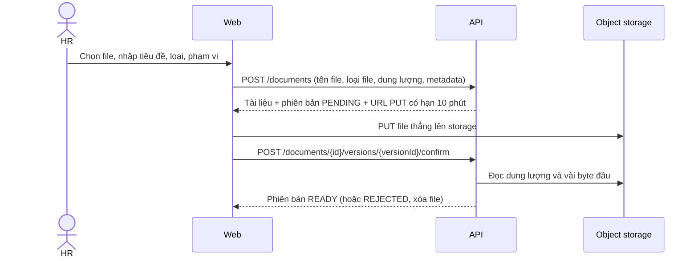
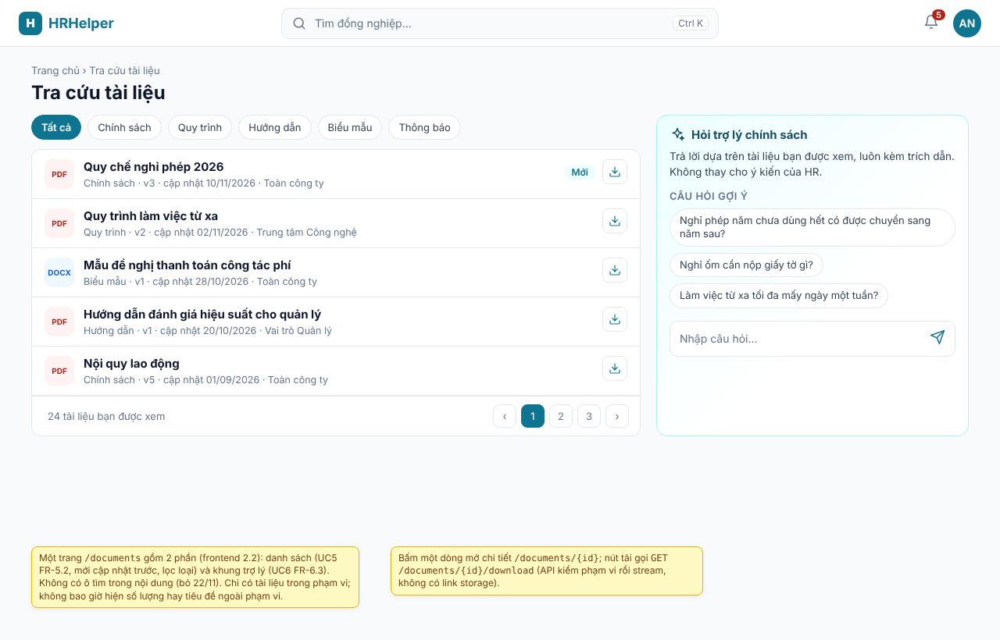
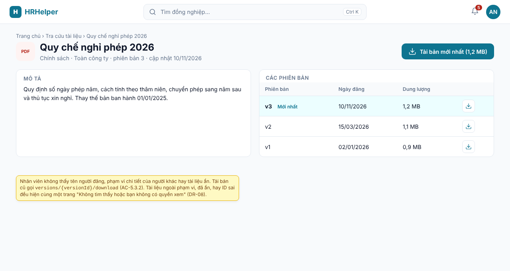
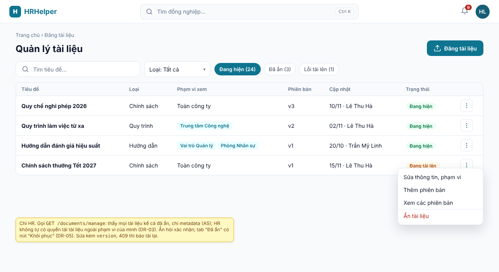
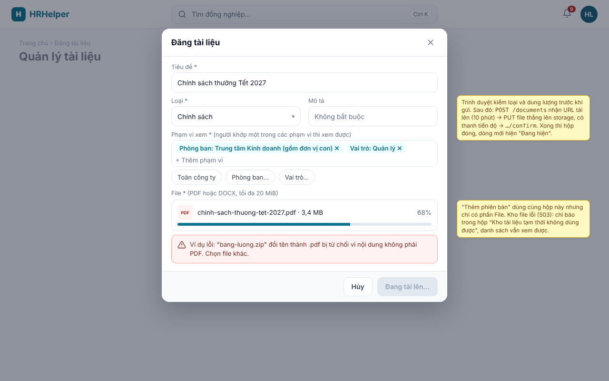
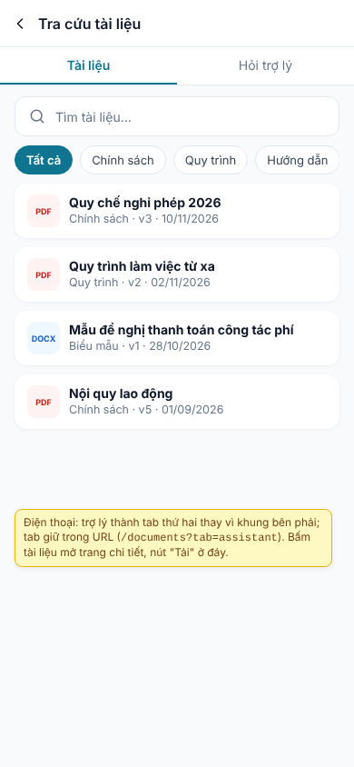

# UC5 – Kho tài liệu chính sách

| Mục | Nội dung |
|---|---|
| Mục tiêu kinh doanh | MT-4 (nhân viên tự phục vụ, biết bản chính sách mới nhất) |
| Tác nhân chính | HR (đăng, quản lý tài liệu); nhân viên (xem, tải) |
| Tác nhân phụ, hệ thống ngoài | Object storage (S3Mock ở local, S3 trên AWS); search service của UC6 nhận event tài liệu (ADR-15) |
| Yêu cầu (SRS) | FR-5.1 → FR-5.3 |
| Quy tắc | [DR-01 → DR-06, DR-08](../../business/document-rules.md), [ADR-13](../../architecture/adr/ADR-13-document-storage.md), [ADR-14](../../architecture/adr/ADR-14-org-unit-types.md) (đơn vị), [ADR-15](../../architecture/adr/ADR-15-service-extraction.md) (event), [ADR-18](../../architecture/adr/ADR-18-authorization.md) (phân quyền) |
| Mức ưu tiên | M (FR-5.3 là S) |
| Trạng thái | Đã có API (PR #64, 12/11); giao diện đang làm (`feat/document-ui`); chưa phát event cho tìm kiếm; Terraform bucket đã merge (#70) nhưng chưa apply |
| Phiên bản | 1.1 – 22/11/2026 (1.1: kiểm chéo với UC1, UC2, UC3, UC4, UC7, UC8, ADR-14, ADR-15, ADR-18, schema, error-codes; thêm 9.2, 13.2 → 13.4) |

## 1. Mô tả ngắn

HR đăng tài liệu chính sách (PDF, DOCX) kèm tiêu đề, loại và phạm vi xem: toàn công ty, phòng ban (gồm phòng ban con) hoặc
vai trò. Nhân viên chỉ thấy và tải tài liệu thuộc phạm vi của mình; tài liệu ngoài phạm vi không lộ ra dưới bất kỳ hình thức
nào, kể cả tiêu đề hay số lượng. Mỗi lần đăng file mới là một phiên bản mới; phiên bản cũ được giữ. HR ẩn tài liệu thay vì
xóa.

## 2. Tác nhân và quyền

| Tác nhân | Được làm gì | Giới hạn theo dữ liệu |
|---|---|---|
| Nhân viên (mọi vai trò) | Xem danh sách, chi tiết, các phiên bản; tải file | Chỉ tài liệu chưa ẩn, có phiên bản sẵn sàng, khớp ít nhất một phạm vi (DR-02); kiểm lại ở mỗi lần gọi (DR-06). Cần tài khoản gắn hồ sơ chưa `TERMINATED` (UC1, UC8) |
| HR | Thêm: tạo tài liệu, thêm phiên bản, sửa tiêu đề, loại, phạm vi; ẩn, khôi phục; xem metadata mọi tài liệu ở trang quản lý | Không tự có quyền tải nội dung ngoài phạm vi (DR-03) |
| ADMIN | Như nhân viên | Không quản lý kho. Tài khoản chỉ có vai trò ADMIN, không gắn hồ sơ (UC8), nhận danh sách rỗng, kể cả tài liệu có phạm vi vai trò `ADMIN` |

Phạm vi xem dùng hai khái niệm của module khác, cùng tính lại ở mỗi request:

- **Đơn vị** (UC2, ADR-14): `scope.departmentIds` nhận đơn vị mọi loại (`COMPANY`, `CENTER`, `DEPARTMENT`, `TEAM`). Người xem
  khớp khi đơn vị hiện tại của họ là đơn vị đó hoặc đơn vị con cháu. Điều chuyển có ngày hiệu lực (UC2 FR-2.7) chỉ đổi quyền khi
  job áp dụng điều chuyển chạy (tối đa 5 phút sau 0:00 ngày hiệu lực), không đổi lúc HR lên lịch.
- **Vai trò** (UC8, ADR-10, ADR-18): `EMPLOYEE` là mọi người có hồ sơ đang làm việc; `MANAGER` là người **có cấp dưới trực
  tiếp**, không phải trưởng, phó đơn vị; `HR`, `ADMIN` là vai trò được cấp trong ứng dụng. Thu hồi HR thì mất quyền xem tài liệu
  phạm vi `HR` ở request kế tiếp.

## 3. Điều kiện

- **Điều kiện trước:**
  - Người dùng đã đăng nhập.
  - Kho file đã cấu hình (`STORAGE_*`); nếu chưa, các API đụng tới file (tạo, thêm phiên bản, xác nhận, tải xuống) trả 503.
    Danh sách và chi tiết vẫn trả 200 vì chỉ đọc database.
  - Người xem có hồ sơ đang làm việc; nếu không, danh sách rỗng.
- **Kích hoạt:** HR bấm "Đăng tài liệu" hoặc "Thêm phiên bản"; nhân viên mở "Tài liệu".
- **Điều kiện sau khi thành công (đăng):**
  - Tài liệu và phiên bản ở trạng thái `READY`, file nằm trong object storage.
  - Có audit `DOCUMENT_CREATE` hoặc `DOCUMENT_PUBLISH`.
  - Phiên bản mới nhất được hiển thị mặc định.
- **Điều kiện sau khi thất bại:** phiên bản ở `PENDING` (chưa xác nhận) hoặc `REJECTED` (file sai), không hiện với nhân viên.

## 4. Luồng chính: HR đăng tài liệu mới

| Bước | Tác nhân | Hệ thống |
|---|---|---|
| 1 | HR mở "Đăng tài liệu", chọn file, nhập tiêu đề, loại, phạm vi | |
| 2 | Bấm Đăng | Gửi `POST /documents` với tiêu đề, loại, phạm vi, tên file, loại file, dung lượng |
| 3 | | Kiểm vai trò HR; tiêu đề không rỗng; loại thuộc danh mục; ít nhất một phạm vi; file PDF hoặc DOCX, 1 byte → 20 MiB (DR-01) |
| 4 | | Tạo tài liệu và phiên bản 1 ở `PENDING`, ghi audit `DOCUMENT_CREATE`; trả URL tải lên có hạn 10 phút |
| 5 | Trình duyệt tải file thẳng lên storage | File không đi qua API (FR-5.1) |
| 6 | Web gọi xác nhận | `POST /documents/{id}/versions/{versionId}/confirm` |
| 7 | | Kiểm file đã có trên storage, đúng dung lượng khai báo, định dạng thật khớp đuôi (magic number; DOCX kiểm thêm cấu trúc) |
| 8 | | Đạt: phiên bản thành `READY`, ghi audit `DOCUMENT_PUBLISH`. Tài liệu bắt đầu hiện với người trong phạm vi |
| 9 | HR thấy tài liệu ở trang quản lý | Trả metadata tài liệu |

## 5. Luồng thay thế

- **A1, nhân viên xem và tải (FR-5.2):**
  1. `GET /documents?type=` trả tài liệu trong phạm vi, mới cập nhật trước, có phân trang.
  2. Mở chi tiết: `GET /documents/{id}`.
  3. Tải bản mới nhất: `GET /documents/{id}/download`. Tải bản cũ: `GET /documents/{id}/versions/{versionId}/download`.
  4. Mỗi lần tải, API kiểm lại phạm vi rồi stream file từ storage; không phát link tải (DR-06, ADR-13).
- **A2, thêm phiên bản (FR-5.3):** HR gọi `POST /documents/{id}/versions`, rồi đi tiếp bước 5–8. Số phiên bản tăng 1, bản cũ
  giữ nguyên (DR-04).
- **A3, sửa metadata:** `PATCH /documents/{id}` kèm `version`. Phạm vi mới áp dụng cho mọi phiên bản; người mất quyền không tải
  được nữa, kể cả bản cũ. Audit `DOCUMENT_UPDATE`.
- **A4, ẩn và khôi phục (DR-05):** `POST /documents/{id}/hide` và `POST /documents/{id}/restore`. Tài liệu ẩn biến khỏi mọi
  danh sách, tìm kiếm, tải xuống. Audit `DOCUMENT_HIDE`, `DOCUMENT_RESTORE`.
- **A5, HR quản lý:** `GET /documents/manage` và `GET /documents/manage/{id}` thấy mọi tài liệu, kể cả đã ẩn, chỉ metadata.

## 6. Ngoại lệ

| Mã | Tình huống | Hệ thống phản hồi |
|---|---|---|
| E1 | Vai trò không phải HR tạo, sửa, ẩn tài liệu | 403 `FORBIDDEN` |
| E2 | Thiếu tiêu đề, phạm vi rỗng, loại không hợp lệ, file không phải PDF/DOCX, quá 20 MiB, đơn vị không tồn tại | 400 `BAD_REQUEST` kèm `fields` (`title`, `type`, `scope`, `scope.departmentIds`, `fileName`, `contentType`, `sizeBytes`). **Hiện code chỉ có `fields` khi lỗi ở DTO**; lỗi kiểm ở service (đuôi file, content type, phạm vi rỗng, đơn vị không tồn tại) chưa có `fields`, sửa trong `feat/document-ui` (13.3) |
| E3 | Xác nhận khi chưa tải file lên | 400 `BAD_REQUEST`; phiên bản vẫn `PENDING`, tải lên rồi xác nhận lại |
| E3b | File sai dung lượng khai báo hoặc định dạng thật không khớp (ví dụ ZIP đổi đuôi `.pdf`) | Phiên bản `REJECTED`, file bị xóa; 400 `BAD_REQUEST` |
| E4 | Xác nhận lại phiên bản đã `REJECTED` | 409 `CONFLICT`; tạo phiên bản mới. Xác nhận lại phiên bản đã `READY` thì trả lại tài liệu, không đổi gì |
| E5 | Xem hoặc tải tài liệu ngoài phạm vi, đã ẩn, hoặc ID không tồn tại | 404 `NOT_FOUND`, không phân biệt các trường hợp (DR-08) |
| E6 | Sửa metadata với `version` cũ | 409 `CONFLICT` |
| E7 | Kho file chưa cấu hình | 503 `HTTP_503` ("Kho tài liệu chưa được cấu hình") ở các API đụng tới file: tạo, thêm phiên bản, xác nhận, tải xuống. Danh sách, chi tiết, trang quản lý, sửa metadata, ẩn, khôi phục vẫn chạy (NFR-3.4) |
| E8 | URL tải lên quá 10 phút | Storage từ chối PUT; HR tạo phiên bản mới. Phiên bản cũ ở `PENDING` để lại, nên số phiên bản nhân viên thấy có thể nhảy (13.3) |

## 7. Quy tắc áp dụng

- [DR-01](../../business/document-rules.md) file hợp lệ.
- DR-02 phạm vi xem (phép OR, gồm phòng ban con).
- DR-03 chỉ HR quản lý, DR-04 phiên bản, DR-05 ẩn không xóa.
- DR-06 quyền đổi ngay khi đổi phòng ban, DR-08 không lộ metadata.
- [ADR-13](../../architecture/adr/ADR-13-document-storage.md): tải lên bằng presigned URL, tải xuống qua API, lọc phạm vi
  ngay trong truy vấn SQL.
- [ADR-18](../../architecture/adr/ADR-18-authorization.md): lớp 1 `@Roles('HR')` ở controller cho thao tác quản lý; lớp 3 điều
  kiện phạm vi trong `WHERE` (`visibleQuery` trong `document.service.ts`). Hàm thuần `canView` trong `document-rules.ts` chỉ dùng
  cho unit test, nên phải giữ cùng logic với câu SQL (13.3).
- [ADR-15](../../architecture/adr/ADR-15-service-extraction.md): module document phát event qua `document.outbox` cho search
  service (13.2).

## 8. Dữ liệu vào

| Trường | Bắt buộc | Kiểm tra |
|---|---|---|
| `title` | Có | 1 → 200 ký tự, bỏ khoảng trắng hai đầu |
| `type` | Có | `POLICY`, `PROCESS`, `GUIDE`, `FORM`, `NOTICE` |
| `scope.all` | Một trong ba | `true` là toàn công ty |
| `scope.departmentIds` | Một trong ba | Tối đa 50 UUID đơn vị (mọi loại, ADR-14); gồm đơn vị con cháu. Đơn vị `INACTIVE`: xem 13.4 (D3) |
| `scope.roles` | Một trong ba | `EMPLOYEE`, `MANAGER`, `HR`, `ADMIN` |
| `fileName`, `contentType`, `sizeBytes` | Có (khi tạo, thêm phiên bản) | Đuôi `.pdf` với `application/pdf`, hoặc `.docx` với `application/vnd.openxmlformats-officedocument.wordprocessingml.document`; 1 byte → 20 MiB |
| `version` (khi sửa) | Có | Version hiện tại của tài liệu |

## 9. Giao diện và API

| Luồng | Màn hình | API |
|---|---|---|
| Chính, A2 | `/documents/manage`, hộp "Đăng tài liệu", "Thêm phiên bản" (chưa có) | `POST /documents`, `POST /documents/{id}/versions`, `POST …/confirm` |
| A1 | `/documents` (trang "Tra cứu tài liệu", chung với UC6), `/documents/{id}` (chưa có) | `GET /documents`, `GET /documents/{id}`, `GET …/download` |
| A3, A4, A5 | `/documents/manage` (chưa có) | `PATCH /documents/{id}`, `POST …/hide`, `POST …/restore`, `GET /documents/manage` |

### 9.1 Bản vẽ giao diện

Bản vẽ để duyệt bố cục trước khi code (15/11/2026), cùng phong cách với bản vẽ UC1 ở
[giao diện chung mục 10](../frontend.md#10-bản-vẽ-giao-diện). Nguồn ở [`mockups.html`](../mockups/mockups.html), dữ liệu là người
mẫu. Ô vàng là ghi chú cho người đọc. Chỗ nào bản vẽ khác chữ trong spec thì chữ đúng.

**Trang "Tra cứu tài liệu" `/documents`: danh sách (A1) cùng ô tìm và khung trợ lý của UC6**

**Chi tiết `/documents/{id}` với các phiên bản (A1, FR-5.3)**

**HR quản lý tài liệu `/documents/manage` (A3, A4, A5)**

**HR đăng tài liệu: phạm vi, file, tiến độ tải lên (luồng chính)**

**Trên điện thoại: tài liệu và trợ lý là hai tab**

### 9.2 Hợp đồng API

Tất cả dưới `/api/v1`, cần đăng nhập. Bảng ghi đúng code hiện tại (PR #64); `docs/openapi.yaml` sinh từ code nhưng chưa có
schema response cho nhóm này. Lỗi theo dạng chung `{code, message, traceId, fields?}`
([error-codes.md](../../development/error-codes.md#kho-tài-liệu-document)).

| API | Ai gọi | Vào | Ra | Lỗi |
|---|---|---|---|---|
| `GET /documents?type=&page=&size=` | Mọi người | – | Trang `{id, title, type, updatedAt, latest: Version \| null}`, mới cập nhật trước | – (không có hồ sơ thì rỗng) |
| `GET /documents/{id}` | Mọi người | – | Như trên + `versions[]` (chỉ `READY`, mới nhất trước) | 404 (E5) |
| `GET /documents/{id}/download` | Mọi người | – | File bản `READY` mới nhất; `Content-Disposition: attachment` tên file UTF-8; `Cache-Control: private, no-store` | 404, 503 |
| `GET /documents/{id}/versions/{versionId}/download` | Mọi người | – | File của phiên bản đó (phải `READY`) | 404, 503 |
| `GET /documents/manage?type=&page=&size=` | HR | – | Trang `DocumentAdmin`: như trên + `hidden`, `version`, `scope {all, departmentIds, roles}`, `versions[]` mọi trạng thái | 403 |
| `GET /documents/manage/{id}` | HR | – | `DocumentAdmin` (kể cả đã ẩn) | 403, 404 |
| `POST /documents` | HR | `{title, type, scope {all?, departmentIds?, roles?}, fileName, contentType, sizeBytes}` | 201 `{document: DocumentAdmin, upload: UploadTicket}` | 400 (E2), 403, 503 |
| `POST /documents/{id}/versions` | HR | `{fileName, contentType, sizeBytes}` | 201 `UploadTicket` `{versionId, versionNo, url…}` | 400, 403, 404, 503 |
| `POST /documents/{id}/versions/{versionId}/confirm` | HR | – | 200 `DocumentAdmin` | 400 (E3, E3b), 404, 409 (E4), 503 |
| `PATCH /documents/{id}` | HR | `{version, title?, type?, scope?}` (`scope` thay cả bộ) | 200 `DocumentAdmin` | 400, 403, 404, 409 (E6) |
| `POST /documents/{id}/hide`, `/restore` | HR | – | 200 `DocumentAdmin` | 403, 404 |

`Version`: `{id, versionNo, fileName, contentType, sizeBytes, status, createdAt}`.

**Audit** (`entityType = document`, [UC7 spec](../UC7-audit-log/spec.md)): `DOCUMENT_CREATE` (`changedFields`: tiêu đề, loại,
phạm vi), `DOCUMENT_PUBLISH` (số phiên bản, tên file), `DOCUMENT_UPDATE` (trường đổi), `DOCUMENT_HIDE`, `DOCUMENT_RESTORE`. Thêm
phiên bản chưa ghi audit cho tới khi xác nhận; phiên bản bị `REJECTED` không ghi audit. Tải xuống không ghi audit (tài liệu chính
sách không phải dữ liệu nhạy cảm).

**Event:** chưa có. Thiết kế ở 13.2.

## 10. Yêu cầu phi chức năng liên quan

- NFR-5.16: mã hóa file khi lưu. Terraform staging hiện dùng SSE-S3 (`AES256`), chưa dùng khóa KMS (deploy.md mục 3).
- NFR-5.19: bucket chặn public. URL tải lên hết hạn sau 10 phút, đủ để tải file 20 MiB trên mạng chậm; tải xuống không dùng
  presigned URL (ADR-13). SRS 1.6 đã sửa NFR-5.19 cho khớp (22/11).
- NFR-5.23: kiểm loại file theo nội dung.
- NFR-3.4: storage lỗi không ảnh hưởng chức năng khác (kịch bản lỗi trong SRS mục 6.14).
- Đánh đổi của ADR-13: tải xuống tốn băng thông API. Đo khi load test tuần 11.

## 11. Kiểm thử

Chiến lược, test đã có, bảng phủ tiêu chí và ca còn thiếu: [test.md](test.md). Cách triển khai: [deploy.md](deploy.md).

## 12. Hiện trạng và việc còn lại

| Nội dung | Trạng thái | Việc còn lại |
|---|---|---|
| API đăng, phiên bản, phạm vi, tải qua API, ẩn, khôi phục | Đã có (PR #64) | SRS đã cập nhật trạng thái FR-5.x (22/11) |
| Giao diện kho tài liệu | Đang làm | TV1, nhánh `feat/document-ui`; kèm sửa `fields` ở lỗi 400 (13.3) |
| Event tài liệu cho search service (`document.outbox`) | Chưa có | Chưa có nhánh trong kế hoạch 7.7; đề xuất làm đầu nhánh `feat/search-service` (13.2, D1) |
| Dọn phiên bản `PENDING` bỏ dở | Chưa có | Đánh đổi đã ghi trong ADR-13; đề xuất lifecycle rule ở bucket (deploy.md mục 7) |
| Local: object storage | Đã có | S3Mock trong docker-compose (PR #68) |
| Staging: biến `STORAGE_*`, bucket tài liệu | Terraform đã merge (PR #70), chưa apply | TV3 apply tuần 12; đổi mã hóa sang KMS, bỏ `GET`, `HEAD` khỏi CORS (deploy.md mục 3) |
| Ngày hiệu lực, ngày hết hiệu lực của chính sách | Chưa có trong yêu cầu | Thực tế chính sách có ngày áp dụng; TV2 quyết định có thêm vào metadata không |
| Nhân viên xác nhận đã đọc chính sách | Chưa có trong yêu cầu | Thường có ở cổng chính sách HR; ngoài MVP, ghi lại để cân nhắc |

## 13. Thiết kế đề xuất cho phần chưa có

### 13.1 Giao diện

> Đề xuất để có chỗ bám khi code. TV1 chốt trong PR `feat/document-ui`. API đã có; chỉ sửa `fields` ở lỗi 400 (13.3).

| Màn hình | Ai | Nội dung | API |
|---|---|---|---|
| `/documents` | Mọi người | Ô tìm kiếm (UC6), lọc loại, bảng: tiêu đề, loại, phiên bản mới nhất, ngày cập nhật; phân trang. Rỗng thì ghi "Chưa có tài liệu nào dành cho bạn", không gợi ý gì thêm (DR-08) | `GET /documents?type=&page=` |
| `/documents/:id` | Mọi người | Tiêu đề, loại, nút tải bản mới nhất, danh sách phiên bản cũ có nút tải. 404 thì hiện "Không tìm thấy tài liệu", giống hệt cho mọi trường hợp | `GET /documents/{id}`, `GET …/download`, `GET …/versions/{versionId}/download` |
| `/documents/manage` | HR | Mọi tài liệu kể cả đã ẩn, cột trạng thái (hiện, ẩn), phiên bản `PENDING`, `REJECTED` | `GET /documents/manage` |
| `/documents/manage/new` | HR | Form: tiêu đề, loại, phạm vi (toàn công ty / chọn phòng ban trong cây / chọn vai trò), chọn file. Kiểm đuôi và dung lượng ngay ở trình duyệt; thanh tiến độ khi PUT; xác nhận tự động khi PUT xong | `POST /documents`, PUT presigned URL, `POST …/confirm` |
| `/documents/manage/:id` | HR | Sửa tiêu đề, loại, phạm vi (gửi `version`); thêm phiên bản; ẩn, khôi phục có hộp xác nhận | `PATCH /documents/{id}`, `POST …/versions`, `POST …/hide`, `POST …/restore` |

Lỗi khi tải lên: PUT thất bại hoặc URL hết hạn (sau 10 phút) thì giao diện báo "Tải lên không thành công" và cho tạo phiên bản
mới; phiên bản cũ ở `PENDING` được bỏ lại (ADR-13).

Theo giao diện chung: trang `/documents` mở từ ô "Tra cứu tài liệu" ở trang chủ, không đặt trên nav bar (UC6, quyết định
14/11); `/documents/manage` nằm trong nhóm của HR. Phạm vi đơn vị chọn trong cây đơn vị của UC2 (`GET /departments/tree`, chỉ
`ACTIVE`).

### 13.2 Event cho tìm kiếm (ADR-15)

Search service của UC6 không đọc schema `document`, nên phải nhận đủ dữ liệu qua event. Module document ghi event vào
`document.outbox` **trong cùng transaction** với thay đổi (quy tắc 3 của
[event-contract](../../architecture/event-contract.md#6-quy-tắc-khi-đổi-hợp-đồng)), routing key `document.<Event>`, publisher
dùng chung cách của `leave.outbox`.

| Event (`type`) | Phát khi | Payload |
|---|---|---|
| `DocumentPublished` | Phiên bản thành `READY` (`confirm`) | `documentId`, `versionId`, `versionNo`, `objectKey`, `contentType`, `title`, `type`, `scope {all, departmentIds, roles}`, `hidden`, `occurredAt` |
| `DocumentUpdated` | `PATCH` đổi tiêu đề, loại hoặc phạm vi | `documentId`, `title`, `type`, `scope`, `occurredAt` |
| `DocumentHidden`, `DocumentRestored` | Ẩn, khôi phục | `documentId`, `occurredAt` |

- Search service giữ bản sao **phạm vi của tài liệu**, không giữ đơn vị của nhân viên; khi tìm, API tính đơn vị, vai trò hiện
  tại của người dùng rồi gửi kèm (ADR-15 mục 2), nên DR-06 vẫn có hiệu lực ngay.
- Phạm vi trong event là phạm vi **sau** thay đổi, gửi cả bộ: consumer ghi đè, không cần ghép. Thứ tự giữ theo `id` outbox.
- Thao tác không đổi gì (xác nhận lại bản `READY`, `PATCH` không đổi trường nào) không phát event.
- Tài liệu đã `READY` trước khi có event (dữ liệu tuần 10, 11) cần lệnh đồng bộ một lần: ghi `DocumentPublished` cho bản
  `READY` mới nhất của mọi tài liệu, rồi `DocumentHidden` cho tài liệu đã ẩn.
- Không gửi email cho event tài liệu, trừ khi D2 chốt khác.

Lệch cần sửa ở UC6: [UC6 spec 13.1](../UC6-self-service-search/spec.md#131-tìm-tài-liệu-fr-62) vẫn ghi cột `text_content`,
`search_vector` trong `document.document_version` và dùng `visibleQuery` trong API, trong khi ADR-15 và kế hoạch 7.7 đặt index ở
schema `search` của search service. Sửa cùng nhánh `feat/search-service`.

### 13.3 Ca biên phát hiện khi kiểm chéo (22/11/2026)

| # | Ca | Hiện tại | Đề xuất |
|---|---|---|---|
| 1 | Lỗi 400 ở service không có `fields` (E2) | Form không biết gắn lỗi vào ô nào (AC-5.1.4, AC-5.1.8) | Dùng `fieldError` như module leave; làm trong `feat/document-ui` |
| 2 | Phạm vi chọn đơn vị `INACTIVE` (UC2 FR-2.10) | Code nhận đơn vị mọi trạng thái | Xem D3 |
| 3 | URL tải lên hết hạn hoặc PUT lỗi | Phiên bản `PENDING` để lại, số phiên bản `READY` nhảy (1 → 3) | Giữ (ADR-13). Nhân viên thấy đúng số "Phiên bản 3"; trang quản lý hiện cả bản `PENDING`, `REJECTED` để HR hiểu vì sao nhảy |
| 4 | Tài liệu mới tạo nhưng không bao giờ tải file lên | Nằm mãi ở trang quản lý, không xóa được | Chấp nhận cho version 1; HR ẩn đi. Trang quản lý có lọc "Chưa có bản sẵn sàng" |
| 5 | `canView` (unit test) và `visibleQuery` (SQL thật) là hai bản logic | Sửa một bên quên bên kia thì unit test vẫn xanh | e2e là nguồn đúng; sửa phạm vi thì sửa cả hai trong cùng PR |
| 6 | `updated_at` đổi cả khi ẩn, khôi phục, sửa tiêu đề | Danh sách "mới cập nhật trước" đẩy tài liệu chỉ sửa tiêu đề lên đầu | Chấp nhận; DR-07 chỉ quy định thứ tự trong tìm kiếm, làm ở UC6 |
| 7 | e2e nhóm "kho tài liệu" bị bỏ qua khi không có `STORAGE_BUCKET` | CI không chạy nhóm này | Dùng bucket giả trong bộ nhớ như file hồ sơ (`test/fake-storage.ts`) để nhóm này luôn chạy |

### 13.4 Điểm cần quyết

| # | Câu hỏi | Đề xuất | Ai quyết |
|---|---|---|---|
| D1 | Nhánh nào phát event tài liệu (13.2)? Kế hoạch 7.7 chưa có nhánh này | Làm đầu nhánh `feat/search-service` (TV1), vì search service là consumer duy nhất | Duong |
| D2 | Có báo nhân viên khi có tài liệu mới hoặc bản mới không? BRD mục 2 nêu "nhân viên không biết bản mới nhất"; tiêu chí nghiệm thu ADR-15 ghi "upload một tài liệu: notification service xử lý"; nhưng FR-5.x không có yêu cầu này | **Không gửi email ở version 1**: người nhận có thể tới ~2.000 người và notification service không được đọc hồ sơ (ADR-15), nên payload phải mang cả danh sách. Sửa câu tiêu chí ADR-15 thành "search service và notification service cùng nhận event, notification bỏ qua `document.*`" để vẫn chứng minh fan-out | Duong, TV2 |
| D3 | Phạm vi trỏ tới đơn vị `INACTIVE` | Tạo, sửa phạm vi: chỉ nhận đơn vị `ACTIVE`, sai thì 400 `fields.scope.departmentIds`. Phạm vi cũ trỏ tới đơn vị đã ngừng: giữ nguyên (đơn vị ngừng hoạt động không còn người), trang quản lý gắn nhãn "Đơn vị đã ngừng hoạt động" | TV2 |
| D4 | Phạm vi theo trưởng, phó đơn vị (UC2 FR-2.9) thay cho `MANAGER` | Không thêm ở version 1; form chọn phạm vi ghi rõ `MANAGER` là người có cấp dưới trực tiếp | TV2 |
| D5 | Xem trước PDF trong trình duyệt (DR-05, DR-06, DR-08 có nhắc "xem trước") | Không làm ở version 1; nếu làm thì thêm `?inline=true` trên cùng API tải, chỉ cho PDF | Duong |
