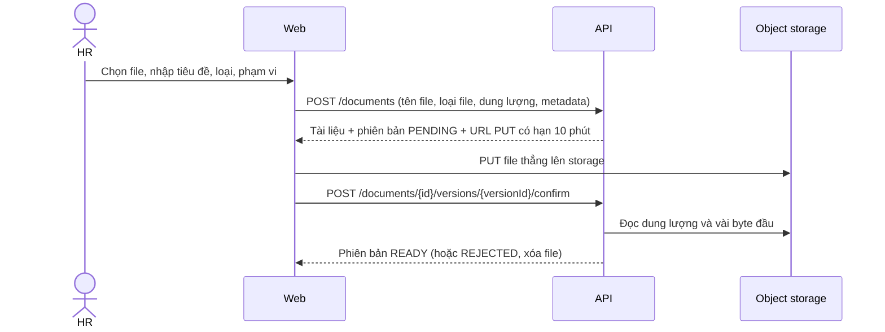

# UC5 – Kho tài liệu chính sách

| Mục | Nội dung |
|---|---|
| Mục tiêu kinh doanh | MT-4 (nhân viên tự phục vụ, biết bản chính sách mới nhất) |
| Tác nhân chính | HR (đăng, quản lý tài liệu); nhân viên (xem, tải) |
| Tác nhân phụ, hệ thống ngoài | Object storage (MinIO ở local, S3 trên AWS) |
| Yêu cầu (SRS) | FR-5.1 → FR-5.3 |
| Quy tắc | [DR-01 → DR-06, DR-08](../../business/document-rules.md), [ADR-13](../../architecture/adr/ADR-13-document-storage.md) |
| Mức ưu tiên | M (FR-5.3 là S) |
| Trạng thái | Đã có API (PR #64, 12/11); chưa có giao diện; staging chưa cấu hình kho |
| Phiên bản | 1.0 – 13/11/2026 |

## 1. Mô tả ngắn

HR đăng tài liệu chính sách (PDF, DOCX) kèm tiêu đề, loại và phạm vi xem: toàn công ty, phòng ban (gồm phòng ban con) hoặc
vai trò. Nhân viên chỉ thấy và tải tài liệu thuộc phạm vi của mình; tài liệu ngoài phạm vi không lộ ra dưới bất kỳ hình thức
nào, kể cả tiêu đề hay số lượng. Mỗi lần đăng file mới là một phiên bản mới; phiên bản cũ được giữ. HR ẩn tài liệu thay vì
xóa.

## 2. Tác nhân và quyền

| Tác nhân | Được làm gì | Giới hạn theo dữ liệu |
|---|---|---|
| Nhân viên (mọi vai trò) | Xem danh sách, chi tiết, các phiên bản; tải file | Chỉ tài liệu chưa ẩn, có phiên bản sẵn sàng, khớp ít nhất một phạm vi (DR-02); kiểm lại ở mỗi lần gọi (DR-06) |
| HR | Thêm: tạo tài liệu, thêm phiên bản, sửa tiêu đề, loại, phạm vi; ẩn, khôi phục; xem metadata mọi tài liệu ở trang quản lý | Không tự có quyền tải nội dung ngoài phạm vi (DR-03) |
| ADMIN | Như nhân viên | Không quản lý kho |

## 3. Điều kiện

- **Điều kiện trước:**
  - Người dùng đã đăng nhập.
  - Kho file đã cấu hình (`STORAGE_*`); nếu chưa, các API đụng tới file (tạo, thêm phiên bản, xác nhận, tải xuống) trả 503.
    Danh sách và chi tiết vẫn trả 200 vì chỉ đọc database.
  - Người xem có hồ sơ đang làm việc; nếu không, danh sách rỗng.
- **Kích hoạt:** HR bấm "Đăng tài liệu" hoặc "Thêm phiên bản"; nhân viên mở "Tài liệu".
- **Điều kiện sau khi thành công (đăng):**
  - Tài liệu và phiên bản ở trạng thái `READY`, file nằm trong object storage.
  - Có audit `DOCUMENT_CREATE` hoặc `DOCUMENT_PUBLISH`.
  - Phiên bản mới nhất được hiển thị mặc định.
- **Điều kiện sau khi thất bại:** phiên bản ở `PENDING` (chưa xác nhận) hoặc `REJECTED` (file sai), không hiện với nhân viên.

## 4. Luồng chính: HR đăng tài liệu mới

| Bước | Tác nhân | Hệ thống |
|---|---|---|
| 1 | HR mở "Đăng tài liệu", chọn file, nhập tiêu đề, loại, phạm vi | |
| 2 | Bấm Đăng | Gửi `POST /documents` với tiêu đề, loại, phạm vi, tên file, loại file, dung lượng |
| 3 | | Kiểm vai trò HR; tiêu đề không rỗng; loại thuộc danh mục; ít nhất một phạm vi; file PDF hoặc DOCX, 1 byte → 20 MiB (DR-01) |
| 4 | | Tạo tài liệu và phiên bản 1 ở `PENDING`, ghi audit `DOCUMENT_CREATE`; trả URL tải lên có hạn 10 phút |
| 5 | Trình duyệt tải file thẳng lên storage | File không đi qua API (FR-5.1) |
| 6 | Web gọi xác nhận | `POST /documents/{id}/versions/{versionId}/confirm` |
| 7 | | Kiểm file đã có trên storage, đúng dung lượng khai báo, định dạng thật khớp đuôi (magic number; DOCX kiểm thêm cấu trúc) |
| 8 | | Đạt: phiên bản thành `READY`, ghi audit `DOCUMENT_PUBLISH`. Tài liệu bắt đầu hiện với người trong phạm vi |
| 9 | HR thấy tài liệu ở trang quản lý | Trả metadata tài liệu |

## 5. Luồng thay thế

- **A1, nhân viên xem và tải (FR-5.2):**
  1. `GET /documents?type=` trả tài liệu trong phạm vi, mới cập nhật trước, có phân trang.
  2. Mở chi tiết: `GET /documents/{id}`.
  3. Tải bản mới nhất: `GET /documents/{id}/download`. Tải bản cũ: `GET /documents/{id}/versions/{versionId}/download`.
  4. Mỗi lần tải, API kiểm lại phạm vi rồi stream file từ storage; không phát link tải (DR-06, ADR-13).
- **A2, thêm phiên bản (FR-5.3):** HR gọi `POST /documents/{id}/versions`, rồi đi tiếp bước 5–8. Số phiên bản tăng 1, bản cũ
  giữ nguyên (DR-04).
- **A3, sửa metadata:** `PATCH /documents/{id}` kèm `version`. Phạm vi mới áp dụng cho mọi phiên bản; người mất quyền không tải
  được nữa, kể cả bản cũ. Audit `DOCUMENT_UPDATE`.
- **A4, ẩn và khôi phục (DR-05):** `POST /documents/{id}/hide` và `POST /documents/{id}/restore`. Tài liệu ẩn biến khỏi mọi
  danh sách, tìm kiếm, tải xuống. Audit `DOCUMENT_HIDE`, `DOCUMENT_RESTORE`.
- **A5, HR quản lý:** `GET /documents/manage` và `GET /documents/manage/{id}` thấy mọi tài liệu, kể cả đã ẩn, chỉ metadata.

## 6. Ngoại lệ

| Mã | Tình huống | Hệ thống phản hồi |
|---|---|---|
| E1 | Vai trò không phải HR tạo, sửa, ẩn tài liệu | 403 `FORBIDDEN` |
| E2 | Thiếu tiêu đề, phạm vi rỗng, loại không hợp lệ, file không phải PDF/DOCX, quá 20 MiB | 400 `BAD_REQUEST` kèm `fields` |
| E3 | Xác nhận khi chưa tải file lên | 400 `BAD_REQUEST`; phiên bản vẫn `PENDING`, tải lên rồi xác nhận lại |
| E3b | File sai dung lượng khai báo hoặc định dạng thật không khớp (ví dụ ZIP đổi đuôi `.pdf`) | Phiên bản `REJECTED`, file bị xóa; 400 `BAD_REQUEST` |
| E4 | Xác nhận lại phiên bản đã `REJECTED` | 409 `CONFLICT`; tạo phiên bản mới. Xác nhận lại phiên bản đã `READY` thì trả lại tài liệu, không đổi gì |
| E5 | Xem hoặc tải tài liệu ngoài phạm vi, đã ẩn, hoặc ID không tồn tại | 404 `NOT_FOUND`, không phân biệt các trường hợp (DR-08) |
| E6 | Sửa metadata với `version` cũ | 409 `CONFLICT` |
| E7 | Kho file chưa cấu hình | 503 `HTTP_503` ("Kho tài liệu chưa được cấu hình") ở các API đụng tới file |
| E8 | URL tải lên quá 10 phút | Storage từ chối PUT; HR tạo phiên bản mới |

## 7. Quy tắc áp dụng

- [DR-01](../../business/document-rules.md) file hợp lệ.
- DR-02 phạm vi xem (phép OR, gồm phòng ban con).
- DR-03 chỉ HR quản lý, DR-04 phiên bản, DR-05 ẩn không xóa.
- DR-06 quyền đổi ngay khi đổi phòng ban, DR-08 không lộ metadata.
- [ADR-13](../../architecture/adr/ADR-13-document-storage.md): tải lên bằng presigned URL, tải xuống qua API, lọc phạm vi
  ngay trong truy vấn SQL.

## 8. Dữ liệu vào

| Trường | Bắt buộc | Kiểm tra |
|---|---|---|
| `title` | Có | Không rỗng |
| `type` | Có | `POLICY`, `PROCESS`, `GUIDE`, `FORM`, `NOTICE` |
| `scope.all` | Một trong ba | `true` là toàn công ty |
| `scope.departmentIds` | Một trong ba | UUID phòng ban; gồm phòng ban con |
| `scope.roles` | Một trong ba | `EMPLOYEE`, `MANAGER`, `HR`, `ADMIN` |
| `fileName`, `contentType`, `sizeBytes` | Có (khi tạo, thêm phiên bản) | PDF hoặc DOCX; 1 byte → 20 MiB |
| `version` (khi sửa) | Có | Version hiện tại của tài liệu |

## 9. Giao diện và API

| Luồng | Màn hình | API |
|---|---|---|
| Chính, A2 | Chưa có | `POST /documents`, `POST /documents/{id}/versions`, `POST …/confirm` |
| A1 | Chưa có | `GET /documents`, `GET /documents/{id}`, `GET …/download` |
| A3, A4, A5 | Chưa có | `PATCH /documents/{id}`, `POST …/hide`, `POST …/restore`, `GET /documents/manage` |

## 10. Yêu cầu phi chức năng liên quan

- NFR-5.16: mã hóa file khi lưu. NFR-5.19: bucket chặn public. **Lệch:** NFR-5.19 ghi "presigned URL hết hạn ≤ 5 phút",
  code đặt URL tải lên 10 phút (`object-storage.ts`). Tải xuống không dùng presigned URL. TV2 sửa NFR-5.19 thành "URL tải lên
  ≤ 10 phút" hoặc TV1 giảm còn 5 phút.
- NFR-5.23: kiểm loại file theo nội dung.
- NFR-3.4: storage lỗi không ảnh hưởng chức năng khác (kịch bản lỗi trong SRS mục 6.14).
- Đánh đổi của ADR-13: tải xuống tốn băng thông API. Đo khi load test tuần 11.

## 11. Kiểm thử

Chiến lược, test đã có, bảng phủ tiêu chí và ca còn thiếu: [test.md](test.md). Cách triển khai: [deploy.md](deploy.md).

## 12. Hiện trạng và việc còn lại

| Nội dung | Trạng thái | Việc còn lại |
|---|---|---|
| API đăng, phiên bản, phạm vi, tải qua API, ẩn, khôi phục | Đã có (PR #64) | TV2 cập nhật trạng thái FR-5.x trong SRS |
| Giao diện kho tài liệu | Chưa có | TV1, nhánh `feat/document-search` (tuần 10) |
| Dọn phiên bản `PENDING` bỏ dở | Chưa có | Đánh đổi đã ghi trong ADR-13 |
| Staging: biến `STORAGE_*`, bucket tài liệu | Chưa có | TV3, `infra/documents-email` |

## 13. Thiết kế đề xuất cho phần chưa có: giao diện

> Đề xuất để có chỗ bám khi code. TV1 chốt trong PR `feat/document-search`. API đã có, không cần đổi.

| Màn hình | Ai | Nội dung | API |
|---|---|---|---|
| `/documents` | Mọi người | Ô tìm kiếm (UC6), lọc loại, bảng: tiêu đề, loại, phiên bản mới nhất, ngày cập nhật; phân trang. Rỗng thì ghi "Chưa có tài liệu nào dành cho bạn", không gợi ý gì thêm (DR-08) | `GET /documents?type=&page=` |
| `/documents/:id` | Mọi người | Tiêu đề, loại, nút tải bản mới nhất, danh sách phiên bản cũ có nút tải. 404 thì hiện "Không tìm thấy tài liệu", giống hệt cho mọi trường hợp | `GET /documents/{id}`, `GET …/download`, `GET …/versions/{versionId}/download` |
| `/documents/manage` | HR | Mọi tài liệu kể cả đã ẩn, cột trạng thái (hiện, ẩn), phiên bản `PENDING`, `REJECTED` | `GET /documents/manage` |
| `/documents/manage/new` | HR | Form: tiêu đề, loại, phạm vi (toàn công ty / chọn phòng ban trong cây / chọn vai trò), chọn file. Kiểm đuôi và dung lượng ngay ở trình duyệt; thanh tiến độ khi PUT; xác nhận tự động khi PUT xong | `POST /documents`, PUT presigned URL, `POST …/confirm` |
| `/documents/manage/:id` | HR | Sửa tiêu đề, loại, phạm vi (gửi `version`); thêm phiên bản; ẩn, khôi phục có hộp xác nhận | `PATCH /documents/{id}`, `POST …/versions`, `POST …/hide`, `POST …/restore` |

Lỗi khi tải lên: PUT thất bại hoặc URL hết hạn (sau 10 phút) thì giao diện báo "Tải lên không thành công" và cho tạo phiên bản
mới; phiên bản cũ ở `PENDING` được bỏ lại (ADR-13).
