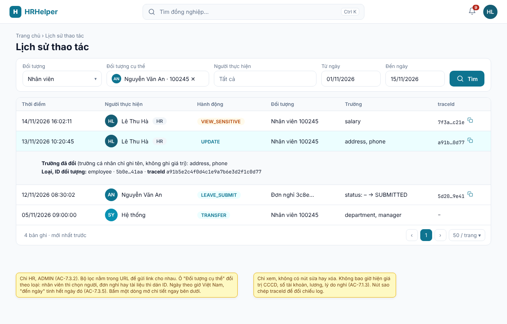

# UC7 – Lịch sử thao tác (audit log)

| Mục | Nội dung |
|---|---|
| Mục tiêu kinh doanh | MT-3 (100% lượt đọc, sửa dữ liệu nhạy cảm và lượt duyệt có audit) |
| Tác nhân chính | HR, ADMIN (tra cứu) |
| Tác nhân phụ, hệ thống ngoài | Các module Employee, Organization, Leave, Document, Identity và worker đồng bộ IdP (ghi audit); database (chặn sửa, xóa) |
| Yêu cầu (SRS) | FR-7.1 → FR-7.3 |
| Quy tắc | [ADR-09](../../architecture/adr/ADR-09-append-only-audit.md), ADR-08, ADR-18, [BR-13, BR-14](../../business/leave-rules.md), [quy tắc toàn vẹn tổ chức mục 3, 4](../../business/org-integrity-rules.md) |
| Mức ưu tiên | M |
| Trạng thái | Đã code (`feat/audit-ui`, 23/11): ghi audit ở mọi module, API tra cứu, trang `/audit`. Còn audit đăng nhập (AC-7.4.1) |
| Phiên bản | 1.2 – 23/11/2026 (1.2: code `feat/audit-ui`, mục 12, 13 thành hiện trạng; 1.1: kiểm chéo với code UC1 → UC5, UC8, ADR-14, ADR-15, ADR-17, ADR-18, schema, SRS; bảng thao tác đủ theo code; chốt thời gian lưu 5 năm; thêm 12, 13.2, 13.3; Duong chốt D1 → D3 theo đề xuất ngày 23/11) |

## 1. Mô tả ngắn

Mọi thao tác quan trọng được hệ thống tự ghi vào audit log. Audit ghi cùng giao dịch với thao tác nên không có thao tác nào
thành công mà thiếu log. Audit chỉ được thêm, database chặn mọi lệnh sửa, xóa. HR và ADMIN tra cứu audit theo đối tượng,
người thực hiện và khoảng thời gian, để trả lời câu hỏi "ai đã làm gì, lúc nào". UC7 gồm hai phần: phần ghi (tự động) và phần
tra cứu (người dùng).

Audit còn là nguồn dữ liệu của **nhật ký thay đổi hồ sơ** UC1 (FR-1.11, `GET /employees/{id}/history`): API đó đọc audit của
một hồ sơ, chỉ lấy các thao tác về hồ sơ, và áp quyền của UC1 (chủ hồ sơ, HR). Đó không phải đường tra cứu audit chung; quyền
của UC7 không áp cho API đó.

## 2. Tác nhân và quyền

| Tác nhân | Được làm gì | Giới hạn theo dữ liệu |
|---|---|---|
| HR | Tra cứu audit | Không sửa, không xóa |
| ADMIN | Tra cứu audit | Như HR, **trừ** audit đơn nghỉ và số dư phép (`leave_request`, `leave_balance`): API lọc bỏ khi người gọi không có `HR` (D1, chốt 23/11) |
| Nhân viên, quản lý | Không truy cập `GET /audit-logs` | Chủ hồ sơ vẫn xem nhật ký hồ sơ của mình qua UC1 FR-1.11 |
| Hệ thống (các module) | Ghi audit qua `AuditService.record(entry, manager)` trong cùng giao dịch | Không ghi giá trị nhạy cảm, lý do sức khỏe, ghi chú tự do của đơn |
| Worker, lệnh quản trị | `identity-sync` và `npm run grant-admin` ghi thẳng bằng SQL `INSERT` (không qua `AuditService`), `actor_id` để `NULL` | Chỉ `INSERT`, không có `ip`, `traceId` |

**Các thao tác được ghi (FR-7.1)**, đối chiếu code ngày 22/11/2026. Cột "Đối tượng" là giá trị `entity_type`, cũng là giá trị
của bộ lọc `entity`.

| Module | Đối tượng (`entityType`), `entityId` | Hành động (`action`) | Khi nào, `changedFields` |
|---|---|---|---|
| Employee | `employee`, id hồ sơ | `CREATE`, `UPDATE` | Tạo, sửa hồ sơ. Trường tổ chức (`departmentId`, `positionId`, `managerId`, `status`, `hireDate`) ghi giá trị cũ và mới; trường cá nhân và nhạy cảm chỉ ghi tên, giá trị `***` ([quy tắc toàn vẹn mục 3](../../business/org-integrity-rules.md#3-nội-dung-audit-theo-nhóm-trường)) |
| Employee | `employee` | `VIEW_SENSITIVE` | HR xem CCCD, số tài khoản, lương; chủ hồ sơ bấm mắt xem lương, tài khoản của mình; HR xem giá trị nhạy cảm của yêu cầu cập nhật. `changedFields`: `fields`, `section` |
| Employee | `employee` | `PROFILE_CHANGE_SUBMIT`, `PROFILE_CHANGE_CANCEL`, `PROFILE_CHANGE_APPROVE`, `PROFILE_CHANGE_REJECT` | Yêu cầu cập nhật hồ sơ (UC1 FR-1.9). Ghi mục, mã yêu cầu, thao tác, tên trường; **không** có giá trị, lý do từ chối |
| Employee | `employee` | `PROFILE_ITEM_CREATE`, `PROFILE_ITEM_UPDATE`, `PROFILE_ITEM_DELETE` | HR sửa thẳng dòng của mục (hợp đồng, lương…) |
| Employee | `employee` | `PROFILE_FILE_UPLOAD`, `PROFILE_FILE_DELETE`, `PROFILE_FILE_DOWNLOAD` | File hồ sơ: mã file, mục, loại, dung lượng, SHA-256; **không** có tên file gốc. Tải xuống chỉ ghi khi HR tải file của người khác |
| Employee (UC2) | `employee` | `TRANSFER_SCHEDULE`, `TRANSFER_CANCEL`, `TRANSFER`, `TRANSFER_FAIL` | Điều chuyển có ngày hiệu lực (FR-2.7): lên lịch, hủy, áp dụng (giá trị cũ, mới của phòng, chức danh, quản lý; mã lý do), job áp dụng lỗi (`actor_id` NULL) |
| Organization (UC2) | `department`, id đơn vị | `CREATE`, `UPDATE` | Tạo, sửa, ngừng hoạt động đơn vị; đổi trưởng, phó; job gỡ trưởng, phó khi nghỉ việc hoặc điều chuyển (`reason`: `HEAD_TRANSFERRED`, `DEPUTY_TRANSFERRED`) |
| Organization (UC2) | `position`, id chức danh | `CREATE`, `UPDATE` | Danh mục chức danh (FR-2.6) |
| Leave (UC3, UC4) | `leave_request`, id đơn | `LEAVE_SUBMIT` | Gửi đơn, kể cả tạo hộ (`onBehalfOf`). Ghi loại phép, ngày, số ngày |
| Leave | `leave_request` | `LEAVE_APPROVE`, `LEAVE_REJECT`, `LEAVE_HR_APPROVE`, `LEAVE_HR_REJECT`, `LEAVE_CANCEL`, `LEAVE_CANCEL_REQUEST`, `LEAVE_CANCEL_APPROVED`, `LEAVE_CANCEL_REQUEST_REJECT`, `LEAVE_COMPLETE`, `LEAVE_SYSTEM_CANCEL` | Mọi bước của đơn. Ghi trạng thái trước và sau, số ngày; hủy do nghỉ việc có `reason: TERMINATED`. **Không** ghi lý do và ghi chú tự do (BR-14) |
| Leave | `leave_request` | `LEAVE_RECALCULATE` | HR tính lại số ngày khi lịch nghỉ lễ đổi (BR-19) |
| Leave | `leave_request` | `VIEW_LEAVE_REASON` | HR đọc lý do đơn nghỉ ốm, thai sản (BR-14). Chỉ ghi `field: reason` |
| Leave | `leave_balance`, id **nhân viên** | `LEAVE_BALANCE_ADJUST`, `LEAVE_BALANCE_OVERDRAWN` | HR chỉnh mức nền, hạn mức (FR-3.8, BR-18), không ghi ghi chú; hệ thống ghi khi số dư tính lại nhỏ hơn đã dùng cộng đang chờ |
| Leave | `holiday`, ngày `YYYY-MM-DD` | `HOLIDAY_CREATE`, `HOLIDAY_DELETE` | Lịch nghỉ lễ |
| Leave | `approval_delegation`, id phân công | `DELEGATION_CREATE`, `DELEGATION_END` | Người duyệt thay (BR-06) |
| Document (UC5) | `document`, id tài liệu | `DOCUMENT_CREATE`, `DOCUMENT_PUBLISH`, `DOCUMENT_UPDATE`, `DOCUMENT_HIDE`, `DOCUMENT_RESTORE` | Quản lý kho tài liệu. Tải xuống không ghi audit ([UC5 spec 9.2](../UC5-document-repository/spec.md)) |
| Identity (UC8) | `user_account`, id tài khoản | `ACCOUNT_INVITE`, `ACCOUNT_SYNC_FAILED` | HR gửi lại lời mời; worker đồng bộ IdP lỗi (`actor_id` NULL) |
| Identity (UC8) | `role_assignment`, id tài khoản | `ROLE_GRANT`, `ROLE_REVOKE` | ADMIN cấp, thu hồi `HR`, `ADMIN` (FR-8.7); nghỉ việc tự thu hồi. Ghi vai trò và **lý do** ADMIN nhập (ngoại lệ có chủ ý của quy tắc "không ghi chữ tự do": lý do cấp quyền là bằng chứng cần giữ, không phải dữ liệu cá nhân) |

Chưa ghi: đăng nhập thành công, thất bại, bị khóa (AC-7.4.1, NFR-5.10, theo ADR-17 mục 6); HR đổi cấu hình loại phép
(`LEAVE_TYPE_UPDATE`, chưa có màn hình, UC4 spec 12).

Mỗi bản ghi có:
- người thực hiện (`actor_id` là id **hồ sơ nhân viên**, không phải id tài khoản; `NULL` với job, worker);
- hành động;
- loại và ID đối tượng;
- thời điểm;
- `traceId` và IP của request (AC-7.1.4; job, worker không có);
- danh sách trường đã đổi.

## 3. Điều kiện

- **Điều kiện trước:** HR hoặc ADMIN đã đăng nhập.
- **Kích hoạt:**
  - Phần ghi: bất kỳ thao tác nào trong bảng trên.
  - Phần tra cứu: HR, ADMIN mở trang "Lịch sử thao tác".
- **Điều kiện sau khi thành công:** tra cứu không thay đổi dữ liệu và không tự ghi audit.
- **Điều kiện sau khi thất bại:** thao tác nghiệp vụ lỗi thì audit cũng không được ghi (cùng giao dịch). Với thao tác chỉ đọc
  (`VIEW_SENSITIVE`, `VIEW_LEAVE_REASON`, `PROFILE_FILE_DOWNLOAD`), ghi audit lỗi thì request lỗi, không trả dữ liệu.

## 4. Luồng chính: HR tra cứu ai đã xem lương của một nhân viên

| Bước | Tác nhân | Hệ thống |
|---|---|---|
| 1 | HR mở "Lịch sử thao tác", chọn đối tượng "Nhân viên", chọn người, chọn khoảng thời gian | |
| 2 | Bấm Tìm | Gọi `GET /audit-logs?entity=employee&entityId=…&from=…&to=…&page=&size=` |
| 3 | | Kiểm vai trò HR hoặc ADMIN; lọc theo điều kiện; mới nhất trước; phân trang |
| 4 | Xem danh sách: lúc nào, ai, hành động gì (ví dụ `VIEW_SENSITIVE`), `traceId` | Trả danh sách |
| 5 | Lấy `traceId` để đối chiếu log hệ thống nếu cần | |

## 5. Luồng thay thế

- **A1 (bước 1), tìm theo người thực hiện:** lọc `actor` để xem một người đã làm những gì.
- **A2 (bước 1), tìm theo đơn nghỉ:** `entity = leave_request` và ID đơn, để xem toàn bộ các bước của một đơn. Bộ lọc
  `entity = employee` **không** trả các bước của đơn nghỉ của nhân viên đó (đối tượng khác).
- **A3, phần ghi khi thao tác thất bại:** giao dịch bị hủy, không có bản ghi audit, không có thay đổi dữ liệu.
- **A4 (bước 1), chỉ lọc theo thời gian:** không chọn đối tượng, người; dùng chỉ mục BRIN `ix_audit_at` để đạt NFR-2.4 (mục 13.3, D2).

## 6. Ngoại lệ

| Mã | Tình huống | Hệ thống phản hồi |
|---|---|---|
| E1 | Nhân viên, quản lý gọi `GET /audit-logs` | 403 `FORBIDDEN` |
| E2 | Ngày sai định dạng, `actor` không phải UUID | 400 `BAD_REQUEST` |
| E3 | Bất kỳ ai, kể cả ứng dụng, chạy UPDATE hoặc DELETE trên bảng audit | Database trigger chặn, giao dịch lỗi (FR-7.2) |
| E4 | `size` lớn hơn 100 hoặc nhỏ hơn 1, `page` nhỏ hơn 1 | 400 `BAD_REQUEST` |

## 7. Quy tắc áp dụng

- [ADR-09](../../architecture/adr/ADR-09-append-only-audit.md): append-only, trigger chặn sửa, xóa, ghi cùng giao dịch.
- [ADR-08](../../architecture/adr/ADR-08-field-encryption.md): audit ghi tên trường nhạy cảm, không ghi giá trị.
- **BR-13 (đã chốt):** giữ mỗi bản ghi audit **5 năm** kể từ lúc ghi, có legal hold (TV2 chốt ở
  [quy tắc toàn vẹn tổ chức mục 4](../../business/org-integrity-rules.md#4-thời-gian-lưu-audit); SRS NFR-6.3 đã sửa theo). Hết
  hạn chỉ archive bất biến hoặc hủy bằng quy trình có phê duyệt, không phải quyền xóa của ứng dụng. Chưa có quy trình đó.
- BR-14: không đưa lý do sức khỏe, ghi chú tự do của đơn vào audit; ADMIN không được thấy lý do qua audit.
- NFR-5.18: không lộ dữ liệu nhạy cảm qua kênh phụ. Loại phép (`leaveType`) trong audit đơn nghỉ là thông tin sức khỏe gián tiếp
  (ốm, thai sản), nên ADMIN không thấy audit đơn nghỉ, số dư phép (D1).

## 8. Dữ liệu vào

| Trường | Bắt buộc | Kiểm tra |
|---|---|---|
| `entity` | Không | Một trong `employee`, `department`, `position`, `leave_request`, `leave_balance`, `holiday`, `approval_delegation`, `document`, `user_account`, `role_assignment` (so khớp chính xác; giá trị khác hiện trả rỗng, đề xuất trả 400 ở mục 13.2) |
| `entityId` | Không | ID đối tượng (với `leave_balance` là id nhân viên, với `holiday` là ngày) |
| `actor` | Không | UUID hồ sơ nhân viên của người thực hiện (không phải ID tài khoản) |
| `from`, `to` | Không | Ngày `YYYY-MM-DD` hoặc ngày giờ ISO 8601. Cả hai tính cả mốc theo giờ Việt Nam: `from=2026-11-01` bắt đầu 00:00 ngày 1/11 giờ Việt Nam, `to=2026-11-01` lấy hết ngày 1/11 |
| `action` | Không | Một hoặc nhiều hành động trong bảng mục 2 (D3); giá trị lạ trả 400 |
| `page`, `size` | Không | `page` ≥ 1; `size` 1 → 100, mặc định 20 |

## 9. Giao diện và API

| Luồng | Màn hình | API |
|---|---|---|
| Tra cứu | `/audit` (ô "Lịch sử thao tác" ở trang chủ của HR, ADMIN; link từ hồ sơ và chi tiết đơn của HR) | `GET /audit-logs` |
| Ghi | Không có màn hình | `AuditService.record` gọi trong cùng giao dịch của từng module |

Response hiện tại: `{ items, page, size, total }`, mỗi item có `id`, `actorId`, `action`, `entityType`, `entityId`,
`changedFields`, `ip`, `traceId`, `at`, `actorName`. `docs/openapi.yaml` có tham số, danh sách `entity`, `action`; chưa mô tả
response và mã lỗi (chung cho mọi API, error-codes.md).

### 9.1 Bản vẽ giao diện

Bản vẽ để duyệt bố cục trước khi code (15/11/2026), cùng phong cách với bản vẽ UC1 ở
[giao diện chung mục 10](../frontend.md#10-bản-vẽ-giao-diện). Nguồn ở [`mockups.html`](../mockups/mockups.html), dữ liệu là người
mẫu. Ô vàng là ghi chú cho người đọc. Chỗ nào bản vẽ khác chữ trong spec thì chữ đúng.

**Lịch sử thao tác `/audit`: bộ lọc theo API, bảng mới nhất trước, mở dòng xem trường đã đổi**

Chỗ bản vẽ khác trang đã code (trang theo spec):
- Dòng `LEAVE_SUBMIT` "Đơn nghỉ 3c8e…" không thể hiện khi đang lọc đối tượng "Nhân viên" (luồng A2).
- Nhãn vai trò "HR" cạnh tên người thực hiện: audit không lưu vai trò lúc thao tác; bỏ nhãn (mục 13.2).
- Ô "Tìm đồng nghiệp…" trên nav bar theo quyết định của UC6, không thuộc UC7.

## 10. Yêu cầu phi chức năng liên quan

- NFR-6.1 → NFR-6.4: audit đủ, không sửa được, lưu 5 năm, `traceId`.
- NFR-2.4: tra cứu theo đối tượng hoặc thời gian p95 < 1 s với 3 năm dữ liệu (~3,75 triệu bản ghi).
- NFR-5.10: ghi đăng nhập (chưa có) và cấp, thu hồi vai trò (đã có qua UC8 FR-8.7).
- NFR-5.14: tài khoản database của ứng dụng không sửa, xóa, `TRUNCATE` được bảng audit.

## 11. Kiểm thử

Chiến lược, test đã có, bảng phủ tiêu chí và ca còn thiếu: [test.md](test.md). Cách triển khai: [deploy.md](deploy.md).

## 12. Hiện trạng và việc còn lại

| Nội dung | Trạng thái | Việc còn lại |
|---|---|---|
| Ghi audit cùng giao dịch, chặn sửa xóa | Đã có ở mọi module trong bảng mục 2 | – |
| API tra cứu | Đã có: `actorName`, lọc `action` (D3), ADMIN không thấy audit đơn nghỉ, số dư (D1), `entity`, `action` sai trả 400 | – |
| Màn hình tra cứu | Đã có: `frontend/src/pages/AuditPage.tsx`, bộ lọc nằm trên URL | – |
| `traceId`, IP trong audit | Đã có ở mọi module: middleware lưu `traceId`, IP vào request context (`common/request-context.ts`), `AuditService.record` tự lấy khi module không truyền | – |
| `employeeCode` trong audit | Đã sửa: chỉ ghi tên, giá trị `***` ([quy tắc toàn vẹn mục 3](../../business/org-integrity-rules.md#3-nội-dung-audit-theo-nhóm-trường)). Bản ghi cũ vẫn giữ giá trị (append-only) | – |
| `from`, `to` theo giờ Việt Nam | Đã sửa (`audit-period.ts`) | – |
| Tra cứu chỉ theo thời gian (NFR-2.4) | Có chỉ mục BRIN `ix_audit_at` (migration `AuditTimeIndex`) | Đo với 3,75 triệu bản ghi (TV4) |
| Audit đăng nhập | Chưa có | TV3, `infra/idp-auth-events`, tuần 13 (AC-7.4.1) |
| Audit cấp, thu hồi vai trò | Đã có (UC8 `feat/uc8-role-admin`) | – (AC-7.4.2) |
| Thời gian lưu | Đã chốt 5 năm (BR-13) | Quy trình archive, legal hold trước production (ngoài MVP) |

## 13. Thiết kế màn hình tra cứu và quyết định

### 13.1 Màn hình tra cứu

> Đã code ở `feat/audit-ui` (23/11/2026).

- **Route** `/audit`, chỉ hiện trong menu với HR, ADMIN.
- **Bộ lọc:** loại đối tượng (danh sách ở mục 8, hiện tên tiếng Việt), đối tượng cụ thể (với nhân viên là ô tìm theo danh bạ;
  loại khác nhập ID), người thực hiện (ô tìm theo danh bạ, gửi UUID hồ sơ), hành động (chọn nhiều, nhóm theo module, D3), từ ngày, đến ngày
  (tính cả hai ngày).
- **Bảng:** thời điểm (giờ Việt Nam), người thực hiện (tên, "Hệ thống" khi `actorId` NULL), hành động, đối tượng (link tới hồ
  sơ, đơn, tài liệu nếu người xem có quyền), `traceId` (nút sao chép), nút mở `changedFields`.
- **Mở nhanh:** trang hồ sơ nhân viên và chi tiết đơn của HR có link "Lịch sử thao tác" mở `/audit` với bộ lọc điền sẵn.
- Không có nút sửa, xóa. Không có xuất file, để audit không thành đường lộ dữ liệu (BR-14).

### 13.2 Thay đổi API đi kèm (đã code)

Không đổi đường dẫn, không phá client cũ.

- Mỗi item thêm `actorName` (tên hồ sơ, `null` với hệ thống), cùng cách UC1 `history` đang làm (một truy vấn `IN` theo trang).
  Không thêm vai trò vì audit không lưu vai trò lúc thao tác.
- `entity` ngoài danh sách mục 8 trả 400 thay vì rỗng, để lỗi gõ không bị hiểu là "không có ai làm gì".
- `from`, `to` nhận `YYYY-MM-DD` là ngày theo giờ Việt Nam (`Asia/Ho_Chi_Minh`), `to` cộng một ngày rồi so `<`.
- Lọc `action` (một hoặc nhiều giá trị, D3).
- Người gọi chỉ có `ADMIN` (không có `HR`): truy vấn luôn thêm `entity_type NOT IN ('leave_request', 'leave_balance')`; lọc
  `entity=leave_request` hoặc `leave_balance` trả rỗng (D1). Dropdown đối tượng của ADMIN không có hai loại này.
- Migration mới: `CREATE INDEX ix_audit_at ON audit.audit_log USING brin (at)` (D2).

### 13.3 Quyết định đã chốt (Duong, 23/11/2026, theo đề xuất)

| Mã | Câu hỏi | Chốt | Lý do |
|---|---|---|---|
| D1 | ADMIN có được thấy audit đơn nghỉ, số dư phép (`leave_request`, `leave_balance`) không? Audit có `leaveType` (`SICK`, `MATERNITY`), số ngày | **Không.** API lọc bỏ hai loại đối tượng này với người chỉ có `ADMIN`; HR thấy đủ | BR-14, NFR-5.18 cấm lộ loại phép ốm, thai sản qua kênh phụ (email đã che); ADMIN là vai trò kỹ thuật, không xử lý đơn (authorization.md). ADMIN vẫn thấy `VIEW_SENSITIVE` của HR để giám sát HR |
| D2 | Thêm chỉ mục cho tra cứu chỉ theo thời gian? | **Có**, migration mới `CREATE INDEX ix_audit_at ON audit.audit_log USING brin (at)` | Hai chỉ mục hiện có đều bắt đầu bằng `entity_type` hoặc `actor_id`; lọc chỉ theo ngày phải quét cả bảng 3,75 triệu dòng, khó đạt NFR-2.4. BRIN nhỏ, hợp bảng chỉ thêm theo thời gian |
| D3 | Có lọc theo hành động không? ([frontend.md 10.8](../frontend.md#108-bản-vẽ-uc2--uc7) đang ghi "chưa lọc") | **Có**, chọn nhiều hành động, nhóm theo module | Đã có gần 45 hành động; câu hỏi thường gặp là "ai đã xem lương" (`VIEW_SENSITIVE`) hay "ai cấp quyền" (`ROLE_GRANT`) trên toàn hệ thống. Chi phí nhỏ, không cần chỉ mục mới nếu đã có D2 |
