# UC8 – Đăng nhập và tài khoản

| Mục | Nội dung |
|---|---|
| Mục tiêu kinh doanh | MT-3 (bảo vệ dữ liệu nhân sự), hỗ trợ MT-1 (BRD) |
| Tác nhân chính | Nhân viên (mọi vai trò), HR |
| Tác nhân phụ, hệ thống ngoài | Identity provider (Keycloak local, Amazon Cognito staging), dịch vụ email (Mailpit, Amazon SES), ADMIN |
| Yêu cầu (SRS) | FR-8.1 → FR-8.7; NFR-5.1 → NFR-5.13 |
| Quy tắc | ADR-17, ADR-18, ADR-03, ADR-15, ADR-10, ADR-09; threat model T-02, T-03, T-06 |
| Mức ưu tiên | M (FR-8.6 là S) |
| Trạng thái | Một phần: đăng nhập, đăng xuất đã có; còn lại kế hoạch tuần 11 – 12 |
| Phiên bản | 1.1 – 18/11/2026 (thêm FR-8.7, sơ đồ luồng, bản vẽ, hợp đồng API, thiết kế dữ liệu) |

## 1. Mô tả ngắn

Người dùng đăng nhập bằng email công ty trên trang của identity provider (IdP), không bao giờ nhập mật khẩu vào ứng dụng. IdP lo
mật khẩu, MFA, quên mật khẩu, khóa khi dò. Ứng dụng lo phần nghiệp vụ: tạo tài khoản khi HR tạo hồ sơ, khóa khi nghỉ việc, gắn tài
khoản với hồ sơ theo email đã xác minh.

## 2. Tác nhân và quyền

| Tác nhân | Được làm gì trong use case này | Giới hạn theo dữ liệu |
|---|---|---|
| Mọi người dùng | Đăng nhập, đăng xuất, quên mật khẩu, đăng ký TOTP | Chỉ tài khoản của mình |
| HR | Tạo hồ sơ (kéo theo tạo tài khoản), cho nghỉ việc, khôi phục (khóa, mở tài khoản), xem trạng thái tài khoản, gửi lại lời mời | Mọi nhân viên |
| ADMIN | Cấp, thu hồi vai trò `HR`, `ADMIN` trong ứng dụng (FR-8.7); đặt lại MFA trên console IdP | Không tự cấp, tự thu hồi cho mình; không xem hồ sơ cá nhân (NFR-5.13) |

## 3. Điều kiện

- **Điều kiện trước:** người dùng có hồ sơ với email công ty duy nhất; IdP có tài khoản cùng email, đã xác minh, đang mở.
- **Kích hoạt:** mở web khi chưa có token; hoặc HR lưu hồ sơ mới, đổi trạng thái nghỉ việc.
- **Điều kiện sau khi thành công:** web có access token trong `sessionStorage`; `iam.user_account` có `subject` và `last_login_at`;
  với vòng đời tài khoản, `idp_status` khớp trạng thái trên IdP.
- **Điều kiện sau khi thất bại:** không có token; hồ sơ HR vừa lưu vẫn giữ, tài khoản ở `FAILED` để thử lại.

## 4. Luồng chính

### 4.1 Đăng nhập (FR-8.1)

| Bước | Tác nhân | Hệ thống |
|---|---|---|
| 1 | Mở web | Web không có token, tạo `code_verifier`, `state`, chuyển tới `/authorize` của IdP với `code_challenge` S256 |
| 2 | Nhập email, mật khẩu | IdP kiểm mật khẩu, đếm lần sai |
| 3 | Nhập mã TOTP (nếu bắt buộc, FR-8.5) | IdP kiểm mã |
| 4 | | IdP chuyển về `/callback?code=…&state=…`; web kiểm `state`, đổi `code` + `code_verifier` lấy token |
| 5 | | Web gọi `GET /me`; API kiểm chữ ký JWKS, issuer, client; tìm tài khoản theo `sub`, chưa có thì theo email đã xác minh; vai trò lấy từ database (`iam.role_assignment` cho `HR`, `ADMIN`; sơ đồ tổ chức cho `MANAGER`), bỏ qua nhóm trong token (ADR-18, AC-8.1.10) |
| 6 | | Web hiện trang chủ theo vai trò; token tự gia hạn trước khi hết hạn |

**Giao diện và sơ đồ luồng**

Chạy từng bước: [f1](flows/flows.html#f1) (mở `flows.html` bằng trình duyệt).

*Màn hình: lỗi đăng nhập ở /callback (AC-8.1.11)*

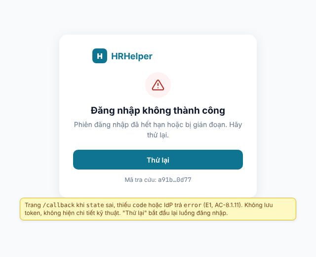

*Sơ đồ f1: đăng nhập (4.1)*

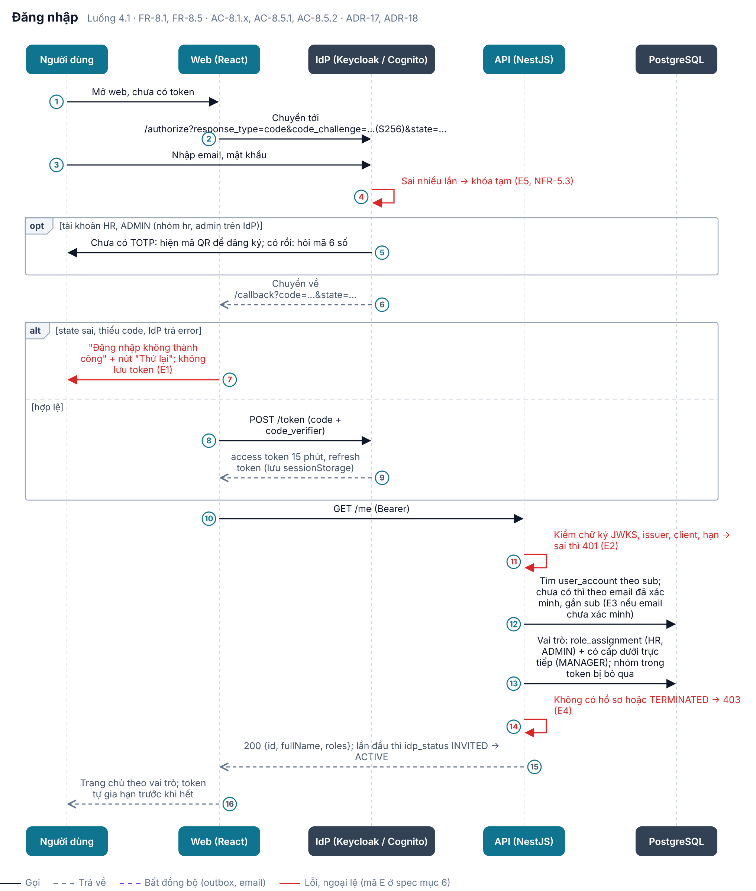

### 4.2 Tạo tài khoản khi HR tạo hồ sơ (FR-8.3)

| Bước | Tác nhân | Hệ thống |
|---|---|---|
| 1 | HR lưu hồ sơ mới | API lưu hồ sơ, tạo `iam.user_account` (`idp_status = PENDING`) và event `EmployeeCreated` trong outbox, cùng một giao dịch |
| 2 | | Relay đẩy event lên queue (local RabbitMQ; staging SNS `hr-events` → SQS `identity-sync`) |
| 3 | | Consumer `identity-sync` gọi `IdentityProviderAdmin.createUser(email, tên, nhóm employee)` |
| 4 | | IdP tạo tài khoản, email đã xác minh, gửi email mời có mật khẩu tạm hoặc link đặt mật khẩu |
| 5 | | Consumer ghi `idp_status = INVITED` |
| 6 | Người được mời đăng nhập, đổi mật khẩu tạm | Luồng 4.1; API gắn `subject`, ghi `idp_status = ACTIVE` |

**Giao diện và sơ đồ luồng**

Chạy từng bước: [f3](flows/flows.html#f3), [g1](flows/flows.html#g1) (mở `flows.html` bằng trình duyệt).

*Màn hình: dòng "Tài khoản đăng nhập" trong hồ sơ*

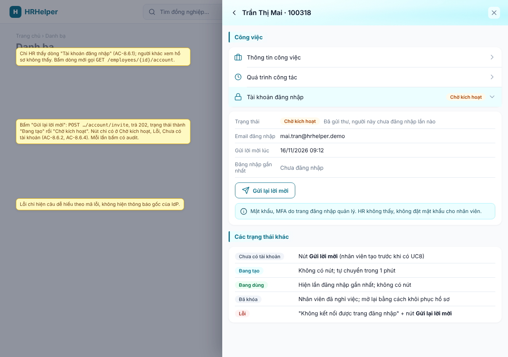

*Sơ đồ f3: tạo tài khoản khi tạo hồ sơ (4.2)*

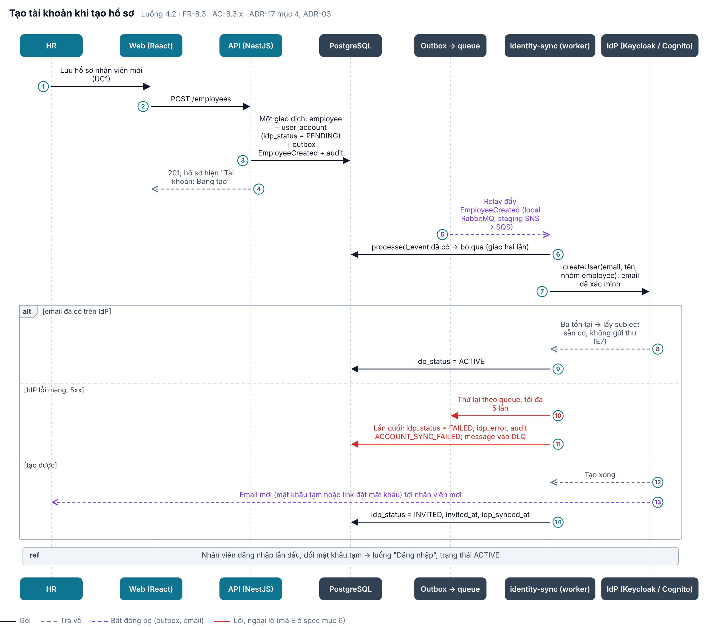

*Sơ đồ g1: trạng thái tài khoản*

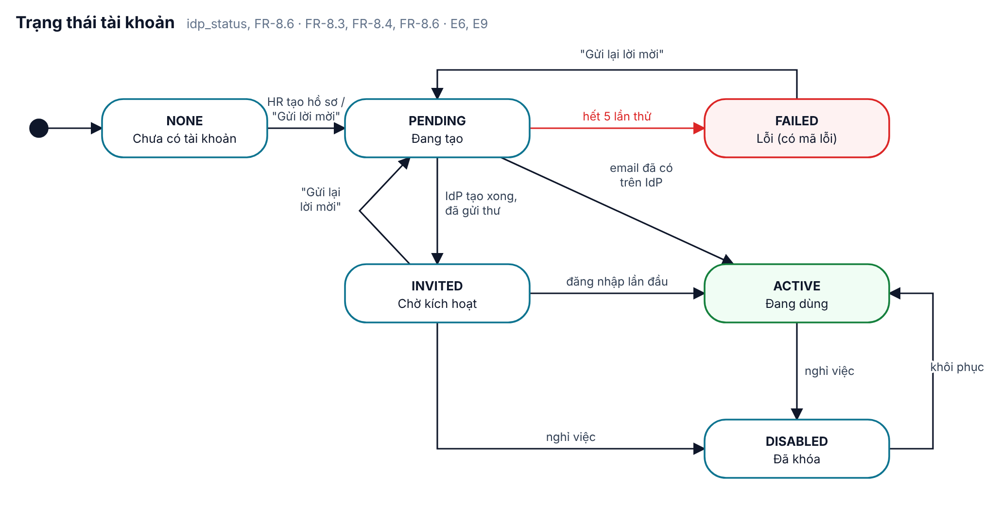

### 4.3 Khóa tài khoản khi nghỉ việc (FR-8.4)

| Bước | Tác nhân | Hệ thống |
|---|---|---|
| 1 | HR cho nhân viên nghỉ việc (FR-1.7) | API đổi trạng thái `TERMINATED`, ghi event `EmployeeTerminated` trong outbox |
| 2 | | Consumer gọi `disableUser` và `signOutAll` (Cognito `AdminDisableUser`, `AdminUserGlobalSignOut`) |
| 3 | | Ghi `idp_status = DISABLED`. Access token còn hạn (≤ 15 phút) vẫn bị API trả 403 vì kiểm `TERMINATED` |

**Giao diện và sơ đồ luồng**

Chạy từng bước: [f4](flows/flows.html#f4) (mở `flows.html` bằng trình duyệt).

*Sơ đồ f4: nghỉ việc, khôi phục (4.3, A5)*

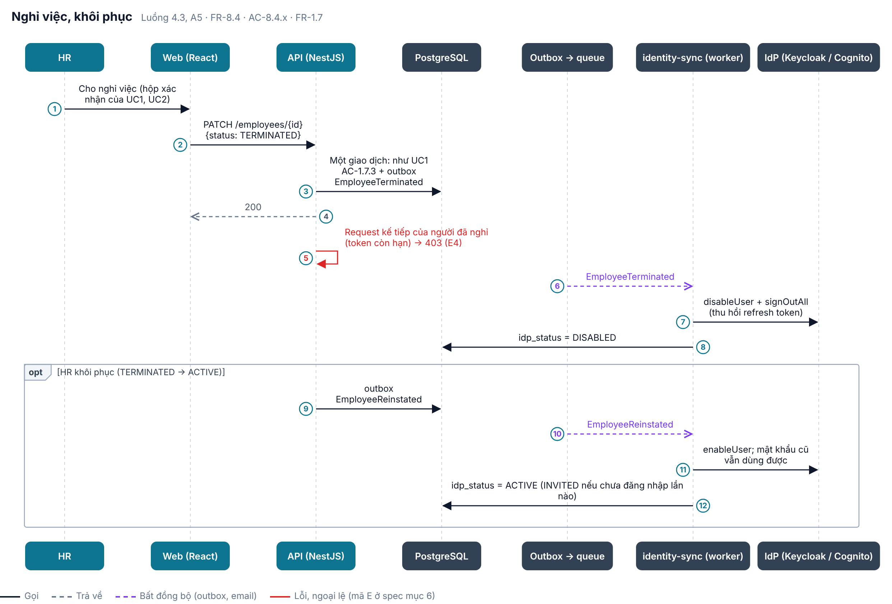

### 4.4 ADMIN cấp, thu hồi vai trò (FR-8.7)

| Bước | Tác nhân | Hệ thống |
|---|---|---|
| 1 | ADMIN mở `/admin/roles` | API trả danh sách người đang có `HR`, `ADMIN` với người cấp, ngày cấp, lý do |
| 2 | Bấm "Cấp vai trò", chọn nhân viên, vai trò, nhập lý do | Web gọi `POST /admin/role-assignments` |
| 3 | | API kiểm: người gọi là ADMIN, không phải chính mình (E11), nhân viên có tài khoản và đang làm việc (E10, E13), chưa có vai trò (E14) |
| 4 | | Cùng một giao dịch: thêm dòng `iam.role_assignment`, audit `ROLE_GRANT`, event `RoleGranted` vào outbox |
| 5 | | Người được cấp có quyền mới từ request kế tiếp (đọc database mỗi request) |
| 6 | | Consumer `identity-sync` thêm tài khoản vào nhóm `hr` hoặc `admin` trên IdP; IdP bắt MFA từ lần đăng nhập sau |

**Giao diện và sơ đồ luồng**

Chạy từng bước: [f6](flows/flows.html#f6) (mở `flows.html` bằng trình duyệt).

*Màn hình: trang "Phân quyền" /admin/roles*

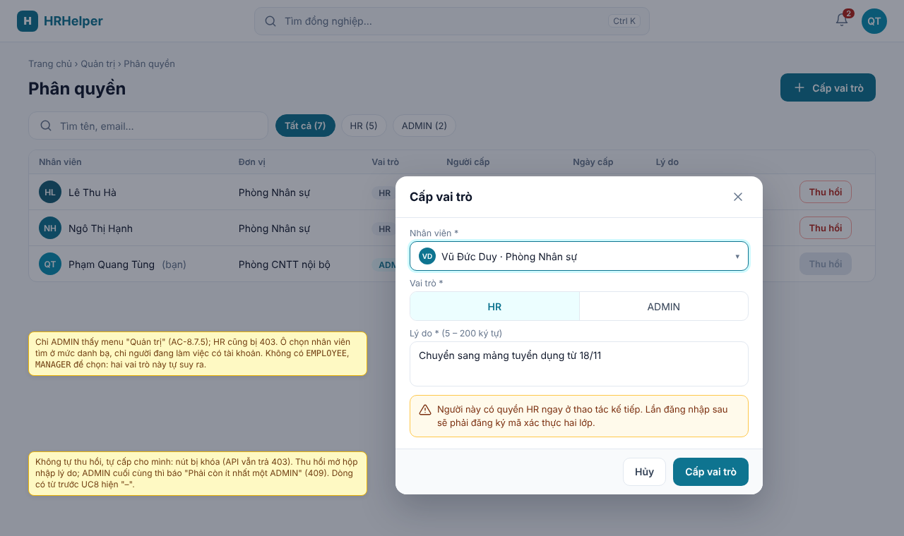

*Sơ đồ f6: cấp, thu hồi vai trò (4.4, A7)*

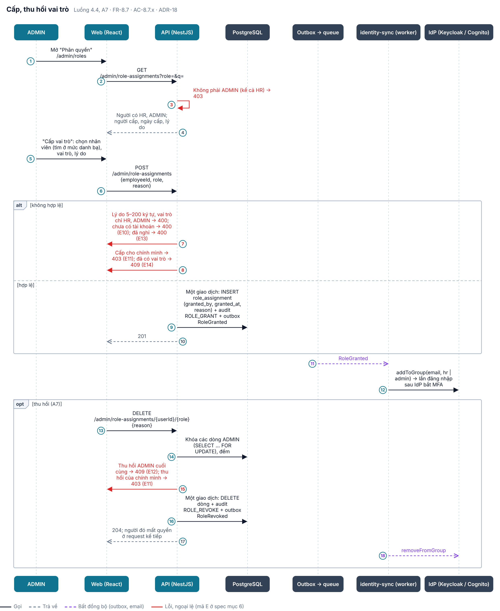

## 5. Luồng thay thế

- **A1 (từ bước 2 của 4.1) – Quên mật khẩu (FR-8.2):** bấm "Quên mật khẩu", nhập email; IdP gửi mã hoặc link; nhập mật khẩu mới theo
  NFR-5.2; quay lại bước 2.
- **A2 (từ bước 3 của 4.1) – Đăng ký TOTP lần đầu (FR-8.5):** IdP hiện mã QR, người dùng quét bằng ứng dụng xác thực và nhập mã đầu tiên.
- **A3 (từ bước 6 của 4.1) – Đăng xuất:** web xóa token; Keycloak gọi `end_session_endpoint`, Cognito gọi `/logout` của Managed Login.
- **A4 (sau bước 6 của 4.1) – Hết phiên:** 30 phút không thao tác thì web tự đăng xuất như A3; refresh token hết sau 10 giờ thì về bước 1.
- **A5 (từ bước 1 của 4.3) – Khôi phục:** event `EmployeeReinstated`, consumer gọi `enableUser`, `idp_status = ACTIVE`.
- **A6 (FR-8.6) – Gửi lại lời mời:** HR bấm "Gửi lại lời mời" khi `idp_status` là `INVITED` hoặc `FAILED`; API ghi event
  `AccountInviteRequested`; consumer gọi `resendInvite` (Cognito `AdminCreateUser` với `MessageAction=RESEND`). Trạng thái `NONE`
  (nhân viên tạo trước UC8) thì nút là "Gửi lời mời", consumer tạo tài khoản như 4.2, email đã có trên IdP thì chỉ gắn (AC-8.6.4).
- **A7 (từ bước 3 của 4.4) – Thu hồi:** ADMIN bấm "Thu hồi" trên một dòng, nhập lý do; `DELETE /admin/role-assignments/{userId}/{role}`;
  API chặn thu hồi ADMIN cuối cùng (E12); xóa dòng, audit `ROLE_REVOKE`, event `RoleRevoked`; consumer gỡ nhóm trên IdP.
- **A8 (UC1 AC-1.4.4) – Đổi email công ty:** HR sửa email trong hồ sơ; API đổi `iam.user_account.email` và ghi event
  `EmployeeEmailChanged`; consumer đổi email trên IdP, giữ trạng thái đã xác minh (AC-8.3.6). `subject` không đổi nên vẫn gắn đúng hồ sơ.

**Minh họa luồng thay thế: A1**

Chạy từng bước: [f2](flows/flows.html#f2) (mở `flows.html` bằng trình duyệt).

*Sơ đồ f2: quên mật khẩu (A1)*

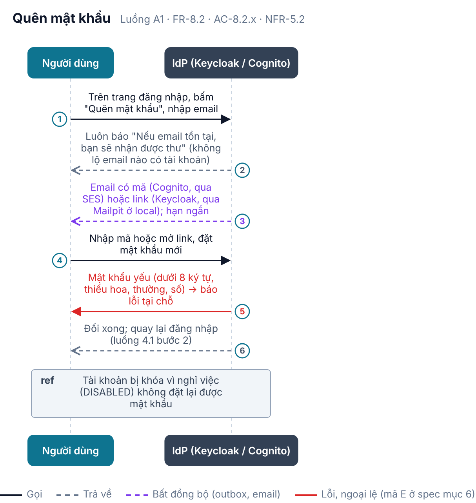

**Minh họa luồng thay thế: A3, A4**

Chạy từng bước: [f7](flows/flows.html#f7) (mở `flows.html` bằng trình duyệt).

*Màn hình: cảnh báo sắp hết phiên, phiên đã hết*

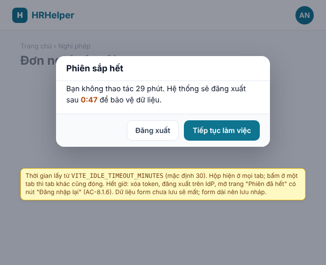

*Sơ đồ f7: tự đăng xuất khi không thao tác (A4)*

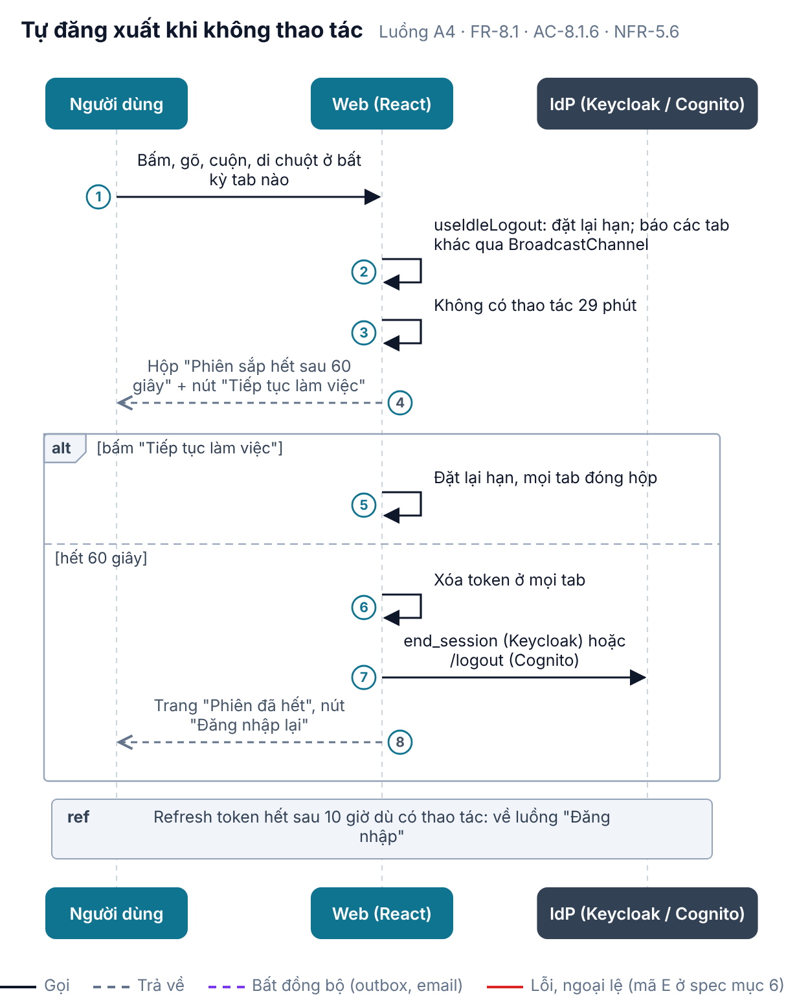

**Minh họa luồng thay thế: A6**

Chạy từng bước: [f5](flows/flows.html#f5) (mở `flows.html` bằng trình duyệt).

*Sơ đồ f5: gửi lại lời mời (A6)*

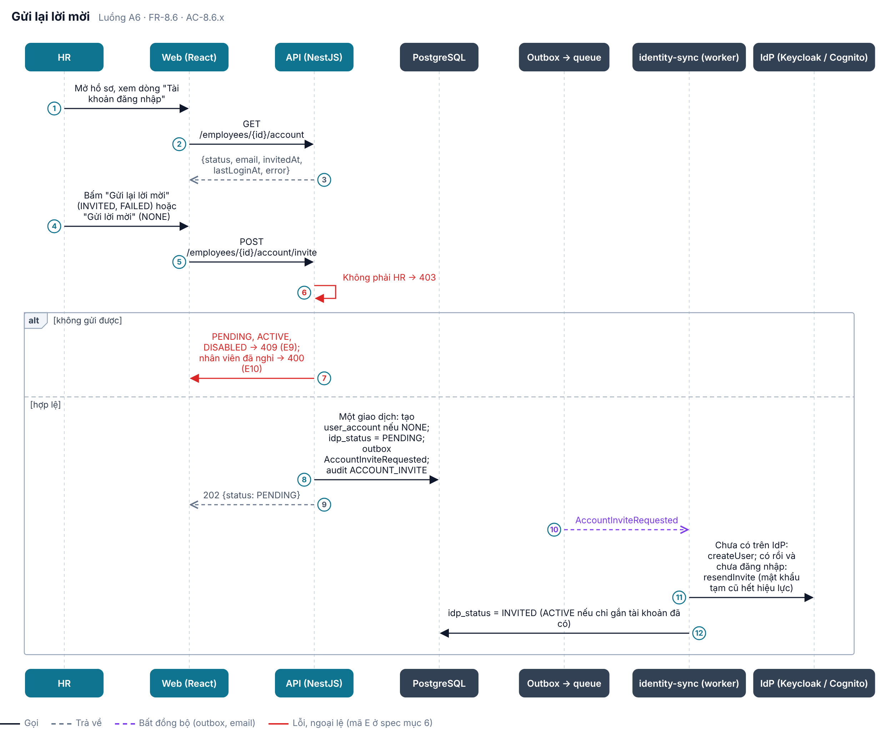

## 6. Ngoại lệ

Ngoại lệ chung của mọi API không lặp lại ở đây ([error-codes.md](../../development/error-codes.md#lỗi-chung)): 401 chưa đăng nhập hoặc token hết hạn; 403 tài khoản đã nghỉ việc (UC8 E4); 400 khi gửi trường lạ (chống gán hàng loạt) hoặc ID không phải UUID; 413 body quá 64 KiB; 500 kèm `traceId`. Cách rà ngoại lệ: [README mục "Rà ngoại lệ"](../README.md#rà-ngoại-lệ).

| Mã | Tình huống | Hệ thống phản hồi |
|---|---|---|
| E1 | `state` ở `/callback` không khớp hoặc thiếu `code` | Web báo "Đăng nhập không thành công", nút thử lại; không lưu token |
| E2 | Token sai chữ ký, hết hạn, sai client | HTTP 401 `UNAUTHENTICATED` |
| E3 | Email trong token chưa xác minh, hoặc email đã gắn với `subject` khác | HTTP 401 `UNAUTHENTICATED` (T-02) |
| E4 | Tài khoản không có hồ sơ hoặc hồ sơ `TERMINATED` | HTTP 403 `FORBIDDEN` |
| E5 | Sai mật khẩu nhiều lần | IdP khóa tạm (NFR-5.3) |
| E6 | IdP không gọi được khi tạo, khóa tài khoản | Thử lại theo SQS, tối đa 5 lần; rồi `idp_status = FAILED`, message vào DLQ |
| E7 | Email đã có tài khoản trên IdP khi tạo | Consumer lấy tài khoản sẵn có, không tạo trùng (idempotent) |
| E8 | Token có nhóm `hr`, `admin`, `manager` nhưng database không có vai trò đó | Nhóm bị bỏ qua; gọi API của vai trò đó nhận 403 (AC-8.1.10) |
| E9 | Gửi lại lời mời khi trạng thái là `PENDING`, `ACTIVE`, `DISABLED` | HTTP 409 `CONFLICT` "Tài khoản không ở trạng thái chờ kích hoạt" |
| E10 | Nhân viên chưa có tài khoản (cấp vai trò), hoặc đã nghỉ việc (gửi lời mời) | HTTP 400 `BAD_REQUEST` |
| E11 | ADMIN cấp hoặc thu hồi vai trò của chính mình | HTTP 403 `FORBIDDEN` "Không tự cấp, thu hồi vai trò của mình" |
| E12 | Thu hồi `ADMIN` của ADMIN cuối cùng còn hoạt động | HTTP 409 `CONFLICT` "Phải còn ít nhất một ADMIN". Kiểm trước E11, vì ADMIN cuối cùng chỉ có thể là chính người gọi |
| E13 | Cấp vai trò cho nhân viên đã nghỉ việc | HTTP 400 `BAD_REQUEST` |
| E14 | Cấp vai trò người đó đã có | HTTP 409 `CONFLICT` |

### 6.1 Ngoại lệ bổ sung (rà 24/11/2026)

Rà theo các nhóm ở [README](../README.md#rà-ngoại-lệ). Cột "Code" là hiện trạng: **Có** đã đối chiếu code hoặc thiết kế đã chốt; **Cần kiểm** chưa đối chiếu, test phải xác nhận; **Chưa đạt** code chưa làm đúng (mục 12); **Đề xuất** cần TV2 chốt nghiệp vụ.

| Mã | Nhóm | Tình huống | Hệ thống phản hồi | Code |
|---|---|---|---|---|
| E15 | Phiên | Đăng xuất ở một tab khi đang mở nhiều tab | Mọi tab cùng đăng xuất (BroadcastChannel, A4) | Có |
| E16 | Phiên | Refresh token đã bị thu hồi (nghỉ việc, ADMIN đăng xuất mọi nơi) | Làm mới thất bại → trang "Phiên đã hết", không lặp gọi IdP | Cần kiểm |
| E17 | Dữ liệu vào | Đồng hồ máy người dùng lệch | API kiểm hạn token theo giờ server, cho lệch tối đa 60 giây | Cần kiểm |
| E18 | Bảo mật | Link đăng nhập mang đường dẫn quay về trỏ ra ngoài (open redirect) | Chỉ quay về đường dẫn nội bộ bắt đầu bằng `/`; `redirect_uri` cố định `/callback` | Có |
| E19 | Tranh chấp | Hai ADMIN cùng lúc thu hồi ADMIN của nhau khi chỉ còn hai | Khóa các dòng ADMIN (`FOR UPDATE`); người sau nhận E12 | Có |
| E20 | Hệ thống ngoài | Email mời bị trả về (sai địa chỉ) | `idp_status` vẫn `INVITED`; HR sửa email (A8) rồi gửi lại lời mời | Cần kiểm |
| E21 | Bảo mật | Mã TOTP dùng lại hoặc sai nhiều lần | IdP từ chối, khóa tạm như E5 | Có |

## 7. Quy tắc áp dụng

[ADR-17](../../architecture/adr/ADR-17-authentication.md) (toàn bộ), [ADR-03](../../architecture/adr/ADR-03-sync-workflow-async-notification.md)
(outbox), [ADR-15](../../architecture/adr/ADR-15-service-extraction.md) (SNS `hr-events`), [ADR-10](../../architecture/adr/ADR-10-manager-role-derived.md)
(MANAGER không phải nhóm trên IdP), [ADR-18](../../architecture/adr/ADR-18-authorization.md) (vai trò từ database, cấp, thu hồi),
[phân quyền](../../security/authorization.md), [threat model](../../security/threat-model.md) T-02, T-03, T-06.

## 8. Dữ liệu vào

| Trường | Bắt buộc | Kiểm tra |
|---|---|---|
| Email (trên trang IdP) | Có | Đúng định dạng; thông báo lỗi không phân biệt sai email hay sai mật khẩu |
| Mật khẩu mới | Có | ≥ 8 ký tự, có chữ hoa, chữ thường, số; không trùng email (NFR-5.2) |
| Mã TOTP | Khi MFA bật | 6 số, theo thời gian 30 giây |
| `employeeId` (cấp vai trò) | Có | Nhân viên tồn tại, đang làm việc, có `iam.user_account` |
| `role` | Có | `HR` hoặc `ADMIN` (không cấp tay `EMPLOYEE`, `MANAGER`, ADR-10) |
| `reason` | Có | 5 – 200 ký tự sau khi bỏ khoảng trắng hai đầu |

## 9. Giao diện và API

> Trang đăng nhập, quên mật khẩu, MFA là của IdP. Ứng dụng chỉ có các phần dưới đây; nav bar, màu, cách báo lỗi theo
> [giao diện chung](../frontend.md).

| Luồng | Màn hình | API (chi tiết ở 9.2) |
|---|---|---|
| 4.1 bước 1 | `/` khi chưa đăng nhập: chuyển thẳng sang IdP (local có thêm trang chọn tài khoản demo khi `VITE_AUTH_MODE=dev`) | – |
| 4.1 bước 4, E1 | `/callback`; lỗi thì hiện "Đăng nhập không thành công" và nút "Thử lại" | – |
| 4.1 bước 5 | – | `GET /me` |
| A4 | Hộp cảnh báo 1 phút trước khi hết phiên, rồi hộp "Phiên đã hết" | – |
| A6, FR-8.6 | Hồ sơ nhân viên (góc nhìn HR), dòng "Tài khoản đăng nhập": trạng thái + nút "Gửi lời mời" / "Gửi lại lời mời" | `GET /employees/{id}/account`, `POST /employees/{id}/account/invite` |
| 4.4, A7 | `/admin/roles` "Phân quyền" (chỉ ADMIN), hộp "Cấp vai trò", hộp "Thu hồi" | `GET`, `POST /admin/role-assignments`, `DELETE /admin/role-assignments/{userId}/{role}` |

**Sơ đồ luồng** (bấm "Chạy" để xem từng bước): [`flows/flows.html`](flows/flows.html), ảnh PNG cùng thư mục, xuất lại bằng
`flows/render.js` (Playwright).

| Luồng | Sơ đồ |
|---|---|
| Đăng nhập, vai trò lấy từ database (4.1) | [uc8-f1.png](flows/uc8-f1.png) |
| Quên mật khẩu (A1) | [uc8-f2.png](flows/uc8-f2.png) |
| Tạo tài khoản khi HR tạo hồ sơ (4.2) | [uc8-f3.png](flows/uc8-f3.png) |
| Nghỉ việc, khôi phục (4.3, A5) | [uc8-f4.png](flows/uc8-f4.png) |
| Gửi lại lời mời (A6) | [uc8-f5.png](flows/uc8-f5.png) |
| Cấp, thu hồi vai trò (4.4, A7) | [uc8-f6.png](flows/uc8-f6.png) |
| Tự đăng xuất khi không thao tác (A4) | [uc8-f7.png](flows/uc8-f7.png) |
| Trạng thái tài khoản `idp_status` (FR-8.6) | [uc8-g1.png](flows/uc8-g1.png) |

### 9.1 Bản vẽ giao diện

Bản vẽ để duyệt bố cục trước khi code (18/11/2026). Nguồn ở [`mockups.html`](../mockups/mockups.html), dữ liệu là người mẫu. Ô vàng
là ghi chú cho người đọc. Chỗ nào bản vẽ khác chữ trong spec thì chữ đúng.

**HR xem tài khoản đăng nhập trong hồ sơ nhân viên (FR-8.6)**


**ADMIN "Phân quyền" `/admin/roles` và hộp "Cấp vai trò" (FR-8.7)**


**Cảnh báo sắp hết phiên, phiên đã hết (AC-8.1.6) và lỗi đăng nhập ở `/callback` (AC-8.1.11)**

| Hết phiên | Lỗi đăng nhập |
|---|---|
|  |  |

### 9.2 Hợp đồng API

Tất cả dưới `/api/v1`, cần đăng nhập (E2). `docs/openapi.yaml` sinh từ code nên chỉ cập nhật khi code merge; bảng dưới là hợp đồng
để code theo. Lỗi theo dạng chung `{code, message, traceId, fields?}` ([error-codes.md](../../development/error-codes.md)). Dòng
tương ứng trong [ma trận phân quyền](../../security/access-control-matrix.md) thêm cùng PR code.

**Tài khoản của nhân viên (FR-8.6)**

| API | Ai gọi | Vào | Ra | Lỗi |
|---|---|---|---|---|
| `GET /me` | Mọi người | – | Như hiện tại; `roles` chỉ từ database | E2, E3, E4 |
| `GET /employees/{id}/account` | HR | – | `{status: NONE\|PENDING\|INVITED\|ACTIVE\|DISABLED\|FAILED, email, invitedAt, lastLoginAt, syncedAt, error}`; `error` chỉ là mã (`IDP_UNAVAILABLE`, `IDP_REJECTED`) | 403, 404 (không có nhân viên) |
| `POST /employees/{id}/account/invite` | HR | – | 202 `{status: PENDING}`; ghi audit `ACCOUNT_INVITE` | 403, 404, 409 (E9), 400 (E10) |

**Vai trò (FR-8.7)**

| API | Ai gọi | Vào | Ra | Lỗi |
|---|---|---|---|---|
| `GET /admin/role-assignments?role=&q=&page=&size=` | ADMIN | – | Trang `{userId, employeeId, fullName, email, departmentName, role, grantedBy: {id, fullName} \| null, grantedAt, reason}`; dòng có từ trước UC8 thì `grantedBy`, `reason` là `null` | 403 |
| `POST /admin/role-assignments` | ADMIN | `{employeeId, role: HR\|ADMIN, reason}` | 201 dòng như trên | 400 (`fields`, E10, E13), 403 (E11), 409 (E14) |
| `DELETE /admin/role-assignments/{userId}/{role}` | ADMIN | `{reason}` (body JSON) | 204 | 400, 403 (E11), 404 (không có dòng), 409 (E12) |

ADMIN không có quyền đọc hồ sơ (NFR-5.13): danh sách chọn nhân viên trong hộp "Cấp vai trò" dùng `GET /employees?q=` ở mức danh bạ.

**Audit** (`entityType`): `user_account` (`ACCOUNT_INVITE`, `ACCOUNT_SYNC_FAILED`), `role_assignment` (`ROLE_GRANT`, `ROLE_REVOKE`;
`changedFields: {userId, role, reason}`). Ghi trong cùng giao dịch (ADR-09).

**Event** (bảng outbox hiện có `leave.outbox`; `event_type` viết PascalCase như event đang có, tương ứng tên logic trong ADR-17,
ADR-18). Payload chỉ có id, email, tên; không có dữ liệu nhạy cảm.

| `event_type` | Khi | Payload | Consumer `identity-sync` gọi |
|---|---|---|---|
| `EmployeeCreated` | HR tạo hồ sơ (UC1) | `{employeeId, accountId, email, fullName}` | `createUser` (nhóm `employee`), ghi `INVITED` hoặc `ACTIVE` nếu đã có |
| `AccountInviteRequested` | `POST …/account/invite` | như trên | `createUser` khi chưa có trên IdP, ngược lại `resendInvite` |
| `EmployeeTerminated` | `PATCH /employees/{id}` sang `TERMINATED` | `{employeeId, accountId, email}` | `disableUser`, `signOutAll`, ghi `DISABLED` |
| `EmployeeReinstated` | Từ `TERMINATED` về `ACTIVE` | như trên | `enableUser`, ghi `ACTIVE` (hoặc `INVITED` nếu chưa đăng nhập lần nào) |
| `EmployeeEmailChanged` | HR đổi email công ty | `{employeeId, accountId, oldEmail, email}` | `updateEmail` |
| `RoleGranted`, `RoleRevoked` | 4.4, A7 | `{accountId, email, role}` | `addToGroup`, `removeFromGroup` |

## 10. Yêu cầu phi chức năng liên quan

NFR-5.1 → NFR-5.13. Riêng UC8: email mời tới trong 1 phút kể từ khi HR lưu (khi IdP, SES bình thường); đồng bộ vai trò, khóa tài
khoản trên IdP trong 1 phút; quyền trong API đổi ngay ở request kế tiếp.

## 11. Kiểm thử

Xem [`test.md`](test.md). Cách triển khai: [`deploy.md`](deploy.md).

## 12. Hiện trạng và việc còn lại

| Nội dung | Trạng thái (18/11/2026, tính cả `feat/uc8-account-lifecycle`) | Việc còn lại |
|---|---|---|
| Đăng nhập, đăng xuất OIDC Code + PKCE | Đã có: `frontend/src/auth/auth.tsx`, `CallbackPage` (lỗi E1 có màn hình "Đăng nhập không thành công", nút "Thử lại"), `token-verifier.ts` (Keycloak, Cognito) | `callback_urls` của Cognito (TV3) |
| Gắn tài khoản theo `sub`, email | Đã có, chặn `TERMINATED` | Kiểm `email_verified` (`fix/auth-email-verified`) |
| Vai trò | Chỉ từ database (`feat/uc8-roles-from-db`): `HR`, `ADMIN` ở `iam.role_assignment`, `EMPLOYEE`, `MANAGER` suy ra; token không còn claim vai trò; bỏ `manager` ở realm Keycloak và Cognito | – |
| Cấp, thu hồi vai trò | Đã có (`feat/uc8-role-admin`): API, trang `/admin/roles` (ô "Phân quyền" ở trang chủ của ADMIN), audit, event; lệnh `npm run grant-admin -- <email>` cho ADMIN đầu tiên. Nhóm trên IdP đồng bộ theo (`feat/uc8-account-lifecycle`) | – |
| Tạo, khóa, mở tài khoản trên IdP; trạng thái; gửi lại lời mời | Đã có (`feat/uc8-account-lifecycle`): event khi tạo, nghỉ việc, khôi phục, đổi email; `IdentitySync` trong worker; driver `keycloak` (đã chạy thử với Keycloak 26.0.7 thật), `cognito` (chưa chạy với pool thật), `none`; API, dòng "Tài khoản đăng nhập" trong hồ sơ; realm local có client `hr-api-admin`, SMTP Mailpit | Staging: hàng đợi, IAM, SES, biến môi trường của worker (TV3 `infra/idp-account-lifecycle`) |
| Tự đăng xuất khi không thao tác | Đã có: `frontend/src/auth/idle.tsx` (`VITE_IDLE_TIMEOUT_MINUTES`, cảnh báo 1 phút, đồng bộ các tab) | – |
| Quên mật khẩu, MFA, cấu hình IdP staging | Local đã bật "Quên mật khẩu" và SMTP (thư vào Mailpit); chưa kiểm AC-8.2.x; MFA chưa có | TV3 `infra/idp-hardening`, `infra/idp-mfa` |
| Ngoại lệ bổ sung mục 6.1 (E15 → E21) | Rà 24/11/2026 | cần kiểm: E16, E17, E20. TV4 viết test cho cả bảng, sửa code ca chưa đạt |

Ai làm, tuần nào: mục 4 của [`requirements.md`](requirements.md).

## 13. Thiết kế đề xuất cho phần chưa có

Ba nhánh code theo thứ tự, mỗi nhánh một PR, mỗi PR sửa `database-schema.md`, `test.md`, ma trận phân quyền và mục 12 cùng lúc:

| Nhánh | Nội dung | Tiêu chí |
|---|---|---|
| `feat/uc8-roles-from-db` | `IdentityService.resolve` bỏ đọc nhóm trong token; bỏ realm role `manager` ở `keycloak/realm-hr.json`; test token có `hr` nhưng database không | AC-8.1.10 |
| `feat/uc8-role-admin` | Migration `role_assignment`; API 9.2 "Vai trò"; audit; event `RoleGranted`, `RoleRevoked`; trang `/admin/roles`; lệnh `npm run grant-admin` | AC-8.7.x |
| `feat/uc8-account-lifecycle` | Migration `user_account`; event khi tạo, nghỉ việc, khôi phục, đổi email; `identity-sync` trong worker; driver `keycloak`, `cognito`, `none`; API 9.2 "Tài khoản"; dòng tài khoản trong hồ sơ; tự đăng xuất; màn hình lỗi `/callback`; realm Keycloak local (client `hr-api-admin`, SMTP Mailpit, bật quên mật khẩu). OTP cho `hr`, `admin` để lại cho TV3 `infra/idp-mfa` theo bảng việc ở `requirements.md` mục 4 | AC-8.1.6, 8.1.11, AC-8.3.x, 8.4.2, 8.4.3, AC-8.6.x |

Phần staging (SNS → SQS `identity-sync`, IAM `cognito-idp:Admin*`, SES, MFA của Cognito) là của TV3, `infra/idp-account-lifecycle`.

**Dữ liệu** (migration mới `AccountLifecycle`, `RoleAssignmentAudit`; không sửa migration cũ):

- **`iam.user_account`** thêm `idp_status varchar(10) NOT NULL DEFAULT 'ACTIVE'` (CHECK `PENDING`, `INVITED`, `ACTIVE`, `DISABLED`,
  `FAILED`; dòng có sẵn đều đã đăng nhập nên là `ACTIVE`), `invited_at timestamptz`, `idp_synced_at timestamptz`, `idp_error
  varchar(40)` (chỉ mã lỗi). Index `(idp_status)` cho trang HR lọc tài khoản lỗi. `NONE` không lưu: là khi chưa có dòng.
- **`iam.role_assignment`** thêm `granted_by uuid NULL` (ref `iam.user_account.id`), `granted_at timestamptz NOT NULL DEFAULT now()`,
  `reason varchar(200) NULL`. Dòng cũ để `NULL`. Thu hồi xóa dòng; lịch sử nằm ở audit. Chặn ADMIN cuối cùng bằng
  `SELECT … FOR UPDATE` các dòng `ADMIN` trong cùng giao dịch.

**Interface** (backend `src/modules/identity/idp-admin/`):

```ts
interface IdentityProviderAdmin {
  createUser(input: { email: string; fullName: string; groups: string[] }): Promise<{ subject: string; created: boolean }>;
  resendInvite(email: string): Promise<void>;
  updateEmail(oldEmail: string, email: string): Promise<void>;
  disableUser(email: string): Promise<void>;
  enableUser(email: string): Promise<void>;
  signOutAll(email: string): Promise<void>;
  addToGroup(email: string, group: 'hr' | 'admin'): Promise<void>;
  removeFromGroup(email: string, group: 'hr' | 'admin'): Promise<void>;
}
```

Driver chọn bằng `IDP_ADMIN_DRIVER=keycloak|cognito|none` (`none` cho `AUTH_MODE=dev` và test: chỉ ghi log, trả thành công).

- `cognito`: `@aws-sdk/client-cognito-identity-provider`: `AdminCreateUser` (`DesiredDeliveryMediums=EMAIL`, `email_verified=true`,
  `MessageAction=RESEND` khi gửi lại), `AdminUpdateUserAttributes`, `AdminAddUserToGroup`, `AdminRemoveUserFromGroup`,
  `AdminDisableUser`, `AdminEnableUser`, `AdminUserGlobalSignOut`.
- `keycloak`: Admin REST API bằng client `hr-api-admin` (client credentials, chỉ role `manage-users` của realm `hr`):
  `POST /admin/realms/hr/users` với `requiredActions: ["UPDATE_PASSWORD"]`, `PUT …/execute-actions-email`, `PUT …/users/{id}`
  (`enabled`, `email`), `POST …/users/{id}/logout`, `PUT|DELETE …/users/{id}/role-mappings/realm`.

**Worker:** `NotificationWorker.handle` chuyển các event ở bảng 9.2 sang `IdentitySync` (`backend/src/worker/identity-sync.ts`,
cùng bảng `processed_event` để không xử lý hai lần). Lỗi mạng, 5xx, 429 thì thử lại ngay trong worker (`IDP_SYNC_ATTEMPTS`,
mặc định 5 lần, chờ nhân đôi từ `IDP_SYNC_RETRY_DELAY_MS`); hết lượt, hoặc lỗi 4xx của IdP (ví dụ email không hợp lệ) thì ghi
`idp_error`, audit `ACCOUNT_SYNC_FAILED` rồi ném lỗi để message vào DLQ. Trạng thái thành `FAILED` chỉ với `EmployeeCreated`,
`AccountInviteRequested` (chưa có tài khoản dùng được); event khác giữ trạng thái, chỉ ghi `idp_error`.

**Web:**

- Hook `useIdleLogout` trong `AuthProvider`: thời gian lấy từ `VITE_IDLE_TIMEOUT_MINUTES` (mặc định 30); nghe `mousemove`,
  `keydown`, `click`, `scroll`; đồng bộ giữa các tab bằng `BroadcastChannel`; cảnh báo 1 phút trước.
- `CallbackPage`: bắt lỗi `signinRedirectCallback`, hiện E1, nút "Thử lại" gọi lại `signinRedirect`.
- Hồ sơ nhân viên (HR): dòng "Tài khoản đăng nhập" trong mục thông tin công việc.
- Trang `/admin/roles` trong menu "Quản trị" (chỉ ADMIN thấy menu; API vẫn kiểm).
