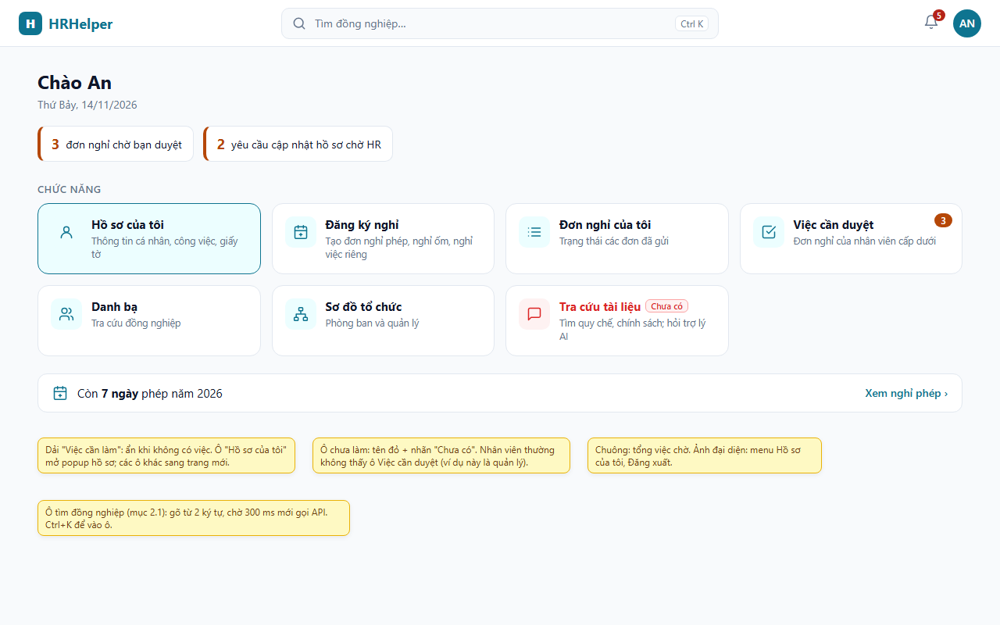
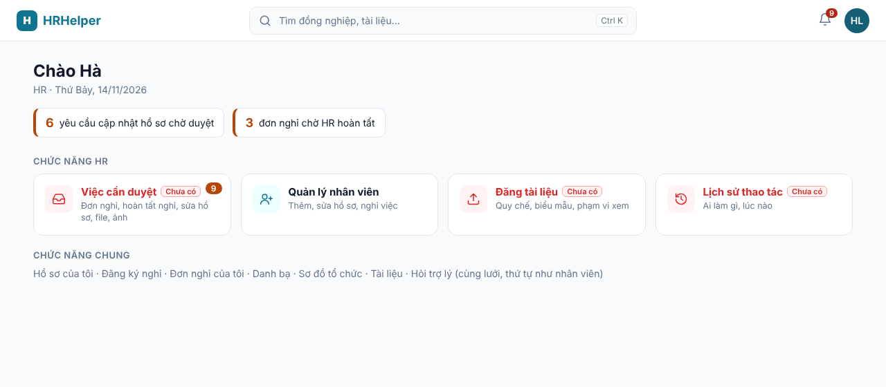
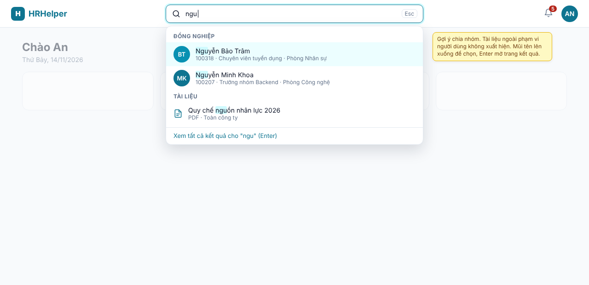
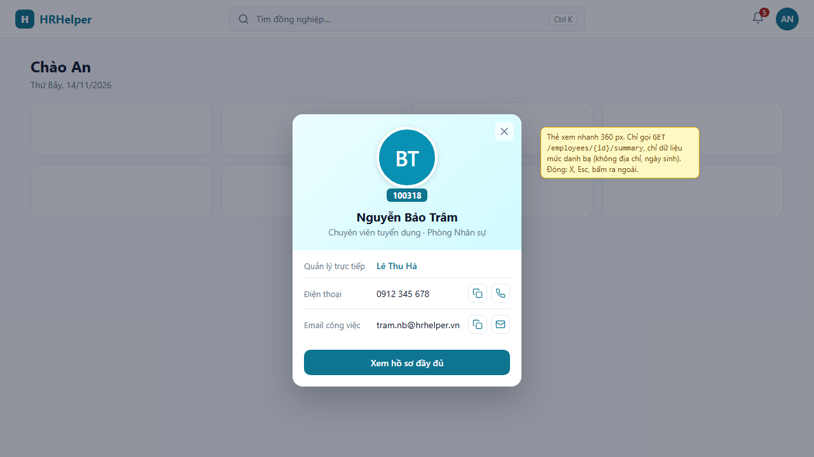
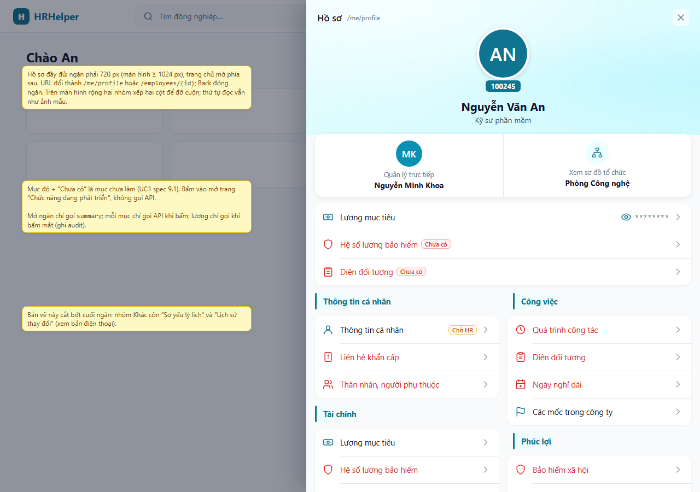
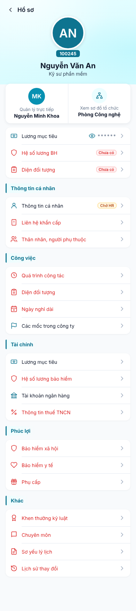
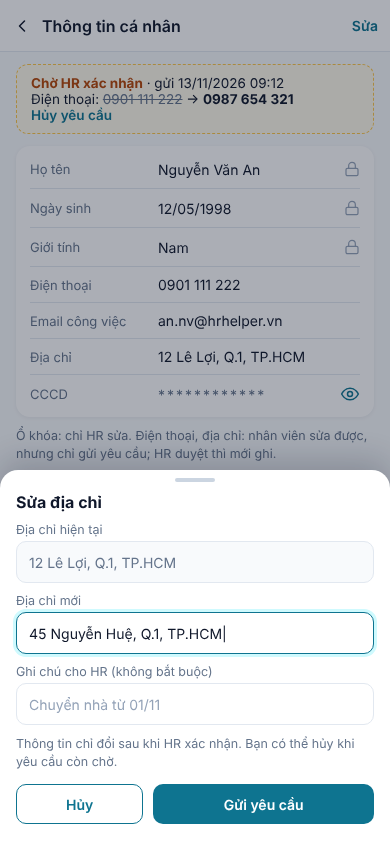
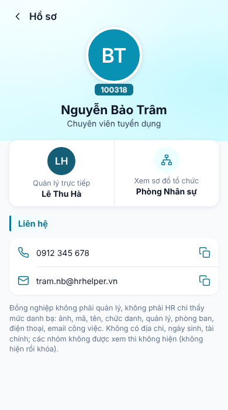
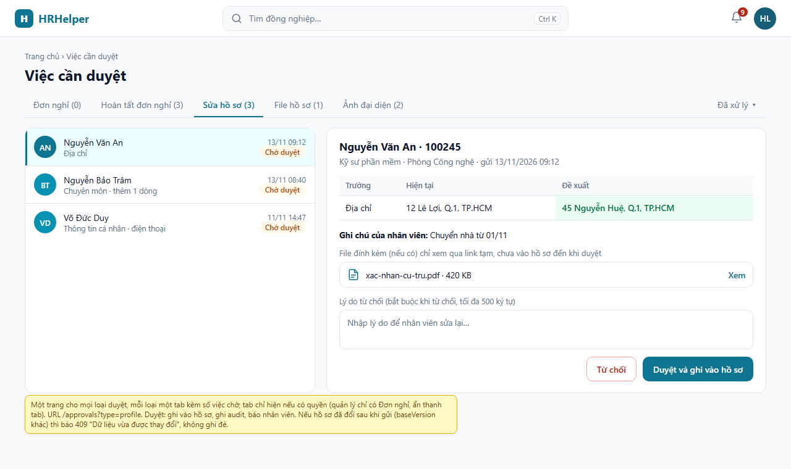

# Giao diện chung (frontend)

> Phiên bản 1.2 – 14/11/2026 (1.1: bản vẽ giao diện mục 10; 1.2: gộp mọi loại duyệt vào trang "Việc cần duyệt", mục 2.4). Áp dụng cho mọi tính năng UC1 → UC7. Bộ tài liệu: [`docs/README.md`](../README.md).
> Mỗi UC chỉ mô tả màn hình riêng của mình ở mục 9 trong `spec.md` và dẫn về file này cho phần dùng chung.
> Mục còn ghi **Chưa có** là phần code chưa làm; tiêu chí `AC-0.x.y` dùng cho các PR giao diện như `AC` của từng UC.

## 1. Cách chia tài liệu giao diện

Dùng **hai tầng**, giống cách các nhóm sản phẩm thường làm (design system cộng màn hình theo tính năng):

| Tầng | Ở đâu | Nội dung |
|---|---|---|
| Dùng chung | File này | Khung ứng dụng (nav bar, trang chủ), điều hướng và URL, popup hồ sơ, màu và thành phần dùng lại, quy tắc tải dữ liệu, hiển thị lỗi, khả năng truy cập, kích thước màn hình |
| Theo tính năng | `UCn-*/spec.md` mục 9 | Màn hình, trường, nút, API của riêng tính năng đó |

Lý do: nếu chỉ viết trong từng UC thì nav bar, màu, cách báo lỗi bị chép 7 lần và lệch nhau. Nếu chỉ viết một file chung
thì người làm một tính năng phải đọc cả file dài. Hai tầng giữ mỗi quy tắc ở đúng một chỗ.

## 2. Khung ứng dụng

### 2.1 Nav bar (thanh trên cùng, mọi trang)

| Vị trí | Thành phần | Hành vi | Trạng thái |
|---|---|---|---|
| Trái | Logo HRHelper | Bấm về trang chủ `/` | Có chữ, chưa có logo |
| Giữa | Ô tìm kiếm chung | Gõ từ 2 ký tự thì hiện gợi ý chia nhóm "Đồng nghiệp" (UC2, UC6 FR-6.1) và "Tài liệu" (UC6 FR-6.2); chờ 300 ms sau phím cuối mới gọi API. Phím tắt `/` hoặc `Ctrl+K` để vào ô. Chọn một đồng nghiệp thì mở thẻ xem nhanh (mục 4.1). Enter thì sang trang kết quả `/search?q=` | **Chưa có** |
| Phải | Chuông thông báo | Số việc đang chờ mình: đơn chờ duyệt (quản lý), yêu cầu cập nhật hồ sơ chờ duyệt (HR), yêu cầu của mình bị từ chối. Bấm mở danh sách ngắn, mỗi dòng dẫn tới trang xử lý | **Chưa có** |
| Phải | Ảnh đại diện | Bấm mở menu: tên, vai trò; "Hồ sơ của tôi" (mở popup hồ sơ của mình); "Đăng xuất". Chưa có ảnh thì hiện chữ cái đầu | **Chưa có** (hiện là tên, nhãn vai trò, nút Đăng xuất) |

Trên điện thoại (dưới 640 px): ô tìm kiếm thu thành biểu tượng kính lúp, bấm thì mở ô tìm kiếm toàn màn hình.

### 2.2 Trang chủ `/`

Từ trên xuống:

1. **Lời chào và "Việc cần làm"**: "Chào {tên}", rồi một dải thẻ nhỏ cho việc đang chờ người dùng (ví dụ "3 đơn chờ bạn
   duyệt", "2 yêu cầu cập nhật hồ sơ chờ HR"). Không có việc gì thì ẩn dải này. **Chưa có**
2. **Ô chức năng chính**: lưới các ô, mỗi ô có biểu tượng, tên, mô tả một dòng và số việc chờ (nếu có). Bấm thì sang trang của
   chức năng, riêng "Hồ sơ của tôi" mở popup hồ sơ (mục 4). **Chưa có**
3. **Số dư phép năm** dạng một dòng ngắn ("Còn 7 ngày phép năm"), bấm sang trang Nghỉ phép. **Chưa có**

**Ô chức năng theo vai trò** (chỉ hiện ô người dùng được dùng; ô chức năng chưa làm vẫn hiện, tên màu đỏ và nhãn "Chưa có"):

| Ô | Đi tới | Ai thấy | UC |
|---|---|---|---|
| Hồ sơ của tôi | Popup hồ sơ của mình | Mọi người có hồ sơ | UC1 |
| Đăng ký nghỉ | `/leave/new` | Mọi người có hồ sơ | UC3 |
| Đơn nghỉ của tôi | `/leave` | Mọi người có hồ sơ | UC3 |
| Việc cần duyệt | `/approvals` (mục 2.4) | Quản lý, người duyệt thay, HR | UC1, UC4 |
| Danh bạ | `/directory` | Mọi người | UC2 |
| Sơ đồ tổ chức | `/org` | Mọi người | UC2 |
| Tài liệu | `/documents` | Mọi người | UC5, UC6 |
| Hỏi trợ lý chính sách | `/assistant` | Mọi người | UC6 |
| Quản lý nhân viên | `/employees/new`, danh bạ ở chế độ HR | HR | UC1 |
| Đăng tài liệu | `/documents/manage` | HR | UC5 |
| Lịch sử thao tác | `/audit` | HR, ADMIN | UC7 |

Lưới: 4 cột trên màn hình rộng, 3 cột trên máy tính bảng, 2 cột trên điện thoại. Thứ tự cố định như bảng, để người dùng nhớ
vị trí.

### 2.3 Trang chức năng

Mỗi chức năng là một trang riêng có URL riêng (như bảng trên), có tiêu đề trang và nút quay về trang chủ. Nav bar luôn ở trên.
Nút Back của trình duyệt quay về trang trước.

### 2.4 Trang "Việc cần duyệt" `/approvals`

Mọi việc người dùng phải duyệt nằm ở **một trang, chia tab theo loại**, thay vì mỗi loại một trang riêng. Đây là cách các hệ
thống HR lớn làm (hộp duyệt chung kiểu "Inbox", "Approvals"): người duyệt không phải nhớ nhiều chỗ, chuông và dải "Việc cần làm"
chỉ cần dẫn về một nơi. Gộp **giao diện**, không gộp **nghiệp vụ**: quyền, trạng thái, quy tắc của từng loại vẫn theo UC của nó.

| Tab | `type` | Nội dung | Ai thấy | Quy tắc |
|---|---|---|---|---|
| Đơn nghỉ | `leave` | Quản lý: đơn `SUBMITTED` của cấp dưới trực tiếp, đơn được giao duyệt thay. HR: đơn của CEO và đơn `PENDING_HR` chờ HR duyệt thêm (BR-16), hiện kèm quyết định của quản lý | Quản lý, người duyệt thay, HR | UC4 luồng chính, A1, A3, A5, A6 |
| Hoàn tất đơn nghỉ | `leave-complete` | Đơn đã duyệt chờ HR hoàn tất | HR | UC4 A2 |
| Sửa hồ sơ | `profile` | Yêu cầu sửa trường, thêm, sửa, xóa dòng (liên hệ khẩn cấp, thân nhân, chuyên môn…) | HR | UC1 4.2, 4.7 |
| File hồ sơ | `profile-file` | File nhân viên tải lên đang `PENDING_REVIEW` | HR | UC1 4.3, 4.7 |
| Ảnh đại diện | `avatar` | Ảnh đại diện mới chờ duyệt | HR | UC1 4.3, 4.7 |

Sau này có loại duyệt mới (ví dụ đăng ký làm thêm giờ) thì thêm một tab, không thêm trang hay ô chức năng mới.

Không có tab "Tất cả" trộn các loại: mỗi loại xem và quyết định theo cách khác nhau (đơn nghỉ xem số dư, hồ sơ xem trước và sau),
trộn vào một danh sách thì người duyệt phải đổi cách nghĩ ở mỗi dòng. Thay vào đó, mở `/approvals` không kèm `type` thì vào tab
đang có nhiều việc chờ nhất.

**Quy tắc:**

- **Chỉ hiện tab người dùng có quyền.** Quản lý chỉ có tab "Đơn nghỉ" nên thanh tab ẩn đi; HR thấy đủ. Người không có tab nào thì không
  có ô "Việc cần duyệt" ở trang chủ, mở thẳng `/approvals` thì báo không có quyền (mục 3).
- **Mỗi tab có số việc chờ** lấy từ `GET /me/todo-counts`, cùng số với chuông và dải "Việc cần làm". Tab không có việc vẫn hiện,
  số 0, để vị trí tab không nhảy.
- **URL:** tab là `/approvals?type=leave`; mở một việc là `/approvals/{type}/{id}` (ví dụ `/approvals/profile/8f2c…`). Link
  trong email, chuông, dải "Việc cần làm" trỏ thẳng vào tab hoặc việc đó. Các đường dẫn cũ `/leave/approvals`, `/leave/hr`
  chuyển tiếp sang tab tương ứng để link cũ vẫn chạy.
- **Bố cục chung:** danh sách bên trái (người gửi, tóm tắt, thời điểm gửi, đã chờ bao lâu, nhãn "Quá hạn" nếu quá hạn; cũ nhất
  lên đầu), chi tiết bên phải; trên điện
  thoại danh sách là một trang, chi tiết là trang tiếp theo. Bộ lọc chung: phòng ban, người gửi, khoảng ngày gửi.
- **Chi tiết riêng theo loại:** đơn nghỉ hiện loại nghỉ, ngày, số ngày, số dư phép, đơn trùng ngày của cùng nhóm; sửa hồ sơ hiện
  bảng giá trị hiện tại và đề xuất; file hiện tên, loại, dung lượng, nút xem qua link tạm. Nút hành động theo loại: Duyệt, Từ
  chối (đơn nghỉ, hồ sơ), Hoàn tất (đơn nghỉ đã duyệt).
- **Từ chối luôn bắt buộc lý do** (UC1 E-lý do, UC4 FR-4.2). Duyệt xong việc biến khỏi danh sách, chi tiết chuyển sang việc kế
  tiếp để duyệt liên tục.
- **Không duyệt hàng loạt** trong phạm vi tuần 11–13. Nếu làm sau thì chỉ cho tab "Đơn nghỉ", mỗi đơn vẫn kiểm `version` riêng và
  báo kết quả từng đơn; không bao giờ cho yêu cầu sửa hồ sơ, file, ảnh (phải xem từng cái).
- **Dữ liệu:** backend giữ API riêng của từng UC, không làm API gộp. Mỗi tab gọi API danh sách của UC đó (UC4: `GET
  /leave-requests/pending-approval`, `GET /leave-requests?status=APPROVED`; UC1: `GET /change-requests?status=PENDING` lọc theo loại), chỉ khi tab được
  mở. Số trên tab lấy từ `GET /me/todo-counts`. Mở chi tiết thì gọi API chi tiết của UC đó (UC1 mục 9, UC4 mục 9). Không tải
  chi tiết của việc chưa mở.

## 3. Điều hướng và URL

- Mọi màn hình người dùng có thể muốn gửi link cho người khác hoặc mở lại đều phải có URL riêng, kể cả popup hồ sơ.
- Bấm Back của trình duyệt hoặc vuốt quay lại trên điện thoại thì đóng popup hoặc quay lại màn hình trước, không thoát ứng dụng.
- Tải lại trang (F5) ở bất kỳ URL nào phải mở lại đúng màn hình đó.
- Link tới trang người dùng không có quyền thì hiện trang "Bạn không có quyền xem nội dung này" và nút về trang chủ, không hiện
  trang trắng.

## 4. Popup hồ sơ

Có hai mức, để tra cứu nhanh không phải tải cả hồ sơ:

### 4.1 Thẻ xem nhanh

Mở khi chọn một đồng nghiệp trong ô tìm kiếm, hoặc bấm tên một người ở danh bạ, sơ đồ tổ chức, đơn nghỉ. Thẻ nhỏ (rộng 360 px)
nổi giữa màn hình, gồm ảnh, họ tên, mã, chức danh, phòng ban, quản lý trực tiếp, số điện thoại, email (nút sao chép, nút gọi,
nút gửi mail) và nút **"Xem hồ sơ đầy đủ"**. Chỉ gọi `GET /employees/{id}/summary`, chỉ chứa dữ liệu mức danh bạ. Đóng bằng X,
Esc, bấm ra ngoài. **Chưa có**

### 4.2 Hồ sơ đầy đủ

Mở khi bấm "Xem hồ sơ đầy đủ" trên thẻ xem nhanh, bấm ô "Hồ sơ của tôi", hoặc "Hồ sơ của tôi" trong menu ảnh đại diện. Nội dung popup theo [UC1 spec mục 9.1](UC1-employee-profile/spec.md#91-bố-cục-trang-hồ-sơ).

| Màn hình | Dạng popup |
|---|---|
| Rộng từ 1024 px | Ngăn trượt từ cạnh phải (drawer), rộng 720 px, trang phía sau mờ đi nhưng vẫn thấy |
| Dưới 1024 px | Toàn màn hình, có nút "<" ở góc trên trái, giống ảnh mẫu |

Quy tắc:

- **Popup có URL:** mở popup thì URL đổi thành `/employees/{id}` (hồ sơ của mình là `/me/profile`), trang phía sau giữ nguyên.
  Back đóng popup. Mở thẳng URL đó (từ link được gửi) thì hiện trang chủ phía sau và popup mở sẵn.
- **Mục con mở bên trong popup**, không mở popup thứ hai: bấm "Thông tin liên hệ khẩn cấp" thì nội dung popup trượt sang trang
  con, URL thành `/employees/{id}/emergency-contacts`, nút "<" quay về trang chính của hồ sơ. Không bao giờ có popup chồng
  popup.
- **Đóng popup:** nút X, phím Esc, bấm vùng mờ phía sau, nút Back. Nếu đang sửa dở form thì hỏi "Bỏ thay đổi chưa gửi?" trước
  khi đóng.
- **Bàn phím và trình đọc màn hình:** mở popup thì con trỏ bàn phím vào tiêu đề popup, Tab chỉ chạy trong popup; đóng popup thì
  con trỏ về lại chỗ đã bấm mở. Popup có `role="dialog"`, `aria-modal="true"` và tiêu đề là tên người.
- **Tải dữ liệu theo nhu cầu:** mở popup chỉ gọi `GET /employees/{id}/summary`; mỗi mục con chỉ gọi API khi bấm vào; giá trị
  nhạy cảm chỉ gọi khi bấm mắt (UC1 AC-1.8.7, AC-1.8.8).

## 5. Màu và thành phần dùng chung

### 5.1 Màu (CSS custom properties ở `frontend/src/styles.css`)

| Biến | Giá trị | Dùng cho |
|---|---|---|
| `--primary` | `#0E7490` (cyan-700) | Nút chính, link, tiêu đề nhóm, biểu tượng, viền ô đang chọn |
| `--primary-hover` | `#155E75` (cyan-800) | Nút chính khi rê chuột |
| `--primary-soft` | `#ECFEFF` → `#CFFAFE` | Nền đầu popup hồ sơ, nền ô chức năng khi rê chuột |
| `--accent` | `#06B6D4` (cyan-500) | Điểm nhấn trang trí, không dùng làm màu chữ |
| `--todo` | `#DC2626` | Tiêu đề mục, ô chức năng **chưa có** kèm nhãn "Chưa có" |
| `--danger` | `#B42318` | Lỗi, nút xóa, từ chối |
| `--ok` | `#067647` | Thành công, đã duyệt |
| `--warn` | `#B54708` | Chờ duyệt, quá hạn |

Màu chữ trên nền màu phải đạt tỉ lệ tương phản WCAG AA (4,5:1). Không dùng màu làm tín hiệu duy nhất: mục chưa có vừa đỏ vừa có
chữ "Chưa có"; trạng thái đơn vừa có màu vừa có chữ.

### 5.2 Thành phần dùng lại

| Thành phần | Dùng ở | Trạng thái |
|---|---|---|
| `NavBar`, `SearchBox`, `NotificationBell`, `AvatarMenu` | Mọi trang | **Chưa có** |
| `FeatureTile` (ô chức năng, có số việc chờ và trạng thái "Chưa có") | Trang chủ | **Chưa có** |
| `ProfilePanel` (drawer hoặc toàn màn hình, có URL, trang con bên trong) | Popup hồ sơ | **Chưa có** |
| `SectionRow` (hàng có biểu tượng, tiêu đề, giá trị, mũi tên; đỏ khi chưa có) | Hồ sơ, các trang danh sách mục | **Chưa có** |
| `MaskedValue` (`********` + nút mắt, chỉ gọi API khi bấm) | Lương, số tài khoản, CCCD | **Chưa có** (hiện là nút "Xem trường nhạy cảm") |
| `StatusBadge` | Đơn nghỉ, yêu cầu cập nhật, tài liệu | Có một phần (`.badge`) |
| `ErrorBox`, `EmptyState`, `Skeleton` | Mọi trang | `ErrorBox` có; hai cái còn lại **chưa có** |
| `FileUpload` (chọn file, kiểm loại và dung lượng ở trình duyệt, thanh tiến độ) | UC1, UC5 | **Chưa có** |

Không thêm thư viện giao diện lớn; dùng React, CSS thuần với biến ở trên. Biểu tượng dùng một bộ SVG duy nhất (đề xuất
Lucide), không trộn nhiều bộ.

## 6. Dữ liệu, trạng thái tải và lỗi

- **Tải theo nhu cầu:** mỗi màn hình chỉ gọi API cho phần đang hiện. Trang chủ chỉ gọi `GET /me` và một API đếm việc cần làm
  (`GET /me/todo-counts`, **chưa có**). Không tải trước dữ liệu của trang chưa mở.
- **Đang tải:** hiện khung xám (skeleton) đúng hình nội dung, không hiện chữ "Đang tải…" giữa trang trắng.
- **Lỗi theo mã HTTP** (dùng mã lỗi ở [`error-codes.md`](../development/error-codes.md)):

| Mã | Hiển thị |
|---|---|
| 400 | Lỗi hiện dưới đúng ô theo `fields`; ô đầu tiên bị lỗi được focus |
| 401 | Đăng nhập lại, rồi quay về đúng URL đang mở |
| 403, 404 | Trang hoặc khung "Không tìm thấy hoặc bạn không có quyền xem", giống nhau cho cả hai mã |
| 409 | "Dữ liệu vừa được người khác thay đổi", nút "Tải lại" |
| 429 | "Bạn thao tác quá nhanh, thử lại sau {Retry-After} giây"; nút gửi bị khóa đến hết thời gian đó |
| 503 | Chỉ khung của chức năng bị lỗi báo "Tạm thời không dùng được"; phần còn lại của trang vẫn chạy |
| 500 | "Có lỗi xảy ra", kèm `traceId` để báo HR hoặc nhóm phát triển |

- **Nút gửi** bị khóa trong lúc chờ phản hồi để không gửi hai lần; lệnh tạo dùng `Idempotency-Key` như API yêu cầu.
- Không lưu dữ liệu cá nhân, giá trị nhạy cảm vào `localStorage`; token theo cách đăng nhập hiện tại (`oidc-client-ts`).

## 7. Kích thước màn hình và truy cập

- Dùng được từ 360 px (điện thoại) đến 1440 px trở lên. Không cuộn ngang ở 375 px.
- Vùng bấm tối thiểu 44 × 44 px trên điện thoại.
- Mọi thao tác làm được bằng bàn phím; thứ tự Tab theo thứ tự đọc; có viền focus rõ màu `--primary`.
- Ảnh có `alt`; nút chỉ có biểu tượng thì có `aria-label` (ví dụ nút mắt: "Hiện lương").
- Ngôn ngữ giao diện tiếng Việt; ngày dạng `dd/mm/yyyy`; tiền dạng `12.000.000 ₫`.

## 8. Tiêu chí chấp nhận

- **AC-0.1.1** *(chưa có)* Mọi trang có nav bar gồm logo, ô tìm kiếm, chuông thông báo, ảnh đại diện; bấm logo về trang chủ.
- **AC-0.1.2** *(chưa có)* Gõ "ngu" vào ô tìm kiếm. Thì sau 300 ms có gợi ý chia nhóm Đồng nghiệp và Tài liệu; tài liệu ngoài
  phạm vi không xuất hiện (DR-08). Chọn một đồng nghiệp thì mở popup hồ sơ người đó.
- **AC-0.2.1** *(chưa có)* Trang chủ của nhân viên thường không có ô "Việc cần duyệt", "Lịch sử thao tác"; của quản lý và HR
  thì có ô "Việc cần duyệt". Ô chức năng chưa làm có tên màu `--todo` kèm nhãn "Chưa có".
- **AC-0.2.2** *(chưa có)* Quản lý có 3 đơn chờ duyệt. Thì ô "Việc cần duyệt", tab "Đơn nghỉ" và chuông đều hiện số 3; dải
  "Việc cần làm" có thẻ "3 đơn chờ bạn duyệt", bấm vào mở `/approvals?type=leave`.
- **AC-0.6.1** *(chưa có)* Quản lý mở `/approvals`. Thì thấy ngay danh sách đơn nghỉ, không có thanh tab; HR mở thì có đủ 5 tab,
  mỗi tab có số việc chờ.
- **AC-0.6.2** *(chưa có)* HR có 2 yêu cầu sửa hồ sơ và 1 đơn nghỉ chờ hoàn tất, mở `/approvals`. Thì vào tab "Sửa hồ sơ" (nhiều
  việc nhất), có 2 dòng, cũ nhất lên đầu, và chỉ gọi API danh sách của tab đó. Mở một dòng thì URL là `/approvals/{type}/{id}` và
  chỉ gọi API chi tiết của dòng đó.
- **AC-0.6.3** *(chưa có)* Bấm "Từ chối" khi chưa nhập lý do. Thì không gửi request, ô lý do báo lỗi, với mọi loại.
- **AC-0.6.4** *(chưa có)* Mở link cũ `/leave/approvals`. Thì chuyển sang `/approvals?type=leave`.
- **AC-0.3.0** *(chưa có)* Chọn một đồng nghiệp trong ô tìm kiếm. Thì thẻ xem nhanh hiện, chỉ có một request `summary`, không có
  ngày sinh, địa chỉ; bấm "Xem hồ sơ đầy đủ" thì mở hồ sơ đầy đủ.
- **AC-0.3.1** *(chưa có)* Mở popup hồ sơ của một đồng nghiệp, copy URL, mở ở tab mới. Thì popup hồ sơ người đó mở sẵn. Bấm Back
  thì popup đóng, không rời ứng dụng.
- **AC-0.3.2** *(chưa có)* Trong popup, bấm một mục con. Thì nội dung trượt sang trang con trong cùng popup, không có popup thứ
  hai; nút "<" quay về.
- **AC-0.3.3** *(chưa có)* Mở popup bằng bàn phím. Thì focus ở tiêu đề popup, Tab không ra ngoài popup, Esc đóng popup và focus
  về nút đã mở.
- **AC-0.4.1** *(chưa có)* Trên màn hình 375 px, popup hồ sơ là toàn màn hình; trên 1280 px là ngăn bên phải rộng 720 px.
- **AC-0.5.1** *(chưa có)* Khi API trả 429. Thì hiện câu báo kèm số giây, nút gửi khóa đến hết thời gian `Retry-After`.
- **AC-0.5.2** *(chưa có)* Khi kho file lỗi (503) lúc đang ở popup hồ sơ. Thì chỉ mục "Sơ yếu lý lịch" báo không dùng được; các
  mục khác vẫn mở được.

## 9. Hiện trạng và việc còn lại

| Nội dung | Hiện tại | Việc còn lại |
|---|---|---|
| Nav bar | Thanh trên có tên HRHelper, các link Hồ sơ của tôi, Danh bạ, Sơ đồ tổ chức, Nghỉ phép, Duyệt đơn, HR hoàn tất; tên người dùng, nhãn vai trò, Đăng xuất (`frontend/src/components/Layout.tsx`) | Thay bằng logo, ô tìm kiếm, chuông, ảnh đại diện (mục 2.1); các link chuyển xuống ô chức năng ở trang chủ |
| Trang chủ | `/` đang là trang "Hồ sơ của tôi" | Trang chủ mới (mục 2.2); hồ sơ chuyển vào popup |
| Popup hồ sơ | Chưa có; hồ sơ người khác là trang `/employees/:id` | `ProfilePanel` theo mục 4 |
| Màu | `--primary: #2457c5` (xanh dương) | Đổi sang bảng màu mục 5.1 |
| Tìm kiếm chung | Chỉ có ô tìm trong trang Danh bạ | `SearchBox` trên nav bar, cần API tìm tài liệu của UC6 |
| Trang duyệt | Ba trang riêng `/leave/approvals`, `/leave/hr`; chưa có trang duyệt hồ sơ | Gộp vào `/approvals` có tab (mục 2.4) |
| Đếm việc cần làm | Chưa có API | `GET /me/todo-counts` (đơn chờ duyệt, yêu cầu hồ sơ chờ, yêu cầu bị từ chối) |

| Việc | Tiêu chí | Người | Nhánh | Tuần |
|---|---|---|---|---|
| Trang "Việc cần duyệt" `/approvals` có tab (gom trang duyệt đơn, HR hoàn tất hiện có), không thêm API gộp | AC-0.6.x | TV1 | `feat/approvals-inbox` | 12 |
| Nav bar, trang chủ, màu, popup hồ sơ có URL | AC-0.1.1, AC-0.2.1, AC-0.3.x, AC-0.4.1, UC1 AC-1.8.x | TV1 | `feat/profile-layout` | 11 |
| Ô tìm kiếm chung trên nav bar | AC-0.1.2 | TV1 | `feat/document-search` | 11 |
| Chuông, việc cần làm, `GET /me/todo-counts` | AC-0.2.2 | TV1 | `feat/app-shell-todo` | 12 |
| Hiển thị lỗi 429, 503 theo mục 6 | AC-0.5.x | TV1 | `feat/security-headers-ratelimit` | 11 |
| Ca kiểm thử giao diện chung (bàn phím, 375 px, URL popup) | AC-0.x | TV4 | `docs/test-cases-week11` | 11 |

## 10. Bản vẽ giao diện

Bản vẽ để duyệt bố cục trước khi code, không phải ảnh chụp ứng dụng thật. Dữ liệu là người mẫu, không phải nhân viên thật.
Nguồn là [`mockups/mockups.html`](mockups/mockups.html) (mở bằng trình duyệt là xem được); sửa file đó rồi xuất lại ảnh PNG
bằng `powershell -ExecutionPolicy Bypass -File docs/features/mockups/render.ps1` (Windows, dùng Edge) hoặc
`node docs/features/mockups/render.js` (máy có Playwright). Ô vàng là ghi chú cho người đọc, không có trong giao diện thật.
Bản vẽ theo mục 2 → 7 ở trên và [UC1 spec mục 9.1](UC1-employee-profile/spec.md#91-bố-cục-trang-hồ-sơ); chỗ nào bản vẽ khác
chữ thì chữ đúng.

### 10.1 Trang chủ (quản lý)

Nav bar, dải "Việc cần làm", lưới ô chức năng 4 cột, dòng số dư phép. Ô "Tài liệu", "Hỏi trợ lý chính sách" chưa làm nên tên
đỏ và nhãn "Chưa có".

### 10.2 Trang chủ (HR)

HR có thêm nhóm "Chức năng HR"; mọi loại duyệt gom vào một ô "Việc cần duyệt"; các ô chung xếp như nhân viên.

### 10.3 Tìm kiếm trên nav bar

### 10.4 Thẻ xem nhanh (mục 4.1)

### 10.5 Hồ sơ đầy đủ trên màn hình rộng (mục 4.2)

Ngăn phải 720 px. Hai nhóm xếp thành hai cột để đỡ cuộn; trên điện thoại là một cột như ảnh mẫu.

### 10.6 Hồ sơ trên điện thoại, trang con và người khác xem

| Hồ sơ của mình (toàn màn hình) | Trang con "Thông tin cá nhân", gửi yêu cầu sửa | Đồng nghiệp xem (mức danh bạ) |
|---|---|---|
|  |  |  |

### 10.7 Trang "Việc cần duyệt" của HR, tab "Sửa hồ sơ" (mục 2.4, UC1 FR-1.9)

Tab theo loại kèm số việc chờ. Danh sách bên trái, chi tiết bên phải: giá trị hiện tại và đề xuất, file đính kèm, lý do từ chối
bắt buộc khi từ chối. Tab "Đơn nghỉ" cùng bố cục, phần chi tiết là thông tin đơn và số dư phép.

