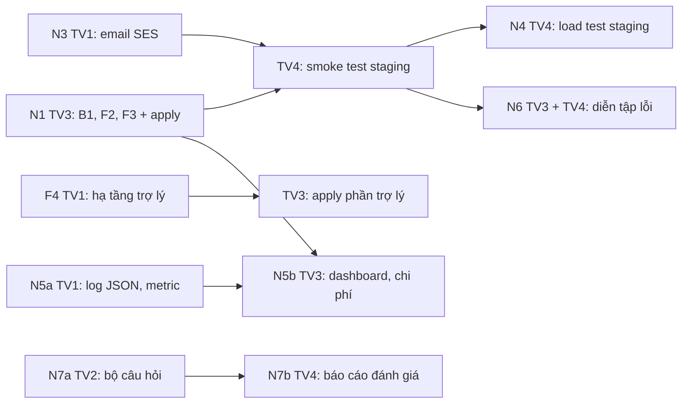

# Tuần 12 bổ sung (25/11 → 1/12): đóng các tiêu chí môn học còn thiếu

> Lập tối T4 (25/11/2026) từ [đối chiếu yêu cầu môn học](../../defense/doi-chieu-yeu-cau-mon-hoc.md) (mục 6, việc N1 → N13).
> Thư mục này **bổ sung** cho kế hoạch tuần 12 (`tuan-12/README.md` trong PR báo cáo tuần 11), không thay thế: việc tuần 12 đã giao
> vẫn giữ hạn. Báo cáo thứ 2 (30/11) chép trạng thái từ các file ở đây.

## Vì sao có thư mục này

Đối chiếu với slide yêu cầu của môn (đề tài 3 – Enterprise HR Platform) cho thấy code nghiệp vụ gần đủ, nhưng thiếu các thứ giảng
viên chấm trực tiếp:

| Tiêu chí của slide | Đang thiếu | Việc |
|---|---|---|
| Use case 6 "Employee self-service search" | Nhân viên chưa tìm được tài liệu theo từ khóa | N2 |
| Real cloud deployment, Automated deployment | Staging chưa `apply`, Deploy Staging chưa chạy lần nào | N1, N3, F4 |
| Measurable NFRs (P4 load test) | Load test chỉ ở local, NFR-2.1 chưa đạt | N4 |
| Failure handling (P4 reliability) | Chưa diễn tập lỗi có biên bản | N6 |
| Observability, SLI/SLO (P4) | Chưa có dashboard, log JSON, phiên bản ở `/health` | N5 |
| Cost awareness (P4) | Chưa có chi phí thật, chưa tính trợ lý | N5 |
| AI: evaluation, latency & token cost (P5) | Chưa có bộ câu hỏi đánh giá, chưa có báo cáo | N7 |
| Threat model (P3) | Chưa phủ kho tài liệu, trợ lý, cloud | N11 |
| CI/CD (P3) | 150 ca e2e chưa chạy trong CI | N9 |
| Functional scope trong SRS | Cột trạng thái FR lệch code | N10 |

## Quy tắc

- **TV1 xong phần của mình trong một ngày** (tới hết T5 26/11). TV1 nhận thêm F4 (Terraform và workflow cho trợ lý) và N9 (e2e trong
  CI) từ TV3, để TV3 chỉ còn hạ tầng lõi, `apply` và vận hành. Báo cáo tuần ghi đúng người viết.
- **Thành viên khác theo hạn trong file của mình**, không bị dồn vào một ngày. Hạn "Mở PR" là hạn mở PR; "Merge" là hạn được
  approve và merge.
- Mỗi việc một nhánh tách từ `dev`, một PR vào `dev`, mô tả PR ghi mã việc (N1 …) và kết quả chạy thật (lệnh, mã HTTP, ảnh).
- Review trong 24 giờ; quá 24 giờ TV1 merge, báo cáo ghi PR thiếu review (quy tắc 16/11).
- **Staging là đường găng.** TV3 `apply` chậm nhất T6 (27/11) 21:00; quá hạn thì TV1 báo giảng viên và nhóm demo, đo ở local.
- Staging tắt ngoài giờ đo và demo (`infra/README.md` mục 5.3).

## Trạng thái phần TV1 (cập nhật 25/11)

Code, test và tài liệu xong trong ngày 25/11, sớm hơn hạn T5 (26/11). Chờ review rồi merge.

| Mã | PR | Kiểm chứng | Ghi chú |
|---|---|---|---|
| N2 | [#140](https://github.com/Acerchicken/HR-Enterprise-Platform/pull/140) | e2e 152/152 | |
| N3 | [#141](https://github.com/Acerchicken/HR-Enterprise-Platform/pull/141) | unit 189/189 | Gửi SES thật cần `apply` staging (TV3); chưa có giãn cách tăng dần khi gửi email lỗi |
| N5a | [#142](https://github.com/Acerchicken/HR-Enterprise-Platform/pull/142) | unit 196/196, e2e 152/152 | Xếp chồng trên #141: merge #141 trước, dùng merge commit |
| – (T-02) | [#143](https://github.com/Acerchicken/HR-Enterprise-Platform/pull/143) | unit 185/185, e2e 151/151 | AC-8.1.12 mới |
| N9 | [#144](https://github.com/Acerchicken/HR-Enterprise-Platform/pull/144) | Chạy thử các bước trên database trống: e2e 151/151, OpenAPI khớp | |
| F4 | [#145](https://github.com/Acerchicken/HR-Enterprise-Platform/pull/145) | `terraform fmt`, `validate` qua | Xếp chồng trên #141. TV3 `plan`/`apply`, rồi `ALTER ROLE assistant_svc` |
| N12 | [#146](https://github.com/Acerchicken/HR-Enterprise-Platform/pull/146) | – | |

**Thứ tự merge:** #141 → #142, #145 (merge commit); các PR còn lại độc lập, merge thứ tự nào cũng được (đã thử gộp từng cặp, không xung đột).
Cập nhật 26/11: #139 → #147 đã merge.

### Ngày tiếp theo (26/11): ADR-15 bước 1 và bước 4

| Việc | PR | Kiểm chứng | Ghi chú |
|---|---|---|---|
| `feat/notification-service`: tách gửi email thành `services/notification`, API gắn sẵn người nhận, thử lại có giãn cách (NFR-3.5), queue `identity.sync` cho UC8 | [#148](https://github.com/Acerchicken/HR-Enterprise-Platform/pull/148) | Backend unit 194/194, e2e 154/154; service 25 test + 2 test với PostgreSQL thật (chạy cả bằng user `notification_svc`) | Chưa chạy `docker compose` (container không có Docker) |
| `infra/notification-staging` (F6): task ECS notification, queue `identity-sync`, quyền SES chuyển sang task mới | [#149](https://github.com/Acerchicken/HR-Enterprise-Platform/pull/149) | `terraform fmt`, `validate` qua | Merge cùng đợt với #148. TV3 `plan`/`apply`, rồi `ALTER ROLE notification_svc` |
| `feat/tracing-otel`: OpenTelemetry cho API, worker, notification, assistant; `traceparent` qua outbox và queue; Jaeger local | [#152](https://github.com/Acerchicken/HR-Enterprise-Platform/pull/152) | Backend unit 199/199, e2e 154/154; chạy API thật gửi trace ra OTLP: trace của request khớp `trace_context` trong outbox | X-Ray staging chưa nối (cần ADOT collector) |
| `feat/approvals-todo-counts`: số việc chờ (API `GET /me/todo-counts`) trên chuông, dải "Việc cần làm" ở trang chủ và tab trang Việc cần duyệt (AC-0.2.2, AC-0.6.1 → 0.6.4) | PR `feat/approvals-todo-counts` | Backend unit 204/204, e2e 155/155; chạy UI thật với 3 vai trò, màn hình 375 px không cuộn ngang | Tab "File hồ sơ", "Ảnh đại diện" bỏ: duyệt qua yêu cầu sửa hồ sơ |

Cập nhật 26/11 chiều: #148, #149, #150, #151, #152 đã merge vào `dev`.

## Bảng tổng hợp

| Mã | Việc | Người | Nhánh | Mở PR | Merge | Review | Chi tiết |
|---|---|---|---|---|---|---|---|
| N2 | Tìm tài liệu theo từ khóa cho nhân viên | TV1 | `feat/document-search` | T5 (26/11) | T5 (26/11) | TV2, TV4 | [TV1](TV1_Duong.md#n2) |
| N3 | Email qua SES trên staging (F1), IP thật trong audit (F5) | TV1 | `feat/mail-ses-trust-proxy` | T5 (26/11) | T5 (26/11) | TV3 | [TV1](TV1_Duong.md#n3) |
| N5a | Log JSON, phiên bản ở `/health`, metric outbox, timeout database | TV1 | `feat/observability-basics` | T5 (26/11) | T5 (26/11) | TV3 | [TV1](TV1_Duong.md#n5a) |
| F4 | Hạ tầng trợ lý trên staging (Terraform + workflow) | TV1 | `infra/assistant-staging` | T5 (26/11) | T6 (27/11) | TV3 | [TV1](TV1_Duong.md#f4) |
| N9 | 150 ca e2e chạy trong CI | TV1 | `ci/e2e` | T5 (26/11) | T5 (26/11) | TV3 | [TV1](TV1_Duong.md#n9) |
| – | Chỉ liên kết tài khoản khi `email_verified` (threat model T-02, tồn tuần 11) | TV1 | `fix/auth-email-verified` | T5 (26/11) | T5 (26/11) | TV3, TV4 | [TV1](TV1_Duong.md) |
| N12 | ADR-15 → ADR-18 "Đã chấp nhận" | TV1 | `docs/adr-status` | T5 (26/11) | T5 (26/11) | – | [TV1](TV1_Duong.md#n12) |
| N1 | Cognito, Keycloak (B1), bucket hồ sơ (F3), quyền Cognito cho worker (F2); `apply` staging; Deploy Staging | TV3 | `infra/idp-hardening`, `infra/profile-files`, rồi `apply` | T5 (26/11), 21:00 | `apply` T6 (27/11), 21:00 | TV1 | [TV3](TV3_Bao.md#n1) |
| N8 | MFA TOTP cho HR, ADMIN | TV3 | `infra/idp-mfa` | T7 (28/11), 21:00 | CN (29/11) | TV1 | [TV3](TV3_Bao.md#n8) |
| N5b | Dashboard CloudWatch, chi phí thật, sửa NFR-7.1 | TV3 | `docs/slo-dashboard-cost` | CN (29/11), 12:00 | T2 (30/11) | TV1 | [TV3](TV3_Bao.md#n5b) |
| N6 | Diễn tập lỗi trên staging | TV3 làm, TV4 ghi | `docs/test-report-failure` | T2 (30/11), 21:00 | T3 (1/12) | TV1 | [TV3](TV3_Bao.md#n6), [TV4](TV4_Duy.md#n6) |
| N4 | Load test: sửa #121, đo lại local, đo trên staging | TV4 | `test/load-k6` (#121), `docs/load-test-staging` | #121: T6 (27/11); staging: T2 (30/11), 21:00 | T3 (1/12) | TV1, TV3 | [TV4](TV4_Duy.md#n4) |
| N7a | Bộ câu hỏi đánh giá trợ lý (**đã trễ** từ T3 24/11) | TV2 | `docs/assistant-eval-set` | T5 (26/11), 21:00 | T6 (27/11) | TV1, TV4 | [TV2](TV2_Thanh.md#n7a) |
| N7b | Báo cáo đánh giá trợ lý | TV4 | `docs/assistant-eval-report` | T2 (30/11), 21:00 | T3 (1/12) | TV1, TV2 | [TV4](TV4_Duy.md#n7b) |
| N10 | Cột trạng thái FR trong SRS | TV2 | `docs/feature-status-final` | T7 (28/11), 21:00 | CN (29/11) | TV1 | [TV2](TV2_Thanh.md#n10) |
| N11 | Threat model cho kho tài liệu, trợ lý, cloud | TV2 | `docs/threat-model-uc5-uc6-cloud` | T7 (28/11), 21:00 | CN (29/11) | TV1 | [TV2](TV2_Thanh.md#n11) |
| N13 | Slide, tập bảo vệ, video demo | Cả nhóm | `docs/defense` | Tập T6 (4/12) | Bảo vệ T2 (7/12) | – | [đối chiếu mục 5, 7](../../defense/doi-chieu-yeu-cau-mon-hoc.md#5-how-projects-will-be-reviewed-câu-trả-lời-chuẩn-bị-sẵn) |

## Thứ tự phụ thuộc

## Trạng thái

Người làm cập nhật cột này khi mở PR, khi merge.

| Mã | Trạng thái | PR |
|---|---|---|
| N2, N3, N5a, F4, N9, N12, `fix/auth-email-verified` | TV1 đang làm (25–26/11) | – |
| N1 | Chưa mở PR | – |
| N4 | #121 Request changes chưa sửa | #121 |
| N7a | Chưa mở PR (trễ) | – |
| N5b, N6, N7b, N8, N10, N11, N13 | Chưa tới hạn | – |
