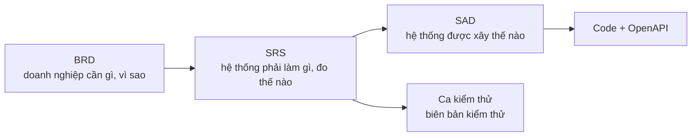

# Software Requirements Specification (SRS) – HRHelper (HR Enterprise Platform)

| Mục | Nội dung |
|---|---|
| Dự án | HRHelper – HR Enterprise Platform – môn Cloud Application Development |
| Phiên bản tài liệu | 1.2 |
| Ngày | 13/11/2026 (tuần 10) |
| Người soạn | TV1 (Dương), tách từ BRD 1.0 |
| Người review | TV2 (Thanh) nghiệp vụ, TV4 (Duy) khả năng kiểm thử |
| Trạng thái | Bản nháp, chờ review trên PR |
| Đầu vào | [BRD](../business/BRD.md) (yêu cầu nghiệp vụ) |
| Đầu ra | [Kiến trúc hệ thống](../architecture/SAD-1-system-architecture.md) · [Kiến trúc phần mềm](../architecture/SAD-2-software-architecture.md) · [API](../openapi.yaml) · [Ca kiểm thử](../business/leave-test-cases.md) |

**Lịch sử thay đổi**

| Phiên bản | Ngày | Nội dung |
|---|---|---|
| 1.2 | 13/11/2026 | Thêm tài liệu theo tính năng UC1 → UC7 trong `docs/features/`: mỗi tính năng có `requirements.md` (user story, tiêu chí chấp nhận), `spec.md` (đặc tả use case), `deploy.md`, `test.md`; link từ mục 4 |
| 1.1 | 13/11/2026 | Tách rõ FR và NFR (định nghĩa, tiêu đề mục, bảng phân biệt). Viết lại mục 6: 11 nhóm NFR, 74 yêu cầu có ngưỡng đo, cách kiểm chứng và trạng thái; bảo mật chia 5 phần (đăng nhập và phiên, phân quyền, bảo vệ dữ liệu, bảo mật ứng dụng web, secret); thêm SLI/SLO/SLA (6.13) và kịch bản lỗi (6.14) |
| 1.0 | 12/11/2026 | Tách từ BRD 1.0: yêu cầu chức năng (BRD mục 7), dữ liệu (mục 9), phi chức năng (mục 10), ma trận truy vết (mục 14). Thêm mô tả tổng quan, giao diện ngoài, phương pháp kiểm chứng và cột thiết kế trong ma trận truy vết. Nội dung yêu cầu giữ nguyên |

**Cách đọc tài liệu:** SRS có hai loại yêu cầu, tách ở hai mục riêng.

| Loại | Trả lời câu hỏi | Ví dụ | Mã | Nằm ở |
|---|---|---|---|---|
| **FR** – yêu cầu chức năng (Functional Requirement) | Hệ thống **làm gì**? | "Nhân viên tạo đơn nghỉ" | `FR-x.y`: x là số use case (UC1 → UC7), y là số thứ tự trong use case. Ví dụ FR-3.2 là yêu cầu thứ 2 của UC3 | [Mục 4](#4-yêu-cầu-chức-năng-fr) |
| **NFR** – yêu cầu phi chức năng (Non-Functional Requirement) | Hệ thống làm **tốt đến mức nào**? | "Tạo đơn phản hồi dưới 500 ms", "Khóa tài khoản sau 5 lần sai mật khẩu" | `NFR-n` là nhóm chất lượng, `NFR-n.m` là một yêu cầu trong nhóm. Ví dụ NFR-5.3 là yêu cầu thứ 3 của nhóm bảo mật | [Mục 6](#6-yêu-cầu-phi-chức-năng-nfr) |

Mã khác: `MT-n` là mục tiêu kinh doanh (trong BRD), `BR-nn` là business rule chi tiết trong
[`leave-rules.md`](../business/leave-rules.md). Cột "Trạng thái" phản ánh hệ thống trên nhánh `dev`: **Đã có** (đã chạy và có
test), **Một phần**, **Kế hoạch tuần N**. Ai merge code làm đổi trạng thái một yêu cầu thì cập nhật cột này trong cùng PR.

---

## 1. Giới thiệu

### 1.1 Mục đích

Tài liệu đặc tả **hệ thống phải làm gì và đạt chất lượng nào** để đáp ứng các mục tiêu kinh doanh trong BRD. Mỗi yêu cầu có
tiêu chí chấp nhận kiểm chứng được. Người viết code, người kiểm thử và người thiết kế kiến trúc dùng tài liệu này làm căn cứ.

### 1.2 Vị trí trong bộ tài liệu

| Tài liệu | Trả lời câu hỏi | Tương ứng chuẩn |
|---|---|---|
| [BRD](../business/BRD.md) | Bối cảnh, vấn đề, mục tiêu kinh doanh, phạm vi, stakeholder, quy trình nghiệp vụ, business rule, rủi ro, nghiệm thu | BRS / StRS – ISO/IEC/IEEE 29148 |
| **SRS (tài liệu này)** | Yêu cầu chức năng, dữ liệu, phi chức năng, giao diện ngoài, kiểm chứng, truy vết | SRS – ISO/IEC/IEEE 29148 |
| SAD: [kiến trúc hệ thống](../architecture/SAD-1-system-architecture.md) + [kiến trúc phần mềm](../architecture/SAD-2-software-architecture.md) + ADR | Khối, hạ tầng, module, pattern, quyết định kiến trúc | Architecture description – ISO/IEC/IEEE 42010 |

### 1.3 Phạm vi

Version 1 (MVP, đến tuần 13 – 7/12/2026) gồm 7 use case UC1 → UC7 trong [BRD mục 4](../business/BRD.md#4-phạm-vi). Phần ngoài
phạm vi (tính lương, chấm công, tuyển dụng, ứng dụng di động, multi-AZ…) theo BRD mục 4.2.

### 1.4 Thuật ngữ và tài liệu tham chiếu

- Thuật ngữ nghiệp vụ: [BRD mục 16](../business/BRD.md#16-thuật-ngữ).
- Business rule nghỉ phép: [`leave-rules.md`](../business/leave-rules.md); loại phép, ngày lễ:
  [`leave-types-holidays.md`](../business/leave-types-holidays.md); kho tài liệu: [`document-rules.md`](../business/document-rules.md).
- Phân quyền từng API: [ma trận phân quyền](../security/access-control-matrix.md); mối đe dọa: [threat model](../security/threat-model.md).
- Quy ước API: [`CONVENTIONS.md` mục 4](../CONVENTIONS.md#4-api).

## 2. Mô tả tổng quan

### 2.1 Bối cảnh sản phẩm

HRHelper là ứng dụng web nội bộ chạy trên cloud, thay cho Excel và email (hiện trạng ở [BRD mục 2](../business/BRD.md#2-bối-cảnh-và-vấn-đề)).
Hệ thống làm việc với các hệ thống ngoài: identity provider (đăng nhập OIDC), dịch vụ gửi email, object storage (file tài liệu),
LLM API (trợ lý, tuần 12) và hệ thống Payroll (ngoài phạm vi version 1). Sơ đồ ngữ cảnh:
[kiến trúc hệ thống mục 2](../architecture/SAD-1-system-architecture.md#2-ngữ-cảnh-hệ-thống-c4-mức-1).

### 2.2 Chức năng chính

| Use case | Hệ thống phải cho phép | Yêu cầu chức năng (FR) |
|---|---|---|
| UC1 Hồ sơ nhân viên | Xem hồ sơ theo 3 mức, tự sửa liên hệ, HR quản lý hồ sơ và trường nhạy cảm | FR-1.1 → FR-1.6 |
| UC2 Thông tin tổ chức | Danh bạ, cây tổ chức, quản lý trực tiếp, quản lý phòng ban | FR-2.1 → FR-2.5 |
| UC3 Tạo đơn nghỉ | Xem số dư, tạo, hủy đơn, tạo đơn hộ | FR-3.1 → FR-3.7 |
| UC4 Duyệt đơn | Duyệt, từ chối, duyệt thay, HR hoàn tất, email thông báo | FR-4.1 → FR-4.7 |
| UC5 Kho tài liệu | Đăng tài liệu theo phạm vi xem, phiên bản | FR-5.1 → FR-5.3 |
| UC6 Tự tra cứu | Tìm đồng nghiệp, tìm tài liệu, trợ lý chính sách | FR-6.1 → FR-6.3 |
| UC7 Lịch sử thao tác | Audit append-only, tra cứu audit | FR-7.1 → FR-7.3 |

### 2.3 Lớp người dùng

| Vai trò | Cách có vai trò | Dữ liệu được xem |
|---|---|---|
| EMPLOYEE | Mọi tài khoản đăng nhập có hồ sơ | Dữ liệu của mình + danh bạ |
| MANAGER | Suy ra từ sơ đồ tổ chức: có ít nhất một cấp dưới đang làm việc (ADR-10) | Thêm thông tin cá nhân của cấp dưới trực tiếp, không có trường nhạy cảm |
| HR | Gán rõ ràng | Toàn bộ hồ sơ, kể cả trường nhạy cảm (mỗi lần xem ghi audit) |
| ADMIN | Gán rõ ràng | Tài khoản, phòng ban, audit; không xem hồ sơ cá nhân hay trường nhạy cảm của người khác |

Số lượng từng vai trò và nhu cầu: [BRD mục 5](../business/BRD.md#5-stakeholder-và-người-dùng).

### 2.4 Ràng buộc thiết kế

- Dùng dịch vụ managed cho database, lưu file, đăng nhập (ADR-00).
- Modular monolith, không microservices, không Kubernetes (ADR-01, ADR-06).
- Database quan hệ PostgreSQL (ADR-02); thông báo và xử lý nền đi qua outbox + queue (ADR-03).
- Trường nhạy cảm mã hóa ở tầng ứng dụng (ADR-08); audit chỉ thêm, khóa ở database (ADR-09).
- Version 1 chỉ dùng dữ liệu giả lập; dữ liệu cá nhân tuân thủ quy định bảo vệ dữ liệu cá nhân của Việt Nam ([BRD mục 11](../business/BRD.md#11-giả-định-ràng-buộc-phụ-thuộc)).

### 2.5 Giả định và phụ thuộc

Theo [BRD mục 11](../business/BRD.md#11-giả-định-ràng-buộc-phụ-thuộc). Giả định ảnh hưởng trực tiếp tới yêu cầu: mỗi nhân viên
có email công ty duy nhất (dùng để khớp tài khoản đăng nhập với hồ sơ); quy mô 2.000 nhân viên là căn cứ của NFR-1, NFR-2.

## 3. Yêu cầu giao diện ngoài

### 3.1 Giao diện người dùng

Ứng dụng web một trang (SPA) chạy trên trình duyệt, đăng nhập qua trang của identity provider. Mỗi vai trò chỉ thấy chức năng
mình được dùng; chức năng bị chặn ở giao diện vẫn phải bị chặn ở API (phân quyền hai lớp, [`CONVENTIONS.md` mục 4](../CONVENTIONS.md#4-api)).

### 3.2 Giao diện phần mềm

| Hệ thống ngoài | Giao thức | Đồng bộ? | Yêu cầu khi lỗi |
|---|---|---|---|
| Identity provider | OIDC; API kiểm chữ ký token bằng JWKS | Đồng bộ | Không đăng nhập mới được; token còn hạn vẫn dùng |
| Dịch vụ email | Queue → worker → SMTP | Bất đồng bộ | Gửi lại, không gửi trùng; trạng thái đơn không đổi (FR-4.6) |
| Object storage | Presigned URL tải lên/tải xuống | Tải lên đồng bộ | File không đi qua API (FR-5.1) |
| LLM API | REST có timeout | Đồng bộ | Hết thời gian thì chỉ tới tài liệu gốc (FR-6.3) |

Chi tiết cách tích hợp: [kiến trúc hệ thống mục 2](../architecture/SAD-1-system-architecture.md#2-ngữ-cảnh-hệ-thống-c4-mức-1).

### 3.3 API

- REST, tiền tố `/api/v1`; đổi không tương thích thì lên `/v2`.
- Lỗi luôn có dạng `{ code, message, traceId }`; mã HTTP 400, 403, 404, 409 theo [`CONVENTIONS.md` mục 4](../CONVENTIONS.md#4-api).
- Danh sách luôn phân trang `?page=&size=` (tối đa 100).
- Hợp đồng chi tiết: [`openapi.yaml`](../openapi.yaml), sinh từ code bằng `npm run openapi`.

## 4. Yêu cầu chức năng (FR)

> **FR (Functional Requirement)** trả lời câu hỏi "hệ thống phải **làm gì**": một hành động người dùng thực hiện được hoặc
> một xử lý hệ thống phải làm. Mỗi FR thuộc đúng một use case và có tiêu chí chấp nhận để viết ca kiểm thử.
> Yêu cầu về tốc độ, bảo mật, sẵn sàng… không nằm ở đây mà ở [mục 6 (NFR)](#6-yêu-cầu-phi-chức-năng-nfr).

**Tài liệu theo từng tính năng** (tiêu chí chấp nhận, đặc tả use case, cách triển khai, cách kiểm thử):
[`docs/features/`](../features/README.md). Bảng FR dưới đây là nguồn chính về yêu cầu; đặc tả mô tả yêu cầu diễn ra thế nào.

Mã `FR-x.y`: x là số use case, y là số thứ tự. Mức ưu tiên theo MoSCoW: **M** (bắt buộc), **S** (nên có), **C** (có thể có).

### 4.1 UC1 – Hồ sơ nhân viên (FR-1.x)

Đặc tả: [features/UC1-employee-profile/spec.md](../features/UC1-employee-profile/spec.md) (yêu cầu kèm tiêu chí: [requirements.md](../features/UC1-employee-profile/requirements.md)).

| Mã | Yêu cầu | Ưu tiên | Tiêu chí chấp nhận | Trạng thái |
|---|---|---|---|---|
| FR-1.1 | Xem hồ sơ theo 3 mức: danh bạ (mọi người), cá nhân (chính mình, quản lý trực tiếp), đầy đủ (HR) | M | Người ngoài không thấy ngày sinh, địa chỉ; quản lý thấy thông tin cá nhân cấp dưới; ADMIN chỉ thấy mức danh bạ | Đã có |
| FR-1.2 | Nhân viên tự sửa số điện thoại, địa chỉ của mình | M | Sửa trường khác hoặc hồ sơ người khác bị từ chối (403) | Đã có |
| FR-1.3 | HR xem CCCD, số tài khoản, lương; mỗi lượt xem ghi audit | M | Vai trò khác bị 403; audit có `VIEW_SENSITIVE` | Đã có |
| FR-1.4 | HR sửa mọi trường hồ sơ, kể cả trường nhạy cảm | M | Audit chỉ ghi tên trường nhạy cảm, không ghi giá trị | Một phần: API có, giao diện tuần 10 |
| FR-1.5 | HR tạo nhân viên mới (phòng ban, chức danh, quản lý trực tiếp, trường nhạy cảm) | M | Thiếu dữ liệu bắt buộc trả 400; quản lý tạo vòng lặp bị chặn | Một phần: API có, giao diện tuần 10 |
| FR-1.6 | Hai người cùng sửa một hồ sơ không ghi đè nhau | S | Gửi `version` cũ trả 409 | Đã có |

### 4.2 UC2 – Thông tin tổ chức (FR-2.x)

Đặc tả: [features/UC2-organization/spec.md](../features/UC2-organization/spec.md) (yêu cầu kèm tiêu chí: [requirements.md](../features/UC2-organization/requirements.md)).

| Mã | Yêu cầu | Ưu tiên | Tiêu chí chấp nhận | Trạng thái |
|---|---|---|---|---|
| FR-2.1 | Danh bạ: tìm theo tên, email, mã; lọc phòng ban; phân trang | M | Không hiện nhân viên đã nghỉ việc; tối đa 100 dòng/trang | Đã có |
| FR-2.2 | Xem toàn bộ cây tổ chức và thành viên từng phòng ban | M | Cây có một gốc; quyết định issue #21: không cần nhập mã phòng ban | Đã có |
| FR-2.3 | Xem quản lý trực tiếp và nhân viên trực thuộc của một người | M | Danh sách cấp dưới đúng với dữ liệu | Đã có |
| FR-2.4 | HR, ADMIN tạo và sửa phòng ban | S | Đổi phòng ban cha không được tạo vòng | Một phần: API có |
| FR-2.5 | Mỗi nhân viên có đúng một quản lý trực tiếp, trừ CEO | M | Tạo/sửa nhân viên thiếu quản lý (không phải CEO) bị từ chối (issue #22) | Đã có (tuần 10) |

### 4.3 UC3 – Tạo đơn nghỉ (FR-3.x)

Đặc tả: [features/UC3-create-leave-request/spec.md](../features/UC3-create-leave-request/spec.md) (yêu cầu kèm tiêu chí: [requirements.md](../features/UC3-create-leave-request/requirements.md)).

| Mã | Yêu cầu | Ưu tiên | Tiêu chí chấp nhận | Trạng thái |
|---|---|---|---|---|
| FR-3.1 | Xem số dư phép theo loại: được hưởng, đã dùng, đang chờ, còn lại | M | Còn lại = được hưởng − đã dùng − đang chờ | Đã có |
| FR-3.2 | Tạo đơn: loại phép, khoảng ngày, nghỉ nửa ngày, lý do | M | Không đủ số dư trả 400 (BR-01) | Đã có |
| FR-3.3 | Không cho đơn trùng lịch với đơn đang chờ hoặc đã duyệt | M | Trùng ngày trả 409; hai nửa ngày khác buổi không trùng (BR-02, BR-04) | Đã có |
| FR-3.4 | Số ngày tính theo ngày làm việc, bỏ cuối tuần và ngày lễ | M | 29/4–4/5/2026 tính 2 ngày; đơn chỉ gồm ngày nghỉ bù 27/4 bị từ chối (BR-03) | Đã có |
| FR-3.5 | Gửi lại do mạng lỗi không tạo đơn thứ hai | M | Cùng `Idempotency-Key` trả lại đơn cũ (BR-11) | Đã có |
| FR-3.6 | Nhân viên hủy đơn chưa có quyết định; không tự hủy đơn đã duyệt | M | Hủy trả lại số ngày; hủy đơn đã duyệt trả 409 (BR-07, BR-08) | Đã có |
| FR-3.7 | HR và quản lý trực tiếp tạo đơn hộ nhân viên | S | Số dư là của nhân viên; nhân viên nhận email, vẫn tự hủy được; lịch sử ghi người tạo hộ (BR-12) | Kế hoạch tuần 10 |

### 4.4 UC4 – Duyệt đơn (FR-4.x)

Đặc tả: [features/UC4-approve-leave-request/spec.md](../features/UC4-approve-leave-request/spec.md) (yêu cầu kèm tiêu chí: [requirements.md](../features/UC4-approve-leave-request/requirements.md)).

| Mã | Yêu cầu | Ưu tiên | Tiêu chí chấp nhận | Trạng thái |
|---|---|---|---|---|
| FR-4.1 | Quản lý xem danh sách đơn chờ duyệt của cấp dưới trực tiếp | M | Không thấy đơn của người không trực thuộc | Đã có |
| FR-4.2 | Duyệt hoặc từ chối kèm ghi chú; chỉ quản lý trực tiếp tại thời điểm xử lý | M | Người khác trả 403; duyệt lại lần hai không đổi gì; quyết định ngược lại trả 409 (BR-05, BR-09, BR-11) | Đã có |
| FR-4.3 | Người duyệt thay khi quản lý vắng mặt, do HR chỉ định theo khoảng ngày | S | Người thay thấy và xử lý đơn trong thời hạn được giao (BR-06) | Kế hoạch tuần 10 |
| FR-4.4 | HR duyệt đơn của CEO (người duy nhất không có quản lý) | S | Chỉ áp dụng cho đơn của CEO (issue #22) | Đã có (tuần 10) |
| FR-4.5 | HR hoàn tất đơn đã duyệt | M | Số ngày giữ chỗ chuyển thành đã dùng; đơn chưa duyệt trả 409 (BR-10) | Đã có |
| FR-4.6 | Email thông báo: đơn mới → quản lý; duyệt, từ chối, hoàn tất → nhân viên; hủy → quản lý | M | Email tới đúng người; không gửi trùng khi hệ thống gửi lại event | Đã có |
| FR-4.7 | Xem chi tiết đơn và lịch sử trạng thái | M | Chỉ chủ đơn, quản lý trực tiếp, HR xem được | Đã có |

### 4.5 UC5 – Kho tài liệu chính sách (FR-5.x)

Đặc tả: [features/UC5-document-repository/spec.md](../features/UC5-document-repository/spec.md) (yêu cầu kèm tiêu chí: [requirements.md](../features/UC5-document-repository/requirements.md)).

| Mã | Yêu cầu | Ưu tiên | Tiêu chí chấp nhận | Trạng thái |
|---|---|---|---|---|
| FR-5.1 | HR tải lên tài liệu PDF/DOCX kèm tiêu đề, loại, phạm vi xem (toàn công ty, phòng ban, vai trò) | M | Chỉ HR tải lên được; file không đi qua API mà tải thẳng lên object storage | Kế hoạch tuần 10 |
| FR-5.2 | Nhân viên chỉ xem, tải tài liệu thuộc phạm vi của mình | M | Tài liệu ngoài phạm vi không hiện trong danh sách và link tải bị từ chối | Kế hoạch tuần 10 |
| FR-5.3 | Tài liệu có phiên bản; mặc định hiện phiên bản mới nhất | S | Đăng bản mới không mất bản cũ | Kế hoạch tuần 10 |

### 4.6 UC6 – Tự tra cứu (FR-6.x)

Đặc tả: [features/UC6-self-service-search/spec.md](../features/UC6-self-service-search/spec.md) (yêu cầu kèm tiêu chí: [requirements.md](../features/UC6-self-service-search/requirements.md)).

| Mã | Yêu cầu | Ưu tiên | Tiêu chí chấp nhận | Trạng thái |
|---|---|---|---|---|
| FR-6.1 | Tìm đồng nghiệp | M | Như FR-2.1 | Đã có |
| FR-6.2 | Tìm tài liệu theo từ khóa trong tiêu đề và nội dung, lọc theo quyền | M | Không trả tài liệu ngoài phạm vi | Kế hoạch tuần 10 |
| FR-6.3 | Trợ lý trả lời câu hỏi về chính sách HR, có trích dẫn tài liệu nguồn | C | Chỉ dùng tài liệu người hỏi được xem; không trả lời được thì chỉ tới tài liệu gốc | Kế hoạch tuần 12 |

### 4.7 UC7 – Lịch sử thao tác (FR-7.x)

Đặc tả: [features/UC7-audit-log/spec.md](../features/UC7-audit-log/spec.md) (yêu cầu kèm tiêu chí: [requirements.md](../features/UC7-audit-log/requirements.md)).

| Mã | Yêu cầu | Ưu tiên | Tiêu chí chấp nhận | Trạng thái |
|---|---|---|---|---|
| FR-7.1 | Ghi audit cho tạo/sửa hồ sơ, đọc trường nhạy cảm, mọi bước của đơn nghỉ | M | Audit ghi cùng giao dịch với thao tác; không ghi giá trị nhạy cảm | Đã có |
| FR-7.2 | Audit chỉ được thêm, không ai sửa/xóa | M | Lệnh UPDATE/DELETE trên bảng audit bị database chặn | Đã có |
| FR-7.3 | HR, ADMIN tra cứu audit theo đối tượng, người thực hiện, khoảng thời gian | M | Vai trò khác trả 403 | Một phần: API có, giao diện tuần 10 |

**Tổng hợp FR:** 34 yêu cầu chức năng; 23 đã có, 4 một phần (API có, chưa có giao diện), 7 theo kế hoạch tuần 10–12 (cập nhật 10/11).

## 5. Yêu cầu dữ liệu

### 5.1 Dữ liệu chính

| Nhóm dữ liệu | Nội dung | Phân loại |
|---|---|---|
| Hồ sơ nhân viên | Mã, họ tên, email công ty, điện thoại, ngày sinh, địa chỉ, phòng ban, chức danh, quản lý, ngày vào làm, trạng thái | Cá nhân |
| Trường nhạy cảm | CCCD, số tài khoản ngân hàng, lương | **Nhạy cảm:** mã hóa ở tầng ứng dụng, chỉ HR, đọc là ghi audit (ADR-08) |
| Tổ chức | Phòng ban (cây), chức danh, trưởng đơn vị | Nội bộ |
| Nghỉ phép | Loại phép, số dư theo năm, đơn, lịch sử trạng thái, ngày lễ | Cá nhân (đơn nghỉ ốm, thai sản cần hạn chế người xem) |
| Tài liệu | Metadata, file, phạm vi xem, phiên bản | Nội bộ |
| Audit | Ai, làm gì, trên đối tượng nào, lúc nào, trường nào đổi | Nhạy cảm (chỉ HR, ADMIN) |

Mô hình dữ liệu chi tiết: [data model tuần 6](../progress/tuan-06/TV2_Thanh.md#2-data-model--data-ownership).

### 5.2 Quy mô (ước tính tuần 5, dùng cho NFR-1, NFR-2)

| Dữ liệu | Khối lượng |
|---|---|
| Đơn nghỉ phép | ~100 đơn/ngày (~25.000 đơn/năm) |
| Audit log | ~1,25 triệu bản ghi/năm |
| Tài liệu | ~500 file, ~2 GB |
| Lưu lượng | trung bình ≈ 0,5 request/giây, cao điểm ≈ 10, thiết kế cho 50 |

Cách tính lưu lượng ([tuần 5](../progress/tuan-05/TV4_Duy.md)): giả định ~40.000 request/ngày → 40.000 ÷ 86.400 ≈ 0,5
request/giây; cao điểm (8:00–9:00, đầu tháng) gấp 20 lần ≈ 10 request/giây; thiết kế gấp 5 lần cao điểm = 50 request/giây.
Đây là **ước tính**, chưa phải số đo thực tế; khi có staging, đo lại bằng metric request/giây (NFR-8.2) và cập nhật bảng này.

## 6. Yêu cầu phi chức năng (NFR)

> **NFR (Non-Functional Requirement)** trả lời câu hỏi "hệ thống phải **tốt đến mức nào**": nhanh bao nhiêu, chịu bao nhiêu
> người, sập thì sao, bảo mật ra sao. NFR không gắn với một use case mà áp dụng cho toàn hệ thống.
> Mỗi NFR phải có **ngưỡng đo được** và **cách kiểm chứng**.

**Cách đánh mã:**
- `NFR-n` là nhóm chất lượng, phân theo ISO/IEC 25010. Mã nhóm giữ như bản 1.0 để link từ BRD, SAD và threat model không gãy.
- `NFR-n.m` là một yêu cầu cụ thể trong nhóm, dùng khi viết test và khi review.

**Trạng thái:** **Đã có** (code hoặc cấu hình đã có trên `dev`), **Một phần**, **Chưa có**, **Kế hoạch tuần N**. Riêng
NFR-1, NFR-2, NFR-3 chỉ chuyển sang "Đã có" khi đã có kết quả load test.

### 6.1 Tổng hợp các nhóm NFR

| Nhóm | Tên | Câu hỏi trả lời | Số yêu cầu |
|---|---|---|---|
| NFR-1 | Hiệu năng | Nhanh đến đâu? | 6 |
| NFR-2 | Khả năng mở rộng và dung lượng | Chịu bao nhiêu người, bao nhiêu dữ liệu? | 4 |
| NFR-3 | Sẵn sàng và chịu lỗi | Một phần hỏng thì hệ thống còn chạy không? | 6 |
| NFR-4 | Sao lưu và phục hồi | Mất dữ liệu thì lấy lại thế nào, mất tối đa bao nhiêu? | 5 |
| NFR-5 | Bảo mật | Ai được vào, được làm gì, dữ liệu được bảo vệ thế nào? | 27 |
| NFR-6 | Truy vết (audit) | Ai đã làm gì, lúc nào? | 4 |
| NFR-7 | Chi phí | Tốn bao nhiêu tiền mỗi tháng? | 3 |
| NFR-8 | Vận hành và quan sát | Biết hệ thống đang khỏe hay không bằng cách nào? | 5 |
| NFR-9 | Bảo trì và kiểm thử | Sửa, thêm tính năng có dễ và an toàn không? | 5 |
| NFR-10 | Khả dụng và tương thích | Người dùng có dễ dùng, dùng trên thiết bị nào? | 5 |
| NFR-11 | Tuân thủ và quyền riêng tư | Có đúng quy định về dữ liệu cá nhân không? | 4 |

Ba nhóm NFR-1, NFR-3, NFR-4 được gom thành mục tiêu dịch vụ (SLI, SLO, SLA) ở mục 6.13. Cách hệ thống chịu từng loại lỗi
nằm ở mục 6.14.

### 6.2 NFR-1 – Hiệu năng

Điều kiện đo chung: tải 50 request/giây, dữ liệu seed 2.000 nhân viên, đo ở phía load balancer, không tính lần gọi đầu tiên
khi instance vừa khởi động.

| Mã | Yêu cầu | Ngưỡng | Kiểm chứng | Trạng thái |
|---|---|---|---|---|
| NFR-1.1 | Thời gian phản hồi API đọc (hồ sơ, danh bạ, số dư, danh sách đơn) | p95 < 300 ms, p99 < 1 s | Load test tuần 11 | Kế hoạch tuần 11 |
| NFR-1.2 | Thời gian phản hồi API ghi (tạo, duyệt, hủy đơn; sửa hồ sơ) | p95 < 500 ms, p99 < 1,5 s | Load test tuần 11 | Kế hoạch tuần 11 |
| NFR-1.3 | Tìm kiếm đồng nghiệp và tài liệu | p95 < 1 s với 2.000 nhân viên, 500 tài liệu | Load test tuần 11 | Kế hoạch tuần 11 |
| NFR-1.4 | Email thông báo tới hộp thư sau khi đơn đổi trạng thái | p95 < 1 phút | Đo thời gian giữa audit và email trong load test | Một phần: luồng đã chạy, chưa đo |
| NFR-1.5 | Trang web hiển thị lần đầu | < 3 s trên mạng 4G (Largest Contentful Paint) | Lighthouse trên staging | Chưa có |
| NFR-1.6 | Danh sách luôn phân trang để không trả dữ liệu quá lớn | Tối đa 100 dòng mỗi trang | e2e test | Đã có |

### 6.3 NFR-2 – Khả năng mở rộng và dung lượng

| Mã | Yêu cầu | Ngưỡng | Kiểm chứng | Trạng thái |
|---|---|---|---|---|
| NFR-2.1 | Chịu tải thiết kế liên tục | 50 request/giây trong 15 phút, khoảng 500 người dùng đồng thời, tỉ lệ lỗi < 0,1% | Load test tuần 11 | Kế hoạch tuần 11 |
| NFR-2.2 | Tăng 5 lần (10.000 nhân viên, 250 request/giây) chỉ bằng thêm instance hoặc nâng cấp database, không đổi kiến trúc | Đạt NFR-1.1, NFR-1.2 khi đã tăng tài nguyên | Load test với seed 10.000 nhân viên; review kiến trúc | Kế hoạch tuần 11 |
| NFR-2.3 | API không giữ trạng thái phiên trong bộ nhớ, để thêm hoặc bớt instance không làm người dùng mất phiên | Mọi request tự mang JWT | Review code; tắt 1 instance trong load test | Đã có |
| NFR-2.4 | Dữ liệu tích lũy không làm chậm truy vấn | Tra cứu audit theo đối tượng hoặc khoảng thời gian p95 < 1 s với 3 năm dữ liệu (~3,75 triệu bản ghi) | Seed audit giả lập rồi đo | Chưa có |

### 6.4 NFR-3 – Sẵn sàng và chịu lỗi

| Mã | Yêu cầu | Ngưỡng | Kiểm chứng | Trạng thái |
|---|---|---|---|---|
| NFR-3.1 | Tỉ lệ sẵn sàng hằng tháng | ≥ 99,5% (tối đa khoảng 3,6 giờ dừng mỗi tháng), đo theo SLI ở mục 6.13 | Metric của load balancer | Kế hoạch tuần 12 |
| NFR-3.2 | Không có điểm hỏng đơn lẻ ở tầng API | Tối thiểu 2 instance; mất 1 instance thì tỉ lệ lỗi < 1% và tự thay instance mới trong < 5 phút | Tắt 1 instance trong load test (ADR-06) | Kế hoạch tuần 11 |
| NFR-3.3 | Phát hành phiên bản mới không dừng dịch vụ | Lỗi 5xx < 1% trong lúc deploy; migration tương thích ngược; quay về image trước trong < 15 phút | Deploy giữa load test; thử rollback | Một phần: pipeline có bước gắn tag image để rollback |
| NFR-3.4 | Lỗi của queue, email, LLM không làm hỏng nghiệp vụ chính | Tạo, duyệt, hủy đơn vẫn chạy; email gửi bù khi dịch vụ hoạt động lại | Tắt queue rồi tạo đơn | Đã có: outbox + queue (ADR-03) |
| NFR-3.5 | Gọi hệ thống ngoài có giới hạn thời gian và thử lại | Timeout ≤ 10 s; thử lại tối đa 3 lần, giãn cách tăng dần; hết lượt thì vào DLQ | Unit test; tắt SMTP trong test | Một phần: có DLQ, chưa có giãn cách tăng dần |
| NFR-3.6 | Load balancer biết instance nào hỏng | `GET /api/v1/health` trả 200 khi API và database sẵn sàng, không cần đăng nhập | e2e test | Đã có |

### 6.5 NFR-4 – Sao lưu và phục hồi

| Mã | Yêu cầu | Ngưỡng | Kiểm chứng | Trạng thái |
|---|---|---|---|---|
| NFR-4.1 | Mất dữ liệu tối đa (RPO) | ≤ 1 giờ: backup tự động mỗi ngày và khôi phục theo thời điểm | Cấu hình database managed | Một phần: Terraform đặt backup 7 ngày, chưa apply |
| NFR-4.2 | Thời gian khôi phục (RTO) | ≤ 4 giờ từ lúc phát hiện tới lúc dùng lại được | Diễn tập khôi phục database về một thời điểm, có ghi lại thời gian | Kế hoạch tuần 12 |
| NFR-4.3 | Không mất đơn đã được hệ thống nhận | Đơn và event outbox ghi trong cùng giao dịch trước khi trả 201 | e2e test; tắt queue khi tạo đơn | Đã có |
| NFR-4.4 | Giữ và bảo vệ bản sao lưu | Giữ 7 ngày; mã hóa; người có quyền xóa database không tự xóa được backup | Review cấu hình | Một phần |
| NFR-4.5 | Message không mất khi worker dừng | Queue giữ 4 ngày, DLQ giữ 14 ngày | Review cấu hình | Một phần: Terraform đã khai báo, chưa apply |

### 6.6 NFR-5 – Bảo mật

Mối đe dọa đứng sau từng yêu cầu: [threat model](../security/threat-model.md) (mã T-nn). Phân quyền từng API:
[ma trận phân quyền](../security/access-control-matrix.md). Ca kiểm thử: [ca kiểm thử bảo mật](../business/security-test-cases.md).
Căn cứ tham khảo: OWASP ASVS 4.0 (mức 2) và NIST SP 800-63B cho phần mật khẩu.

**a) Đăng nhập và phiên làm việc**

| Mã | Yêu cầu | Ngưỡng | Kiểm chứng | Trạng thái |
|---|---|---|---|---|
| NFR-5.1 | Chỉ đăng nhập qua identity provider (OIDC, Authorization Code + PKCE S256); ứng dụng không nhận, không lưu mật khẩu | Không API nào nhận mật khẩu | Review code; e2e | Đã có (Keycloak local, Cognito staging) |
| NFR-5.2 | Chính sách mật khẩu | Tối thiểu 8 ký tự, có chữ hoa, chữ thường và số; không trùng email; không bắt đổi định kỳ (theo NIST SP 800-63B) | Thử đặt mật khẩu yếu | Một phần: Cognito chưa bắt chữ hoa, Keycloak chưa đặt chính sách. Sửa tuần 10 (`infra/idp-hardening`) |
| NFR-5.3 | Chống dò mật khẩu | Sai 5 lần liên tiếp trong 15 phút thì khóa tạm tài khoản 15 phút; thông báo lỗi không cho biết sai email hay sai mật khẩu | Thử sai 6 lần | Một phần: Keycloak bật chống dò nhưng chưa đặt ngưỡng 5 lần. Sửa tuần 10 (`infra/idp-hardening`) |
| NFR-5.4 | Xác thực hai lớp (MFA) cho tài khoản đặc quyền | Bắt buộc với HR và ADMIN (ứng dụng TOTP); nhân viên tự chọn | Đăng nhập bằng tài khoản HR | Kế hoạch tuần 11 (`infra/idp-mfa`) |
| NFR-5.5 | Thời hạn phiên | Access token ≤ 15 phút; phiên hết sau 30 phút không thao tác; tối đa 10 giờ thì phải đăng nhập lại; token tự gia hạn khi đang dùng | Review cấu hình IdP | Một phần: Keycloak đúng 15 và 30 phút; Cognito đang để mặc định. Sửa tuần 10 (`infra/idp-hardening`) |
| NFR-5.6 | Đăng xuất | Kết thúc phiên ở identity provider và xóa token ở trình duyệt | Đăng xuất rồi bấm Back | Đã có |
| NFR-5.7 | Giữ token an toàn ở trình duyệt | Token chỉ trong `sessionStorage` (đóng tab là mất), không trong `localStorage`, URL hay log | Review code | Đã có |
| NFR-5.8 | API kiểm token ở mọi request | Kiểm chữ ký (JWKS), issuer, hạn dùng, client (`azp`/`aud`); sai thì 401 | e2e test token giả, token hết hạn | Đã có |
| NFR-5.9 | Không tự đăng ký tài khoản | Tài khoản do HR hoặc ADMIN tạo; chỉ liên kết tài khoản với hồ sơ khi email đã xác minh (T-02) | Thử đăng ký trên trang đăng nhập | Một phần: Keycloak đã tắt, Cognito còn cho tự đăng ký. Sửa tuần 10 (`infra/idp-hardening`) |
| NFR-5.10 | Ghi nhận đăng nhập | Lưu đăng nhập thành công, thất bại, bị khóa và mọi lần cấp, thu hồi vai trò HR, ADMIN (T-03, T-06) | Xem event của IdP và audit | Chưa có |

**b) Phân quyền**

| Mã | Yêu cầu | Ngưỡng | Kiểm chứng | Trạng thái |
|---|---|---|---|---|
| NFR-5.11 | Mặc định từ chối: mọi API cần đăng nhập, trừ health check | Không có endpoint nghiệp vụ nào mở công khai | e2e quét toàn bộ route | Đã có |
| NFR-5.12 | Phân quyền theo vai trò (RBAC) ở API, không chỉ ẩn nút ở giao diện | Đúng 100% ô của ma trận phân quyền | Ca kiểm thử bảo mật | Đã có |
| NFR-5.13 | Phân quyền theo dữ liệu | Nhân viên chỉ xem dữ liệu của mình; quản lý chỉ cấp dưới trực tiếp; ADMIN không xem hồ sơ cá nhân | e2e test | Đã có |
| NFR-5.14 | Quyền tối thiểu cho thành phần hệ thống | API và worker mỗi bên một IAM role riêng; tài khoản database của ứng dụng không sửa, xóa được bảng audit | Review Terraform và quyền database | Một phần |

**c) Bảo vệ dữ liệu**

| Mã | Yêu cầu | Ngưỡng | Kiểm chứng | Trạng thái |
|---|---|---|---|---|
| NFR-5.15 | Mã hóa khi truyền | TLS 1.2 trở lên cho trình duyệt → hệ thống, API → database, worker → SMTP; bật HSTS | Kiểm tra bằng trình duyệt và SSL Labs trên staging | Một phần: staging có HTTPS; local dùng HTTP |
| NFR-5.16 | Mã hóa khi lưu | Database, object storage, backup, queue mã hóa bằng khóa KMS | Review Terraform | Một phần: đã khai báo, chưa apply |
| NFR-5.17 | Mã hóa trường nhạy cảm ở tầng ứng dụng | CCCD, số tài khoản, lương dùng AES-256-GCM; khóa trong secret manager, có quy trình xoay khóa (ADR-08) | Đọc thẳng bảng trong database thấy dữ liệu đã mã hóa | Một phần: mã hóa đã có, khóa ở local còn giá trị mặc định |
| NFR-5.18 | Không lộ dữ liệu nhạy cảm qua kênh phụ | Không ghi giá trị nhạy cảm, token vào log, audit, email; email không nêu loại phép ốm, thai sản (T-16) | Review log, email mẫu | Một phần |
| NFR-5.19 | Link tải tài liệu an toàn | Presigned URL hết hạn ≤ 5 phút; bucket chặn truy cập public | Thử dùng lại link sau 5 phút | Kế hoạch tuần 10 |

**d) Bảo mật ứng dụng web**

| Mã | Yêu cầu | Ngưỡng | Kiểm chứng | Trạng thái |
|---|---|---|---|---|
| NFR-5.20 | Kiểm tra đầu vào ở server | Từ chối trường không khai báo; truy vấn database tham số hóa qua ORM, không ghép chuỗi SQL | e2e gửi trường lạ; review code | Đã có |
| NFR-5.21 | Giới hạn tần suất gọi (chống lạm dụng, T-05, T-11) | 100 request/phút cho mỗi người dùng, 20 request/phút cho tìm kiếm; vượt thì 429 | Load test vượt ngưỡng | Kế hoạch tuần 11 (`feat/security-headers-ratelimit`) |
| NFR-5.22 | Header bảo mật và CORS | CSP, HSTS, `X-Content-Type-Options: nosniff`, chặn nhúng iframe; CORS chỉ cho domain web | Quét header trên staging | Một phần: CORS đã có, header bảo mật làm tuần 11 (`feat/security-headers-ratelimit`) |
| NFR-5.23 | Kiểm soát file tải lên | Chỉ PDF, DOCX; tối đa 20 MB; kiểm loại file theo nội dung, không chỉ theo đuôi | Thử tải file `.exe` đổi đuôi | Kế hoạch tuần 10 |
| NFR-5.24 | Thông báo lỗi không lộ thông tin nội bộ | Chỉ trả `{ code, message, traceId }`, không trả stack trace hay câu SQL | e2e test lỗi 500 | Đã có |

**e) Secret và chuỗi cung ứng phần mềm**

| Mã | Yêu cầu | Ngưỡng | Kiểm chứng | Trạng thái |
|---|---|---|---|---|
| NFR-5.25 | Không có secret trong code hay image | Lấy từ secret manager lúc khởi động; thiếu secret thì không khởi động | Quét repo; review Terraform | Một phần: local còn khóa mặc định |
| NFR-5.26 | Quét lỗ hổng trước khi phát hành | CI quét image bằng Trivy, có lỗ hổng mức CRITICAL thì dừng build | Xem lịch sử CI | Đã có |
| NFR-5.27 | CI không giữ khóa truy cập lâu dài | GitHub Actions vào AWS bằng OIDC, quyền tạm thời | Review workflow | Đã có |

### 6.7 NFR-6 – Truy vết (audit)

| Mã | Yêu cầu | Ngưỡng | Kiểm chứng | Trạng thái |
|---|---|---|---|---|
| NFR-6.1 | Có audit cho thao tác quan trọng | 100% thao tác ghi hồ sơ, đọc trường nhạy cảm, mọi bước của đơn nghỉ; ghi ai, làm gì, đối tượng nào, lúc nào, traceId | e2e test | Đã có |
| NFR-6.2 | Audit không sửa, không xóa được | Database chặn UPDATE, DELETE trên bảng audit (ADR-09) | e2e test | Đã có |
| NFR-6.3 | Thời gian lưu audit | Tối thiểu 2 năm (đề xuất, chờ chốt ở mục 8) | Review chính sách lưu trữ | Chưa có |
| NFR-6.4 | Mỗi request có mã truy vết | Header `X-Trace-Id` trả về client và có trong mọi dòng log của request | e2e test | Đã có |

### 6.8 NFR-7 – Chi phí

| Mã | Yêu cầu | Ngưỡng | Kiểm chứng | Trạng thái |
|---|---|---|---|---|
| NFR-7.1 | Chi phí staging | < 100 USD/tháng (ước tính hiện tại khoảng 56,8 USD, ADR-12) | Hóa đơn AWS | Kế hoạch tuần 12 |
| NFR-7.2 | Cảnh báo chi phí | AWS Budgets báo khi tới 80% và 100% ngân sách | Review cấu hình | Kế hoạch tuần 12 |
| NFR-7.3 | Tắt tài nguyên khi không dùng | Môi trường staging tắt ngoài giờ demo | Review lịch chạy | Kế hoạch tuần 12 |

### 6.9 NFR-8 – Vận hành và quan sát

| Mã | Yêu cầu | Ngưỡng | Kiểm chứng | Trạng thái |
|---|---|---|---|---|
| NFR-8.1 | Log tập trung | Log dạng JSON, có traceId, giữ 14 ngày, tìm được theo traceId | Tìm một request trên CloudWatch | Một phần: có traceId, log chưa ở dạng JSON |
| NFR-8.2 | Metric chính | Request/giây, p95, tỉ lệ 5xx, độ dài queue, số message trong DLQ, số event outbox chưa gửi, CPU và kết nối database | Dashboard | Kế hoạch tuần 11 |
| NFR-8.3 | Cảnh báo | Báo khi tỉ lệ 5xx > 1% trong 5 phút, p95 > 1 s trong 10 phút, DLQ có message, outbox tồn quá 15 phút | Kích hoạt thử từng cảnh báo | Kế hoạch tuần 11 |
| NFR-8.4 | Sổ tay xử lý sự cố (runbook) | Có runbook cho từng tình huống ở mục 6.14 | Review tài liệu | Kế hoạch tuần 12 |
| NFR-8.5 | Thông tin phiên bản đang chạy | Biết được commit hoặc tag đang chạy ở mỗi môi trường | Gọi health check | Chưa có |

### 6.10 NFR-9 – Bảo trì và kiểm thử

| Mã | Yêu cầu | Ngưỡng | Kiểm chứng | Trạng thái |
|---|---|---|---|---|
| NFR-9.1 | Mọi PR qua kiểm tra tự động | Lint, unit test, build và quét image phải đạt trước khi merge | Rule bảo vệ nhánh `dev`, `main` | Đã có |
| NFR-9.2 | Mọi PR được review | Ít nhất 1 người duyệt (CODEOWNERS) | Ruleset GitHub | Đã có |
| NFR-9.3 | Độ phủ test của logic nghiệp vụ | ≥ 70% dòng code ở thư mục `modules/leave`, `modules/employee` | Báo cáo coverage trong CI | Chưa đo |
| NFR-9.4 | Thay đổi database có kiểm soát | Migration có phiên bản, chạy được nhiều lần, không sửa tay database | Review PR | Đã có |
| NFR-9.5 | Tài liệu API khớp code | `openapi.yaml` sinh từ code; CI báo khi file chưa cập nhật | `npm run openapi` | Một phần: sinh được, CI chưa kiểm |

### 6.11 NFR-10 – Khả dụng và tương thích

| Mã | Yêu cầu | Ngưỡng | Kiểm chứng | Trạng thái |
|---|---|---|---|---|
| NFR-10.1 | Ngôn ngữ và định dạng | Giao diện tiếng Việt; ngày dd/mm/yyyy; múi giờ Asia/Ho_Chi_Minh | Kiểm thử thủ công | Đã có |
| NFR-10.2 | Trình duyệt hỗ trợ | Chrome, Edge, Firefox, Safari, hai phiên bản mới nhất | Kiểm thử thủ công | Chưa kiểm |
| NFR-10.3 | Kích thước màn hình | Dùng đủ chức năng ở màn hình từ 1280 px; xem và tạo đơn được trên điện thoại rộng 375 px | Kiểm thử thủ công | Chưa kiểm |
| NFR-10.4 | Dễ dùng | Nhân viên mới tạo được đơn nghỉ trong ≤ 2 phút mà không cần hướng dẫn | Thử với 3 người ngoài nhóm | Kế hoạch tuần 12 |
| NFR-10.5 | Báo lỗi rõ ràng | Lỗi nhập liệu hiện đúng ô, bằng tiếng Việt | Kiểm thử thủ công | Đã có |

### 6.12 NFR-11 – Tuân thủ và quyền riêng tư

| Mã | Yêu cầu | Ngưỡng | Kiểm chứng | Trạng thái |
|---|---|---|---|---|
| NFR-11.1 | Tuân thủ quy định bảo vệ dữ liệu cá nhân của Việt Nam (Nghị định 13/2023/NĐ-CP, Luật Bảo vệ dữ liệu cá nhân 2025) | Có danh mục dữ liệu cá nhân và dữ liệu nhạy cảm (mục 5.1), mục đích xử lý, người được xem | Review tài liệu | Một phần |
| NFR-11.2 | Chỉ thu dữ liệu cần thiết | Mỗi trường trong hồ sơ có lý do nghiệp vụ | Review data model | Đã có |
| NFR-11.3 | Version 1 không dùng dữ liệu thật | Chỉ dữ liệu giả lập ở mọi môi trường | Review seed | Đã có |
| NFR-11.4 | Nơi lưu dữ liệu | Toàn bộ dữ liệu và backup ở một vùng AWS đã chốt (ap-southeast-1, Singapore) | Review Terraform | Đã có trong Terraform |

### 6.13 Mục tiêu dịch vụ: SLI, SLO, SLA

- **SLI** (chỉ số đo): con số đo thực tế.
- **SLO** (mục tiêu nội bộ): ngưỡng nhóm tự đặt cho SLI.
- **SLA** (cam kết với người dùng): lỏng hơn SLO, có hệ quả khi vi phạm.

Nhóm theo dõi SLO để không bao giờ chạm tới SLA.

| SLI | Cách đo | SLO (tháng) | Liên quan |
|---|---|---|---|
| Sẵn sàng | Số request không lỗi 5xx ÷ tổng request tại load balancer (không tính 4xx và `/health`) | ≥ 99,5% | NFR-3.1 |
| Độ trễ đọc | Tỉ lệ request đọc < 300 ms | ≥ 95% | NFR-1.1 |
| Độ trễ ghi | Tỉ lệ request ghi < 500 ms | ≥ 95% | NFR-1.2 |
| Email kịp thời | Tỉ lệ email gửi trong 1 phút sau khi đơn đổi trạng thái | ≥ 95% | NFR-1.4 |
| Toàn vẹn đơn | Số đơn đã nhận 201 nhưng bị mất | 0 | NFR-4.3 |

**Error budget:** SLO 99,5% cho phép 0,5% request lỗi, tương đương khoảng 216 phút (3,6 giờ) mỗi tháng. Nếu tiêu quá 50%
budget trước giữa tháng, nhóm ưu tiên sửa lỗi ổn định trước tính năng mới. Hết budget thì chỉ merge bản sửa lỗi cho tới tháng sau.

**SLA đề xuất với phòng HR (khách hàng nội bộ), chờ chốt ở mục 8:**

| Hạng mục | Cam kết |
|---|---|
| Sẵn sàng | ≥ 99,0% mỗi tháng trong giờ làm việc 8:00–18:00, thứ Hai đến thứ Sáu; không tính bảo trì có báo trước 48 giờ |
| Sự cố mức 1 (cả hệ thống dừng hoặc lộ dữ liệu) | Phản hồi trong 1 giờ, khôi phục trong 4 giờ (bằng RTO) |
| Sự cố mức 2 (một chức năng chính lỗi, ví dụ không duyệt được đơn) | Phản hồi trong 4 giờ, khắc phục trong 1 ngày làm việc |
| Sự cố mức 3 (lỗi nhỏ, có cách làm tạm) | Khắc phục trong bản phát hành kế tiếp |
| Mất dữ liệu | Tối đa 1 giờ (bằng RPO) |
| Khi vi phạm | Báo cáo nguyên nhân (postmortem) trong 3 ngày làm việc, kèm biện pháp tránh lặp lại |

### 6.14 Kịch bản lỗi và cách chịu lỗi

Bảng dưới là căn cứ để viết runbook (NFR-8.4) và thử lỗi trong load test tuần 11. Cách thiết kế tương ứng nằm ở
[SAD phần 1, mục sẵn sàng và phục hồi](../architecture/SAD-1-system-architecture.md).

| Tình huống | Phát hiện bằng | Hệ thống phải làm | Mục tiêu | Thử thế nào |
|---|---|---|---|---|
| Một instance API chết | Health check | Load balancer bỏ instance hỏng, tạo instance mới | Lỗi < 1%, hồi phục < 5 phút | Tắt 1 instance giữa load test |
| Tải tăng đột biến (5 lần cao điểm) | Metric request/giây, p95 | Tự tăng số instance; vượt ngưỡng NFR-5.21 thì trả 429 | Không sập; p95 < 1 s | Load test tăng dần 10 → 250 request/giây |
| Database chậm hoặc hết kết nối | Metric kết nối, p95 | Request chờ tối đa 5 s rồi trả 503 thay vì treo | Hệ thống tự trở lại khi database ổn | Giới hạn pool kết nối trong test |
| Database hỏng hoặc mất dữ liệu | Cảnh báo 5xx | Khôi phục theo thời điểm từ backup | RPO ≤ 1 giờ, RTO ≤ 4 giờ | Diễn tập khôi phục tuần 12 |
| Queue ngừng | Số event outbox chưa gửi tăng | Đơn vẫn tạo, duyệt được; event chờ trong outbox | Không mất thông báo | Tắt queue rồi tạo đơn |
| Dịch vụ email lỗi | DLQ có message | Thử lại 3 lần, giãn cách tăng dần, rồi vào DLQ; trạng thái đơn không đổi | Không gửi trùng; gửi bù được từ DLQ | Tắt SMTP |
| Identity provider lỗi | Đăng nhập thất bại tăng | Phiên còn hạn vẫn dùng; khóa công khai JWKS được cache | Chỉ ảnh hưởng đăng nhập mới | Chặn mạng tới IdP |
| LLM API chậm hoặc lỗi | Timeout | Sau 10 s trả link tài liệu gốc (FR-6.3) | Không ảnh hưởng chức năng khác | Giả lập timeout |
| Object storage lỗi | Lỗi tạo presigned URL | Báo lỗi tải tài liệu; chức năng khác vẫn chạy | Không ảnh hưởng đơn nghỉ | Sai quyền IAM trong test |
| Bản phát hành mới bị lỗi | Cảnh báo 5xx sau deploy | Quay về image trước | < 15 phút | Thử rollback trên staging |
| Lộ secret hoặc khóa | Quét repo, cảnh báo AWS | Thu hồi, xoay khóa, mã hóa lại trường nhạy cảm | Xoay xong trong 24 giờ | Diễn tập trên giấy |

## 7. Kiểm chứng và truy vết

### 7.1 Phương pháp kiểm chứng

| Phương pháp | Áp dụng cho | Bằng chứng |
|---|---|---|
| Kiểm thử tự động | FR mức M đã có; NFR-5, NFR-6, NFR-9 | Unit test `*.spec.ts`, e2e `backend/test/app.e2e-spec.ts`, chạy trong CI |
| Kiểm thử chức năng thủ công | FR có giao diện | [Ca kiểm thử](../business/leave-test-cases.md), [ca kiểm thử bảo mật](../business/security-test-cases.md), biên bản tuần 8, 9 |
| Đo, phân tích | NFR-1 → NFR-4, NFR-8 | Load test và thử lỗi tuần 11 (mục 6.14); diễn tập khôi phục database tuần 12 |
| Xem xét (inspection) | NFR-7, NFR-10, NFR-11, ràng buộc mục 2.4 | AWS Budgets; review cấu hình Terraform, IdP; review PR theo `CONVENTIONS.md` |

### 7.2 Ma trận truy vết

Chiều xuôi: mục tiêu (BRD) → yêu cầu (SRS) → thiết kế (SAD) → kiểm chứng.

| Mục tiêu (BRD) | Use case | Yêu cầu (SRS) | Business rule | Thiết kế (SAD) | Kiểm chứng |
|---|---|---|---|---|---|
| MT-1 | UC1, UC2 | FR-1.1 → FR-1.6, FR-2.1 → FR-2.5 | Quy tắc hồ sơ, issue #21, #22 | Module Employee, Organization, Identity; ADR-10 | e2e `app.e2e-spec.ts`; biên bản kiểm thử tuần 7 |
| MT-2 | UC3, UC4 | FR-3.1 → FR-3.7, FR-4.1 → FR-4.7 | BR-01 → BR-12 | Module Leave, Worker; outbox + queue (ADR-03) | 22 ca kiểm thử `leave-test-cases.md`; e2e nhóm "workflow nghỉ phép" |
| MT-3 | UC1, UC7 | FR-1.3, FR-1.4, FR-7.1 → FR-7.3 | ADR-08, ADR-09 | Module Employee (`FieldCrypto`, ADR-08), Audit (ADR-09) | e2e audit, `VIEW_SENSITIVE`; ma trận phân quyền |
| MT-4 | UC5, UC6 | FR-5.1 → FR-5.3, FR-6.1 → FR-6.3 | [Quy tắc kho tài liệu](../business/document-rules.md) | Module Document, object storage (ADR-13) | Kế hoạch kiểm thử tuần 10, 12 |

Thiết kế chi tiết từng module: [kiến trúc phần mềm mục 4](../architecture/SAD-2-software-architecture.md#4-danh-mục-module).
NFR-1 → NFR-11 dẫn tới quyết định kiến trúc ở [kiến trúc hệ thống mục 1](../architecture/SAD-1-system-architecture.md#1-yêu-cầu-dẫn-dắt-kiến-trúc).

## 8. Vấn đề còn mở

Câu hỏi riêng của SRS, cần chốt trước nghiệm thu:

| # | Câu hỏi | Đề xuất | Ảnh hưởng |
|---|---|---|---|
| 1 | SLA với phòng HR | 99,0% trong giờ làm việc, như bảng ở mục 6.13 | NFR-3.1, mục 6.13 |
| 2 | MFA cho HR, ADMIN có bắt buộc từ version 1 không | Bắt buộc trên staging, tắt ở local cho tiện demo | NFR-5.4 |
| 3 | Thời gian lưu audit | 2 năm | NFR-6.3 |

Các câu hỏi chưa chốt khác ảnh hưởng tới yêu cầu nằm ở [BRD mục 15](../business/BRD.md#15-vấn-đề-còn-mở-và-quyết-định-đã-chốt). Khi chốt, cập nhật FR hoặc BR liên quan và tăng phiên bản tài liệu này.
