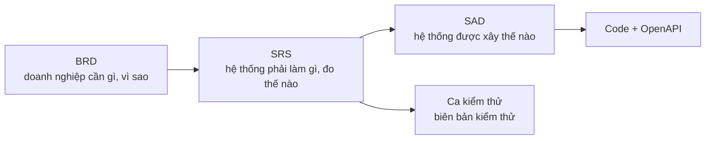

# Software Requirements Specification (SRS) – HRHelper (HR Enterprise Platform)

| Mục | Nội dung |
|---|---|
| Dự án | HRHelper – HR Enterprise Platform – môn Cloud Application Development |
| Phiên bản tài liệu | 1.0 |
| Ngày | 12/11/2026 (tuần 10) |
| Người soạn | TV1 (Dương), tách từ BRD 1.0 |
| Người review | TV2 (Thanh) nghiệp vụ, TV4 (Duy) khả năng kiểm thử |
| Trạng thái | Bản nháp, chờ review trên PR |
| Đầu vào | [BRD](../business/BRD.md) (yêu cầu nghiệp vụ) |
| Đầu ra | [Kiến trúc hệ thống](../architecture/system-architecture.md) · [Kiến trúc phần mềm](../architecture/software-architecture.md) · [API](../openapi.yaml) · [Ca kiểm thử](../business/leave-test-cases.md) |

**Lịch sử thay đổi**

| Phiên bản | Ngày | Nội dung |
|---|---|---|
| 1.0 | 12/11/2026 | Tách từ BRD 1.0: yêu cầu chức năng (BRD mục 7), dữ liệu (mục 9), phi chức năng (mục 10), ma trận truy vết (mục 14). Thêm mô tả tổng quan, giao diện ngoài, phương pháp kiểm chứng và cột thiết kế trong ma trận truy vết. Nội dung yêu cầu giữ nguyên |

**Cách đọc tài liệu:** mỗi yêu cầu có mã để truy vết. `MT-n` là mục tiêu kinh doanh (trong BRD), `FR-x.y` là yêu cầu chức năng
theo use case, `NFR-n` là yêu cầu phi chức năng, `BR-nn` là business rule chi tiết trong
[`leave-rules.md`](../business/leave-rules.md). Cột "Trạng thái" phản ánh hệ thống trên nhánh `dev`: **Đã có** (đã chạy và có
test), **Một phần**, **Kế hoạch tuần N**. Ai merge code làm đổi trạng thái một FR thì cập nhật cột này trong cùng PR.

---

## 1. Giới thiệu

### 1.1 Mục đích

Tài liệu đặc tả **hệ thống phải làm gì và đạt chất lượng nào** để đáp ứng các mục tiêu kinh doanh trong BRD. Mỗi yêu cầu có
tiêu chí chấp nhận kiểm chứng được. Người viết code, người kiểm thử và người thiết kế kiến trúc dùng tài liệu này làm căn cứ.

### 1.2 Vị trí trong bộ tài liệu

| Tài liệu | Trả lời câu hỏi | Tương ứng chuẩn |
|---|---|---|
| [BRD](../business/BRD.md) | Bối cảnh, vấn đề, mục tiêu kinh doanh, phạm vi, stakeholder, quy trình nghiệp vụ, business rule, rủi ro, nghiệm thu | BRS / StRS – ISO/IEC/IEEE 29148 |
| **SRS (tài liệu này)** | Yêu cầu chức năng, dữ liệu, phi chức năng, giao diện ngoài, kiểm chứng, truy vết | SRS – ISO/IEC/IEEE 29148 |
| SAD: [kiến trúc hệ thống](../architecture/system-architecture.md) + [kiến trúc phần mềm](../architecture/software-architecture.md) + ADR | Khối, hạ tầng, module, pattern, quyết định kiến trúc | Architecture description – ISO/IEC/IEEE 42010 |

### 1.3 Phạm vi

Version 1 (MVP, đến tuần 13 – 7/12/2026) gồm 7 use case UC1 → UC7 trong [BRD mục 4](../business/BRD.md#4-phạm-vi). Phần ngoài
phạm vi (tính lương, chấm công, tuyển dụng, ứng dụng di động, multi-AZ…) theo BRD mục 4.2.

### 1.4 Thuật ngữ và tài liệu tham chiếu

- Thuật ngữ nghiệp vụ: [BRD mục 16](../business/BRD.md#16-thuật-ngữ).
- Business rule nghỉ phép: [`leave-rules.md`](../business/leave-rules.md); loại phép, ngày lễ:
  [`leave-types-holidays.md`](../business/leave-types-holidays.md).
- Phân quyền từng API: [ma trận phân quyền](../security/access-control-matrix.md); mối đe dọa: [threat model](../security/threat-model.md).
- Quy ước API: [`CONVENTIONS.md` mục 4](../CONVENTIONS.md#4-api).

## 2. Mô tả tổng quan

### 2.1 Bối cảnh sản phẩm

HRHelper là ứng dụng web nội bộ chạy trên cloud, thay cho Excel và email (hiện trạng ở [BRD mục 2](../business/BRD.md#2-bối-cảnh-và-vấn-đề)).
Hệ thống làm việc với các hệ thống ngoài: identity provider (đăng nhập OIDC), dịch vụ gửi email, object storage (file tài liệu),
LLM API (trợ lý, tuần 12) và hệ thống Payroll (ngoài phạm vi version 1). Sơ đồ ngữ cảnh:
[kiến trúc hệ thống mục 2](../architecture/system-architecture.md#2-ngữ-cảnh-hệ-thống-c4-mức-1).

### 2.2 Chức năng chính

| Use case | Hệ thống phải cho phép | Yêu cầu |
|---|---|---|
| UC1 Hồ sơ nhân viên | Xem hồ sơ theo 3 mức, tự sửa liên hệ, HR quản lý hồ sơ và trường nhạy cảm | FR-1.1 → FR-1.6 |
| UC2 Thông tin tổ chức | Danh bạ, cây tổ chức, quản lý trực tiếp, quản lý phòng ban | FR-2.1 → FR-2.5 |
| UC3 Tạo đơn nghỉ | Xem số dư, tạo, hủy đơn, tạo đơn hộ | FR-3.1 → FR-3.7 |
| UC4 Duyệt đơn | Duyệt, từ chối, duyệt thay, HR hoàn tất, email thông báo | FR-4.1 → FR-4.7 |
| UC5 Kho tài liệu | Đăng tài liệu theo phạm vi xem, phiên bản | FR-5.1 → FR-5.3 |
| UC6 Tự tra cứu | Tìm đồng nghiệp, tìm tài liệu, trợ lý chính sách | FR-6.1 → FR-6.3 |
| UC7 Lịch sử thao tác | Audit append-only, tra cứu audit | FR-7.1 → FR-7.3 |

### 2.3 Lớp người dùng

| Vai trò | Cách có vai trò | Dữ liệu được xem |
|---|---|---|
| EMPLOYEE | Mọi tài khoản đăng nhập có hồ sơ | Dữ liệu của mình + danh bạ |
| MANAGER | Suy ra từ sơ đồ tổ chức: có ít nhất một cấp dưới đang làm việc (ADR-10) | Thêm thông tin cá nhân của cấp dưới trực tiếp, không có trường nhạy cảm |
| HR | Gán rõ ràng | Toàn bộ hồ sơ, kể cả trường nhạy cảm (mỗi lần xem ghi audit) |
| ADMIN | Gán rõ ràng | Tài khoản, phòng ban, audit; không xem hồ sơ cá nhân hay trường nhạy cảm của người khác |

Số lượng từng vai trò và nhu cầu: [BRD mục 5](../business/BRD.md#5-stakeholder-và-người-dùng).

### 2.4 Ràng buộc thiết kế

- Dùng dịch vụ managed cho database, lưu file, đăng nhập (ADR-00).
- Modular monolith, không microservices, không Kubernetes (ADR-01, ADR-06).
- Database quan hệ PostgreSQL (ADR-02); thông báo và xử lý nền đi qua outbox + queue (ADR-03).
- Trường nhạy cảm mã hóa ở tầng ứng dụng (ADR-08); audit chỉ thêm, khóa ở database (ADR-09).
- Version 1 chỉ dùng dữ liệu giả lập; dữ liệu cá nhân tuân thủ quy định bảo vệ dữ liệu cá nhân của Việt Nam ([BRD mục 11](../business/BRD.md#11-giả-định-ràng-buộc-phụ-thuộc)).

### 2.5 Giả định và phụ thuộc

Theo [BRD mục 11](../business/BRD.md#11-giả-định-ràng-buộc-phụ-thuộc). Giả định ảnh hưởng trực tiếp tới yêu cầu: mỗi nhân viên
có email công ty duy nhất (dùng để khớp tài khoản đăng nhập với hồ sơ); quy mô 2.000 nhân viên là căn cứ của NFR-1, NFR-2.

## 3. Yêu cầu giao diện ngoài

### 3.1 Giao diện người dùng

Ứng dụng web một trang (SPA) chạy trên trình duyệt, đăng nhập qua trang của identity provider. Mỗi vai trò chỉ thấy chức năng
mình được dùng; chức năng bị chặn ở giao diện vẫn phải bị chặn ở API (phân quyền hai lớp, [`CONVENTIONS.md` mục 4](../CONVENTIONS.md#4-api)).

### 3.2 Giao diện phần mềm

| Hệ thống ngoài | Giao thức | Đồng bộ? | Yêu cầu khi lỗi |
|---|---|---|---|
| Identity provider | OIDC; API kiểm chữ ký token bằng JWKS | Đồng bộ | Không đăng nhập mới được; token còn hạn vẫn dùng |
| Dịch vụ email | Queue → worker → SMTP | Bất đồng bộ | Gửi lại, không gửi trùng; trạng thái đơn không đổi (FR-4.6) |
| Object storage | Presigned URL tải lên/tải xuống | Tải lên đồng bộ | File không đi qua API (FR-5.1) |
| LLM API | REST có timeout | Đồng bộ | Hết thời gian thì chỉ tới tài liệu gốc (FR-6.3) |

Chi tiết cách tích hợp: [kiến trúc hệ thống mục 2](../architecture/system-architecture.md#2-ngữ-cảnh-hệ-thống-c4-mức-1).

### 3.3 API

- REST, tiền tố `/api/v1`; đổi không tương thích thì lên `/v2`.
- Lỗi luôn có dạng `{ code, message, traceId }`; mã HTTP 400, 403, 404, 409 theo [`CONVENTIONS.md` mục 4](../CONVENTIONS.md#4-api).
- Danh sách luôn phân trang `?page=&size=` (tối đa 100).
- Hợp đồng chi tiết: [`openapi.yaml`](../openapi.yaml), sinh từ code bằng `npm run openapi`.

## 4. Yêu cầu chức năng

Mức ưu tiên theo MoSCoW: **M** (bắt buộc), **S** (nên có), **C** (có thể có).

### 4.1 UC1 – Hồ sơ nhân viên

| Mã | Yêu cầu | Ưu tiên | Tiêu chí chấp nhận | Trạng thái |
|---|---|---|---|---|
| FR-1.1 | Xem hồ sơ theo 3 mức: danh bạ (mọi người), cá nhân (chính mình, quản lý trực tiếp), đầy đủ (HR) | M | Người ngoài không thấy ngày sinh, địa chỉ; quản lý thấy thông tin cá nhân cấp dưới; ADMIN chỉ thấy mức danh bạ | Đã có |
| FR-1.2 | Nhân viên tự sửa số điện thoại, địa chỉ của mình | M | Sửa trường khác hoặc hồ sơ người khác bị từ chối (403) | Đã có |
| FR-1.3 | HR xem CCCD, số tài khoản, lương; mỗi lượt xem ghi audit | M | Vai trò khác bị 403; audit có `VIEW_SENSITIVE` | Đã có |
| FR-1.4 | HR sửa mọi trường hồ sơ, kể cả trường nhạy cảm | M | Audit chỉ ghi tên trường nhạy cảm, không ghi giá trị | Một phần: API có, giao diện tuần 10 |
| FR-1.5 | HR tạo nhân viên mới (phòng ban, chức danh, quản lý trực tiếp, trường nhạy cảm) | M | Thiếu dữ liệu bắt buộc trả 400; quản lý tạo vòng lặp bị chặn | Một phần: API có, giao diện tuần 10 |
| FR-1.6 | Hai người cùng sửa một hồ sơ không ghi đè nhau | S | Gửi `version` cũ trả 409 | Đã có |

### 4.2 UC2 – Thông tin tổ chức

| Mã | Yêu cầu | Ưu tiên | Tiêu chí chấp nhận | Trạng thái |
|---|---|---|---|---|
| FR-2.1 | Danh bạ: tìm theo tên, email, mã; lọc phòng ban; phân trang | M | Không hiện nhân viên đã nghỉ việc; tối đa 100 dòng/trang | Đã có |
| FR-2.2 | Xem toàn bộ cây tổ chức và thành viên từng phòng ban | M | Cây có một gốc; quyết định issue #21: không cần nhập mã phòng ban | Đã có |
| FR-2.3 | Xem quản lý trực tiếp và nhân viên trực thuộc của một người | M | Danh sách cấp dưới đúng với dữ liệu | Đã có |
| FR-2.4 | HR, ADMIN tạo và sửa phòng ban | S | Đổi phòng ban cha không được tạo vòng | Một phần: API có |
| FR-2.5 | Mỗi nhân viên có đúng một quản lý trực tiếp, trừ CEO | M | Tạo/sửa nhân viên thiếu quản lý (không phải CEO) bị từ chối (issue #22) | Kế hoạch tuần 10 |

### 4.3 UC3 – Tạo đơn nghỉ

| Mã | Yêu cầu | Ưu tiên | Tiêu chí chấp nhận | Trạng thái |
|---|---|---|---|---|
| FR-3.1 | Xem số dư phép theo loại: được hưởng, đã dùng, đang chờ, còn lại | M | Còn lại = được hưởng − đã dùng − đang chờ | Đã có |
| FR-3.2 | Tạo đơn: loại phép, khoảng ngày, nghỉ nửa ngày, lý do | M | Không đủ số dư trả 400 (BR-01) | Đã có |
| FR-3.3 | Không cho đơn trùng lịch với đơn đang chờ hoặc đã duyệt | M | Trùng ngày trả 409; hai nửa ngày khác buổi không trùng (BR-02, BR-04) | Đã có |
| FR-3.4 | Số ngày tính theo ngày làm việc, bỏ cuối tuần và ngày lễ | M | 29/4–4/5/2026 tính 2 ngày; đơn chỉ gồm ngày nghỉ bù 27/4 bị từ chối (BR-03) | Đã có |
| FR-3.5 | Gửi lại do mạng lỗi không tạo đơn thứ hai | M | Cùng `Idempotency-Key` trả lại đơn cũ (BR-11) | Đã có |
| FR-3.6 | Nhân viên hủy đơn chưa có quyết định; không tự hủy đơn đã duyệt | M | Hủy trả lại số ngày; hủy đơn đã duyệt trả 409 (BR-07, BR-08) | Đã có |
| FR-3.7 | HR và quản lý trực tiếp tạo đơn hộ nhân viên | S | Số dư là của nhân viên; nhân viên nhận email, vẫn tự hủy được; lịch sử ghi người tạo hộ (BR-12) | Kế hoạch tuần 10 |

### 4.4 UC4 – Duyệt đơn

| Mã | Yêu cầu | Ưu tiên | Tiêu chí chấp nhận | Trạng thái |
|---|---|---|---|---|
| FR-4.1 | Quản lý xem danh sách đơn chờ duyệt của cấp dưới trực tiếp | M | Không thấy đơn của người không trực thuộc | Đã có |
| FR-4.2 | Duyệt hoặc từ chối kèm ghi chú; chỉ quản lý trực tiếp tại thời điểm xử lý | M | Người khác trả 403; duyệt lại lần hai không đổi gì; quyết định ngược lại trả 409 (BR-05, BR-09, BR-11) | Đã có |
| FR-4.3 | Người duyệt thay khi quản lý vắng mặt, do HR chỉ định theo khoảng ngày | S | Người thay thấy và xử lý đơn trong thời hạn được giao (BR-06) | Kế hoạch tuần 10 |
| FR-4.4 | HR duyệt đơn của CEO (người duy nhất không có quản lý) | S | Chỉ áp dụng cho đơn của CEO (issue #22) | Kế hoạch tuần 10 |
| FR-4.5 | HR hoàn tất đơn đã duyệt | M | Số ngày giữ chỗ chuyển thành đã dùng; đơn chưa duyệt trả 409 (BR-10) | Đã có |
| FR-4.6 | Email thông báo: đơn mới → quản lý; duyệt, từ chối, hoàn tất → nhân viên; hủy → quản lý | M | Email tới đúng người; không gửi trùng khi hệ thống gửi lại event | Đã có |
| FR-4.7 | Xem chi tiết đơn và lịch sử trạng thái | M | Chỉ chủ đơn, quản lý trực tiếp, HR xem được | Đã có |

### 4.5 UC5 – Kho tài liệu chính sách

| Mã | Yêu cầu | Ưu tiên | Tiêu chí chấp nhận | Trạng thái |
|---|---|---|---|---|
| FR-5.1 | HR tải lên tài liệu PDF/DOCX kèm tiêu đề, loại, phạm vi xem (toàn công ty, phòng ban, vai trò) | M | Chỉ HR tải lên được; file không đi qua API mà tải thẳng lên object storage | Kế hoạch tuần 10 |
| FR-5.2 | Nhân viên chỉ xem, tải tài liệu thuộc phạm vi của mình | M | Tài liệu ngoài phạm vi không hiện trong danh sách và link tải bị từ chối | Kế hoạch tuần 10 |
| FR-5.3 | Tài liệu có phiên bản; mặc định hiện phiên bản mới nhất | S | Đăng bản mới không mất bản cũ | Kế hoạch tuần 10 |

### 4.6 UC6 – Tự tra cứu

| Mã | Yêu cầu | Ưu tiên | Tiêu chí chấp nhận | Trạng thái |
|---|---|---|---|---|
| FR-6.1 | Tìm đồng nghiệp | M | Như FR-2.1 | Đã có |
| FR-6.2 | Tìm tài liệu theo từ khóa trong tiêu đề và nội dung, lọc theo quyền | M | Không trả tài liệu ngoài phạm vi | Kế hoạch tuần 10 |
| FR-6.3 | Trợ lý trả lời câu hỏi về chính sách HR, có trích dẫn tài liệu nguồn | C | Chỉ dùng tài liệu người hỏi được xem; không trả lời được thì chỉ tới tài liệu gốc | Kế hoạch tuần 12 |

### 4.7 UC7 – Lịch sử thao tác

| Mã | Yêu cầu | Ưu tiên | Tiêu chí chấp nhận | Trạng thái |
|---|---|---|---|---|
| FR-7.1 | Ghi audit cho tạo/sửa hồ sơ, đọc trường nhạy cảm, mọi bước của đơn nghỉ | M | Audit ghi cùng giao dịch với thao tác; không ghi giá trị nhạy cảm | Đã có |
| FR-7.2 | Audit chỉ được thêm, không ai sửa/xóa | M | Lệnh UPDATE/DELETE trên bảng audit bị database chặn | Đã có |
| FR-7.3 | HR, ADMIN tra cứu audit theo đối tượng, người thực hiện, khoảng thời gian | M | Vai trò khác trả 403 | Một phần: API có, giao diện tuần 10 |

**Tổng hợp (theo `dev` ngày 6/11/2026):** 34 yêu cầu chức năng; 21 đã có, 4 một phần (API có, chưa có giao diện), 9 theo kế hoạch tuần 10–12.

## 5. Yêu cầu dữ liệu

### 5.1 Dữ liệu chính

| Nhóm dữ liệu | Nội dung | Phân loại |
|---|---|---|
| Hồ sơ nhân viên | Mã, họ tên, email công ty, điện thoại, ngày sinh, địa chỉ, phòng ban, chức danh, quản lý, ngày vào làm, trạng thái | Cá nhân |
| Trường nhạy cảm | CCCD, số tài khoản ngân hàng, lương | **Nhạy cảm:** mã hóa ở tầng ứng dụng, chỉ HR, đọc là ghi audit (ADR-08) |
| Tổ chức | Phòng ban (cây), chức danh, trưởng đơn vị | Nội bộ |
| Nghỉ phép | Loại phép, số dư theo năm, đơn, lịch sử trạng thái, ngày lễ | Cá nhân (đơn nghỉ ốm, thai sản cần hạn chế người xem) |
| Tài liệu | Metadata, file, phạm vi xem, phiên bản | Nội bộ |
| Audit | Ai, làm gì, trên đối tượng nào, lúc nào, trường nào đổi | Nhạy cảm (chỉ HR, ADMIN) |

Mô hình dữ liệu chi tiết: [data model tuần 6](../progress/tuan-06/TV2_Thanh.md#2-data-model--data-ownership).

### 5.2 Quy mô (ước tính tuần 5, dùng cho NFR-1, NFR-2)

| Dữ liệu | Khối lượng |
|---|---|
| Đơn nghỉ phép | ~100 đơn/ngày (~25.000 đơn/năm) |
| Audit log | ~1,25 triệu bản ghi/năm |
| Tài liệu | ~500 file, ~2 GB |
| Lưu lượng | trung bình ≈ 0,5 request/giây, cao điểm ≈ 10, thiết kế cho 50 |

## 6. Yêu cầu phi chức năng

| Mã | Nhóm | Yêu cầu | Cách kiểm chứng |
|---|---|---|---|
| NFR-1 | Hiệu năng | p95 < 300 ms API đọc, < 500 ms API ghi, tìm kiếm p95 < 1 s | Load test tuần 11 ở 50 request/giây |
| NFR-2 | Mở rộng | ~500 người dùng đồng thời; tăng 5× (10.000 nhân viên) không đổi kiến trúc | Load test tuần 11 |
| NFR-3 | Sẵn sàng | 99,5%/tháng (≈ 3,6 giờ dừng); 2 instance API, mất 1 instance lỗi < 1% (ADR-06) | Tắt 1 instance trong load test |
| NFR-4 | Phục hồi | RPO ≤ 1 giờ, RTO ≤ 4 giờ; không mất đơn đã gửi | Khôi phục thử database về một thời điểm |
| NFR-5 | Bảo mật | Nhân viên không đọc được hồ sơ người khác; quản lý chỉ thấy cấp dưới; trường nhạy cảm mã hóa, chỉ HR; TLS mọi kết nối; secret không nằm trong code | e2e test phân quyền theo ma trận; threat model tuần 9 |
| NFR-6 | Truy vết | 100% thao tác duyệt và đọc trường nhạy cảm có audit | e2e test |
| NFR-7 | Chi phí | < 100 USD/tháng cho staging | AWS Budgets (ADR-12) |

## 7. Kiểm chứng và truy vết

### 7.1 Phương pháp kiểm chứng

| Phương pháp | Áp dụng cho | Bằng chứng |
|---|---|---|
| Kiểm thử tự động | FR mức M đã có; NFR-5, NFR-6 | Unit test `*.spec.ts`, e2e `backend/test/app.e2e-spec.ts`, chạy trong CI |
| Kiểm thử chức năng thủ công | FR có giao diện | [Ca kiểm thử](../business/leave-test-cases.md), [ca kiểm thử bảo mật](../business/security-test-cases.md), biên bản tuần 8, 9 |
| Đo, phân tích | NFR-1 → NFR-4 | Load test tuần 11; thử khôi phục database |
| Xem xét (inspection) | NFR-7, ràng buộc mục 2.4 | AWS Budgets; review PR theo `CONVENTIONS.md` |

### 7.2 Ma trận truy vết

Chiều xuôi: mục tiêu (BRD) → yêu cầu (SRS) → thiết kế (SAD) → kiểm chứng.

| Mục tiêu (BRD) | Use case | Yêu cầu (SRS) | Business rule | Thiết kế (SAD) | Kiểm chứng |
|---|---|---|---|---|---|
| MT-1 | UC1, UC2 | FR-1.1 → FR-1.6, FR-2.1 → FR-2.5 | Quy tắc hồ sơ, issue #21, #22 | Module Employee, Organization, Identity; ADR-10 | e2e `app.e2e-spec.ts`; biên bản kiểm thử tuần 7 |
| MT-2 | UC3, UC4 | FR-3.1 → FR-3.7, FR-4.1 → FR-4.7 | BR-01 → BR-12 | Module Leave, Worker; outbox + queue (ADR-03) | 22 ca kiểm thử `leave-test-cases.md`; e2e nhóm "workflow nghỉ phép" |
| MT-3 | UC1, UC7 | FR-1.3, FR-1.4, FR-7.1 → FR-7.3 | ADR-08, ADR-09 | Module Employee (`FieldCrypto`, ADR-08), Audit (ADR-09) | e2e audit, `VIEW_SENSITIVE`; ma trận phân quyền |
| MT-4 | UC5, UC6 | FR-5.1 → FR-5.3, FR-6.1 → FR-6.3 | Phạm vi tài liệu | Module Document (tuần 10), object storage, tìm kiếm full-text | Kế hoạch kiểm thử tuần 10, 12 |

Thiết kế chi tiết từng module: [kiến trúc phần mềm mục 4](../architecture/software-architecture.md#4-danh-mục-module).
NFR-1 → NFR-7 dẫn tới quyết định kiến trúc ở [kiến trúc hệ thống mục 1](../architecture/system-architecture.md#1-yêu-cầu-dẫn-dắt-kiến-trúc).

## 8. Vấn đề còn mở

Các câu hỏi chưa chốt ảnh hưởng tới yêu cầu nằm ở [BRD mục 15](../business/BRD.md#15-vấn-đề-còn-mở). Khi chốt, cập nhật FR hoặc BR liên quan và tăng phiên bản tài liệu này.
