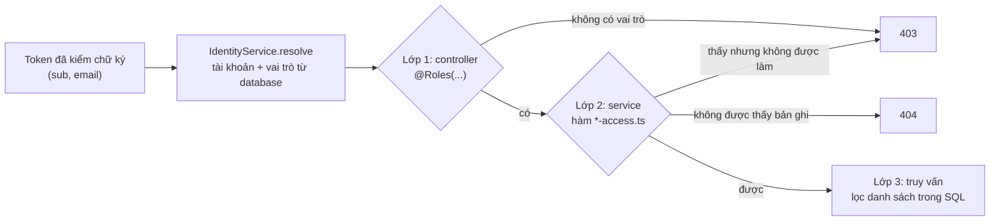

# Phân quyền: mô hình và cách làm

> Phụ lục của [SRS](../requirements/SRS.md) (NFR-5.11 → 5.13). Quyết định: [ADR-18](../architecture/adr/ADR-18-authorization.md).
> Hợp đồng từng API: [ma trận phân quyền](access-control-matrix.md). Xác thực (đăng nhập, MFA, tài khoản):
> [ADR-17](../architecture/adr/ADR-17-authentication.md), [UC8](../features/UC8-authentication/spec.md).

File này trả lời câu hỏi "người đã đăng nhập được làm gì, trên bản ghi nào", và hướng dẫn người code thêm một API mới cho đúng.

| Tài liệu | Trả lời | Khi nào đọc |
|---|---|---|
| ADR-17, UC8 | Người gọi là ai (authentication) | Làm phần đăng nhập, tài khoản |
| **File này**, ADR-18 | Mô hình phân quyền, quy ước code (authorization) | Trước khi viết API mới |
| Ma trận phân quyền | API cụ thể nào cho vai trò nào, điều kiện gì | Viết e2e, ca kiểm thử, review PR |

## 1. Mô hình: RBAC cộng kiểm theo dữ liệu



- **RBAC (Role-Based Access Control)**: quyền theo vai trò. Trả lời "vai trò này có được gọi thao tác này không".
- **Kiểm theo dữ liệu** (còn gọi ABAC, Attribute-Based Access Control, hoặc ReBAC, Relationship-Based, khi điều kiện là quan hệ
  giữa người): trả lời "trên bản ghi này thì sao": chủ bản ghi, quản lý trực tiếp, phạm vi đơn vị, trạng thái bản ghi.

Chỉ RBAC là không đủ: "quản lý duyệt đơn" đúng ở mức vai trò, nhưng chỉ đúng với đơn của **cấp dưới trực tiếp** (BR-05).

## 2. Vai trò

| Vai trò | Loại | Có khi nào | Ý nghĩa |
|---|---|---|---|
| `EMPLOYEE` | Suy ra | Tài khoản gắn hồ sơ chưa `TERMINATED` | Dữ liệu của mình, danh bạ |
| `MANAGER` | Suy ra | Có ít nhất một cấp dưới trực tiếp (ADR-10) | Thêm: dữ liệu mức quản lý của mọi cấp dưới trực tiếp và gián tiếp (chuỗi quản lý, `resolveRelation`, chốt 18/11/2026); duyệt đơn chỉ của cấp dưới trực tiếp |
| `HR` | Được cấp | ADMIN cấp trong ứng dụng | Toàn bộ hồ sơ, trường nhạy cảm (có audit), quản lý tổ chức, tài liệu |
| `ADMIN` | Được cấp | ADMIN khác cấp; người đầu tiên tạo bằng seed hoặc `grant-admin` | Quản trị kỹ thuật: tài khoản, vai trò, đơn vị, audit. **Không** xem hồ sơ cá nhân, trường nhạy cảm của người khác |

Một người có thể có nhiều vai trò (HR cũng là EMPLOYEE, có thể là MANAGER). Quyền là hợp các vai trò, nhưng kiểm theo dữ liệu vẫn
áp dụng: HR tự duyệt yêu cầu sửa hồ sơ của chính mình bị chặn.

**Nguồn vai trò:** chỉ database (`iam.role_assignment` cho `HR`, `ADMIN`; sơ đồ tổ chức cho `MANAGER`). Claim vai trò trong token
bị bỏ qua. Nhóm trên IdP là bản sao để IdP bắt MFA theo vai trò (ADR-17 mục 2).

## 3. Cấp và thu hồi vai trò

| Bước | Hệ thống |
|---|---|
| 1 | ADMIN chọn tài khoản, chọn `HR` hoặc `ADMIN`, nhập lý do |
| 2 | API kiểm: người gọi là ADMIN; không tự cấp, tự thu hồi cho mình; thu hồi không làm mất ADMIN cuối cùng (409) |
| 3 | Cùng một giao dịch: ghi `iam.role_assignment`, audit `ROLE_GRANT` / `ROLE_REVOKE` (người làm, người nhận, vai trò, lý do), event `role.granted` / `role.revoked` vào outbox |
| 4 | Consumer `identity-sync` thêm hoặc bớt nhóm trên IdP |
| 5 | Có hiệu lực ngay ở API từ request kế tiếp (đọc database mỗi request) |

API (tuần 11, nhánh `feat/uc8-role-admin`, hợp đồng ở [UC8 spec mục 9.2](../features/UC8-authentication/spec.md#92-hợp-đồng-api)): `GET /admin/role-assignments`, `POST /admin/role-assignments`,
`DELETE /admin/role-assignments/{userId}/{role}`. Chỉ `ADMIN`.

## 4. Quy ước code

**Lớp 1, controller:**

```ts
@Roles('HR')                         // chỉ khi thao tác thuộc hẳn về một số vai trò
@Post('employees')
create(@CurrentUser() user: AuthUser, @Body() dto: CreateEmployeeDto) { … }
```

Không có `@Roles` nghĩa là mọi người đã đăng nhập; điều kiện theo bản ghi vẫn phải có ở lớp 2. `@Public()` chỉ dùng cho health check.

**Lớp 2, service:** mỗi module có một file `<module>-access.ts` gồm hàm thuần, không gọi database, có unit test cho từng vai trò.

```ts
// employee-access.ts (đã có)
export function viewLevel(actor: AuthUser, target: { id: string; managerId: string | null }): ViewLevel
// leave-access.ts (đề xuất, gom điều kiện đang nằm trong LeaveService)
export function canDecide(actor: AuthUser, req: { ownerId: string; ownerManagerId: string | null; ownerIsCeo: boolean }): boolean
```

| Module | File | Trạng thái |
|---|---|---|
| Employee | `employee-access.ts` | Đã có |
| Document | `document-rules.ts` (`canView`) | Đã có, đổi tên hoặc tách `document-access.ts` khi sửa |
| Leave | Điều kiện trong `LeaveService` | Gom về `leave-access.ts` |
| Organization | `@Roles('HR','ADMIN')` ở controller | Đủ cho version 1 |
| Audit | `@Roles('HR','ADMIN')` | Đủ |

**Lớp 3, truy vấn:** danh sách (đơn chờ duyệt, tài liệu, cấp dưới) phải có điều kiện quyền trong `WHERE`, để phân trang và tổng số
đúng, không rò số bản ghi người gọi không được thấy.

**Mã lỗi** theo [`error-codes.md`](../development/error-codes.md): thiếu hoặc sai token 401; không có vai trò, hoặc biết bản ghi
nhưng không được làm 403; không được biết bản ghi tồn tại 404.

## 5. Thêm một API mới: danh sách kiểm

1. Thêm một dòng vào [ma trận phân quyền](access-control-matrix.md): vai trò nào ✓, điều kiện theo dữ liệu, 403 hay 404.
2. `@Roles(...)` nếu chỉ một số vai trò được gọi.
3. Điều kiện theo bản ghi viết thành hàm trong `<module>-access.ts` và unit test mỗi vai trò, kể cả ADMIN.
4. API danh sách: điều kiện nằm trong truy vấn.
5. Đọc dữ liệu nhạy cảm hoặc thao tác đặc quyền thì ghi audit trong cùng giao dịch (ADR-09).
6. e2e: một ca được phép, một ca bị chặn cho mỗi vai trò có điều kiện.
7. Mô tả PR mục "Ảnh hưởng tới phân quyền / dữ liệu nhạy cảm" ghi dòng ma trận đã thêm.

## 6. Hiện trạng và việc còn lại (17/11/2026)

| Việc | Tiêu chí | Người | Nhánh | Tuần |
|---|---|---|---|---|
| `IdentityService` bỏ đọc vai trò từ token; bỏ `manager` ở `keycloak/realm-hr.json` và `infra/staging/cognito.tf` | ADR-18 nghiệm thu 1, 2 | TV1 | `feat/uc8-roles-from-db` (xong) | 11 |
| API và màn hình cấp, thu hồi vai trò; audit; event `RoleGranted`, `RoleRevoked` | ADR-18 nghiệm thu 3; NFR-5.10; UC8 FR-8.7 | TV1 | `feat/uc8-role-admin` | 11 |
| Đồng bộ nhóm sang IdP trong `identity-sync` | UC8 AC-8.7.1 | TV1 | `feat/uc8-account-lifecycle` | 11 |
| Gom điều kiện duyệt đơn về `leave-access.ts` | – | TV1 | cùng PR sửa UC4 | 11 |
| Cập nhật ma trận: `direct-reports`, `members` mức danh bạ; cột 403/404 | ADR-18 mục 4, 5 | TV1 | PR này | 11 |
| Ca kiểm thử: token có nhóm `hr` nhưng database không; tự cấp vai trò; thu hồi ADMIN cuối | ADR-18 nghiệm thu | TV4 | `docs/security-test-cases-week11` | 11 |
