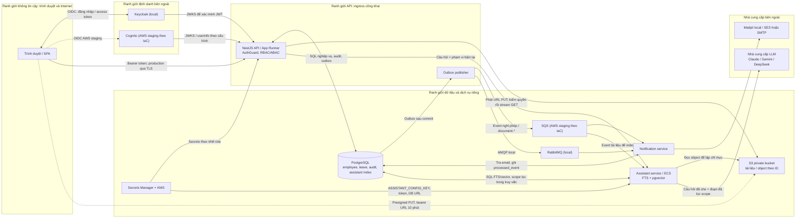

# Threat model STRIDE – hồ sơ, nghỉ phép, kho tài liệu, trợ lý và cloud

> Phụ lục của [SRS](../requirements/SRS.md): mối đe dọa và yêu cầu bảo mật (NFR-5). Bộ tài liệu: [`docs/README.md`](../README.md).

## Phạm vi và giả định

Đánh giá các luồng: đăng nhập OIDC; hồ sơ nhân viên; nghỉ phép/email; kho tài liệu UC5; trợ lý chính sách UC6; và hạ tầng AWS staging. Đối chiếu mã nguồn trên `dev` ngày 26/11/2026. Đây là đánh giá thiết kế và cấu hình trong repository, không phải kiểm thử xâm nhập hay xác nhận trạng thái AWS đang chạy.

Kho tài liệu và trợ lý đã có API/service trong `dev`; Cognito, S3, SQS, App Runner, ECS, Secrets Manager và KMS được mô tả bằng Terraform ở `infra/staging`. Hiệu lực thực tế của cấu hình cloud cần được xác nhận ở tài khoản AWS. Local vẫn dùng Keycloak, MinIO, PostgreSQL, RabbitMQ và Mailpit. T-19 → T-23 ghi nhận rủi ro UC6; T-24 → T-33 bổ sung UC5, prompt injection và các rủi ro cloud.

## Sơ đồ luồng dữ liệu và ranh giới tin cậy

Ranh giới cần bảo vệ gồm client Internet → API; trình duyệt ↔ IdP; API ↔ S3/assistant; publisher → SQS/RabbitMQ; assistant → PostgreSQL/S3 và nhà cung cấp LLM; worker → PostgreSQL/email. Presigned URL là bearer credential có thời hạn; nội dung tài liệu và phản hồi từ LLM đều là dữ liệu không tin cậy. Mũi tên nét đứt biểu thị luồng tới dịch vụ ngoài ranh giới tin cậy, không hàm ý dịch vụ chưa triển khai. Sơ đồ mô tả IaC và luồng ứng dụng, không xác nhận trạng thái AWS thực tế. Local dùng HTTP và SMTP không mã hóa; production phải dùng TLS.

## Biện pháp hiện có

- **Đăng nhập:** `TokenVerifier` xác minh chữ ký JWT qua JWKS, `issuer`, hạn token do `jose` kiểm tra, và giới hạn `azp`
  theo cấu hình. `AuthGuard` toàn cục yêu cầu Bearer token trừ health check; role được lấy từ token/DB, `MANAGER` suy ra từ
  sơ đồ tổ chức. `AUTH_MODE=dev` bị chặn khi `NODE_ENV=production`.
- **Hồ sơ:** role và điều kiện chủ hồ sơ/quản lý trực tiếp/HR được kiểm tra ở controller và service. Validation dùng
  whitelist và từ chối field lạ. CCCD, tài khoản ngân hàng, lương dùng AES-256-GCM; HR đọc trường nhạy cảm bị ghi audit.
  Cập nhật hồ sơ ghi audit trong transaction; giá trị trường nhạy cảm được che trong audit.
- **Nghỉ phép:** chủ đơn lấy từ danh tính xác thực, không tin `employeeId` trong request; tạo đơn kiểm tra số dư, ngày,
  trùng lịch và khóa giao dịch; `Idempotency-Key` chống gửi lặp cùng key. Duyệt/từ chối yêu cầu role MANAGER và quản lý
  trực tiếp; HR hoàn tất; state machine, version, history và audit được thực thi trong transaction.
- **Kho tài liệu:** HR-only tạo/sửa; API xác thực loại/kích thước và nội dung trước khi READY; scope kiểm tại truy vấn danh sách, xem, tải và trợ lý; download qua API.
- **Trợ lý:** API tính scope hiện tại; truy hồi FTS/vector lọc scope trong SQL; guard che một số PII, chuẩn hóa nội dung và giới hạn citation vào đoạn đã gửi; không lưu câu hỏi/đáp án.
- **Email và audit:** outbox ghi cùng transaction với nghiệp vụ; publisher dùng publisher-confirm và worker chống xử lý event trùng, lỗi gửi chuyển DLQ. Audit có trigger chặn `UPDATE`/`DELETE` ở PostgreSQL. Đây không phải bảo vệ chống người có quyền superuser database.

## Danh sách mối đe dọa

Mức độ là đánh giá rủi ro nghiệp vụ hiện tại: **Cao** cần ưu tiên trước khi đưa staging dữ liệu thật vào sử dụng; **Trung
bình** cần xử lý trước production hoặc có biện pháp vận hành bù; **Thấp** cần theo dõi. Chủ xử lý đề xuất theo phân vai:
TV1 (API/web/worker), TV3 (cloud/IaC/CI), TV2 (nghiệp vụ).

| Mã | Luồng | STRIDE | Mối đe dọa và tài sản | Biện pháp hiện có | Khoảng trống / xử lý đề xuất | Mức độ | Chủ xử lý đề xuất |
|---|---|---|---|---|---|---|---|
| T-01 | Đăng nhập | Spoofing | Kẻ có access token bị đánh cắp có thể mạo danh nhân viên/HR và gọi API cho đến khi token hết hạn. Tài sản: hồ sơ, đơn nghỉ, quyền HR. | JWT phải có chữ ký hợp lệ, issuer và hạn token hợp lệ; API yêu cầu Bearer token. | Chưa thấy cơ chế thu hồi token theo phiên hoặc ràng buộc phiên trong API. Bắt buộc TLS ở ingress, đặt thời hạn token phù hợp, bảo vệ token phía SPA, logout/thu hồi theo khả năng IdP và giám sát đăng nhập bất thường. | Cao | TV1, TV3 |
| T-02 | Đăng nhập | Tampering | Claim `email` được dùng để provision/liên kết tài khoản. Nếu IdP phát token có email chưa xác minh, đăng nhập có thể gắn nhầm tài khoản nhân viên theo email. Tài sản: liên kết tài khoản–nhân viên, danh tính và quyền truy cập hồ sơ. | Token ký đúng bởi IdP tin cậy; account đã có subject khác sẽ bị từ chối. | **Đã sửa 25/11 (`fix/auth-email-verified`):** API đọc `email_verified` (token Keycloak, userinfo Cognito); chưa xác minh thì 401, không tạo hay gắn tài khoản theo email (AC-8.1.12). Còn lại: quy trình sửa liên kết khi gắn nhầm. | Thấp | TV1 |
| T-03 | Đăng nhập | Repudiation | Người dùng có thể phủ nhận lần đăng nhập hoặc thay đổi role/employee-account mapping; hiện không có audit event đăng nhập trong ứng dụng. Tài sản: truy vết truy cập và cấp quyền. | Request có trace ID; audit ghi các thao tác nghiệp vụ có hỗ trợ. | Trace ID không phải audit xác thực; không lưu actor, kết quả đăng nhập, hoặc thay đổi role trong audit hiện tại. Bổ sung log xác thực tối thiểu, không ghi token/secret, và audit cấp/thu hồi role. | Trung bình | TV1 |
| T-04 | Đăng nhập | Information disclosure | Token hoặc claim danh tính bị lộ ở trình duyệt, log hay kênh mạng sẽ làm lộ danh tính và có thể cấp quyền truy cập như người dùng. | Bearer token chỉ gửi trong Authorization; `TokenVerifier` không trả token vào response. | Local dùng HTTP; cấu hình CSP, chính sách lưu token và redaction log chưa được xác nhận. Dùng HTTPS ở cloud, hạn chế token trong JavaScript/storage, thêm security headers/CSP và xác minh không ghi Authorization header. | Cao | TV1, TV3 |
| T-05 | Đăng nhập | Denial of service | Flood request đăng nhập/API hoặc làm IdP/JWKS/DB quá tải; mỗi request xác thực còn resolve tài khoản và role từ DB. Tài sản: khả dụng của API và đăng nhập. | JWKS được cache; lỗi token bị trả Unauthorized; pool/dependency health được cấu hình trong local compose. | Chưa thấy rate limit, giới hạn concurrency, hoặc bảo vệ ingress trong ứng dụng. Đặt throttling/WAF tại edge, giới hạn request/body và theo dõi độ trễ IdP/DB. | Trung bình | TV1, TV3 |
| T-06 | Đăng nhập | Elevation of privilege | Gán nhầm role HR/ADMIN trong IdP hoặc `role_assignment` sẽ trao quyền đọc dữ liệu HR hoặc sửa tổ chức. Tài sản: quyền đặc quyền, dữ liệu hồ sơ nhân sự và cấu hình tổ chức. | Chỉ nhận role thuộc danh sách cho phép; role trong token phải qua xác minh chữ ký; `@Roles` chặn endpoint. | Không thấy quy trình phê duyệt/review cấp role trong luồng runtime. Hạn chế người được cấp role đặc quyền, audit mọi thay đổi role và kiểm thử sai cấu hình claim/assignment. | Cao | TV1, TV3 |
| T-07 | Xem/sửa hồ sơ | Spoofing | Kẻ mạo danh chủ hồ sơ hoặc HR có thể đọc/sửa thông tin cá nhân và trường nhạy cảm. | Bearer token xác minh; `viewLevel` và `forbiddenFields` giới hạn hồ sơ theo actor, chủ hồ sơ, quản lý trực tiếp và HR. | Rủi ro token bị chiếm đoạt như T-01 vẫn áp dụng; thêm TLS, bảo vệ phiên HR và MFA/conditional access tại IdP nếu được hỗ trợ. | Cao | TV1, TV3 |
| T-08 | Xem/sửa hồ sơ | Tampering | Người gọi sửa ID hồ sơ hoặc field để thử cập nhật hồ sơ ngoài quyền; nếu cập nhật đồng thời mà không gửi `version`, thay đổi mới hơn có thể bị ghi đè mà không phát hiện xung đột. Tài sản: tính toàn vẹn hồ sơ nhân viên, PII và các cập nhật mới nhất. | DTO whitelist/forbid field lạ; service kiểm tra quyền theo target; transaction khóa dòng; version sai bị từ chối nếu gửi. | `version` là tùy chọn, nên chỉ kiểm soát xung đột khi client gửi giá trị hiện hành. Đây là rủi ro mất cập nhật, không phải vượt quyền. Bắt buộc version ở các luồng cần optimistic concurrency và test đổi target ID, field bị cấm, version cũ, `managerId: null`. | Trung bình | TV1 |
| T-09 | Xem/sửa hồ sơ | Repudiation | Người dùng phủ nhận đã đọc hoặc sửa hồ sơ. Tài sản: bằng chứng truy cập và lịch sử thay đổi. | Cập nhật và HR đọc trường nhạy cảm có audit; cập nhật ghi cùng transaction; audit append-only ở DB. | Đọc hồ sơ/danh bạ thường không audit; audit trigger không chống DB superuser; `X-Trace-Id` do client cung cấp có thể bị tự chọn. Xác định trường hợp cần audit đọc, dùng trace ID server-generated/chuẩn hóa và sao chép audit bất biến nếu cần chống DBA. | Trung bình | TV1, TV3 |
| T-10 | Xem/sửa hồ sơ | Information disclosure | Trường CCCD/tài khoản/lương hoặc PII có thể lộ qua DB, audit hoặc API. Tài sản: dữ liệu cá nhân và dữ liệu nhân sự. | Trường nhạy cảm mã hóa AES-256-GCM; chỉ HR được giải mã qua API; audit che giá trị trường nhạy cảm; matrix quy định phạm vi danh bạ. | Cấu hình hiện có khóa mã hóa mặc định dùng chung trong code/config local; audit cập nhật vẫn ghi một số PII thường như địa chỉ/ngày sinh, và HR/ADMIN có thể đọc audit. Thay khóa bằng secret manager/KMS, không dùng khóa mặc định, giảm/mask PII trong audit và xác nhận quyền đọc audit. | Cao | TV1, TV3 |
| T-11 | Xem/sửa hồ sơ | Denial of service | Truy vấn danh bạ/phòng ban liên tục hoặc quét trang có thể tiêu thụ DB và làm API chậm. Tài sản: khả dụng DB/API. | Danh bạ phân trang, giới hạn `size` tối đa 100; truy vấn lọc trạng thái và có thứ tự ổn định. | Chưa thấy rate limit, query timeout hoặc kiểm soát tần suất tìm kiếm. Thêm throttling, timeout/index phù hợp và cảnh báo tải truy vấn. | Trung bình | TV1 |
| T-12 | Xem/sửa hồ sơ | Elevation of privilege | Người dùng đã đăng nhập có thể gọi endpoint xem cấp dưới/thành viên phòng ban tùy ý; quản lý có thể thử lấy dữ liệu vượt phạm vi mình phụ trách. | Các route yêu cầu đăng nhập; response danh bạ không bao gồm trường nhạy cảm; matrix ghi rõ hiện không giới hạn phạm vi ở hai endpoint này. | `direct-reports` và `departments/{id}/members` không kiểm tra quan hệ người gọi; hành vi đã được nhóm chấp nhận cho danh bạ toàn tổ chức theo UC2/UC6. Xác nhận không trả thêm PII ngoài phạm vi đã duyệt và kiểm thử phạm vi khi yêu cầu nghiệp vụ đổi. | Trung bình | TV1, TV2 |
| T-13 | Nghỉ phép | Spoofing | Kẻ mạo danh nhân viên/manager/HR có thể tạo hoặc quyết định đơn. | Actor gắn với JWT xác minh; tạo đơn lấy employee ID từ token; duyệt yêu cầu role MANAGER và kiểm tra quản lý trực tiếp; hoàn tất yêu cầu HR. | Bảo vệ phiên/token HR và manager theo T-01/T-07; chưa có kiểm toán đăng nhập để phát hiện lạm dụng sớm. Dùng TLS/MFA cho role nhạy cảm và cảnh báo hành động bất thường. | Cao | TV1, TV3 |
| T-14 | Nghỉ phép | Tampering | Client sửa `employeeId`, ngày, loại phép, số ngày, trạng thái hoặc gửi lại request để tạo đơn của người khác/vượt số dư. | Chủ đơn và người tạo hộ là hai danh tính riêng (`employee_id`, `created_by`); chỉ HR hoặc quản lý trực tiếp được tạo hộ; ngày, số dư, trùng lịch kiểm tra server-side trong transaction; `Idempotency-Key`, version và state machine chặn thao tác sai (#120). | Duy trì kiểm thử đổi owner/actor, field trạng thái, request đồng thời và gửi lặp; không nhận actor từ body. | Trung bình | TV1, TV2 |
| T-15 | Nghỉ phép | Repudiation | Người tạo hộ hoặc người duyệt phủ nhận đã gửi/ra quyết định; không phân biệt actor và chủ đơn sẽ làm mất dấu trách nhiệm. | Tạo hộ ghi `created_by` và `employee_id` riêng; lịch sử SUBMIT và audit gắn actor thật; mọi chuyển trạng thái ghi history/audit trong transaction; trigger chặn UPDATE/DELETE (#120). | DBA superuser vẫn có thể vượt trigger; giữ danh tính người tạo hộ/người duyệt trong báo cáo và cân nhắc bản sao audit bất biến trước production. | Trung bình | TV1, TV3 |
| T-16 | Nghỉ phép | Information disclosure | Email/outbox có thể tiết lộ loại phép (ví dụ nghỉ ốm), thời gian nghỉ, tên và ghi chú tự do cho người nhận không phù hợp; SMTP có thể bị nghe lén. | Event được ghi trong outbox; email gửi tới nhân viên hoặc quản lý trực tiếp theo loại event; hiện payload không đưa `reason` của đơn vào email. | Email hiện có `leaveType`, ngày và có thể có comment; local SMTP/Mailpit không TLS và comment có thể chứa thông tin sức khỏe. Tối thiểu hóa nội dung (không gửi comment/loại phép nhạy cảm), xác minh recipient, dùng SMTP/TLS và chính sách retention phù hợp trước cloud. | Cao | TV1, TV3, TV2 |
| T-17 | Nghỉ phép | Denial of service | Kẻ gửi nhiều đơn với idempotency key khác nhau hoặc làm broker/email provider lỗi có thể tăng dữ liệu outbox, queue và DLQ, làm chậm xử lý phép. | Cùng key không tạo đơn trùng; publisher confirm, batch 50, worker prefetch 10 và DLQ giới hạn việc lặp email lỗi. | Key khác nhau vẫn tiêu thụ DB; outbox retry theo poll chưa có backoff/giới hạn/retention rõ; chưa thấy rate limit và cảnh báo DLQ. Đặt throttling theo tài khoản, retry/backoff, retention và alert/qui trình xử lý DLQ. | Trung bình | TV1, TV3 |
| T-18 | Nghỉ phép | Elevation of privilege | Nhân viên, quản lý không trực tiếp, HR hoặc ADMIN cố quyết định đơn trái quyền; ngoại lệ là người duyệt thay đang hiệu lực và HR xử lý đơn của CEO. | Đã có trong `leave-access.ts`, `leave.service.ts` và `leave-access.spec.ts` (#120): quan hệ người duyệt thay tính theo quản lý/chủ đơn và khoảng ngày; quản lý trực tiếp hoặc người thay mới được duyệt; HR chỉ duyệt bước đầu với đơn CEO; HR duyệt thêm theo `PENDING_HR`, không duyệt đơn của chính mình; có audit. | Rà soát định kỳ việc HR thiết lập/kết thúc phân công thay; xác minh e2e trên staging với tài khoản/đơn vị trước khi dùng dữ liệu thật. | Trung bình | TV1, TV2 |
| T-19 | Trợ lý chính sách (UC6) | Information disclosure | Người hỏi nhận câu trả lời, trích dẫn hoặc tên tài liệu ngoài phạm vi; tài khoản không có hồ sơ nhân viên có thể dò tài liệu toàn công ty. | API tính đơn vị hiện tại, đơn vị cha và vai trò mỗi câu; không gọi assistant khi không có hồ sơ đang làm việc. Cả truy vấn FTS và vector lọc `hidden`, phiên bản đã index và `scope_all`/đơn vị/vai trò trong SQL (`retriever.ts`); danh sách/tải kho tài liệu kiểm scope ở API. Có unit/integration/e2e test (#130, #131). | Chạy bộ đánh giá với tài liệu ngoài phạm vi chứa đúng đáp án ở từng provider; xác nhận đổi đơn vị/ẩn tài liệu cập nhật index và quyền; theo dõi rò rỉ qua trích dẫn/metadata. | Cao | TV1, TV4 |
| T-20 | Trợ lý chính sách (UC6) | Tampering | Chỉ dẫn trong câu hỏi hoặc tài liệu có thể khiến LLM bỏ quy tắc, bịa câu trả lời hoặc trích dẫn. | System prompt coi chỉ dẫn trong câu hỏi/tài liệu là dữ liệu; prompt builder bọc đoạn và thoát `<`, `>`; lọc trích dẫn về các đoạn server đã gửi; G3 làm sạch ký tự vô hình, G2 chặn câu trả lời lặp system prompt; không có nguồn hợp lệ thì fallback (#131). | Guard không chứng minh mô hình miễn nhiễm injection; chạy đủ Q25–Q30 với từng provider, kiểm tra nội dung, trích dẫn và fallback. | Cao | TV1, TV2, TV4 |
| T-21 | Cấu hình trợ lý (UC6) | Information disclosure | API key của nhà cung cấp AI lộ qua response, log, audit, database, giao diện ADMIN hoặc tài khoản cloud; kẻ có khóa tiêu thụ credit. | API chỉ cho ADMIN; service mã hóa khóa AES-256-GCM bằng `ASSISTANT_CONFIG_KEY` từ Secrets Manager/KMS ở staging; GET/audit chỉ có 4 ký tự cuối; DB chỉ lưu ciphertext (#133, `assistant.tf`). | Rà soát role có quyền đọc secret và Terraform state; bảo đảm khóa không xuất hiện trong browser logs, exception, CI output; quy định xoay khóa và ứng phó lộ khóa. | Cao | TV1, TV3 |
| T-22 | Trợ lý chính sách (UC6) | Information disclosure | Câu hỏi và đoạn tài liệu gửi tới nhà cung cấp AI ngoài AWS, có thể ngoài Việt Nam; người dùng có thể nhập dữ liệu cá nhân. | G1 che điện thoại, email và chuỗi số dài trước khi gửi; không lưu câu hỏi/đáp án trong DB, audit, log; cấu hình hiển thị nhà cung cấp/quốc gia; staging chỉ dùng dữ liệu giả (#131, #133). | G1 không phát hiện mọi PII như tên, địa chỉ hoặc dữ liệu suy luận. Trước production cần đánh giá nhà cung cấp, hợp đồng, vị trí xử lý và tác động chuyển dữ liệu; chưa HR/pháp chế duyệt thì không bật với dữ liệu thật. | Cao | TV2, TV3 |
| T-23 | Trợ lý chính sách (UC6) | Denial of service | Lặp câu hỏi hoặc truy vấn tốn kém làm cạn credit LLM hoặc quá tải assistant service. | Giới hạn 10 câu/phút, 100 câu/ngày mỗi người; câu hỏi 1–500 ký tự, giới hạn số đoạn/token; timeout 10 giây, không retry; ADMIN có thể tắt trợ lý (#131, #133). | Chưa thấy hạn mức chi tiêu và cảnh báo tổng hợp theo tài khoản provider trong ứng dụng; đặt budget/quota, cảnh báo tại provider/AWS và theo dõi tăng đột biến trước khi mở rộng người dùng. | Trung bình | TV1, TV3 |
| T-24 | Kho tài liệu (UC5) | Elevation of privilege | Người lộ presigned URL PUT có thể ghi object vào vị trí của phiên bản tài liệu trước khi URL hết hạn; URL đóng vai trò bearer token. | URL chỉ ghi một object theo ID tài liệu/phiên bản, hết hạn sau 10 phút; chữ ký ràng buộc content type và content length; chỉ HR tạo phiên bản; confirm kiểm dung lượng/nội dung; download luôn qua API sau kiểm phạm vi (`s3-bucket.ts`, `document.service.ts`). | Không thu hồi được URL đã phát trước khi hết hạn; kiểm tra rò URL trong log/referrer, giới hạn CORS theo origin production, theo dõi phiên bản PENDING/PUT bất thường và giữ TTL ngắn nhất phù hợp. | Cao | TV1, TV3 |
| T-25 | Kho tài liệu (UC5) | Tampering | File độc hại, polyglot hoặc file giả phần mở rộng PDF/DOCX có thể vượt xác thực và khai thác bộ trích văn bản/index. | So khớp phần mở rộng, MIME khai báo, kích thước tối đa 20 MiB và magic bytes; DOCX còn kiểm dấu vết gói ZIP; file sai bị REJECTED và xóa khi confirm (`document-rules.ts`, `document.service.ts`). | Chưa thấy antivirus, sandbox hoặc quét macro/exploit; magic check không chứng minh cấu trúc toàn file an toàn. Thêm quét trước khi index, giới hạn tài nguyên parser, lưu trữ cách ly và kiểm file polyglot. | Cao | TV1, TV3 |
| T-26 | Kho tài liệu (UC5) | Elevation of privilege | Người dùng sửa document ID/version hoặc gọi API trực tiếp để xem/tải tài liệu ngoài phạm vi đơn vị/vai trò hay tài liệu đã ẩn. | `visibleQuery` lọc hidden, READY và scope theo đơn vị hiện tại/cha hoặc role; `visibleOrThrow` dùng chung cho xem/tải; API tính lại viewer mỗi request; tải không phát URL S3 (#64, #126). | Duy trì kiểm thử IDOR với mọi route/version và đổi đơn vị/role; xác nhận cấu hình CloudFront/S3 không mở lối tải trực tiếp và lỗi luôn không tiết lộ metadata ngoài phạm vi. | Cao | TV1, TV4 |
| T-27 | Trợ lý chính sách (UC6) | Tampering | Prompt injection trực tiếp yêu cầu bỏ qua phân quyền, tiết lộ system prompt/secret hoặc bịa chính sách. | Truy hồi chỉ đưa đoạn đã lọc scope; system prompt cấm theo chỉ dẫn của câu hỏi; G3 bỏ ký tự vô hình, G2 chặn một số rò prompt; trích dẫn bị giới hạn vào nguồn trả về (#131). | Không có bộ lọc nào xác định chắc chắn mọi injection ngữ nghĩa; các câu Q25–Q27 phải chạy qua từng provider và kiểm tra không có secret, trích dẫn giả hay câu trả lời bịa. | Cao | TV1, TV2, TV4 |
| T-28 | Trợ lý chính sách (UC6) | Tampering | Prompt injection gián tiếp trong tài liệu được index hướng mô hình tiết lộ bí mật, đổi đáp án hoặc làm lộ dữ liệu khác. | Nội dung đoạn được đóng khung như dữ liệu, thoát ký tự `<`/`>`; adapter Claude dùng khối `search_result`; phạm vi vẫn lọc ở SQL trước khi gọi LLM (#131). | Ranh giới prompt không phải sandbox. Kiểm thử payload trong DOCX/PDF với các provider; theo dõi phiên bản tài liệu đã index, cách ly tài liệu bất thường và giữ quyền HR ẩn tài liệu nhanh chóng. | Cao | TV1, TV2, TV4 |
| T-29 | Trợ lý chính sách (UC6) | Information disclosure | LLM có thể suy diễn ngoài bằng chứng, gắn trích dẫn hợp lệ vào ý sai hoặc tạo thông tin nhạy cảm dù truy hồi không lấy tài liệu ngoài scope. | Chỉ gửi tối đa các đoạn truy hồi đã lọc; máy chủ loại citation không thuộc danh sách nguồn; không có citation hợp lệ thì fallback; G2 che số PII ngoài đoạn nguồn (#131). | Citation có thật không đảm bảo nội dung được trích dẫn hỗ trợ kết luận. Chấm đúng ý và citation riêng theo bộ đánh giá; không trả lời tình huống cá nhân, bổ sung kiểm tra độ hỗ trợ trước production nếu tỷ lệ bịa đáng kể. | Cao | TV1, TV4 |
| T-30 | Cognito (AWS staging) | Spoofing | Tự đăng ký tài khoản làm tăng tài khoản rác hoặc tạo danh tính không gắn với nhân viên, dò luồng API và tiêu thụ tài nguyên. | IaC hiện đặt `allow_admin_create_user_only = false`; API yêu cầu email xác minh khi liên kết danh tính; không có hồ sơ đang làm việc thì UC6 không gọi assistant service. | Tắt self-registration nếu chỉ HR mời nhân viên; nếu cần đăng ký mở thì thêm allowlist/domain và quy trình liên kết có duyệt, rate limit, phát hiện tài khoản mồ côi. Xác nhận quyết định trước mở staging công khai. | Trung bình | TV1, TV3 |
| T-31 | S3 tài liệu (AWS staging) | Information disclosure | Cấu hình bucket hoặc policy sai làm tài liệu HR tải công khai, vượt qua phân quyền ứng dụng. | `aws_s3_bucket_public_access_block` bật đủ bốn chặn; bucket mã hóa server-side AES256; không phát link tải S3 cho nhân viên; quyền đọc qua API/service role (`s3_cloudfront.tf`). | IaC không chứng minh trạng thái tài khoản thật hoặc không có policy drift. Bật account-level Block Public Access, rà bucket policy/ACL và AWS Config/CloudTrail cảnh báo truy cập công khai trước production. | Cao | TV3 |
| T-32 | IAM / AWS staging | Elevation of privilege | Role App Runner/ECS bị chiếm có thể đọc secret, tài liệu hoặc giải mã dữ liệu vượt nhu cầu tối thiểu. | Role tách theo API, assistant, worker; một số quyền giới hạn ARN secret, queue và bucket; assistant task chỉ nhận một queue và quyền S3/KMS khai báo trong `assistant.tf`. | API role đọc nhiều secret, assistant role đọc object trong cả bucket và dùng KMS key chung. Tách secret/key theo workload, bó hẹp S3 prefix, rà trust policy và quyền CI deploy; kiểm tra policy thực tế định kỳ. | Cao | TV3 |
| T-33 | Secrets và Terraform state (AWS staging) | Information disclosure | Lộ state, log CI hoặc quyền đọc Secrets Manager có thể làm lộ DB password, token nội bộ, khóa mã hóa LLM và thông tin nhà cung cấp. | Giá trị secret lấy từ random resource, truyền bằng secret reference cho runtime, lưu trong Secrets Manager mã hóa KMS; không đưa giá trị secret ra Terraform outputs (`assistant.tf`, `kms_secrets.tf`). | Terraform quản lý secret version nên state có thể chứa giá trị nhạy cảm. Bảo vệ backend state bằng mã hóa, IAM tối thiểu, locking và audit; cấm lưu state trong repo/artifact/log; có quy trình rotate toàn bộ credential sau sự cố. | Cao | TV3 |

## Việc cần làm tiếp

Ưu tiên trước khi staging chứa dữ liệu thật hoặc mở cho người dùng:

1. **Cao – secret và khóa mã hóa:** xóa khóa mặc định khỏi đường chạy production, lấy khóa/DB/broker credential từ secret manager hoặc KMS; xoay mọi khóa đã dùng chung trong môi trường phát triển, đánh giá khả năng giải mã dữ liệu cũ.
2. **Cao – email nghỉ phép:** giảm dữ liệu trong subject/body (đặc biệt loại phép và comment tự do), kiểm tra người nhận, dùng SMTP/TLS ở cloud và quy định thời gian lưu email/outbox.
3. **Cao – danh tính và role:** kiểm tra email đã xác minh trước JIT account linking; xác nhận `aud`/`azp` theo token contract của Keycloak và Cognito; audit cấp/thu hồi HR/ADMIN và bảo vệ tài khoản đặc quyền.
4. **Cao – phân quyền BR-06/CEO:** logic người duyệt thay theo thời hạn và HR chỉ duyệt đơn CEO đã được triển khai ở #120; còn lại kiểm chứng end-to-end trên staging và kiểm soát việc HR quản lý khoảng ngày phân công.
5. **Trung bình – audit/PII:** giảm PII ghi trong `changedFields`, xem xét giới hạn ADMIN đọc audit, ghi audit cho các lượt đọc nhạy cảm theo chính sách và chuyển bản sao bất biến nếu cần chống DBA.
6. **Trung bình – chống lạm dụng và vận hành:** thêm rate limit/query timeout, cảnh báo auth failures và DLQ, retry có backoff, quy trình retention cho outbox/log; trên AWS cấu hình IAM least privilege, mã hóa và network policy cho RDS/SQS/SMTP.

## Nguồn đối chiếu

- Xác thực và role: `backend/src/modules/identity/{token-verifier,auth.guard,identity.service}.ts`,
  `backend/src/modules/identity/auth.decorators.ts`.
- Hồ sơ và mã hóa: `backend/src/modules/employee/{employee.controller,employee.service,employee-access}.ts`,
  `backend/src/common/field-crypto.ts`, `backend/src/modules/audit/audit.service.ts`.
- Nghỉ phép và thông báo: `backend/src/modules/leave/{leave.controller,leave.service,leave-state-machine}.ts`,
  `backend/src/modules/leave/outbox/{leave-events,outbox-publisher,notification-recipients}.ts`,
  `services/notification/src/{handler,templates}.ts`, `services/notification/src/mail/sender.ts` (từ 26/11, ADR-15 bước 1).
- Kho tài liệu: `backend/src/modules/document/{document.service,document-rules}.ts`, `backend/src/common/s3-bucket.ts`, `infra/staging/s3_cloudfront.tf`.
- Trợ lý: `services/assistant/src/guardrails/`, `services/assistant/src/rag/retriever.ts`, `backend/src/modules/assistant/`.
- Cloud/identity/secret: `infra/staging/{cognito,assistant,app_runner,s3_cloudfront,iam_oidc,kms_secrets}.tf`.
- Ranh giới local hiện tại: `backend/src/bootstrap.ts`, `backend/src/config/config.ts`, `docker-compose.yml`.
- Nghiệp vụ/quyết định: `docs/business/leave-rules.md`, `docs/progress/tuan-07/README.md` (ADR-08/09/10),
  `docs/security/access-control-matrix.md`.
