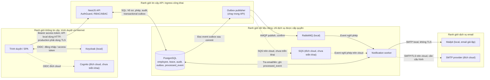

# Threat model STRIDE – hồ sơ nhân viên và nghỉ phép

## Phạm vi và giả định

Đánh giá ba luồng hiện có: đăng nhập OIDC; xem/cập nhật hồ sơ nhân viên; tạo, duyệt, hoàn tất đơn nghỉ phép và gửi email.
Đối chiếu code trên `dev` ngày 5/11/2026. Đây là đánh giá thiết kế nghiệp vụ, không phải kết quả kiểm thử xâm nhập.

Keycloak, PostgreSQL, RabbitMQ và Mailpit là cấu hình local hiện tại. Cognito, SQS và SMTP thật là đích triển khai cloud
được lên kế hoạch, chưa được thể hiện như biện pháp đã có. Không có kho tài liệu HR trong OpenAPI hiện tại nên UC5 chưa nằm
trong luồng được đánh giá.

## Sơ đồ luồng dữ liệu và ranh giới tin cậy

Ranh giới cần bảo vệ: client Internet → API công khai; API/publisher → PostgreSQL; publisher → broker; worker → PostgreSQL
và SMTP. Mũi tên nét đứt là thành phần tương lai, không phải đường đi đang chạy. DFD không hàm ý giao tiếp local hiện có
TLS; cấu hình local dùng HTTP và SMTP không mã hóa.

## Biện pháp hiện có

- **Đăng nhập:** `TokenVerifier` xác minh chữ ký JWT qua JWKS, `issuer`, hạn token do `jose` kiểm tra, và giới hạn `azp`
  theo cấu hình. `AuthGuard` toàn cục yêu cầu Bearer token trừ health check; role được lấy từ token/DB, `MANAGER` suy ra từ
  sơ đồ tổ chức. `AUTH_MODE=dev` bị chặn khi `NODE_ENV=production`.
- **Hồ sơ:** role và điều kiện chủ hồ sơ/quản lý trực tiếp/HR được kiểm tra ở controller và service. Validation dùng
  whitelist và từ chối field lạ. CCCD, tài khoản ngân hàng, lương dùng AES-256-GCM; HR đọc trường nhạy cảm bị ghi audit.
  Cập nhật hồ sơ ghi audit trong transaction; giá trị trường nhạy cảm được che trong audit.
- **Nghỉ phép:** chủ đơn lấy từ danh tính xác thực, không tin `employeeId` trong request; tạo đơn kiểm tra số dư, ngày,
  trùng lịch và khóa giao dịch; `Idempotency-Key` chống gửi lặp cùng key. Duyệt/từ chối yêu cầu role MANAGER và quản lý
  trực tiếp; HR hoàn tất; state machine, version, history và audit được thực thi trong transaction.
- **Email và audit:** outbox ghi cùng transaction với nghiệp vụ; publisher dùng publisher-confirm và worker chống xử lý
  event trùng, lỗi gửi chuyển DLQ. Audit có trigger chặn `UPDATE`/`DELETE` ở PostgreSQL. Đây không phải bảo vệ chống người
  có quyền superuser database.

## Danh sách mối đe dọa

Mức độ là đánh giá rủi ro nghiệp vụ hiện tại: **Cao** cần ưu tiên trước khi đưa staging dữ liệu thật vào sử dụng; **Trung
bình** cần xử lý trước production hoặc có biện pháp vận hành bù; **Thấp** cần theo dõi. Chủ xử lý đề xuất theo phân vai:
TV1 (API/web/worker), TV3 (cloud/IaC/CI), TV2 (nghiệp vụ).

| Mã | Luồng | STRIDE | Mối đe dọa và tài sản | Biện pháp hiện có | Khoảng trống / xử lý đề xuất | Mức độ | Chủ xử lý đề xuất |
|---|---|---|---|---|---|---|---|
| T-01 | Đăng nhập | Spoofing | Kẻ có access token bị đánh cắp có thể mạo danh nhân viên/HR và gọi API cho đến khi token hết hạn. Tài sản: hồ sơ, đơn nghỉ, quyền HR. | JWT phải có chữ ký hợp lệ, issuer và hạn token hợp lệ; API yêu cầu Bearer token. | Chưa thấy cơ chế thu hồi token theo phiên hoặc ràng buộc phiên trong API. Bắt buộc TLS ở ingress, đặt thời hạn token phù hợp, bảo vệ token phía SPA, logout/thu hồi theo khả năng IdP và giám sát đăng nhập bất thường. | Cao | TV1, TV3 |
| T-02 | Đăng nhập | Tampering | Claim `email` được dùng để provision/liên kết tài khoản. Nếu IdP phát token có email chưa xác minh, đăng nhập có thể gắn nhầm tài khoản nhân viên theo email. | Token ký đúng bởi IdP tin cậy; account đã có subject khác sẽ bị từ chối. | Code chưa kiểm tra claim `email_verified` trước JIT provisioning/liên kết. Chỉ liên kết email đã xác minh; quy định quy trình sửa liên kết và test đổi email/subject. | Cao | TV1 |
| T-03 | Đăng nhập | Repudiation | Người dùng có thể phủ nhận lần đăng nhập hoặc thay đổi role/employee-account mapping; hiện không có audit event đăng nhập trong ứng dụng. Tài sản: truy vết truy cập và cấp quyền. | Request có trace ID; audit ghi các thao tác nghiệp vụ có hỗ trợ. | Trace ID không phải audit xác thực; không lưu actor, kết quả đăng nhập, hoặc thay đổi role trong audit hiện tại. Bổ sung log xác thực tối thiểu, không ghi token/secret, và audit cấp/thu hồi role. | Trung bình | TV1 |
| T-04 | Đăng nhập | Information disclosure | Token hoặc claim danh tính bị lộ ở trình duyệt, log hay kênh mạng sẽ làm lộ danh tính và có thể cấp quyền truy cập như người dùng. | Bearer token chỉ gửi trong Authorization; `TokenVerifier` không trả token vào response. | Local dùng HTTP; cấu hình CSP, chính sách lưu token và redaction log chưa được xác nhận. Dùng HTTPS ở cloud, hạn chế token trong JavaScript/storage, thêm security headers/CSP và xác minh không ghi Authorization header. | Cao | TV1, TV3 |
| T-05 | Đăng nhập | Denial of service | Flood request đăng nhập/API hoặc làm IdP/JWKS/DB quá tải; mỗi request xác thực còn resolve tài khoản và role từ DB. Tài sản: khả dụng của API và đăng nhập. | JWKS được cache; lỗi token bị trả Unauthorized; pool/dependency health được cấu hình trong local compose. | Chưa thấy rate limit, giới hạn concurrency, hoặc bảo vệ ingress trong ứng dụng. Đặt throttling/WAF tại edge, giới hạn request/body và theo dõi độ trễ IdP/DB. | Trung bình | TV1, TV3 |
| T-06 | Đăng nhập | Elevation of privilege | Gán nhầm role HR/ADMIN trong IdP hoặc `role_assignment` sẽ trao quyền đọc dữ liệu HR hoặc sửa tổ chức. | Chỉ nhận role thuộc danh sách cho phép; role trong token phải qua xác minh chữ ký; `@Roles` chặn endpoint. | Không thấy quy trình phê duyệt/review cấp role trong luồng runtime. Hạn chế người được cấp role đặc quyền, audit mọi thay đổi role và kiểm thử sai cấu hình claim/assignment. | Cao | TV1, TV3 |
| T-07 | Xem/sửa hồ sơ | Spoofing | Kẻ mạo danh chủ hồ sơ hoặc HR có thể đọc/sửa thông tin cá nhân và trường nhạy cảm. | Bearer token xác minh; `viewLevel` và `forbiddenFields` giới hạn hồ sơ theo actor, chủ hồ sơ, quản lý trực tiếp và HR. | Rủi ro token bị chiếm đoạt như T-01 vẫn áp dụng; thêm TLS, bảo vệ phiên HR và MFA/conditional access tại IdP nếu được hỗ trợ. | Cao | TV1, TV3 |
| T-08 | Xem/sửa hồ sơ | Tampering | Người gọi sửa ID hồ sơ, field hoặc `version` để vượt quyền hoặc ghi đè cập nhật đồng thời. | DTO whitelist/forbid field lạ; service kiểm tra quyền theo target; transaction khóa dòng; version sai bị từ chối nếu gửi. | `version` là tùy chọn nên client bỏ qua có thể ghi trên dữ liệu mới hơn mà không phát hiện xung đột. Bắt buộc version cho cập nhật nhạy cảm/đồng thời và test đổi target ID, field bị cấm, `managerId: null`. | Trung bình | TV1 |
| T-09 | Xem/sửa hồ sơ | Repudiation | Người dùng phủ nhận đã đọc hoặc sửa hồ sơ. Tài sản: bằng chứng truy cập và lịch sử thay đổi. | Cập nhật và HR đọc trường nhạy cảm có audit; cập nhật ghi cùng transaction; audit append-only ở DB. | Đọc hồ sơ/danh bạ thường không audit; audit trigger không chống DB superuser; `X-Trace-Id` do client cung cấp có thể bị tự chọn. Xác định trường hợp cần audit đọc, dùng trace ID server-generated/chuẩn hóa và sao chép audit bất biến nếu cần chống DBA. | Trung bình | TV1, TV3 |
| T-10 | Xem/sửa hồ sơ | Information disclosure | Trường CCCD/tài khoản/lương hoặc PII có thể lộ qua DB, audit hoặc API. Tài sản: dữ liệu cá nhân và dữ liệu nhân sự. | Trường nhạy cảm mã hóa AES-256-GCM; chỉ HR được giải mã qua API; audit che giá trị trường nhạy cảm; matrix quy định phạm vi danh bạ. | Cấu hình hiện có khóa mã hóa mặc định dùng chung trong code/config local; audit cập nhật vẫn ghi một số PII thường như địa chỉ/ngày sinh, và HR/ADMIN có thể đọc audit. Thay khóa bằng secret manager/KMS, không dùng khóa mặc định, giảm/mask PII trong audit và xác nhận quyền đọc audit. | Cao | TV1, TV3 |
| T-11 | Xem/sửa hồ sơ | Denial of service | Truy vấn danh bạ/phòng ban liên tục hoặc quét trang có thể tiêu thụ DB và làm API chậm. Tài sản: khả dụng DB/API. | Danh bạ phân trang, giới hạn `size` tối đa 100; truy vấn lọc trạng thái và có thứ tự ổn định. | Chưa thấy rate limit, query timeout hoặc kiểm soát tần suất tìm kiếm. Thêm throttling, timeout/index phù hợp và cảnh báo tải truy vấn. | Trung bình | TV1 |
| T-12 | Xem/sửa hồ sơ | Elevation of privilege | Người dùng đã đăng nhập có thể gọi endpoint xem cấp dưới/thành viên phòng ban tùy ý; quản lý có thể thử lấy dữ liệu vượt phạm vi mình phụ trách. | Các route yêu cầu đăng nhập; response danh bạ không bao gồm trường nhạy cảm; matrix ghi rõ hiện không giới hạn phạm vi ở hai endpoint này. | `direct-reports` và `departments/{id}/members` không kiểm tra quan hệ người gọi; hành vi đã được nhóm chấp nhận cho danh bạ toàn tổ chức theo UC2/UC6. Xác nhận không trả thêm PII ngoài phạm vi đã duyệt và kiểm thử phạm vi khi yêu cầu nghiệp vụ đổi. | Trung bình | TV1, TV2 |
| T-13 | Nghỉ phép | Spoofing | Kẻ mạo danh nhân viên/manager/HR có thể tạo hoặc quyết định đơn. | Actor gắn với JWT xác minh; tạo đơn lấy employee ID từ token; duyệt yêu cầu role MANAGER và kiểm tra quản lý trực tiếp; hoàn tất yêu cầu HR. | Bảo vệ phiên/token HR và manager theo T-01/T-07; chưa có kiểm toán đăng nhập để phát hiện lạm dụng sớm. Dùng TLS/MFA cho role nhạy cảm và cảnh báo hành động bất thường. | Cao | TV1, TV3 |
| T-14 | Nghỉ phép | Tampering | Client sửa `employeeId`, ngày, loại phép, số ngày, trạng thái hoặc gửi lại request để tạo đơn của người khác/vượt số dư. | Chủ đơn lấy từ token; ngày, số dư, ngày lễ, trùng lịch được tính/kiểm tra server-side trong transaction; `Idempotency-Key`, optimistic version và state machine chặn thao tác lặp/chuyển trạng thái sai. | Không tin request làm nguồn cho owner/state; duy trì kiểm tra e2e cho mọi field và request đồng thời. Nếu triển khai tạo đơn hộ theo BR-12, lưu riêng actor và chủ đơn, không tái sử dụng identity của người được tạo hộ làm actor. | Trung bình | TV1, TV2 |
| T-15 | Nghỉ phép | Repudiation | Người tạo hoặc người duyệt phủ nhận đã gửi/ra quyết định; audit/history thiếu actor sẽ làm mất khả năng đối chiếu. | Chuyển trạng thái ghi history và audit trong cùng transaction; audit có actor, action, thời gian, trace ID; trigger chặn UPDATE/DELETE. | Đơn tự tạo hiện ghi cùng người làm actor/chủ đơn; tạo đơn hộ theo BR-12 chưa triển khai và cần ghi riêng actor với employee owner. DBA superuser vẫn có thể vượt trigger. Lưu đủ danh tính actor/owner và cân nhắc archive bất biến cho môi trường production. | Trung bình | TV1, TV3 |
| T-16 | Nghỉ phép | Information disclosure | Email/outbox có thể tiết lộ loại phép (ví dụ nghỉ ốm), thời gian nghỉ, tên và ghi chú tự do cho người nhận không phù hợp; SMTP có thể bị nghe lén. | Event được ghi trong outbox; email gửi tới nhân viên hoặc quản lý trực tiếp theo loại event; hiện payload không đưa `reason` của đơn vào email. | Email hiện có `leaveType`, ngày và có thể có comment; local SMTP/Mailpit không TLS và comment có thể chứa thông tin sức khỏe. Tối thiểu hóa nội dung (không gửi comment/loại phép nhạy cảm), xác minh recipient, dùng SMTP/TLS và chính sách retention phù hợp trước cloud. | Cao | TV1, TV3, TV2 |
| T-17 | Nghỉ phép | Denial of service | Kẻ gửi nhiều đơn với idempotency key khác nhau hoặc làm broker/email provider lỗi có thể tăng dữ liệu outbox, queue và DLQ, làm chậm xử lý phép. | Cùng key không tạo đơn trùng; publisher confirm, batch 50, worker prefetch 10 và DLQ giới hạn việc lặp email lỗi. | Key khác nhau vẫn tiêu thụ DB; outbox retry theo poll chưa có backoff/giới hạn/retention rõ; chưa thấy rate limit và cảnh báo DLQ. Đặt throttling theo tài khoản, retry/backoff, retention và alert/qui trình xử lý DLQ. | Trung bình | TV1, TV3 |
| T-18 | Nghỉ phép | Elevation of privilege | Nhân viên, manager không trực tiếp, HR hoặc ADMIN cố duyệt/từ chối/hoàn tất đơn trái quyền; người duyệt thay/CEO là ngoại lệ nghiệp vụ. | Approve/reject yêu cầu role MANAGER và quan hệ quản lý trực tiếp cùng trạng thái SUBMITTED; complete yêu cầu HR và APPROVED; state machine từ chối quan hệ không hợp lệ. | BR-06 (ủy quyền người duyệt thay) và quyết định HR duyệt đơn CEO chưa triển khai trong code hiện tại; không được coi mô tả nghiệp vụ là quyền đã bật. TV1 cần thêm kiểm tra ABAC, UI/inbox và test trước khi mở các quyền đó. | Cao | TV1 |

## Việc cần làm tiếp

Ưu tiên trước khi staging chứa dữ liệu thật hoặc mở cho người dùng:

1. **Cao – secret và khóa mã hóa:** xóa khóa mặc định khỏi đường chạy production, lấy khóa/DB/broker credential từ secret manager hoặc KMS; xoay mọi khóa đã dùng chung trong môi trường phát triển, đánh giá khả năng giải mã dữ liệu cũ.
2. **Cao – email nghỉ phép:** giảm dữ liệu trong subject/body (đặc biệt loại phép và comment tự do), kiểm tra người nhận, dùng SMTP/TLS ở cloud và quy định thời gian lưu email/outbox.
3. **Cao – danh tính và role:** kiểm tra email đã xác minh trước JIT account linking; xác nhận `aud`/`azp` theo token contract của Keycloak và Cognito; audit cấp/thu hồi HR/ADMIN và bảo vệ tài khoản đặc quyền.
4. **Cao – phân quyền BR-06/CEO:** giữ quyền hiện tại cho đến khi TV1 triển khai và test đầy đủ quyền duyệt thay theo thời hạn và quyền HR chỉ duyệt đơn CEO.
5. **Trung bình – audit/PII:** giảm PII ghi trong `changedFields`, xem xét giới hạn ADMIN đọc audit, ghi audit cho các lượt đọc nhạy cảm theo chính sách và chuyển bản sao bất biến nếu cần chống DBA.
6. **Trung bình – chống lạm dụng và vận hành:** thêm rate limit/query timeout, cảnh báo auth failures và DLQ, retry có backoff, quy trình retention cho outbox/log; trên AWS cấu hình IAM least privilege, mã hóa và network policy cho RDS/SQS/SMTP.

## Nguồn đối chiếu

- Xác thực và role: `backend/src/modules/identity/{token-verifier,auth.guard,identity.service}.ts`,
  `backend/src/modules/identity/auth.decorators.ts`.
- Hồ sơ và mã hóa: `backend/src/modules/employee/{employee.controller,employee.service,employee-access}.ts`,
  `backend/src/common/field-crypto.ts`, `backend/src/modules/audit/audit.service.ts`.
- Nghỉ phép và thông báo: `backend/src/modules/leave/{leave.controller,leave.service,leave-state-machine}.ts`,
  `backend/src/modules/leave/outbox/{leave-events,outbox-publisher}.ts`,
  `backend/src/worker/notification-worker.ts`.
- Ranh giới local hiện tại: `backend/src/bootstrap.ts`, `backend/src/config/config.ts`, `docker-compose.yml`.
- Nghiệp vụ/quyết định: `docs/business/leave-rules.md`, `docs/progress/tuan-07/README.md` (ADR-08/09/10),
  `docs/security/access-control-matrix.md`.
